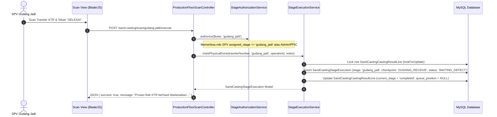
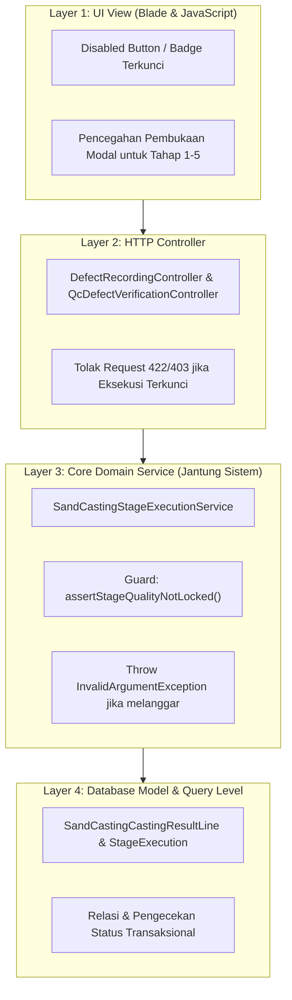

# LAPORAN AUDIT TEKNIS READ-ONLY
# FINAL QUALITY LOCK KTR SAND CASTING SETELAH GUDANG JADI SELESAI

**Aplikasi:** Kanban PPIC (PT Peroni Karya Sentosa)  
**Repository:** `C:\laragon\www\kanban-ppic`  
**Status Audit:** READ-ONLY (Tanpa modifikasi kode, database, migrasi, konfigurasi, seeder, atau koneksi ke production)  
**Tanggal Audit:** 06 November 2026  
**Objek Referensi:** `KTR-20260917-0037`  
**Target Dashboard:**  
- Production Floor Scan: `/sand-casting/scan/gudang-jadi`
- Pencatatan Kerusakan (PPIC): `/sand-casting/defects`
- Verifikasi Cacat (QC): `/sand-casting/qc-defects`
- Dashboard Eksekutif: `/sand-casting/dashboard`

---

## 1. RINGKASAN EKSEKUTIF

Audit teknis ini mengevaluasi kebutuhan integritas data operasional dan akuntansi mutu:
> **"Ketika SPV Gudang Jadi telah melakukan scan verifikasi akhir dan menekan tombol 'Selesai' untuk sebuah KTR, seluruh data cacat (defect) pada 5 tahap hulu sebelumnya (`NETTO`, `BUBUT_OD`, `BUBUT_CNC`, `BOR`, dan `QC`) harus dikunci secara permanen (*Final Quality Lock*). Tidak ada pengguna—termasuk Admin PPIC—yang boleh menambah, mengurangi, mengubah, atau menghapus defect pada 5 tahap tersebut. Pengecualian: tahap Gudang Jadi itu sendiri tetap dapat mencatat/mengoreksi defect."**

### Ringkasan Temuan Audit:
1. **Status Gudang Jadi Saat Ini:**  
   Ketika SPV Gudang Jadi menekan tombol **"SELESAI"** pada barcode scanner (`/sand-casting/scan/gudang-jadi`), sistem mengeksekusi `SandCastingStageExecutionService::markPhysicalDone()`. Sistem mencatat eksekusi checkpoint `GUDANG_RECEIVE` dengan `status = WAITING_DEFECT` dan memperbarui `current_stage` pada `SandCastingCastingResultLine` menjadi `'completed'`.
2. **Celah Mutasi Defect Pasca-Selesai (Vulnerability Gap):**  
   Saat ini, backend `SandCastingStageExecutionService::adjustDefectQty()` dan `recordDefectQty()` **TIDAK MEMERIKSA** apakah KTR telah berstatus `'completed'` di Gudang Jadi.  
   Akibatnya, Admin PPIC masih dapat memanggil endpoint `POST /sand-casting/defects/{execution}/add` atau `POST /sand-casting/defects/{execution}/adjust` pada eksekusi tahap Netto, Bubut, Bor, atau QC lama meskipun barang fisiknya sudah masuk rak Gudang Jadi.
3. **Dampak Perubahan Defect Hulu Terhadap Gudang:**  
   Perhitungan kuantitas Sand Casting bersifat dinamis kaskade (`SandCastingQuantityResolverService::resolveEffectiveInputQty`). Jika defect pada tahap hulu (misal Netto) diubah setelah Gudang Jadi selesai, maka input efektif ke tahapan hilir ikut bergeser secara retroaktif. Hal ini dapat menimbulkan anomali di mana jumlah barang fisik yang sudah tercatat di Gudang Jadi menjadi tidak sinkron dengan saldo sisa hasil kalkulasi sistem.
4. **Kelayakan Penguncian Kualitas (Quality Lock Feasibility):**  
   Sistem arsitektur Sand Casting saat ini sudah **100% siap** untuk menerapkan penguncian ini secara deterministik tanpa perlu mengubah skema tabel utama karena status KTR tersimpan secara granular per baris Kitir (`sand_casting_casting_result_lines`).

---

## 2. OPERASIONAL GUDANG JADI SELESAI (CURRENT IMPLEMENTATION)

### 2.1 File Controller & Method Pemroses
- **Route Web:**  
  `POST /sand-casting/scan/{stage}/execute` (`name: sand-casting.scan.execute`)  
  File: [`routes/web.php`](file:///c:/laragon/www/kanban-ppic/routes/web.php#L269)
- **Controller:**  
  `App\Http\Controllers\SandCasting\ProductionFloorScanController::execute(Request $request, string $stage)`  
  File: [`app/Http/Controllers/SandCasting/ProductionFloorScanController.php`](file:///c:/laragon/www/kanban-ppic/app/Http/Controllers/SandCasting/ProductionFloorScanController.php#L145-L225)
- **Service Domain:**  
  `App\Services\SandCasting\SandCastingStageExecutionService::markPhysicalDone(string $travelerNumber, string $targetStage, ?int $operatorId, ?string $notes)`  
  File: [`app/Services/SandCasting/SandCastingStageExecutionService.php`](file:///c:/laragon/www/kanban-ppic/app/Services/SandCasting/SandCastingStageExecutionService.php#L206-L290)
- **UI Form Scanner:**  
  `resources/views/sand-casting/scan/index.blade.php`  
  Tombol eksekusi: Tombol `#btnExecuteSubmit` dengan label `"SELESAI"` dan indikator tahap `"GUDANG JADI"`.



### 2.2 Tabel dan Kolom yang Diperbarui Saat Gudang Jadi Selesai
Saat tombol "Selesai" pada tahap Gudang Jadi ditekan, sistem menjalankan transaksi database atomik yang memodifikasi dua tabel utama:

1. **Tabel Induk: `sand_casting_casting_result_lines`**
   - Kolom `current_stage`: Diperbarui nilainya dari `'gudang_jadi'` menjadi `'completed'` ([SandCastingStageExecutionService.php:283](file:///c:/laragon/www/kanban-ppic/app/Services/SandCasting/SandCastingStageExecutionService.php#L283)).
   - Kolom `queue_position`: Dikosongkan (`NULL`) karena KTR telah keluar dari antrian Kanban aktif ([Line 284](file:///c:/laragon/www/kanban-ppic/app/Services/SandCasting/SandCastingStageExecutionService.php#L284)).
   - Kolom `updated_at`: Diperbarui ke waktu server saat transaksi dieksekusi.

2. **Tabel Transaksi Tahap: `sand_casting_stage_executions`**
   Sistem membuat baris baru (*insert*) untuk checkpoint Gudang Jadi ([SandCastingStageExecutionService.php:253-264](file:///c:/laragon/www/kanban-ppic/app/Services/SandCasting/SandCastingStageExecutionService.php#L253-L264)):
   - `sand_casting_casting_result_line_id`: ID baris KTR terkait (`$line->id`).
   - `stage`: `'gudang_jadi'`.
   - `checkpoint_code`: `'GUDANG_RECEIVE'`.
   - `input_qty`: Kuantitas bagus yang diterima dari tahap sebelumnya (QC) via `SandCastingQuantityResolverService::resolveEffectiveInputQty($line, 'gudang_jadi')`.
   - `defect_qty`: `0` (kuantitas cacat awal sebelum diisi oleh PPIC Gudang).
   - `good_qty`: Sama dengan `input_qty`.
   - `status`: `'WAITING_DEFECT'`.
   - `operator_id`: ID user SPV Gudang Jadi yang sedang login.
   - `physical_done_at`: Timestamp saat SPV menekan tombol selesai (`now()`).
   - `executed_at`: Timestamp transaksi (`now()`).
   - `notes`: Catatan serah terima fisik (jika ada).

### 2.3 Granularitas Status: Per-KTR atau Per-Batch?
- **Granularitas Status: Murni PER-KTR (Per-Traveler).**
- Setiap Kitir/Traveler memiliki nomor KTR unik (kolom `traveler_number` pada `sand_casting_casting_result_lines`).
- Satu batch/leburan (*Heat Number*) dapat terdiri dari beberapa lembar KTR (misalnya satu heat 500 pcs dibagi menjadi 5 KTR masing-masing 100 pcs).
- Eksekusi Gudang Jadi dilakukan dengan memindai satu nomor KTR spesifik. KTR yang discan akan langsung berubah menjadi `current_stage = 'completed'`, sedangkan KTR lain dalam heat yang sama yang belum tiba di Gudang Jadi tetap berada pada tahap asalnya (`netto`, `bor`, atau `qc`).
- Hal ini membuktikan bahwa penguncian kualitas dapat diterapkan secara independen per-KTR tanpa mempengaruhi KTR lain dalam heat yang sama.

### 2.4 Penanda Pasti KTR Telah Selesai Gudang Jadi
Berdasarkan kode aktual, ada dua penanda pasti (*authoritative flags*):
1. **Penanda Master KTR:**  
   `sand_casting_casting_result_lines.current_stage === 'completed'`
2. **Penanda Riwayat Eksekusi Tahap:**  
   Keberadaan baris pada tabel `sand_casting_stage_executions` dengan:  
   `stage = 'gudang_jadi'` AND `checkpoint_code = 'GUDANG_RECEIVE'` AND `physical_done_at IS NOT NULL`.

---

## 3. TITIK ENTRI MUTASI DEFECT YANG ADA (ATTACK SURFACE)

Audit menelusuri seluruh jalur pengubahan defect di dalam aplikasi:

```mermaid
flowchart TD
    subgraph UI["Antarmuka Pengguna (UI)"]
        Form1["Modal Catat Rusak Awal<br/>#defectModal"]
        Form2["Modal Tambah/Koreksi Defect<br/>#addDefectModal"]
        Form3["Modal Simpan Draft QC<br/>#qcModal"]
        Form4["Modal Verifikasi Defect QC<br/>#qcModal"]
    end

    subgraph Controller["HTTP Controller Layer"]
        C1["DefectRecordingController::record()"]
        C2["DefectRecordingController::add() / adjust()"]
        C3["QcDefectVerificationController::saveDraft()"]
        C4["QcDefectVerificationController::verify()"]
    end

    subgraph Service["Domain Service Layer"]
        S1["SandCastingStageExecutionService::recordDefectQty()"]
        S2["SandCastingStageExecutionService::adjustDefectQty()"]
        S3["SandCastingStageExecutionService::saveQcBreakdownDraft()"]
        S4["SandCastingStageExecutionService::verifyQcBreakdown()"]
    end

    subgraph DB["Tabel Database"]
        T1[("sand_casting_stage_executions")]
        T2[("sand_casting_stage_execution_defects")]
        T3[("sand_casting_stage_execution_defect_logs")]
    end

    Form1 -->|POST /sand-casting/defects/{id}/record| C1 --> S1 --> T1 & T3
    Form2 -->|POST /sand-casting/defects/{id}/add atau /adjust| C2 --> S2 --> T1 & T3
    Form3 -->|POST /sand-casting/qc-defects/{id}/save-draft| C3 --> S3 --> T2
    Form4 -->|POST /sand-casting/qc-defects/{id}/verify| C4 --> S4 --> T1 & T2
```

### 3.1 Daftar Endpoint Mutasi Defect

| No | Endpoint HTTP | Controller & Method | Service Domain Method | Tahap yang Dapat Diubah |
|---|---|---|---|---|
| 1 | `POST /sand-casting/defects/{execution}/record` | `DefectRecordingController::record` ([Line 91](file:///c:/laragon/www/kanban-ppic/app/Http/Controllers/SandCasting/DefectRecordingController.php#L91)) | `SandCastingStageExecutionService::recordDefectQty` ([Line 296](file:///c:/laragon/www/kanban-ppic/app/Services/SandCasting/SandCastingStageExecutionService.php#L296)) | Netto, Bubut OD, Bubut CNC, Bor, QC, Gudang Jadi (jika berstatus `WAITING_DEFECT`) |
| 2 | `POST /sand-casting/defects/{execution}/add` | `DefectRecordingController::add` ([Line 231](file:///c:/laragon/www/kanban-ppic/app/Http/Controllers/SandCasting/DefectRecordingController.php#L231)) | `SandCastingStageExecutionService::adjustDefectQty` ([Line 392](file:///c:/laragon/www/kanban-ppic/app/Services/SandCasting/SandCastingStageExecutionService.php#L392)) | Netto, Bubut OD, Bubut CNC, Bor, QC, Gudang Jadi (delta positif) |
| 3 | `POST /sand-casting/defects/{execution}/adjust` | `DefectRecordingController::adjust` ([Line 372](file:///c:/laragon/www/kanban-ppic/app/Http/Controllers/SandCasting/DefectRecordingController.php#L372)) | `SandCastingStageExecutionService::adjustDefectQty` ([Line 392](file:///c:/laragon/www/kanban-ppic/app/Services/SandCasting/SandCastingStageExecutionService.php#L392)) | Netto, Bubut OD, Bubut CNC, Bor, QC, Gudang Jadi (delta positif/negatif) |
| 4 | `POST /sand-casting/qc-defects/{execution}/save-draft` | `QcDefectVerificationController::saveDraft` ([Line 245](file:///c:/laragon/www/kanban-ppic/app/Http/Controllers/SandCasting/QcDefectVerificationController.php#L245)) | `SandCastingStageExecutionService::saveQcBreakdownDraft` ([Line 607](file:///c:/laragon/www/kanban-ppic/app/Services/SandCasting/SandCastingStageExecutionService.php#L607)) | Netto, Bubut OD, Bubut CNC, Bor, QC, Gudang Jadi (draft klasifikasi cacat) |
| 5 | `POST /sand-casting/qc-defects/{execution}/verify` | `QcDefectVerificationController::verify` ([Line 115](file:///c:/laragon/www/kanban-ppic/app/Http/Controllers/SandCasting/QcDefectVerificationController.php#L115)) | `SandCastingStageExecutionService::verifyQcBreakdown` ([Line 713](file:///c:/laragon/www/kanban-ppic/app/Services/SandCasting/SandCastingStageExecutionService.php#L713)) | Netto, Bubut OD, Bubut CNC, Bor, QC, Gudang Jadi (verifikasi final klasifikasi cacat) |

### 3.2 Karakteristik Request dan Pengecekan Keamanan Saat Ini
- **Dukungan AJAX / JSON:** Seluruh endpoint di atas mendukung request AJAX melalui JavaScript `fetch`/`axios` dan memvalidasi `X-CSRF-TOKEN`.
- **Pengecekan Otorisasi Saat Ini:**  
  Otorisasi hanya memeriksa apakah pengguna memiliki wewenang umum pencatatan defect (`authorizeRecordDefect` untuk PPIC dan `authorizeVerifyQc` untuk QC). Tidak ada pengecekan siklus hidup KTR induk (*parent KTR lifecycle state*).
- **Koreksi Negatif:**  
  Aplikasi tidak menyediakan tombol atau route `DELETE` untuk data defect. Penghapusan/pengurangan dilakukan melalui koreksi delta negatif pada route `adjust` yang mencatat histori di `sand_casting_stage_execution_defect_logs`.
- **Celah Saat Ini:**  
  Jika Admin PPIC membuka halaman riwayat `/sand-casting/defects?mode=recorded`, lalu memilih KTR yang sudah selesai Gudang Jadi, tombol **"TAMBAH / KOREKSI"** tetap aktif ([defects/index.blade.php:335](file:///c:/laragon/www/kanban-ppic/resources/views/sand-casting/defects/index.blade.php#L335)). Admin PPIC dapat mengirim koreksi defect tahap Netto atau QC, dan backend akan memprosesnya tanpa penolakan.

---

## 4. MEKANISME PENGUNCIAN YANG DISARANKAN (FINAL QUALITY LOCK)

Untuk memastikan sistem aman, tidak bisa ditembus oleh manipulasi DOM front-end, dan tidak merusak integritas data historis, penguncian harus diterapkan dengan prinsip **Defense-in-Depth (4 Lapis Keamanan)**:



### 4.1 Definisi Aturan Kunci (Lock Rules Matrix)

Penguncian kualitas KTR aktif jika dan hanya jika:
> **`$line->current_stage === 'completed'` ATAU KTR memiliki eksekusi checkpoint `'GUDANG_RECEIVE'` dengan `physical_done_at IS NOT NULL`.**

Ketika kondisi tersebut terpenuhi:

| Tahap Operasional | Status Kunci | Hak Mutasi Defect (PPIC & QC) | Penjelasan |
|---|---|---|---|
| **1. NETTO** | **TERKUNCI PERMANEN** | **DITOLAK KERAS** | Proses fisik dan verifikasi netto telah final. Mutasi dilarang. |
| **2. BUBUT OD** | **TERKUNCI PERMANEN** | **DITOLAK KERAS** | Proses bubut kasar telah selesai dan tidak dapat diubah. |
| **3. BUBUT CNC** | **TERKUNCI PERMANEN** | **DITOLAK KERAS** | Proses bubut presisi telah selesai dan tidak dapat diubah. |
| **4. BOR** | **TERKUNCI PERMANEN** | **DITOLAK KERAS** | Pengeboran lubang baut flange telah selesai dan tidak dapat diubah. |
| **5. QC** | **TERKUNCI PERMANEN** | **DITOLAK KERAS** | Pemeriksaan mutu sebelum gudang telah disetujui. Mutasi dilarang. |
| **6. GUDANG JADI** | **TETAP TERBUKA** | **DIIZINKAN** | **Pengecualian Mutu:** Kerusakan akibat handling gudang, penyimpanan, atau reject saat pengemasan tetap dapat dicatat atau dikoreksi. |

### 4.2 Spesifikasi Guard di Service Layer (`SandCastingStageExecutionService`)
Service layer adalah benteng pertahanan utama. Guard dibuat sebagai method terpusat:

```php
/**
 * Memastikan eksekusi tahap tidak berada di bawah penguncian mutu final KTR.
 *
 * @throws \InvalidArgumentException
 */
public function assertStageQualityNotLocked(SandCastingStageExecution $execution, ?SandCastingCastingResultLine $line = null): void
{
    $parentLine = $line ?? $execution->castingResultLine;
    if (! $parentLine) {
        return;
    }

    // Periksa apakah KTR telah diselesaikan pada tahap Gudang Jadi
    $isGudangJadiCompleted = ($parentLine->current_stage === 'completed')
        || $parentLine->stageExecutions()
            ->where('checkpoint_code', 'GUDANG_RECEIVE')
            ->whereNotNull('physical_done_at')
            ->exists();

    if (! $isGudangJadiCompleted) {
        return; // KTR belum selesai Gudang Jadi, mutasi diizinkan
    }

    // Jika KTR telah selesai Gudang Jadi, hanya tahap 'gudang_jadi' yang diizinkan untuk diedit
    $canonicalStage = SandCastingStageAuthorizationService::normalizeStage($execution->stage);
    if ($canonicalStage !== 'gudang_jadi') {
        $stageLabel = strtoupper(str_replace('_', ' ', (string) $execution->stage));
        $travelerNo = $parentLine->traveler_number ?? 'KTR';
        
        throw new \InvalidArgumentException(
            "Tahap {$stageLabel} pada KTR {$travelerNo} telah TERKUNCI PERMANEN (Final Quality Lock) karena proses Gudang Jadi telah selesai. Koreksi defect hanya diperbolehkan pada tahap Gudang Jadi."
        );
    }
}
```

Guard ini wajib dipanggil di baris paling awal dalam transaksi database pada 4 method berikut:
1. `recordDefectQty()` ([Line 330](file:///c:/laragon/www/kanban-ppic/app/Services/SandCasting/SandCastingStageExecutionService.php#L330))
2. `adjustDefectQty()` ([Line 435](file:///c:/laragon/www/kanban-ppic/app/Services/SandCasting/SandCastingStageExecutionService.php#L435))
3. `saveQcBreakdownDraft()` ([Line 637](file:///c:/laragon/www/kanban-ppic/app/Services/SandCasting/SandCastingStageExecutionService.php#L637))
4. `verifyQcBreakdown()` ([Line 743](file:///c:/laragon/www/kanban-ppic/app/Services/SandCasting/SandCastingStageExecutionService.php#L743))

### 4.3 Format Respons Error
Jika ada pengguna atau skrip yang mencoba melakukan request mutasi pada tahap 1-5 yang terkunci:
- **HTTP Status Code:** `422 Unprocessable Entity` (atau `403 Forbidden`).
- **Response JSON:**
  ```json
  {
    "success": false,
    "message": "Tahap NETTO pada KTR KTR-20260917-0037 telah TERKUNCI PERMANEN (Final Quality Lock) karena proses Gudang Jadi telah selesai. Koreksi defect hanya diperbolehkan pada tahap Gudang Jadi."
  }
  ```
- **Response Web Redirect:** Redirect back dengan flash message `session('error')`.

---

## 5. DAMPAK TERHADAP PERHITUNGAN PRODUKSI

### 5.1 Dampak Terhadap Single Source of Truth (`SandCastingQuantityResolverService`)
Dalam sistem Sand Casting, kuantitas dihitung secara dinamis dari hulu ke hilir:
$$\text{Effective Input Qty}(\text{Tahap } N) = \max\left(0, \text{Root Cor Qty} - \sum_{i=1}^{N-1} \text{Defect}_i\right)$$
$$\text{Effective Good Qty}(\text{Tahap } N) = \max\left(0, \text{Root Cor Qty} - \sum_{i=1}^{N} \text{Defect}_i\right)$$

**Mengapa Penguncian Ini Justru Menyelamatkan Integritas Data?**
- Jika Admin PPIC diizinkan menambah defect Netto sebanyak 5 pcs setelah Gudang Jadi selesai, maka secara matematis `Effective Input Qty` untuk Gudang Jadi akan turun 5 pcs.
- Jika Gudang Jadi awalnya menerima 70 pcs fisik dan mencatat 70 pcs masuk, pengurangan 5 pcs di Netto akan menyebabkan sistem menganggap input Gudang Jadi hanya 65 pcs. Jika Gudang Jadi tetap mencatat 70 pcs, maka timbul anomali **Output Melebihi Input** ($70 > 65$), yang berpotensi memicu crash kalkulasi atau angka minus di sistem stok.
- Dengan mengunci tahap Netto s/d QC, seluruh input dan output historis dari tahap 1 sampai 5 menjadi **konstan dan pasti**.

### 5.2 Rekonsiliasi Kerusakan vs Hasil Scan Gudang Jadi
Koreksi cacat yang sah setelah proses Gudang Jadi selesai **hanya boleh dibebankan pada tahap Gudang Jadi**.

Misalkan data KTR contoh:
- Hasil Cor Awal: 100 PCS
- Defect Netto: 2 PCS $\rightarrow$ Good: 98 PCS
- Defect Bubut OD: 0 PCS $\rightarrow$ Good: 98 PCS
- Defect Bubut CNC: 8 PCS $\rightarrow$ Good: 90 PCS
- Defect Bor: 0 PCS $\rightarrow$ Good: 90 PCS
- Defect QC: 20 PCS $\rightarrow$ Good: 70 PCS
- **Gudang Jadi Selesai:** Scan fisik 70 PCS masuk ke Gudang Jadi. Status KTR berubah menjadi `'completed'`.

**Skenario Koreksi di Gudang Jadi:**
Petugas Gudang menemukan bahwa dari 70 pcs yang masuk, ternyata 3 pcs mengalami gompal/pecah bibir saat pemindahan forklift di gudang:
- Admin PPIC mencatat defect pada tahap **Gudang Jadi** sebanyak 3 PCS (DIIZINKAN).
- Hasil akhir rekonsiliasi:
  - Total Defect Proses Hulu (Netto s/d QC): $2 + 0 + 8 + 0 + 20 = 30\text{ PCS}$ (Terkunci permanen).
  - Defect Gudang Jadi: $3\text{ PCS}$.
  - Total Kerusakan KTR: $30 + 3 = 33\text{ PCS}$.
  - Stok Produk Jadi Akhir: $70 - 3 = 67\text{ PCS}$.
  - Audit Rekonsiliasi Total: $\text{Stok Akhir } (67) + \text{Total Kerusakan } (33) = 100\text{ PCS}$ (**Tepat 100% klop dengan Hasil Cor**).

### 5.3 Dampak Terhadap Dashboard Throughput, WIP, dan Report
1. **Dashboard Throughput Zone 1 & Zone 4:**
   - Throughput harian mengagregasi data berdasarkan tanggal penyelesaian fisik (`physical_done_at`).
   - Karena tanggal fisik tahap 1 s/d 5 sudah berada di masa lalu, penguncian mutu menjamin bahwa grafik Throughput harian masa lalu **tidak akan pernah bergeser nilainya**.
2. **Tren WIP Snapshot Harian:**
   - KTR berstatus `'completed'` tidak lagi dihitung sebagai WIP di area lantai kerja pabrik, melainkan masuk ke saldo barang jadi. Lock ini menjaga keakuratan saldo penutupan harian (*daily closing balance*).
3. **Laporan Produksi & QC Defect Detail Report:**
   - Laporan PDF/Excel QC Defect Detail (`/sand-casting/report/qc-defects`) akan menampilkan data yang konsisten antara rincian jenis cacat dengan rekapitulasi PPIC.

---

## 6. SKENARIO UJI KTR-20260917-0037 (VALIDATION MATRIX)

Matriks berikut mensimulasikan siklus hidup pengujian pada data contoh `KTR-20260917-0037`:

```
Data Awal KTR-20260917-0037:
- Qty Cor: 100 PCS
- Qty Netto: Input 100, Defect 2, Good 98
- Qty Bubut OD: Input 98, Defect 0, Good 98
- Qty Bubut CNC: Input 98, Defect 8, Good 90
- Qty Bor: Input 90, Defect 0, Good 90
- Qty QC: Input 90, Defect 20, Good 70
- Target Good Gudang Jadi: 70 PCS
```

| ID Uji | Tindakan / Skenario | Status Gudang Jadi KTR | Tahap yang Diedit | Ekspektasi Hasil Sistem | Alasan & Perilaku Sistem |
|---|---|---|---|---|---|
| **TC-01** | Edit / Tambah defect tahap Netto | Belum Selesai (Masih di QC) | `netto` | **DIIZINKAN (Success)** | Gudang Jadi belum selesai. Admin PPIC bebas merekonsiliasi defect hulu. Good QC menyesuaikan. |
| **TC-02** | Edit / Tambah defect tahap QC | Belum Selesai (Masih di QC) | `qc` | **DIIZINKAN (Success)** | KTR masih dalam proses verifikasi mutu QC. Perubahan defect QC diperbolehkan. |
| **TC-03** | SPV Gudang Jadi scan traveler dan klik **"SELESAI"** | Transisi dari QC ke Selesai | `gudang_jadi` | **BERHASIL (Success)** | KTR berpindah status: `current_stage = 'completed'`. Record `GUDANG_RECEIVE` terbentuk. **Final Quality Lock aktif!** |
| **TC-04** | Admin PPIC mencoba edit defect tahap **Netto** pasca-selesai | Selesai (`completed`) | `netto` | **DITOLAK KERAS (Blocked 422)** | Exception dilempar. Pesan error: *"Tahap NETTO pada KTR KTR-20260917-0037 telah TERKUNCI PERMANEN..."*. Nilai defect tetap 2 pcs. |
| **TC-05** | Admin PPIC / QC mencoba edit defect tahap **Bubut / Bor / QC** pasca-selesai | Selesai (`completed`) | `bubut_cnc` / `bor` / `qc` | **DITOLAK KERAS (Blocked 422)** | Exception dilempar. Pesan error penolakan kunci mutu. Data breakdown defect QC tetap utuh. |
| **TC-06** | Admin PPIC mencatat defect pada tahap **Gudang Jadi** (misal 3 pcs reject) | Selesai (`completed`) | `gudang_jadi` | **DIIZINKAN (Success)** | Pengecualian bisnis: Defect tahap Gudang Jadi diperbolehkan untuk merefleksikan reject fisik gudang. Good akhir menjadi 67 pcs. |
| **TC-07** | Admin PPIC mengedit defect pada **KTR lain** yang belum selesai Gudang Jadi | KTR lain (Dalam proses) | `netto` / `qc` | **DIIZINKAN (Success)** | Penguncian bersifat granular per-KTR. KTR lain yang belum selesai Gudang Jadi tidak terpengaruh oleh lock KTR-20260917-0037. |

---

## 7. KEBUTUHAN MEKANISME PEMBUKAAN KUNCI (REOPEN / UNLOCK)

### 7.1 Analisis Kebutuhan Operasional
Apakah sistem memerlukan tombol "Buka Kunci" (*Reopen*)?
Dalam operasional pengecoran logam dan manufaktur presisi berstandar ISO 9001:
- **Prinsip Dasar:** Setelah barang diserahterimakan dan ditandatangani oleh SPV Gudang Jadi, administrasi hulu **tidak boleh dibuka kembali secara sembarangan** untuk mencegah rekayasa performa (*KPI tampering*) atau pengalihan tanggung jawab scrap dari satu departemen ke departemen lain.
- **Kasus Luar Biasa (Edge Case):** Terjadi kesalahan input fatwa fatal di hulu (misalnya salah input defect Netto 50 pcs padahal aktualnya 5 pcs) yang baru disadari setelah Gudang Jadi selesai discan.

### 7.2 Rekomendasi Solusi Pembukaan Kunci

#### Opsi A: Strictly Locked (Rekomendasi Utama Fase 1)
- **Tanpa Fitur Reopen di UI Operasional Biasa.**
- Jika terjadi selisih, koreksi diselesaikan melalui pencatatan defect pada tahap Gudang Jadi disertai nota dinas/keterangan tertulis pada kolom `notes`.
- **Kelebihan:** Sangat aman, tidak ada celah kolusi antar-bagian, implementasi bersih tanpa menambah kompleksitas workflow.

#### Opsi B: Superadmin Authorized Reopen with Audit Trail (Opsi Lanjutan)
Jika manajemen PPIC mensyaratkan adanya fasilitas pembukaan kunci untuk kasus khusus:
1. **Hak Akses:** Hanya dapat dilakukan oleh role `admin` dengan email khusus (misal: Kepala PPIC / Superadmin). SPV dan Admin PPIC biasa tidak memiliki tombol ini.
2. **Syarat Pembukaan Kunci:**
   - Wajib menginput alasan pembukaan kunci (*mandatory reason*, minimal 15 karakter).
   - Sistem mencatat log pembukaan kunci di tabel `sand_casting_quality_unlock_logs` (berisi: user ID, KTR number, reason, timestamp, IP address).
3. **Mekanisme Reopen:**
   - KTR dikembalikan statusnya dari `'completed'` menjadi `current_stage = 'qc'` (atau tahap terkait).
   - Record eksekusi `GUDANG_RECEIVE` dibatalkan status selesainya.
   - SPV Gudang Jadi wajib melakukan scan ulang dan verifikasi fisik kembali setelah koreksi selesai.

> [!NOTE]
> **Rekomendasi Audit:**  
> Terapkan **Opsi A (Strictly Locked)** pada tahap rilis pertama. Jika dalam 3 bulan operasional terdapat kebutuhan riil pembukaan kunci dari manajemen, baru kembangkan Opsi B dengan otorisasi khusus Superadmin.

---

## 8. REKOMENDASI TEKNIS & RENCANA IMPLEMENTASI

### 8.1 Daftar Berkas yang Perlu Dimodifikasi

1. **`app/Services/SandCasting/SandCastingStageExecutionService.php`**
   - Tambahkan method publik: `assertStageQualityNotLocked(SandCastingStageExecution $execution, ?SandCastingCastingResultLine $line = null): void`.
   - Sisipkan panggilan guard di dalam method:
     - `recordDefectQty()`
     - `adjustDefectQty()`
     - `saveQcBreakdownDraft()`
     - `verifyQcBreakdown()`
2. **`app/Services/SandCasting/SandCastingProductionFloorQueryService.php`**
   - Perbarui method `formatDefectRecordingCard()` dan `formatQcVerificationCard()`:
     - Tambahkan atribut boolean `'is_quality_locked' => ($isCompleted && $exec->stage !== 'gudang_jadi')`.
3. **`resources/views/sand-casting/defects/index.blade.php`**
   - Pada kolom aksi tabel riwayat defect:
     - Jika `card.is_quality_locked === true`:
       - Sembunyikan atau ganti tombol `TAMBAH / KOREKSI` dengan badge disabled:
         `<span class="bg-slate-100 text-slate-400 font-bold px-2 py-1 rounded text-xs inline-flex items-center gap-1 border border-slate-200 cursor-not-allowed" title="Terkunci secara permanen karena KTR telah selesai di Gudang Jadi"><i class="fas fa-lock text-slate-400"></i> TERKUNCI</span>`
4. **`resources/views/sand-casting/qc-defects/index.blade.php`**
   - Pada kolom aksi tabel verifikasi QC:
     - Jika `card.is_quality_locked === true`:
       - Tampilkan badge indikator lock serupa dan cegah pembukaan modal edit draft/verifikasi.
5. **`tests/Feature/SandCasting/FinalQualityLockTest.php` (Pengujian Otomatis)**
   - Buat unit & feature test suite lengkap yang memverifikasi 7 kasus uji di atas untuk mencegah regresi di masa depan.

### 8.2 Kebutuhan Migrasi Database Baru
- **Apakah Wajib Migrasi Baru?**  
  **TIDAK WAJIB.**  
  Sistem sudah memiliki relasi dan status deterministik:
  - `sand_casting_casting_result_lines.current_stage === 'completed'`
  - Keberadaan record pada `sand_casting_stage_executions` dengan `checkpoint_code === 'GUDANG_RECEIVE'` dan `physical_done_at IS NOT NULL`.
- **Pertimbangan Migrasi Opsional:**  
  Untuk efisiensi pembacaan data tanpa query relasi berulang, kita *dapat* (opsional) menambahkan kolom penanda pada `sand_casting_casting_result_lines`:
  - `quality_locked_at` (`timestamp nullable`)
  - `quality_locked_by` (`foreignId nullable to users`)
  *Rekomendasi:* Mulai dengan kalkulasi berbasis relasi existing agar tidak ada risiko migrasi database pada tabel produksi yang sudah berjalan.

### 8.3 Estimasi Kompleksitas dan Risiko Regresi
- **Kompleksitas Implementasi:** **RENDAH (Low Complexity)**  
  Perubahan terkonsentrasi pada guard validasi backend dan penyesuaian visual tombol front-end.
- **Risiko Regresi:** **SANGAT RENDAH (Very Low Risk)**  
  Perubahan hanya membatasi operasi *write/update* pada KTR yang memang sudah selesai di gudang. Tidak ada rumus agregasi reporting, dashboard throughput, maupun alur Kanban aktif yang diubah.

---

## 9. KESIMPULAN & LANGKAH SELANJUTNYA

Audit teknis membuktikan bahwa:
1. Integritas data defect Sand Casting saat ini membutuhkan perlindungan Final Quality Lock agar kuantitas historis pada 5 tahap hulu (`NETTO` s/d `QC`) tidak dapat dimanipulasi setelah KTR selesai di Gudang Jadi.
2. Tahap `GUDANG_JADI` harus dikecualikan dari lock agar reject fisik penataan gudang tetap dapat dipertanggungjawabkan secara akurat.
3. Desain penguncian telah dirancang secara aman (Defense-in-Depth) dan tidak mengganggu performa maupun stabilitas database produksi.

Dokumen audit ini siap untuk dipelajari oleh tim PPIC dan Quality Control.  
**Menunggu persetujuan (approval) dari pengguna sebelum tahap implementasi kode dijalankan.**

