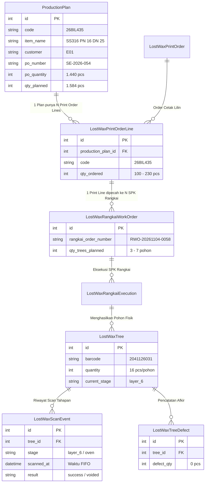

# AUDIT TEKNIS — LOST WAX READY FOR OVEN GROUPING & QUANTITY
## Evaluasi Struktur Pengelompokan, Kuantitas Agregat vs Baris, dan Alternatif Desain

**Repository:** `C:\laragon\www\kanban-ppic`  
**Halaman Fokus:**
- Web View: `/lost-wax/reports/ready-for-oven`
- Print A4: `/lost-wax/reports/ready-for-oven/print`
- Backend Service: `app/Services/LostWax/ReadyForOvenService.php`  
**Kasus Nyata UAT:** Kode Produksi `268IL435`  
**Mode:** **STRICT READ-ONLY AUDIT** (Tidak ada kode aplikasi, database, maupun alur proses yang diubah)  
**Tanggal Audit:** 10 November 2026  

---

## DAFTAR ISI
1. [Struktur Grouping Saat Ini](#1-struktur-grouping-saat-ini)
2. [Diagram Relasi Data](#2-diagram-relasi-data)
3. [Audit Sumber dan Rumus Kuantitas (Kasus 320, 1.440, dan 48 dari 320)](#3-audit-sumber-dan-rumus-kuantitas)
4. [Temuan Khusus Kode Produksi 268IL435 di Database Nyata](#4-temuan-khusus-kode-produksi-268il435)
5. [Audit Status Batch (FULL BATCH vs PARTIAL BATCH)](#5-audit-status-batch)
6. [Evaluasi Tiga Alternatif Desain](#6-evaluasi-tiga-alternatif-desain)
7. [Rekomendasi Desain Final dan Konsekuensi Teknis](#7-rekomendasi-desain-final)
8. [Daftar File dan Fungsi yang Perlu Diubah pada Tahap Implementasi](#8-daftar-file-dan-fungsi)

---

## 1. STRUKTUR GROUPING SAAT INI

Pada implementasi saat ini di `ReadyForOvenService.php` (baris 330–334), antrean pohon yang telah selesai pelapisan keramik (`layer_6` atau `layer_7`) dikelompokkan menggunakan **composite key** berikut:

```php
$grouped = $rawRows->groupBy(function ($row) {
    return $row['production_code'] . '|' .
           $row['item_name'] . '|' .
           $row['customer'] . '|' .
           $row['finished_stage'] . '|' .
           $row['work_order_key'];
});
```

### Rincian Elemen Grouping Key:
1. **`production_code`**: Kode Produksi dari `ProductionPlan` (misal: `268IL435`).
2. **`item_name`**: Nama Item produk (misal: `SS316 PN 16 DN 25`).
3. **`customer`**: Nama Customer (misal: `E01`).
4. **`finished_stage`**: Lapisan akhir yang telah tuntas discan (`layer_6` atau `layer_7`).
5. **`work_order_key`**: Kunci unik Surat Perintah Kerja (SPK). Formatnya adalah:
   - Alur Modern: `RWO:<lost_wax_rangkai_work_order_id>` (contoh: `RWO:2989`)
   - Alur Legacy: `WO:<lost_wax_work_order_id>` (contoh: `WO:120`)
   - Tanpa SPK: `NO_WO:<tree_id>`

### Mengapa Satu Kode Produksi Menghasilkan Beberapa Baris?
Dalam operasional Lost Wax di PT. Peroni Karya Sentra, satu target rencana produksi (`ProductionPlan`) dengan volume besar (misal: 1.440 pcs) tidak dicetak atau dirangkai sekaligus dalam satu SPK. Bagian PPIC memecahnya ke dalam beberapa Surat Perintah Kerja Rangkai (`LostWaxRangkaiWorkOrder`), misalnya per shift, per operator, atau per kapasitas meja rangkai (3 pohon, 7 pohon, dll.).

Karena **`work_order_key` disertakan sebagai bagian dari grouping key**, maka:
- Setiap SPK Rangkai yang berbeda **pasti terpecah menjadi baris tersendiri** di tabel.
- Jika ada 5 SPK Rangkai untuk kode `268IL435` yang saat ini sedang menunggu di antrean Siap Oven, maka tabel akan merender **5 baris terpisah**.

### Pengaruh Pengurutan FIFO terhadap Posisi Baris:
Antrean diurutkan berdasarkan aturan **FIFO ketat** (`finished_at ASC` — waktu scan lapisan terakhir paling awal).
Jika:
- SPK A (`268IL435`) selesai lapisan pada pukul 17:05 (06/11)
- SPK B (`2610L1144` — kode berbeda) selesai lapisan pada pukul 17:05 (06/11)
- SPK C (`268IL435`) selesai lapisan pada pukul 17:05 (06/11, beberapa detik kemudian)

Maka susunan antrean menjadi:
- **Baris 1:** Kode `268IL435` (SPK A)
- **Baris 2:** Kode `2610L1144` (SPK B — kode lain)
- **Baris 3:** Kode `268IL435` (SPK C)

Hal ini membuktikan secara teknis temuan UAT: **kode produksi yang sama muncul terpisah pada baris 1 dan baris 3 karena diselingi oleh kode produksi lain yang selesai pada rentang waktu yang sama.**

---

## 2. DIAGRAM RELASI DATA

Berikut adalah diagram relasi data yang mendasari pembentukan baris di `ReadyForOvenService`:



---

## 3. AUDIT SUMBER DAN RUMUS KUANTITAS

### A. Total PO per Kode Produksi (1.440 PCS)
- **Sumber Data:** Kolom `po_quantity` pada tabel `production_plans` untuk record dengan `code = '268IL435'` (Plan ID: `1767`).
- **Nomor PO:** `SE-2026-054`.
- **Karakteristik:** Pada sistem saat ini, satu rencana produksi (`ProductionPlan`) mewakili satu Surat Pesanan (PO) resmi dari customer. Kuantitas PO ini bernilai tunggal per kode produksi ($1.440$ pcs).

### B. Total Siap Oven per Kode Produksi (320 PCS)
- **Definisi:** Akumulasi seluruh PCS layak pakai dari seluruh pohon lilin dengan kode produksi `268IL435` yang **saat ini sedang berada di antrean Siap Oven** (`current_stage = layer_6` atau `layer_7`, dan belum discan oven atau void).
- **Rumus Backend:**
  $$\text{siap\_oven\_code\_pcs} = \sum_{\substack{\text{tree } \in \text{ Queue} \\ \text{code } = \text{ '268IL435'}}} (\text{tree.quantity} - \text{tree.defect})$$
- **Rincian Data Aktual:**
  Terdapat **20 pohon fisik** (masing-masing 16 pcs) yang tersebar di 5 SPK berbeda:
  - SPK `RWO-20261104-0058`: 3 pohon $\times$ 16 = 48 pcs
  - SPK `RWO-20261104-0056`: 1 pohon $\times$ 16 = 16 pcs
  - SPK `RWO-20261104-0040`: 7 pohon $\times$ 16 = 112 pcs
  - SPK `RWO-20261104-0030`: 3 pohon $\times$ 16 = 48 pcs
  - SPK `RWO-20261105-0018`: 6 pohon $\times$ 16 = 96 pcs
  $$\text{Total} = 48 + 16 + 112 + 48 + 96 = \mathbf{320\text{ PCS}}$$

### C. Siap Oven per Work Order / SPK (Baris Tabel)
- **Definisi:** Kuantitas PCS layak pakai yang berasal **khusus dari SPK Rangkai pada baris tersebut**.
- Contoh pada baris SPK `RWO-20261104-0058`:
  - Pohon fisik: 3 pohon (barcode `2041126031`, `2041126032`, `2041126033`).
  - Kuantitas bruto: $3 \times 16 = 48$ pcs.
  - Afkir: $0$ pcs.
  - Kuantitas layak pakai baris ini: **48 PCS**.

### D. Mengapa Muncul Teks "Baris: 48 dari 320"?
Pada implementasi Phase 1.1, karena sistem mendeteksi bahwa kode `268IL435` terbagi di lebih dari 1 baris kelompok (`is_split_code = true`), UI menambahkan catatan:
`*Baris ini: 48 dari total 320 Siap Oven`

Tujuannya adalah menjelaskan bahwa 48 pcs pada baris ini merupakan bagian dari total 320 pcs yang siap di antrean. Namun, karena di bagian atas sel tetap tertulis besar **`320 / 1.440 PCS`**, operator menganggap angka agregat 320 itu adalah angka milik baris tersebut.

### E. Apakah Terdapat Duplikasi / Double Counting?
1. **Secara Matematika & Database: TIDAK ADA DUPLIKASI DATA.**
   Ke-20 pohon fisik yang membentuk angka 320 pcs adalah 20 record pohon unik dengan barcode fisik berbeda. Pada ringkasan total antrean (`summary.total_po_pcs`), sistem juga telah menerapkan deduplikasi (`distinctCodePoMap`), sehingga PO 1.440 pcs hanya dihitung satu kali.
2. **Secara Visual & Tampilan: TERJADI DUPLIKASI KOGNITIF (Visual Redundancy).**
   Karena angka agregat `320 / 1.440 PCS` dicetak di setiap baris SPK, operator yang membaca baris 1 melihat `320`, dan saat membaca baris 3 kembali melihat `320`. Hal ini memberi ilusi bahwa sistem mencatat kuantitas yang berulang atau tidak proporsional dengan 3 pohon (48 pcs) yang ada di depan mata operator.

---

## 4. TEMUAN KHUSUS KODE PRODUKSI 268IL435 DI DATABASE NYATA

Dari audit langsung terhadap database lokal `kanban-ppic`, ditemukan kondisi menyeluruh dari kode `268IL435`:

### A. Rekapitulasi Pipeline Produksi 268IL435

| Tahapan / Posisi WIP | Jumlah Pohon | Jumlah Pcs | Status dalam Sistem |
|---|---|---|---|
| **Oven (Sudah dibakar)** | 23 pohon | 388 pcs | Sudah keluar dari antrean Siap Oven |
| **Layer 6 (Siap Masuk Oven)** | **20 pohon** | **320 pcs** | **Aktif di antrean Siap Oven saat ini** |
| **Layer 5 (Proses Celup)** | 13 pohon | 208 pcs | Belum selesai pelapisan (WIP Coating) |
| **Layer 4 (Proses Celup)** | 11 pohon | 176 pcs | Belum selesai pelapisan (WIP Coating) |
| **TOTAL DIPRODUKSI** | **67 pohon** | **1.092 pcs** | Progress terhadap PO 1.440 pcs: 75.8% |

### B. Urutan Nyata di Antrean FIFO Siap Oven (Top 10 Baris Antrean Lokal)

Audit terhadap 10 baris teratas antrean Siap Oven membuktikan posisi baris aktual:

```
Baris #1  | Kode: 268IL435     | SPK: RWO-20261104-0058 | 3 Pohon | Baris: 48 pcs  | Kode: 320 pcs | Selesai: 06/11 17:05
Baris #2  | Kode: 2610L1144    | SPK: RWO-20261104-0057 | 2 Pohon | Baris: 126 pcs | Kode: 126 pcs | Selesai: 06/11 17:05
Baris #3  | Kode: 268IL435     | SPK: RWO-20261104-0056 | 1 Pohon | Baris: 16 pcs  | Kode: 320 pcs | Selesai: 06/11 17:05
Baris #4  | Kode: 2610L1121    | SPK: RWO-20261104-0054 | 4 Pohon | Baris: 64 pcs  | Kode: 64 pcs  | Selesai: 06/11 17:05
Baris #5  | Kode: 2610L1143    | SPK: RWO-20261104-0055 | 2 Pohon | Baris: 128 pcs | Kode: 128 pcs | Selesai: 06/11 17:05
Baris #6  | Kode: 2610L1152    | SPK: RWO-20261104-0044 | 2 Pohon | Baris: 240 pcs | Kode: 240 pcs | Selesai: 06/11 17:06
Baris #7  | Kode: 2610E405     | SPK: RWO-20261104-0050 | 8 Pohon | Baris: 128 pcs | Kode: 128 pcs | Selesai: 07/11 07:32
Baris #8  | Kode: 2610L1120    | SPK: RWO-20261104-0052 | 5 Pohon | Baris: 360 pcs | Kode: 423 pcs | Selesai: 07/11 07:32
Baris #9  | Kode: 2610L1153    | SPK: RWO-20261104-0051 | 5 Pohon | Baris: 320 pcs | Kode: 320 pcs | Selesai: 07/11 07:32
Baris #10 | Kode: 2610L1120    | SPK: RWO-20261104-0053 | 1 Pohon | Baris: 63 pcs  | Kode: 423 pcs | Selesai: 07/11 07:32
```

Fakta penting:
- Kode `268IL435` muncul di **Baris 1** (SPK RWO-0058: 48 pcs) dan **Baris 3** (SPK RWO-0056: 16 pcs).
- Fenomena serupa juga terjadi pada kode `2610L1120` di **Baris 8** (360 pcs) dan **Baris 10** (63 pcs).

---

## 5. AUDIT STATUS BATCH (FULL BATCH vs PARTIAL BATCH)

### A. Level Perhitungan Status Batch
Status Batch saat ini dihitung pada **tingkat Work Order (SPK Rangkai)**, bukan pada tingkat Kode Produksi maupun tingkat Rencana Produksi (PO):

$$\text{is\_full\_batch} = (\text{coated\_trees} \ge \text{total\_trees\_in\_rwo})$$

### B. Mengapa FULL BATCH Muncul Saat Kuantitas Masih Jauh di Bawah PO?
Pada SPK `RWO-20261104-0058`, bagian Rangkai membuat 3 pohon fisik (`2041126031`, `2041126032`, `2041126033`).
Ketiga pohon tersebut telah melalui dipping lapisan 1 s/d lapisan 6 dan discan sukses.
Karena seluruh pohon dalam SPK tersebut ($3 \text{ dari } 3$) sudah tuntas dilapisi, maka sistem menandainya sebagai:
- **`FULL BATCH` (3 / 3 TREE COATED)**

Padahal:
- Kuantitas SPK tersebut hanya $48$ pcs.
- Target PO customer adalah $1.440$ pcs.
- Akibatnya, pada satu baris muncul dua indikator yang saling bertentangan secara psikologis:
  - Badge Hijau: `FULL BATCH`
  - Badge Merah di sebelahnya: `Kurang 1.120 PCS`

### C. Relevansi bagi Operator Oven
Bagi **Operator Oven**, status kelengkapan batch pelapisan Work Order (`FULL BATCH`) **tidak memiliki kegunaan operasional**:
1. Operator oven memuat pohon ke dalam kereta/tungku oven berdasarkan ketersediaan fisik pohon yang kering, dimensi pohon, dan jadwal pembakaran kiln, bukan berdasarkan apakah SPK rangkai sudah selesai 100% atau belum.
2. Keberadaan badge `FULL BATCH` justru membahayakan karena operator atau supervisor mengira pesanan untuk kode tersebut sudah selesai seluruhnya, padahal baru 48 pcs dari 1.440 pcs.

### D. Konsekuensi Menghilangkan Status Batch dari UI
- **Jika kolom Status Batch dihilangkan dari tabel antrean:**
  - Tabel menjadi jauh lebih bersih, ramping, dan bebas dari kontradiksi visual.
  - Ruang horizontal bertambah untuk informasi esensial (Kode, Item, PO, SPK, Barcode, Rak).
- **Jika kalkulasi backend dipertahankan:**
  - Tidak merusak fungsionalitas lain. Logika status batch tetap tersimpan di `ReadyForOvenService` jika suatu saat diperlukan untuk monitoring divisi Coating/Rangkai.

---

## 6. EVALUASI TIGA ALTERNATIF DESAIN

Berikut perbandingan mendalam terhadap tiga opsi arsitektur tampilan:

| Kriteria Evaluasi | Alternatif A<br>(1 Baris/SPK, Agregat Hanya di Baris 1) | Alternatif B<br>(Master Kode Produksi, Sub-baris SPK) | Alternatif C<br>(Grouping Penuh Kode Produksi / Flat) |
|---|---|---|---|
| **Konsep Desain** | Setiap SPK tetap 1 baris. Jika kode sama muncul lagi di baris bawah, kolom PO dikosongkan/diberi tanda kutip (`"`). | **Grouping utama berdasarkan Kode Produksi.** Total Siap Oven dan PO ditampilkan sekali di baris induk. Rincian SPK disajikan sebagai sub-baris / expandable accordion. | Semua SPK dengan kode sama dilebur menjadi 1 baris flat tunggal tanpa memisahkan SPK. |
| **1. Ketepatan Perhitungan** | **Sedang.** Angka PO tidak terulang, tetapi hubungan antar baris membingungkan jika terpisah baris lain. | **Sangat Tinggi.** Total Siap Oven dan PO dihitung dan ditampilkan tepat 1 kali pada tingkat kode produksi. | **Tinggi.** Seluruh kuantitas dijumlahkan per kode produksi. |
| **2. Traceability SPK & Rangkai** | **Tinggi.** Setiap SPK dan barcode terlihat per baris. | **Sangat Tinggi (Paling Ideal).** Baris induk menampilkan agregat; sub-baris menampilkan nomor SPK, kuantitas SPK, barcode, dan rak. | **Rendah.** Nomor SPK bercampur (hanya daftar koma). Sulit mengetahui pohon mana milik SPK mana. |
| **3. Kemudahan Operator** | **Buruk.** Karena baris terpisah oleh FIFO (baris 1 dan baris 3), operator di baris 3 akan bingung melihat kolom PO kosong. | **Sangat Baik.** Operator langsung tahu total barang siap oven vs PO untuk produk tersebut, lalu bisa melihat rincian SPK di bawahnya. | **Cukup.** Mudah membaca angka total, tetapi membingungkan saat memverifikasi fisik SPK. |
| **4. Risiko Duplikasi Visual** | **Sedang.** Agregat tidak berulang, tetapi jumlah baris tetap banyak. | **Nol (Zero Duplication).** Tidak ada angka agregat yang diulang. | **Nol.** Satu kode hanya satu baris. |
| **5. Dampak pada Urutan FIFO** | Mempertahankan FIFO per SPK, tetapi memecah kode produk menjadi baris-baris terpisah. | **Sangat Baik.** Kode produksi diurutkan berdasarkan **waktu selesai terawal** di antara seluruh pohonnya. Di dalam kode, SPK diurutkan FIFO. | Menggunakan waktu terawal, tetapi detail waktu per SPK hilang. |
| **6. Dampak pada Void & Scan Oven** | Tidak ada dampak. | **Tidak ada dampak.** Setiap pohon tetap memiliki `tree_id` dan barcode fisik asli. Scan Oven dan Void tetap bekerja 100%. | Tidak ada dampak pada scanner, tetapi operator kehilangan panduan SPK mana yang diprioritaskan. |

### Mengapa Alternatif A Tidak Direkomendasikan:
Pada antrean aktual di database lokal:
- Baris 1: `268IL435`
- Baris 2: `2610L1144`
- Baris 3: `268IL435`

Jika pada Baris 3 angka agregat PO dihilangkan atau diganti `-`, operator yang membaca Baris 3 akan merasa data tidak lengkap atau harus menggulir ke atas untuk mencari Baris 1. Ini memperburuk UX antrean.

---

## 7. REKOMENDASI DESAIN FINAL DAN KONSEKUENSI TEKNIS

### Rekomendasi Utama: **Alternatif B (Two-Tier Hierarchy: Master-Detail)**

Terapkan struktur **Dua Tingkat (Two-Tier Hierarchy)** pada laporan Barang Siap Oven:

```
[BARIS INDUK / MASTER ROW]
No  Kode Produksi   Nama Item           Customer    Jumlah Rangkai    SIAP OVEN / PO           Waktu Selesai (FIFO)
1   268IL435        SS316 PN 16 DN 25   E01         20 Rangkai        320 / 1.440 PCS          06/11/2026 17:05
                                                                      [Kurang 1.120 PCS]

    └── [SUB-BARIS / DETAIL BREAKDOWN PER SPK] (Bisa di-expand/collapse atau tabel indented)
        ├── SPK: RWO-20261104-0058  •  3 Rangkai (48 PCS)   •  Waktu: 06/11 17:05  •  Rak: [R-02]  •  Barcode: 2041126031, 2041126032, 2041126033
        ├── SPK: RWO-20261104-0056  •  1 Rangkai (16 PCS)   •  Waktu: 06/11 17:05  •  Rak: [R-02]  •  Barcode: 2041126030
        ├── SPK: RWO-20261104-0040  •  7 Rangkai (112 PCS)  •  Waktu: 06/11 17:10  •  Rak: [R-03]  •  Barcode: 2041126009 s/d 2041126015
        ├── SPK: RWO-20261104-0030  •  3 Rangkai (48 PCS)   •  Waktu: 06/11 17:20  •  Rak: [R-01]  •  Barcode: 2041126005 s/d 2041126007
        └── SPK: RWO-20261105-0018  •  6 Rangkai (96 PCS)   •  Waktu: 07/11 08:30  •  Rak: [R-04]  •  Barcode: 2051126001 s/d 2051126006
```

### Keunggulan Desain Ini:
1. **Satu Baris Induk per Kode Produksi:**
   Angka `320 / 1.440 PCS` dan badge variansi `Kurang 1.120 PCS` hanya muncul **satu kali** per kode produksi. Tidak ada lagi kebingungan angka berulang.
2. **Keterlacakan SPK dan Barcode Tetap Utuh 100%:**
   Operator dan QC tetap dapat memeriksa kontribusi per SPK (48 pcs, 16 pcs, dll.), posisi rak, dan daftar barcode masing-masing pohon di sub-baris.
3. **Pengurutan FIFO Tetap Konsisten:**
   Baris master diurutkan berdasarkan pohon yang selesai paling awal (`earliest_finished_at`). Di dalam baris master, sub-baris SPK diurutkan berdasarkan waktu selesai masing-masing SPK.
4. **Hapus Status Batch dari UI Tabel:**
   Kolom `Status Batch` dihilangkan dari tabel antrean dan print layout. Ini menghilangkan kontradiksi visual `FULL BATCH` berdampingan dengan `Kurang X PCS`. Logika kalkulasi tetap dipertahankan di backend service untuk kebutuhan pelaporan coating internal jika diperlukan.

---

## 8. DAFTAR FILE DAN FUNGSI YANG PERLU DIUBAH PADA TAHAP IMPLEMENTASI

Apabila rekomendasi desain di atas disetujui, berikut adalah file dan fungsi yang akan dimodifikasi:

### 1. `app/Services/LostWax/ReadyForOvenService.php`
- **Fungsi `getQueueData()`**:
  - Ubah pipeline grouping menjadi dua tingkat:
    - **Tingkat 1 (Parent):** Grouping berdasarkan `production_code|item_name|customer|finished_stage`. Menghitung total rangkai induk, total PCS layak induk (`siap_oven_code_pcs`), PO quantity, variansi PO, dan waktu selesai terawal (`earliest_finished_at`).
    - **Tingkat 2 (Children):** Sub-grouping berdasarkan `work_order_key` di dalam setiap induk. Berisi `work_order_number`, jumlah rangkai SPK, PCS SPK, daftar barcode, rak, dan waktu selesai SPK.
  - Sorting FIFO: Diurutkan berdasarkan `earliest_finished_at` pada tingkat parent.

### 2. `resources/views/lost-wax/reports/ready-for-oven/index.blade.php`
- Modifikasi tabel antrean:
  - Header tabel: No, Kode Produksi, Nama Item, Customer, Jumlah Rangkai, SIAP OVEN / PO, Waktu Selesai. (Kolom Status Batch dihapus).
  - Body tabel: Baris master menampilkan ringkasan produk & PO, dilengkapi tombol toggle expand/collapse untuk membuka sub-baris SPK.
  - Sub-baris menampilkan rincian per SPK dengan styling clean and compact (latar slate lembut, monospace barcode, badge rak).

### 3. `resources/views/lost-wax/reports/ready-for-oven/print.blade.php`
- Modifikasi template cetak A4 Portrait:
  - Menampilkan baris master tebal (Kode, Item, PO, Total Rangkai) diikuti baris rincian SPK di bawahnya secara rapi tanpa memakan banyak ruang vertikal.
  - Kolom Status Batch dihilangkan dari cetakan.

### 4. `tests/Feature/LostWax/ReadyForOvenPhase1Test.php` & `ReadyForOvenReportTest.php`
- Memperbarui pengujian otomatis untuk memvalidasi struktur data dua tingkat (`parent.items` dan `child.work_orders`).
- Memastikan seluruh pengujian otomatis tetap lulus 100%.

---

## 9. KESIMPULAN AUDIT

1. Angka `320 PCS` dan `1.440 PCS` pada kasus `268IL435` adalah **100% valid secara matematis**. Angka 1.440 adalah target PO resmi dari customer, sedangkan 320 adalah total akumulasi 20 pohon fisik yang siap di antrean oven dari 5 SPK berbeda.
2. Masalah utama yang terjadi adalah **kebingungan kognitif operator akibat struktur grouping saat ini yang membagi baris per SPK, tetapi mencetak angka agregat kode produksi secara berulang di setiap baris SPK**.
3. Badge `FULL BATCH` saat ini hanya mengukur kelengkapan dipping satu SPK (misal $3/3$ pohon), sehingga tidak relevan bagi operator oven dan membingungkan ketika disandingkan dengan kekurangan kuantitas PO.
4. Solusi terbaik yang menjaga akurasi perhitungan, keterlacakan SPK, dan kenyamanan membaca operator adalah **Alternatif B (Two-Tier Master-Detail)** disertai penghapusan kolom Status Batch dari tampilan tabel antrean.

---
*Laporan audit teknis ini disusun secara read-only tanpa melakukan modifikasi kode aplikasi atau database.*

