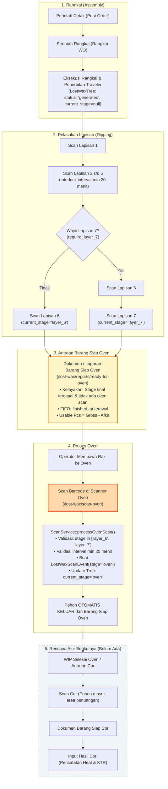
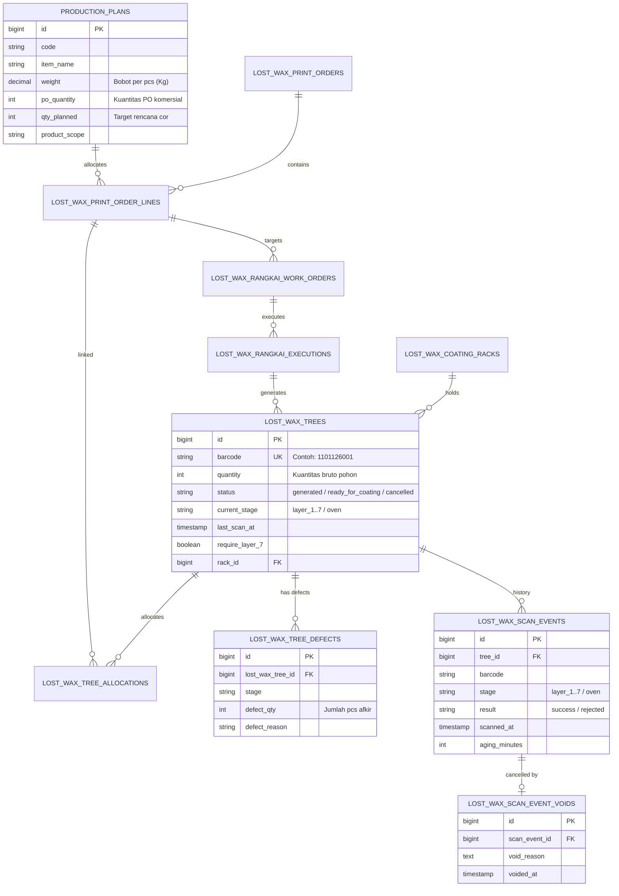

# AUDIT TEKNIS READ-ONLY — LOST WAX OVEN TO CASTING WORKFLOW

**Repository:** `C:\laragon\www\kanban-ppic`  
**Referensi Produksi:** `http://10.88.8.46:6002`  
**Laporan Terkait:** `/lost-wax/reports/ready-for-oven`  
**Proyek:** Kanban PPIC — Lost Wax  
**Mode:** STRICT READ-ONLY AUDIT  
**Tanggal:** 2026-11-10  

---

## A. Executive Summary

Audit teknis ini menganalisis secara mendalam arsitektur data, alur scanner, logika laporan antrean, serta kesiapan sistem dalam menghubungkan proses **Rangkai (Assembly) & Lapisan (Coating)** menuju **Oven**, dan selanjutnya menuju tahap **Pengecoran (Casting / Cor)** pada modul Lost Wax di repositori lokal `C:\laragon\www\kanban-ppic`.

### 1. Kondisi Lost Wax Saat Ini
Modul Lost Wax saat ini telah menyelesaikan implementasi operasional dari Perintah Cetak lilin, Perintah Rangkai (Work Order Rangkai & Eksekusi Traveler), pemantauan rak (*Rack Monitor*), hingga pelacakan scanner lapisan (*dipping* Lapisan 1 s.d. 6/7) dan Scanner Scan Oven. Sistem juga telah memiliki laporan antrean **Barang Siap Oven** (`/lost-wax/reports/ready-for-oven`) yang telah diuji dengan 20 test case komprehensif pada `ReadyForOvenReportTest.php` dan beroperasi stabil di UAT.

### 2. Fitur yang Sudah Berjalan
- **Manajemen Rangkai**: Penerbitan Traveler Rangkai (`LostWaxTree`), pencatatan kapasitas pohon, relasi FIFO ke Perintah Cetak (`LostWaxTreeAllocation`), serta pencatatan cacat/afkir pohon (`LostWaxTreeDefect`).
- **Pelacakan Lapisan (Coating)**: Scan Lapisan 1 s.d. 6 (atau 7 jika wajib) dengan validasi urutan sekuensial, interlock anti double-scan 20 menit, dan klasifikasi aging waktu pengeringan.
- **Scanner Scan Oven**: Form pemindaian barcode pohon saat rak dimasukkan ke Oven (`/lost-wax/scan-oven`), memvalidasi syarat pohon telah tuntas lapisan dan mengubah stage menjadi `oven`.
- **Laporan Barang Siap Oven**: Agregasi real-time pohon yang telah tuntas lapisan terakhir dan siap diproses oven, dikelompokkan berdasarkan `Kode Produksi + Nama Item + Customer + Tahap Selesai` dengan pengurutan murni FIFO.
- **Koreksi & Pembatalan**: Pembatalan Traveler sebelum scan lapisan (`cancelExecution`) dan pembatalan event scan (*Void Scan Event*) yang secara reaktif mengembalikan pohon ke status stage sebelumnya.

### 3. Fitur yang Belum Tersedia / Gap Kritis
- **Informasi Berat (KG) pada Siap Oven**: Laporan Barang Siap Oven saat ini **hanya menghitung Pcs**, belum mengkalkulasi atau menampilkan bobot dalam **Kilogram (Kg)**, meskipun data master berat per pcs (`weight`) telah tersedia pada `production_plans`.
- **Status Kelayakan / Kelengkapan Kelompok (Group Completion Status)**: Belum ada kolom status yang membedakan apakah kelompok barang tersebut sudah selesai seluruh rangkaiannya (`COMPLETED`) atau masih ada rangkaian lain yang tertinggal di proses lapisan (`PO BELUM COMPLETED` / `PARTIAL`).
- **Indikator Buffer Stok (Coverage Days)**: Belum ada KPI ketersediaan stok WIP siap oven dalam hari produksi (misal target 3–4 hari terhadap kapasitas cor harian 2.000 kg).
- **Inkonsistensi Validasi Lapisan 7 pada Scan Oven**: `ReadyForOvenService` mewajibkan pohon dengan `require_layer_7 = true` mencapai `layer_7`, namun `ScanService::processOvenScan` saat ini mengizinkan scan oven langsung dari `layer_6` sekalipun `require_layer_7` bernilai aktif.
- **Alur Pasca Oven Menuju Cor**: Belum ada entitas, stage, scanner, maupun dokumen untuk **Scan Cor**, **Barang Siap Cor**, dan **Input Hasil Cor** Lost Wax. Pohon yang telah di-scan oven saat ini tertahan di `current_stage = 'oven'` tanpa transisi lanjutan.

---

## B. Current Workflow (Lapisan sampai Scan Oven)



---

## C. Ready for Oven Report (`/lost-wax/reports/ready-for-oven`)

### 1. File dan Method
- **Routing:** `routes/web.php` baris 212–213 (`lost-wax.reports.ready-for-oven.index` dan `.print`).
- **Controller:** `App\Http\Controllers\LostWax\ReadyForOvenController` method `index()` (baris 18–34) dan `print()` (baris 39–55).
- **Service Domain:** `App\Services\LostWax\ReadyForOvenService` method `getQueueData(?string $search, ?string $scope)` (baris 19–390).
- **Blade Views:**
  - `resources/views/lost-wax/reports/ready-for-oven/index.blade.php` (tampilan antrean web).
  - `resources/views/lost-wax/reports/ready-for-oven/print.blade.php` (dokumen cetak A4 portrait standar operasional).

### 2. Sumber Data & Query Eloquent
Query dieksekusi secara real-time langsung ke tabel `lost_wax_trees` dengan relasi:
```php
LostWaxTree::query()
    ->with([
        'defects',
        'coatingRack',
        'printOrderLine.productionPlan',
        'workOrder.itemReference',
        'allocations.printOrderLine.productionPlan',
        'scanEvents' => function ($q) {
            $q->whereIn('stage', ['layer_6', 'layer_7', 'oven'])
              ->where('result', 'success')
              ->whereDoesntHave('void')
              ->orderByDesc('scanned_at')
              ->orderByDesc('id');
        },
    ])
```

### 3. Syarat Kelayakan Pohon Masuk Antrean
Sebuah pohon (`LostWaxTree`) lolos seleksi antrean Siap Oven jika memenuhi kriteria:
1. `status != 'cancelled'`: Bukan pohon yang dibatalkan.
2. `current_stage != 'oven'`: Belum pernah berhasil di-scan oven.
3. `whereDoesntHave('scanEvents', stage='oven', result='success', non-void)`: Tidak memiliki riwayat scan oven sukses yang aktif.
4. `require_layer_7` compliance:
   - Jika `require_layer_7 == false`: `current_stage == 'layer_6'` dan memiliki event sukses `layer_6`.
   - Jika `require_layer_7 == true`: `current_stage == 'layer_7'` dan memiliki event sukses `layer_7`.
5. `usable_quantity > 0`: Kuantitas pohon setelah dikurangi total cacat/afkir (`LostWaxTreeDefect`) harus $> 0$. Pohon dengan 100% afkir diabaikan.

### 4. Formula Kuantitas Pcs dan Bobot Kg
- **Kuantitas Pcs Pohon Tunggal:**
  $$\text{usable\_qty} = \max(0, \text{tree.quantity} - \sum \text{defects.defect\_qty})$$
- **Kuantitas Pcs Pohon Multi-Alokasi:**
  Jika satu pohon memuat beberapa alokasi (`LostWaxTreeAllocation`), kuantitas layak pakai dibagi secara proporsional sesuai rasio kuantitas kotor masing-masing alokasi:
  $$\text{groupUsable} = \text{round}\left(\text{treeUsableQty} \times \frac{\text{groupGrossQty}}{\text{totalAllocatedQty}}\right)$$
  Kelompok terakhir mendapatkan sisa kuantitas untuk menghilangkan selisih pembulatan (*zero variance remainder*).
- **Kuantitas Bobot Kg:**
  **Saat ini belum ada sama sekali perhitungan Kg** di `ReadyForOvenService` maupun tampilan Blade. Laporan hanya menjumlahkan `quantity_pcs`, `gross_pcs`, dan `defect_pcs`.

### 5. Aturan Pengelompokan (Grouping) & FIFO
- **Kunci Pengelompokan (Group Key):**
  Pohon digabung menjadi satu baris kelompok jika keempat komponen berikut identik:
  `production_code . '|' . item_name . '|' . customer . '|' . finished_stage`
- **Urutan FIFO (Priority Sorting):**
  1. `finished_at` ASC: Waktu scan sukses lapisan terakhir paling awal di antara anggota kelompok (anggota yang paling lama selesai lapisan diprioritaskan pertama).
  2. `production_code` ASC
  3. `item_name` ASC
  4. `customer` ASC
  5. `first barcode` ASC
- **Sifat Data:** Murni real-time (*on-demand query*), bukan snapshot atau tabel cache.
- **Pencegahan Double Count:** Pohon multi-alokasi membagi kuantitasnya secara presisi. Summary card membedakan `total_rangkai` (jumlah baris alokasi) dengan `total_unique_trees` (`filteredUniqueTreeIds`) untuk mencegah bias pohon fisik ganda.

---

## D. Scanner Oven (`/lost-wax/scan-oven`)

### 1. File dan Method
- **Routing:** `routes/web.php` baris 189–190 (`lost-wax.scan-oven.index` dan `.process`).
- **Controller:** `App\Http\Controllers\LostWax\ScanController::scanOven()` (tampilan) & `processOven()` (eksekusi POST).
- **Service Domain:** `App\Services\ScanService::processOvenScan(string $barcode, int $operatorId)` (baris 186–278).
- **Blade View:** `resources/views/lost-wax/scan-oven/index.blade.php`.

### 2. Status Sebelum dan Sesudah Scan
- **Sebelum Scan:** Pohon berstatus `status = 'generated'`, `current_stage = 'layer_6'` atau `'layer_7'`. Pohon berada di dalam daftar antrean `ReadyForOven`.
- **Sesudah Scan:**
  1. Dibuat record `LostWaxScanEvent`: `stage = 'oven'`, `result = 'success'`, `scanned_at = now()`, `aging_minutes`, `aging_status`.
  2. Field pada `LostWaxTree` diperbarui:
     ```php
     $tree->update([
         'current_stage' => 'oven',
         'last_scan_at' => $scannedAt,
     ]);
     ```
  3. Kolom `status` pada `lost_wax_trees` **TIDAK BERUBAH** (tetap `'generated'`).

### 3. Proteksi Duplikasi & Interlock
- **Row-Level Locking:** Menggunakan `LostWaxTree::lockForUpdate()` di dalam `DB::transaction()` untuk mencegah *race condition*.
- **Pengecekan Duplikat:** Menolak jika `current_stage === 'oven'` atau jika sudah ada event `oven` dengan hasil `success` non-void.
- **Interlock Minimum 20 Menit:** Menolak jika jeda antara `scanned_at` dengan `last_scan_at` lapisan sebelumnya kurang dari 20 menit (`min_scan_interval_minutes = 20`) untuk mencegah operator melakukan scan lapisan dan scan oven secara bersamaan tanpa proses fisik.

### 4. Koreksi & Pembatalan (Void Event)
- Admin/PPIC dapat membatalkan scan oven melalui `POST /lost-wax/scan-events/{event}/void` (`ScanVoidService::void()`).
- Saat di-void:
  1. Record `LostWaxScanEventVoid` dibuat.
  2. `current_stage` pada `LostWaxTree` direkonstruksi secara otomatis mundur ke scan event sukses terakhir sebelumnya (`layer_6` atau `layer_7`).
  3. Pohon **secara otomatis muncul kembali** pada laporan Barang Siap Oven tanpa inkonsistensi data.

### 5. Dampak Terhadap WIP
Scan Oven menandai **berakhirnya antrean Siap Oven**. Segera setelah scan oven sukses, pohon langsung keluar dari laporan `ReadyForOven` dan berpindah ke kondisi fisik "sedang/telah diproses oven".

---

## E. Analisis Status Kelompok Barang (Group Completion Status)

Pengoperasian pabrik menghendaki kejelasan status pada setiap baris kelompok barang di laporan Barang Siap Oven:
- `PO BELUM COMPLETED`: Rangkai yang tersedia baru sebagian dari rencana, masih ada rangkai lain yang tertinggal di lapisan.
- `COMPLETED`: Seluruh rangkai yang direncanakan telah selesai lapisan dan siap masuk oven.

Untuk menerapkan konsep ini secara aman, kita wajib membedakan tiga definisi yang sering tercampur:

### 1. Matriks Perbedaan Konsep Penyelesaian

| Aspek | Definisi | Sumber Data Saat Ini | Apakah Boleh Dijadikan Acuan Status Siap Oven? |
| :--- | :--- | :--- | :---: |
| **A. Penyelesaian Rangkai Fisik (Tree Batch Completeness)** | Apakah seluruh pohon fisik yang diterbitkan dari Perintah Rangkai sudah tuntas lapisan dan masuk antrean oven? | `LostWaxTree` yang terhubung ke `lost_wax_print_order_line_id` atau `rangkai_execution_id`. | **YA (Sangat Direkomendasikan)**. Menjawab kekhawatiran operasional: *"Apakah masih ada pohon yang tertinggal di Lapisan 4?"* |
| **B. Pemenuhan Kuantitas PO (Commercial PO Fulfillment)** | Apakah total pcs layak pakai yang tersedia sudah $\ge$ `po_quantity` customer? | `production_plans.po_quantity` vs $\sum \text{usable\_pcs}$. | **YA (Sebagai Pelengkap)**. Memberi informasi bagi PPIC apakah kuota order komersial sudah tercapai. |
| **C. Ketersediaan WIP Siap Oven (WIP Ready to Burn)** | Berapa kuantitas riil (pcs dan kg) yang saat ini berada di rak dan bisa langsung dimasukkan ke oven hari ini? | `ReadyForOvenService` (filter pohon yang berada di final stage). | **Bukan Status**, melainkan nilai stok aktual yang dapat dieksekusi oven tanpa menunggu pohon yang belum selesai. |

### 2. Temuan Kritis: Mengapa Pcs Aktual Dapat Melebihi PO
Dalam industri pengecoran Lost Wax:
- PO Customer: 1.000 pcs (`po_quantity`).
- Rencana Produksi (dengan *scrap allowance*): 1.100 pcs (`qty_planned`).
- Eksekusi Rangkai: Dibuat 11 pohon @ 100 pcs = 1.100 pcs.
- Jika 8 pohon selesai lapisan: terkumpul 800 pcs $\rightarrow$ **PO BELUM COMPLETED** (belum mencapai 1.000 pcs dan 3 pohon masih di lapisan).
- Jika 11 pohon selesai lapisan dengan 20 pcs afkir: terkumpul 1.080 pcs $\rightarrow$ **COMPLETED** (seluruh 11 pohon selesai, dan kuantitas 1.080 pcs melebihi PO 1.000 pcs).
- **Risiko jika hanya memakai acuan Pcs $\ge$ PO**: Jika 8 pohon saja sudah menghasilkan 1.020 pcs (misal pohon berkapasitas besar), sistem akan memberi status "COMPLETED" padahal masih ada 2 pohon di lapisan. Operator oven bisa mengabaikan 2 pohon sisanya sehingga material lilin/keramik tersebut terbengkalai.

### 3. Rekomendasi Rumusan Status Kelompok Barang
Disarankan status baris kelompok menampilkan dua informasi yang terpisah secara visual:
1. **Status Kelengkapan Rangkai (Batch Progress):**
   $$\text{Progress Rangkai} = \frac{\text{Jumlah Pohon Siap Oven}}{\text{Total Pohon Rangkai Diterbitkan}}\quad (\text{Contoh: } 8/10\ \text{Rangkai})$$
2. **Status Indikator Bisnis (Badge):**
   - Jika Pohon Siap Oven $<$ Total Pohon Diterbitkan:  
     $\rightarrow$ Badge Kuning/Amber: **`PO BELUM COMPLETED`** (atau `PARSIAL (8/10 RANGKAI)`).
   - Jika Pohon Siap Oven $\ge$ Total Pohon Diterbitkan:  
     $\rightarrow$ Badge Hijau/Emerald: **`COMPLETED`** (seluruh rangkai telah siap).

---

## F. Kebutuhan Informasi WIP dalam KG & Konsep Stock 3–4 Hari

### 1. Sumber Data Berat (Weight Source)
Dalam database aplikasi saat ini, bobot per pcs telah tersedia pada:
- **Tabel `production_plans`**: Kolom `weight` (tipe `decimal:2`, satuan kg per pcs).
- **Tabel `lost_wax_item_references` (Legacy)**: Kolom `unit_weight_snapshot` (tipe `decimal:3`).
- **Pola Resolver Aplikasi**:
  Mengikuti pola pada `LostWaxProductionReportService.php` (baris 197 & 314):
  ```php
  $unitWeight = (float) ($plan?->weight ?? $wo?->itemReference?->unit_weight_snapshot ?? 0.0);
  $totalWeightKg = round($usablePcs * $unitWeight, 2);
  ```

### 2. Variasi Kuantitas Rangkai
Database membuktikan bahwa **kuantitas per rangkai TIDAK seragam**:
- Satu pohon dapat berisi 20, 50, 80, 100, atau 120 pcs tergantung jenis produk dan kapasitas cetakan (`standard_capacity_guide`).
- Adanya reject/afkir di tahap lapisan (`lost_wax_tree_defects`) membuat kuantitas layak pakai bervariasi antar pohon.
- Oleh karena itu, agregasi bobot Kg **wajib dihitung per baris pohon fisik** ($\text{usable\_qty} \times \text{unit\_weight}$), bukan mengalikan rata-rata.

### 3. Perhitungan Kebutuhan Stok 3–4 Hari (Coverage Days)
Rumus Coverage Days:
$$\text{Coverage Days} = \frac{\text{Total WIP Siap Oven (kg)}}{\text{Target Kebutuhan Harian (kg)}}$$

**Contoh Simulasi:**
- Total WIP Siap Oven di laporan = 6.420,50 kg.
- Target Kebutuhan Oven/Cor = 2.000,00 kg/hari.
- $\text{Coverage Days} = \frac{6.420,50}{2.000,00} = 3,21\ \text{Hari}$ (Stok cukup untuk 3 hari produksi).

### 4. Opsi Konfigurasi Kapasitas Harian (2.000 kg/hari)

| Opsi | Mekanisme | Kelebihan | Kekurangan / Konsekuensi | Rekomendasi |
| :--- | :--- | :--- | :--- | :---: |
| **Opsi 1: Config File / `.env`** | Didefinisikan di `config/lost_wax.php`: `'daily_capacity_kg' => env('LOST_WAX_DAILY_OVEN_TARGET_KG', 2000)` | Sangat sederhana, zero migration, tidak mengubah struktur database. | Mengubah nilai target harus melalui file `.env` oleh admin sistem. | **Baseline Awal** |
| **Opsi 2: Dynamic UI Parameter** | Input filter di toolbar atas laporan Ready for Oven (dengan default dari config/session). | PPIC dapat melakukan simulasi (*what-if analysis*) misal menguji target 1.500 kg vs 2.000 kg langsung di browser. | Nilai kembali ke default jika browser/session berganti tanpa penyimpanan. | **Sangat Bagus untuk Fleksibilitas** |
| **Opsi 3: Master Table Settings** | Membuat tabel database baru `settings` dengan UI konfigurasi. | Nilai tersimpan terpusat dan dapat diubah dari menu Setting. | Memerlukan migrasi database baru dan interface CRUD tambahan. | **Tahap Lanjutan** |

**Pendekatan Paling Sederhana & Aman:**
Gunakan **Opsi 1 dikombinasikan dengan Opsi 2**: target default diambil dari `config('lost_wax.oven.daily_capacity_kg', 2000)`, dan ditampilkan dalam input/pilihan di header laporan Barang Siap Oven sehingga PPIC dapat melihat coverage 3–4 hari secara langsung dan fleksibel tanpa perlu migrasi database.

---

## G. Data Model & Skema Relasi



---

## H. Gap Analysis

| Komponen / Kebutuhan | Kondisi Eksisting di Kode | Kondisi Ideal yang Diharapkan | Gap Teknis yang Perlu Dibangun |
| :--- | :--- | :--- | :--- |
| **Kuantitas Bobot (Kg)** | Hanya ada `quantity_pcs`, `gross_pcs`, `defect_pcs`. Bobot Kg sama sekali belum dihitung. | Kolom Berat (Kg) per baris kelompok dan Total Berat (Kg) pada ringkasan KPI. | Tambahkan resolver `weight` dari `production_plans` ke dalam raw row dan agregasi grup di `ReadyForOvenService`. |
| **Status Kelompok Barang** | Tidak ada status kelompok. Baris hanya menampilkan daftar pohon yang lolos. | Menampilkan badge `PO BELUM COMPLETED` (jika ada pohon tertinggal di lapisan) dan `COMPLETED` (jika seluruh pohon selesai). | Hubungkan baris dengan total pohon yang diterbitkan dari Rangkai (`LostWaxTree::where(...)`). |
| **Indikator Buffer 3–4 Hari** | Hanya menampilkan 4 kartu KPI (Pohon Fisik, Total Pcs, Kelompok, Prioritas FIFO). | Menampilkan Total Bobot Siap Oven (Kg) dan KPI Coverage Days terhadap target harian (misal 2.000 kg). | Tambahkan perhitungan `coverage_days = total_weight_kg / daily_capacity_kg` pada summary data dan kartu KPI baru. |
| **Inkonsistensi Validasi Lapisan 7** | `ScanService::processOvenScan` mengizinkan scan oven dari `layer_6` meskipun pohon `require_layer_7 = true`. | Scanner Oven menolak jika pohon wajib lapisan 7 belum menyelesaikan Lapisan 7. | Tambahkan pengecekan `if ($tree->require_layer_7 && $tree->current_stage !== 'layer_7')` di `ScanService::processOvenScan`. |
| **Arsitektur Pasca Oven (Menuju Cor)** | Setelah scan oven, `current_stage` pohon berhenti di `'oven'` tanpa kelanjutan alur data. | Pohon selesai oven menjadi antrean Barang Siap Cor, di-scan pada tahap Cor, dan berkurang saat Input Hasil Cor. | Diperlukan perancangan modul tahap berikutnya (Scan Cor, Barang Siap Cor, dan Hasil Cor Lost Wax) pada fase masa depan. |

---

## I. Risiko dan Edge Cases

1. **Rangkai Tertinggal di Lapisan Bawah (Partial Batch Blockage):**
   Jika 8 pohon dari 10 pohon sudah siap oven, 8 pohon tersebut **harus tetap dapat diproses oven** tanpa terblokir oleh 2 pohon yang masih di Lapisan 4. Laporan Barang Siap Oven saat ini sudah mendukung hal ini karena query mengevaluasi kelayakan pohon per unit fisik (`LostWaxTree`). Yang diperlukan hanyalah status informatif (`PO BELUM COMPLETED`) agar operator tahu bahwa batch ini belum 100% lengkap.
2. **Kuantitas Pohon Tidak Seragam:**
   Menghitung bobot Kg tidak boleh mengasumsikan kapasitas tetap (misal 100 pcs/pohon). Perhitungan wajib menggunakan `quantity_pcs` aktual per pohon yang telah dikurangi `LostWaxTreeDefect`.
3. **Pohon Multi-Alokasi (Multi-Allocated Trees):**
   Satu pohon dapat memuat alokasi untuk lebih dari satu Kode Produksi atau Customer. `ReadyForOvenService` saat ini membagi kuantitas pohon secara proporsional. Perhitungan bobot Kg pada pohon multi-alokasi harus menggunakan `weight` dari masing-masing `production_plan` terkait agar akurat.
4. **Rescan dan Void Scan Event:**
   Jika scan oven di-void, pohon kembali ke stage lapisan sebelumnya. Audit membuktikan `ScanVoidService` dan `ReadyForOvenService` sudah menangani hal ini secara reaktif (pohon otomatis kembali ke antrean siap oven).
5. **Pohon dengan 100% Afkir:**
   Pohon yang seluruh kuantitasnya rusak sebelum oven memiliki `usable_quantity = 0`. Pohon ini sudah otomatis diabaikan oleh `ReadyForOvenService` (`if ($treeUsableQty <= 0) continue`).

---

## J. Recommended Implementation Roadmap

Berdasarkan pembatasan bahwa **Scan Cor, Barang Siap Cor, dan Input Hasil Cor BELUM diimplementasikan sekarang**, roadmap disusun secara bertahap:

### FASE 1 (Fokus Utama Saat Ini — Tanpa Migrasi Database)
**Refinement Dokumen & Laporan Barang Siap Oven:**
1. **Integrasi Bobot Kg pada `ReadyForOvenService`:**
   - Ambil `weight` dari `production_plans` (atau fallback legacy `lost_wax_item_references`).
   - Hitung `weight_kg = quantity_pcs * weight` per pohon/alokasi.
   - Tambahkan agregasi `total_weight_kg` ke dalam summary data.
2. **Penambahan Status Kelompok Barang (`Group Completion Status`):**
   - Hitung rasio penyelesaian pohon: `ready_tree_count` vs `total_trees_planned_or_generated`.
   - Tampilkan badge status pada tabel antrean: `PO BELUM COMPLETED` (Amber) vs `COMPLETED` (Emerald).
3. **Penambahan KPI Coverage Days (Target Stok 3–4 Hari):**
   - Tambahkan konfigurasi `LOST_WAX_DAILY_OVEN_TARGET_KG` di `config/lost_wax.php` (default: 2.000 kg).
   - Tampilkan kartu KPI baru: **Total Bobot Siap Oven (Kg)** dan **Ketahanan Stok (Coverage Days)**.
   - Perbarui kolom tabel dan layout cetak A4 pada `ready-for-oven/index.blade.php` dan `print.blade.php`.
4. **Surgical Alignment Scanner Oven:**
   - Perketat `ScanService::processOvenScan` agar menolak pohon yang memiliki `require_layer_7 = true` jika posisinya belum di `layer_7`.

### FASE 2 (Tahap Menengah Masa Depan)
**Perpindahan WIP dari Oven ke Antrean Siap Cor:**
- Pendefinisian stage baru: pohon setelah scan oven masuk ke status `oven_completed` atau antrean `siap_cor`.
- Pembuatan dokumen/laporan **Barang Siap Cor** (mirip dengan Ready for Oven, namun menampilkan pohon yang sudah selesai pemanasan dan siap dituang).

### FASE 3 (Tahap Akhir Masa Depan)
**Pengecoran & Hasil Cor Lost Wax:**
- Pembuatan scanner **Scan Cor** (pencatatan saat pohon lilin masuk ke area tuang).
- Pembuatan form **Input Hasil Cor (Lost Wax)** untuk mencatat nomor Heat leburan, traveler hasil cor (KTR), pemisahan Good vs Scrap penuangan, serta pengurangan WIP Siap Cor.

---

## K. Test Plan untuk Fase 1

Test suite baru disarankan dibuat pada `tests/Feature/LostWax/ReadyForOvenRefinementTest.php`:

1. **Test Kg Calculation Accuracy:**
   - Memastikan pohon dengan 100 pcs dan bobot master 2,5 kg menghasilkan tepat 250,00 kg.
2. **Test Multi-Allocation Weight Isolation:**
   - Pohon dengan 50 pcs Item A (bobot 2 kg) dan 50 pcs Item B (bobot 4 kg) menghitung bobot masing-masing secara terpisah (100 kg dan 200 kg) tanpa distorsi.
3. **Test Defect Deducts Kg Appropriately:**
   - Pohon 100 pcs dengan 10 pcs afkir hanya menghitung bobot untuk 90 pcs layak pakai.
4. **Test Partial Batch Status (`PO BELUM COMPLETED`):**
   - Rencana 10 pohon: 8 pohon di `layer_6`, 2 pohon di `layer_4`. Baris menampilkan status `PO BELUM COMPLETED` dengan detail `8/10 Rangkai`.
5. **Test Full Batch Status (`COMPLETED`):**
   - Seluruh 10 pohon di `layer_6`. Baris menampilkan status `COMPLETED`.
6. **Test Coverage Days Metric:**
   - Total WIP 6.000 kg dengan target harian 2.000 kg menghasilkan Coverage Days tepat 3,0 hari.
7. **Test Alignment Scan Oven Reject Layer 6 on Require Layer 7:**
   - Pohon dengan `require_layer_7 = true` yang di-scan oven saat masih di `layer_6` harus ditolak.
8. **Test Print View Portrait Consistency:**
   - Halaman cetak A4 mencantumkan kolom Bobot (Kg), Status Kelompok, dan KPI Coverage secara rapi tanpa terpotong.

---

## L. Exact Source References

| Komponen | File Path | Class / Function | Nomor Baris Relevan | Keterangan Temuan |
| :--- | :--- | :--- | :--- | :--- |
| **Routing** | `routes/web.php` | Closure / Group | L188–L190, L211–L214 | Definisi route `/lost-wax/scan-oven` dan `/reports/ready-for-oven`. |
| **Controller Report** | `app/Http/Controllers/LostWax/ReadyForOvenController.php` | `ReadyForOvenController::index`, `print` | L18–L55 | Menerima request, membaca scope RBAC, memanggil service antrean, dan me-render view. |
| **Domain Service Report** | `app/Services/LostWax/ReadyForOvenService.php` | `ReadyForOvenService::getQueueData` | L19–L92 | Query pohon layak oven, relasi eager load, dan filter RBAC. |
| **Prorate Usable Pcs** | `app/Services/LostWax/ReadyForOvenService.php` | `ReadyForOvenService::getQueueData` | L158–L191 | Pembagian kuantitas layak pakai pohon multi-alokasi (*zero remainder variance*). |
| **Grouping & FIFO** | `app/Services/LostWax/ReadyForOvenService.php` | `ReadyForOvenService::getQueueData` | L248–L309, L330–L357 | Pengelompokan baris berdasarkan `code|item|cust|stage` dan pengurutan FIFO waktu selesai terawal. |
| **Summary Metrics** | `app/Services/LostWax/ReadyForOvenService.php` | `ReadyForOvenService::getQueueData` | L359–L384 | Agregasi KPI (Pohon Fisik Unik, Total Rangkai, Pcs Layak, Bruto, Afkir). Belum ada Kg. |
| **Controller Scan Oven** | `app/Http/Controllers/LostWax/ScanController.php` | `ScanController::scanOven`, `processOven` | L124–L167 | Handler halaman scanner dan endpoint proses scan oven. |
| **Scan Service Oven** | `app/Services/ScanService.php` | `ScanService::processOvenScan` | L186–L278 | Validasi stage lapisan 6/7, interlock 20 menit, pencatatan event oven, dan pembaruan `current_stage`. |
| **Void Scan Event** | `app/Services/ScanVoidService.php` | `ScanVoidService::void` | L18–L85 | Logika pembatalan event scan terakhir dan rekonstruksi stage pohon mundur ke lapisan sebelumnya. |
| **Model Tree** | `app/Models/LostWaxTree.php` | `LostWaxTree` | L81–L104, L217–L268 | Relasi scan events, defects, accessor `usable_quantity`, `require_layer_7`, dan metode `nextStage()`. |
| **Model Work Order Rangkai** | `app/Models/LostWaxRangkaiWorkOrder.php` | `LostWaxRangkaiWorkOrder` | L56–L95 | Accessor `qty_planned_pcs`, `qty_executed_pcs`, `trees_completed`, dan kapasitas pedoman. |
| **Model Production Plan** | `app/Models/ProductionPlan.php` | `ProductionPlan` | L20–L45 | Penyimpanan data master `weight` (bobot per pcs dalam Kg) dan `po_quantity`. |
| **Config Lost Wax** | `config/lost_wax.php` | Array Config | L22–L74 | Konfigurasi daftar stage, standar aging pengeringan, dan parameter interval scan. |
| **View Web Report** | `resources/views/lost-wax/reports/ready-for-oven/index.blade.php` | Blade Template | L23–L56, L96–L220 | Kartu KPI ringkasan, toolbar pencarian, tabel antrean, dan footer total. |
| **View Print Report** | `resources/views/lost-wax/reports/ready-for-oven/print.blade.php` | Blade Template | L1–L420 | Format cetak dokumen fisik A4 portrait untuk operasional lantai pabrik. |
| **View Scanner Oven** | `resources/views/lost-wax/scan-oven/index.blade.php` | Blade Template | L57–L133, L353–L370 | Interface scanner operator oven dengan feedback visual dan audio bell/buzzer. |

---

## M. Kesimpulan Akhir & Batasan Kepatuhan

Audit teknis ini mengonfirmasi bahwa:
1. Alur Lost Wax dari Rangkai hingga Siap Masuk Oven dan Scan Oven telah memiliki fondasi data yang kuat dan stabil.
2. Penambahan informasi **Bobot dalam Kilogram (Kg)**, **Status Kelompok Barang (`PO BELUM COMPLETED` vs `COMPLETED`)**, dan **Indikator Ketahanan Stok 3–4 Hari (Coverage Days)** pada dokumen Barang Siap Oven dapat diwujudkan pada **Fase 1 tanpa perlu melakukan migrasi skema database** karena seluruh atribut data pendukung (`weight`, kuantitas pohon, alokasi, dan status work order) sudah tersedia di database lokal.
3. Seluruh proses audit ini dijalankan dalam mode **STRICT READ-ONLY**. Tidak ada kode aplikasi, skema database, data transaksi, maupun file konfigurasi yang diubah.

Pekerjaan audit selesai dan sistem siap menunggu arahan evaluasi user sebelum melangkah ke implementasi Fase 1.

