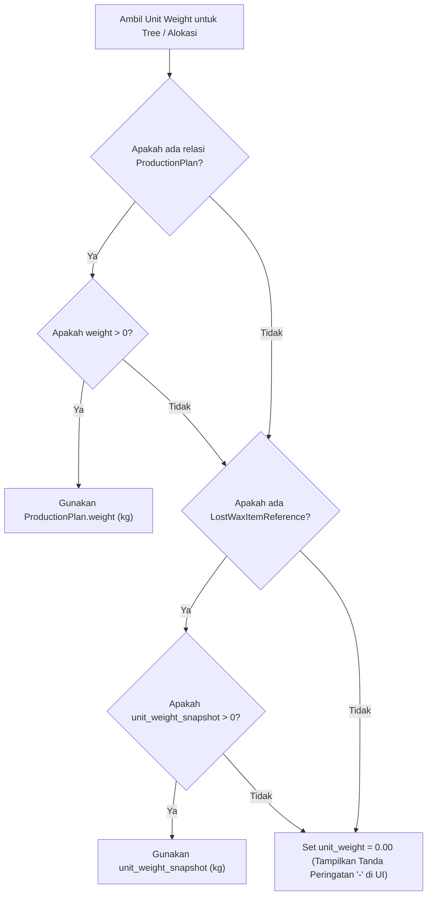
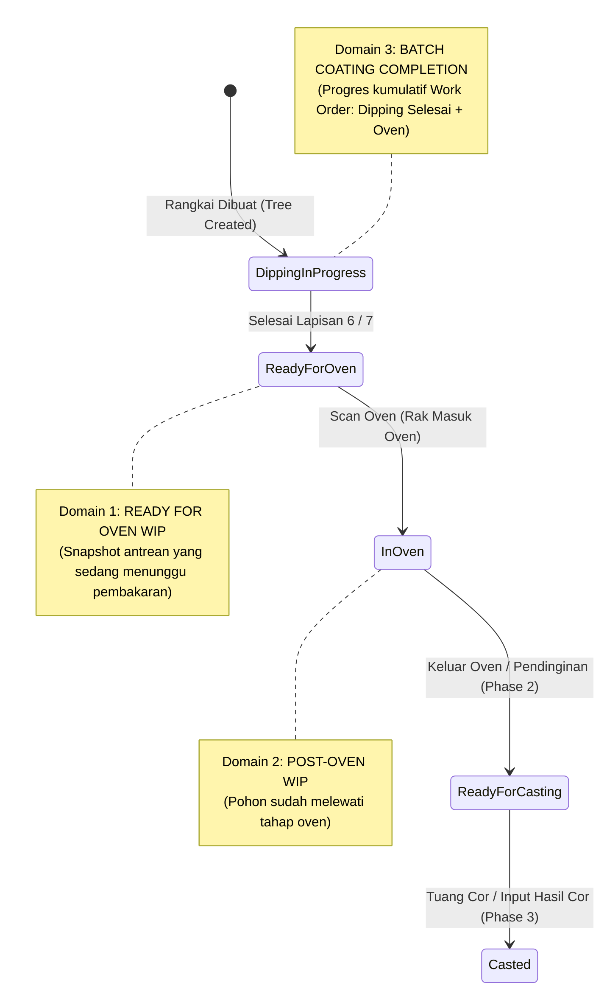
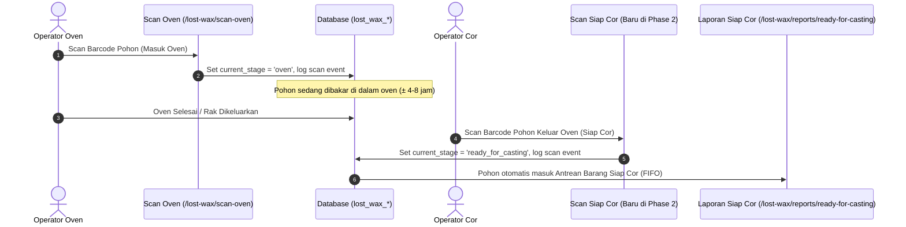
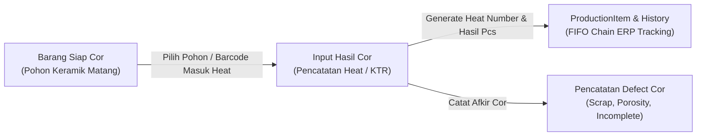

# AUDIT TEKNIS & ANALISIS KESIAPAN MODUL LOST WAX
## Phase 1 — Penyempurnaan Laporan Barang Siap Oven Menuju Phase 2 & Phase 3

**Repository:** `C:\laragon\www\kanban-ppic`  
**Tanggal Audit:** 10 November 2026  
**Mode Audit:** STRICT READ-ONLY AUDIT  
**Status Audit:** COMPLETED  
**Ruang Lingkup:** Evaluasi arsitektur dan kesiapan teknis modul Lost Wax dari alur Perintah Rangkai, Dipping/Coating, Antrean Barang Siap Oven (`/lost-wax/reports/ready-for-oven`), Scan Oven (`/lost-wax/scan-oven`), mekanisme Void, kalkulasi PCS & KG, FIFO, Coating Completion, serta kesiapan transisi menuju Phase 2 (Scan Siap Cor / Barang Siap Cor) dan Phase 3 (Input Hasil Cor).

---

## DAFTAR ISI

1. [Executive Summary](#1-executive-summary)
2. [Peta Arsitektur Lost Wax Saat Ini](#2-peta-arsitektur-lost-wax-saat-ini)
3. [Alur Aktual Work Order Sampai Scan Siap Oven](#3-alur-aktual-work-order-sampai-scan-siap-oven)
4. [Analisis Data Model dan Relasi](#4-analisis-data-model-dan-relasi)
5. [Analisis Perhitungan PCS, Defect, dan KG](#5-analisis-perhitungan-pcs-defect-dan-kg)
6. [Analisis FIFO (First-In, First-Out)](#6-analisis-fifo-first-in-first-out)
7. [Analisis Perhitungan Coating Completion](#7-analisis-perhitungan-coating-completion)
8. [Gap Antara Implementasi Saat Ini dan Kebutuhan Phase 1](#8-gap-antara-implementasi-saat-ini-dan-kebutuhan-phase-1)
9. [Kesiapan Teknis Menuju Phase 2 dan Phase 3](#9-kesiapan-teknis-menuju-phase-2-dan-phase-3)
10. [Analisis Risiko Teknis dan Risiko Integritas Data](#10-analisis-risiko-teknis-dan-risiko-integritas-data)
11. [Rekomendasi Implementasi Bertahap](#11-rekomendasi-implementasi-bertahap)
12. [Daftar File yang Perlu Disentuh pada Fase Implementasi Berikutnya](#12-daftar-file-yang-perlu-disentuh-pada-fase-implementasi-berikutnya)

---

## 1. EXECUTIVE SUMMARY

### 1.1 Tujuan Audit
Audit teknis ini dilakukan secara **read-only** untuk mengevaluasi kesiapan arsitektur sistem Kanban PPIC pada modul Lost Wax, dengan fokus utama pada:
1. Menilai akurasi dan ketahanan laporan **Barang Siap Oven** (`/lost-wax/reports/ready-for-oven`) sebagai filter antrean WIP sebelum proses pembakaran (Oven).
2. Memverifikasi logika FIFO, perhitungan kuantitas (PCS Bruto, Afkir/Defect, dan Layak Pakai), serta ketersediaan data berat (Kilogram / KG).
3. Mengkaji mekanisme *interlock* scan oven, pembatalan scan (*void*), dan dampaknya terhadap status tree.
4. Menilai kelayakan implementasi penyempurnaan **Phase 1 tanpa perubahan skema database (Zero-Migration)**.
5. Memetakan *gap* struktural yang harus diantisipasi untuk pengembangan **Phase 2 (Scan Siap Cor & Barang Siap Cor)** dan **Phase 3 (Input Hasil Cor / Heat Recording)**.

### 1.2 Status Kesiapan Teknis Saat Ini
- **Laporan Siap Oven (`ReadyForOvenService` & `ReadyForOvenController`):** Sudah berjalan secara fungsional dengan pengelompokan (*grouping*) cerdas berdasarkan `production_code|item_name|customer|finished_stage` dan pengurutan FIFO berbasis timestamp selesai lapisan terakhir. Sudah mendukung pohon tunggal (*single tree*) maupun pohon gabungan (*multi-allocation*).
- **Perhitungan Kuantitas (PCS):** Logika PCS Netto (`usable_quantity = quantity - total_defect_quantity`) telah teruji dan berjalan akurat. Pembagian proporsional (*prorating*) pada *multi-allocation* telah dilengkapi mekanisme proteksi *rounding variance*.
- **Data Berat (KG):** **BELUM DITAMPILKAN.** Saat ini baik `ReadyForOvenService`, view `index.blade.php`, maupun view cetak `print.blade.php` belum menghitung atau menampilkan metrik berat (KG), meskipun data referensi berat (`weight`) telah tersedia di model `ProductionPlan` dan `LostWaxItemReference`.
- **Scan Oven (`ScanService::processOvenScan`):** Berfungsi memvalidasi status tree dan memindahkan `current_stage` menjadi `'oven'`. Pohon yang di-scan otomatis langsung keluar dari laporan Barang Siap Oven. Terdapat *interlock* 20 menit untuk mencegah *double scan*.
- **Mekanisme Void (`ScanVoidService::void`):** Berjalan sangat aman dan reaktif. Pembatalan scan oven merekonstruksi state pohon ke event sukses terakhir (`layer_6` atau `layer_7`), sehingga pohon otomatis muncul kembali ke laporan Siap Oven dengan timestamp FIFO aslinya.
- **Temuan Kritis Validasi Oven:** Pada `ScanService.php` (baris 216–228), validasi scan oven hanya memeriksa `in_array($tree->current_stage, ['layer_6', 'layer_7'])` tanpa memverifikasi flag `$tree->require_layer_7`. Akibatnya, operator dapat secara fisik men-scan pohon yang membutuhkan Lapisan 7 pada saat masih di Lapisan 6.

### 1.3 Kesimpulan Kelayakan Phase 1 Tanpa Migration (Zero-Migration)
**KESIMPULAN: SANGAT LAYAK (100% FEASIBLE TANPA MIGRATION).**
Seluruh kebutuhan penyempurnaan Phase 1 (penambahan metrik KG, pemisahan kolom Gross vs Defect vs Usable PCS, indikator status batch/coating completion, dan pengetatan validasi interlock Scan Oven) dapat diwujudkan sepenuhnya melalui modifikasi layer Service, Controller, dan Blade View, tanpa memerlukan migrasi database baru (`Schema::table` / `create`).

---

## 2. PETA ARSITEKTUR LOST WAX SAAT INI

### 2.1 Diagram Aliran Data dan Relasi Entitas (Perintah Rangkai → Scan Oven)

```mermaid
flowchart TD
    subgraph Plan_and_Print["1. Rencana & Cetak Lilin"]
        PP["ProductionPlan<br/>(code, item_name, weight, customer)"]
        POL["LostWaxPrintOrderLine<br/>(qty_ordered, standard_tree_capacity)"]
        PP --> POL
    end

    subgraph Assembly_Flow["2. Perakitan Rangkai (Assembly)"]
        RWO["LostWaxRangkaiWorkOrder<br/>(rangkai_order_number, qty_trees_planned, require_layer_7)"]
        RE["LostWaxRangkaiExecution<br/>(trees_created, variance_qty, status)"]
        POL --> RWO
        RWO --> RE
    end

    subgraph Tree_Entities["3. Identitas Pohon (Tree Tracking)"]
        LWT["LostWaxTree<br/>(barcode, quantity, current_stage, require_layer_7)"]
        LWA["LostWaxTreeAllocation<br/>(allocated_qty, print_order_line_id)"]
        LWD["LostWaxTreeDefect<br/>(defect_qty, stage, reason)"]
        RE --> LWT
        POL -.->|Legacy Tree| LWT
        LWT --> LWA
        LWT --> LWD
        POL --> LWA
    end

    subgraph Dipping_Process["4. Pelapisan Keramik (Dipping Stages)"]
        SE_DIP["LostWaxScanEvent (Dipping)<br/>(stage: layer_1 s/d layer_7, scanned_at)"]
        LWT --> SE_DIP
    end

    subgraph Ready_Oven_Queue["5. Antrean Barang Siap Oven"]
        RO_SVC["ReadyForOvenService<br/>(Filters: finished layer_6/7, usable_qty > 0, not in oven)"]
        RO_VIEW["View: ready-for-oven.index & print<br/>(FIFO, Grouping, Summary Cards)"]
        LWT --> RO_SVC
        SE_DIP --> RO_SVC
        RO_SVC --> RO_VIEW
    end

    subgraph Oven_Processing["6. Proses Pembakaran (Oven)"]
        SCAN_OVEN["ScanController & ScanService<br/>(processOvenScan: updates tree stage to 'oven')"]
        SE_OVEN["LostWaxScanEvent (oven)<br/>(stage: 'oven', aging_minutes)"]
        SE_VOID["LostWaxScanEventVoid<br/>(ScanVoidService: rolls back stage to layer_6/7)"]
        RO_VIEW -.->|Fisik Rangkai Masuk Oven| SCAN_OVEN
        SCAN_OVEN --> SE_OVEN
        SE_OVEN -->|Updates current_stage='oven'| LWT
        SE_OVEN -.->|Jika Dibatalkan| SE_VOID
        SE_VOID -.->|Revert current_stage| LWT
    end

    classDef plan fill:#e0f2fe,stroke:#0369a1,stroke-width:1px;
    classDef tree fill:#fef3c7,stroke:#d97706,stroke-width:1px;
    classDef service fill:#dcfce7,stroke:#15803d,stroke-width:1px;
    classDef oven fill:#fee2e2,stroke:#b91c1c,stroke-width:1px;
    class PP,POL,RWO,RE classDef plan;
    class LWT,LWA,LWD classDef tree;
    class RO_SVC,RO_VIEW classDef service;
    class SCAN_OVEN,SE_OVEN,SE_VOID classDef oven;
```

### 2.2 Komponen dan Role yang Terlibat
1. **PPIC (Admin PPIC):**
   - Menerbitkan `LostWaxPrintOrder` dan `LostWaxRangkaiWorkOrder`.
   - Mengakses Laporan Barang Siap Oven (`/lost-wax/reports/ready-for-oven`).
   - Mencetak dokumen manifes fisik A4 (`/lost-wax/reports/ready-for-oven/print`).
   - Memiliki otorisasi untuk melakukan *Void* Scan Event (`ScanController::voidEvent`).
2. **Operator Rangkai (Assembly Operator):**
   - Mencatat eksekusi perakitan fisik (`LostWaxRangkaiExecution`), mencetak label barcode per pohon (`LostWaxTree`), dan mengalokasikan pola lilin (`LostWaxTreeAllocation`).
3. **Operator Dipping / Lapisan:**
   - Melakukan scan bertahap dari `layer_1` hingga `layer_6` (atau `layer_7`) melalui scanner dipping (`/lost-wax/scan`).
   - Mencatat afkir/defect yang terjadi selama dipping ke `lost_wax_tree_defects`.
4. **Operator Oven:**
   - Membaca dokumen cetak atau monitor antrean Barang Siap Oven.
   - Melakukan scan barcode rak/pohon saat dimasukkan ke dalam ruang oven pembakaran melalui scanner oven (`/lost-wax/scan-oven`).

---

## 3. ALUR AKTUAL WORK ORDER SAMPAI SCAN SIAP OVEN

### 3.1 Langkah demi Langkah Alur Aktual
1. **Pembuatan Work Order & Target:**
   - Dokumen `LostWaxPrintOrderLine` dibuat dari `ProductionPlan`.
   - Admin PPIC menerbitkan `LostWaxRangkaiWorkOrder` yang mendefinisikan target jumlah pohon (`qty_trees_planned`), kapasitas standar per pohon (`tree_capacity` atau `standard_capacity_guide`), dan parameter pelapisan khusus (`require_layer_7`).
2. **Pembuatan Pohon (Tree) & Barcode:**
   - Operator Rangkai mengeksekusi perakitan (`LostWaxRangkaiExecution`).
   - Sistem membangkitkan record `LostWaxTree` fisik dengan atribut barcode unik 11 karakter (contoh: `T2608100001`), kuantitas kotor (`quantity`), dan foreign key `rangkai_execution_id` (serta alokasi ledger `lost_wax_tree_allocations` jika multi-item).
3. **Pelapisan Bertahap (Dipping):**
   - Pohon digantung di rak pelapisan (`LostWaxCoatingRack`) dan dicelupkan ke dalam suspensi keramik.
   - Setiap lapisan di-scan melalui `/lost-wax/scan`. Sistem mencatat `LostWaxScanEvent` dengan validasi *aging interlock* (durasi pengeringan minimal antar lapisan, konfigurasi `config/lost_wax.php`).
   - Pada lapisan terakhir (`layer_6` atau `layer_7`), scan sukses memperbarui status pohon: `current_stage` menjadi `'layer_6'` atau `'layer_7'` dan `last_scan_at` diperbarui ke waktu scan terakhir.
4. **Masuk ke Antrean Barang Siap Oven:**
   - Tanpa perlu aksi manual tambahan, pohon yang telah tuntas di Lapisan 6 (atau Lapisan 7 jika diwajibkan) langsung memenuhi kriteria query `ReadyForOvenService::getQueueData()`.
   - Sistem mengelompokkan pohon-pohon yang sejenis dan menampilkan baris antrean terurut secara FIFO.
5. **Eksekusi Scan Oven:**
   - Operator memasukkan pohon/rak ke dalam tungku oven dan men-scan barcode pada halaman `/lost-wax/scan-oven`.
   - `ScanService::processOvenScan()` memvalidasi keberadaan pohon, mengecek duplikasi, mengecek minimum scan interval (20 menit), mencatat `LostWaxScanEvent` tahap `'oven'`, dan mengupdate `LostWaxTree::current_stage = 'oven'`.
   - Pohon seketika menghilang dari antrean Barang Siap Oven.
6. **Mekanisme Pembatalan (Void):**
   - Jika operator salah scan atau terjadi pembatalan pembakaran, Admin/PPIC dapat membatalkan event tersebut di riwayat scan.
   - `ScanVoidService::void()` membuat record pembatalan pada `lost_wax_scan_event_voids`, menonaktifkan event oven, dan mengembalikan `current_stage` pohon ke event sebelumnya (`layer_6` atau `layer_7`). Pohon langsung muncul kembali di laporan Siap Oven.

---

### 3.2 Jawaban Spesifik dan Pembuktian Kode atas 10 Pertanyaan Wajib

#### Pertanyaan 1: Bagaimana sistem menentukan suatu tree masuk ke Barang Siap Oven?
*Pembuktian Kode:* `app/Services/LostWax/ReadyForOvenService.php`, baris 21–132.  
Sistem menentukan tree masuk antrean melalui kriteria multi-tahap yang dievaluasi dalam loop:
1. Tree tidak dibatalkan: `where('status', '!=', 'cancelled')`.
2. Tree belum berada di tahap oven: `where('current_stage', '!=', 'oven')`.
3. Tree tidak memiliki scan event sukses tahap oven yang aktif (tidak di-void):  
   `whereDoesntHave('scanEvents', fn($q) => $q->where('stage', 'oven')->where('result', 'success')->whereDoesntHave('void'))`.
4. Memenuhi syarat lapisan akhir sesuai flag `require_layer_7`:
   - Jika `$tree->require_layer_7 == true`: Tree harus memiliki `current_stage === 'layer_7'` dan memiliki event sukses non-void pada tahap `layer_7`.
   - Jika `$tree->require_layer_7 == false`: Tree harus memiliki `current_stage === 'layer_6'` dan memiliki event sukses non-void pada tahap `layer_6`.
5. Kuantitas layak pakai harus positif: `$tree->usable_quantity > 0` (pohon dengan afkir 100% otomatis diabaikan).

#### Pertanyaan 2: Bagaimana sistem menentukan jumlah PCS yang masih dapat digunakan?
*Pembuktian Kode:* `app/Models/LostWaxTree.php`, baris 100–103 & `app/Services/LostWax/ReadyForOvenService.php`, baris 180–190.
- **Tingkat Pohon Tunggal:** Dihitung melalui model accessor:
  ```php
  public function getUsableQuantityAttribute(): int
  {
      return max(0, $this->quantity - $this->total_defect_quantity);
  }
  ```
- **Tingkat Pohon Gabungan (Multi-Allocation):** Dilakukan prorata proporsional terhadap alokasi bruto (`allocated_qty`):
  ```php
  $ratio = $groupGrossQty / $totalAllocatedQty;
  $groupUsable = (int) round($treeUsableQty * $ratio);
  ```
  Pada kelompok alokasi terakhir pada pohon tersebut, sistem mengalokasikan sisa kuantitas (`$groupUsable = max(0, $treeUsableQty - $accumulatedUsable)`) guna memastikan tidak terjadi selisih pembulatan (*zero rounding variance*).

#### Pertanyaan 3: Apakah defect dari proses sebelumnya sudah dikurangi?
*Pembuktian Kode:* `app/Models/LostWaxTree.php`, baris 87–98 dan `app/Models/LostWaxTreeDefect.php`.  
**YA, SUDAH DIKURANGI SECARA TOTAL.**  
Model `LostWaxTree` mendefinisikan relasi `hasMany` ke `LostWaxTreeDefect`. Accessor `getTotalDefectQuantityAttribute()` menjumlahkan seluruh afkir (`defect_qty`) yang dicatat pada pohon tersebut dari seluruh tahapan sebelumnya (`assembly`, `layer_1` s/d `layer_7`, maupun penanganan fisik di rak). Nilai total afkir inilah yang langsung mengurangkan `quantity` kotor pohon.

#### Pertanyaan 4: Bagaimana sistem menentukan waktu FIFO?
*Pembuktian Kode:* `app/Services/LostWax/ReadyForOvenService.php`, baris 138, 254–262, dan 325–357.
- **Tingkat Anggota Rangkai (Member Level):** Waktu acuan adalah `$finalStageEvent->scanned_at`, yaitu timestamp persis saat operator men-scan lapisan terakhir (`layer_6` atau `layer_7`).
- **Tingkat Kelompok Barang (Group Level):** Ketika beberapa pohon digabungkan menjadi satu baris kelompok barang (`production_code|item_name|customer|finished_stage`), sistem mengekstrak timestamp selesai **paling awal** di antara anggota kelompok (`$earliestFinishedAt`).
- **Pengurutan Prioritas Antrean:**
  1. `finished_at ASC` (kelompok dengan waktu selesai lapisan paling lama/awal mendapat urutan teratas).
  2. `production_code ASC` (tie-breaker 1).
  3. `item_name ASC` (tie-breaker 2).
  4. `customer ASC` (tie-breaker 3).
  5. `first barcode ASC` (tie-breaker 4).

#### Pertanyaan 5: Apakah scan saat ini mengubah `current_stage` menjadi `oven`?
*Pembuktian Kode:* `app/Services/ScanService.php`, baris 262–265.  
**YA, BENAR.**  
Di dalam transaksi database `ScanService::processOvenScan()`, setelah record `LostWaxScanEvent` berhasil dibuat, sistem mengeksekusi:
```php
$tree->update([
    'current_stage' => 'oven',
    'last_scan_at' => $scannedAt,
]);
```

#### Pertanyaan 6: Secara implementasi, apakah `oven` berarti siap masuk oven atau sudah selesai diproses oven?
*Pembuktian Kode:* `resources/views/lost-wax/scan-oven/index.blade.php`, baris 8 & `config/lost_wax.php`, baris 22–31.  
- **Secara Operasional (UI Copy):** Berarti **sedang/siap masuk oven**. Teks instruksi pada scanner menyebutkan: *"Scan barcode Tree saat rak masuk Oven"*.
- **Secara Arsitektur Kode:** Status `'oven'` saat ini diperlakukan sebagai **tahap akhir (terminal stage)**. Di dalam `config/lost_wax.php`, array tahapan berakhir di `'oven'`. Belum ada tahapan downstream seperti `'oven_completed'`, `'siap_cor'`, atau `'cor'`. Pohon yang berstatus `'oven'` tidak memiliki tahapan berikutnya (`nextStage()` mengembalikan `null`).

#### Pertanyaan 7: Apakah tree langsung hilang dari laporan Barang Siap Oven setelah scan?
*Pembuktian Kode:* `app/Services/ReadyForOvenService.php`, baris 26 & 130–132.  
**YA, LANGSUNG HILANG SECARA OTOMATIS DAN REAL-TIME.**  
Query dasar `ReadyForOvenService` secara eksplisit memasukkan filter `where('current_stage', '!=', 'oven')` dan memeriksa event oven aktif via `whereDoesntHave('scanEvents', stage='oven', result='success')`. Begitu update baris 262 pada `ScanService` selesai di-commit, pohon tersebut tidak lagi lolos filter query Siap Oven.

#### Pertanyaan 8: Bagaimana mekanisme void mengembalikan tree ke tahap sebelumnya?
*Pembuktian Kode:* `app/Services/ScanVoidService.php`, baris 56–81.
1. Service memvalidasi bahwa event yang akan di-void adalah event sukses terakhir pada pohon terkait.
2. Dibuat record pencatatan pembatalan pada tabel `lost_wax_scan_event_voids` yang terikat dengan `scan_event_id`.
3. Service mencari kembali scan event sukses terbaru yang **tidak memiliki relasi void**:
   ```php
   $newLatestEvent = LostWaxScanEvent::where('tree_id', $tree->id)
       ->where('result', 'success')
       ->whereDoesntHave('void')
       ->orderBy('scanned_at', 'desc')
       ->orderBy('id', 'desc')
       ->first();
   ```
4. Jika event oven di-void, maka `$newLatestEvent` otomatis menunjuk ke scan event lapisan terakhir (`layer_6` atau `layer_7`).
5. Pohon diupdate kembali: `current_stage = $newLatestEvent->stage` dan `last_scan_at = $newLatestEvent->scanned_at`.
6. Pohon seketika memenuhi kembali syarat `ReadyForOvenService` dan muncul kembali di antrean dengan timestamp lapisan awal tanpa kehilangan riwayat audit.

#### Pertanyaan 9: Apakah satu Work Order dapat menghasilkan beberapa tree?
*Pembuktian Kode:* `app/Models/LostWaxRangkaiWorkOrder.php`, baris 50–53 & `app/Models/LostWaxRangkaiExecution.php`, baris 62–65.  
**YA, SATU WORK ORDER DAPAT MENGHASILKAN BANYAK TREE.**  
Satu `LostWaxRangkaiWorkOrder` biasanya menargetkan pesanan ratusan hingga ribuan pcs lilin (misal 500 pcs). Sesuai kapasitas standar rak/pohon (misal 50 pcs/pohon), operator membuat 10 entitas fisik `LostWaxTree` yang masing-masing memiliki barcode unik, label rak tersendiri, dan jumlah pcs tersendiri.

#### Pertanyaan 10: Apakah relasi Work Order dan tree cukup kuat untuk menghitung progres coating secara akurat?
*Pembuktian Kode:* `app/Models/LostWaxTree.php` (relasi `rangkaiExecution.workOrder` dan `printOrderLine`).  
**YA, SANGAT KUAT, DENGAN SATU CATATAN ARSITEKTURAL UTAMA:**  
Relasi data model sangat solid untuk menghitung progres coating Work Order, **asalkan perhitungannya tidak mengambil data dari `ReadyForOvenService`**.
- *Alasannya:* Laporan `ReadyForOvenService` hanya berisi snapshot pohon yang saat ini sedang menunggu di antrean Siap Oven (berada di `layer_6` atau `layer_7`). Pohon yang sudah di-scan masuk ke dalam Oven telah dikeluarkan dari antrean Siap Oven.
- Jika progress dihitung dari antrean Siap Oven, maka persentase penyelesaian Work Order justru akan turun drastis (menjadi 0%) saat seluruh pohon masuk ke Oven!
- Oleh karena itu, perhitungan **Coating Completion** harus mengagregasi seluruh pohon anak dari Work Order/Print Order Line tersebut di seluruh siklus hidupnya:
  $$\text{Pohon Selesai Coating} = \text{Tree dengan } current\_stage \in ['layer\_6', 'layer\_7', 'oven']$$
  $$\text{Total Pohon Rangkai} = \text{Tree aktif dengan } status \neq 'cancelled'$$

---

## 4. ANALISIS DATA MODEL DAN RELASI

### 4.1 Tabel dan Relasi Inti

| Model Eloquent | Tabel Database | Primary Key | Foreign Key Penting | Relasi ke Model Lain | Catatan Integritas |
| :--- | :--- | :--- | :--- | :--- | :--- |
| `ProductionPlan` | `production_plans` | `id` | - | `hasMany(LostWaxPrintOrderLine)` | Memuat kolom `code`, `item_name`, `customer`, dan `weight` (decimal:2). |
| `LostWaxPrintOrderLine` | `lost_wax_print_order_lines` | `id` | `production_plan_id`<br/>`lost_wax_print_order_id` | `belongsTo(ProductionPlan)`<br/>`hasMany(LostWaxTree)`<br/>`hasMany(LostWaxTreeAllocation)`<br/>`hasMany(LostWaxRangkaiWorkOrder)` | Jembatan antara rencana PPIC dan eksekusi lantai pabrik. |
| `LostWaxRangkaiWorkOrder` | `lost_wax_rangkai_work_orders` | `id` | `lost_wax_print_order_line_id` | `belongsTo(LostWaxPrintOrderLine)`<br/>`hasMany(LostWaxRangkaiExecution)` | Menyimpan parameter teknis `require_layer_7` dan target pohon. |
| `LostWaxRangkaiExecution` | `lost_wax_rangkai_executions` | `id` | `rangkai_work_order_id`<br/>`recorded_by` | `belongsTo(LostWaxRangkaiWorkOrder)`<br/>`hasMany(LostWaxTree)` | Mencatat sesi perakitan fisik pohon. |
| `LostWaxTree` | `lost_wax_trees` | `id` | `rangkai_execution_id`<br/>`lost_wax_print_order_line_id`<br/>`rack_id` | `belongsTo(LostWaxRangkaiExecution)`<br/>`belongsTo(LostWaxPrintOrderLine)`<br/>`hasMany(LostWaxScanEvent)`<br/>`hasMany(LostWaxTreeAllocation)`<br/>`hasMany(LostWaxTreeDefect)` | Entitas fisik pohon lilin. Membawa status `current_stage`, barcode fisik, dan kuantitas kotor. |
| `LostWaxTreeAllocation` | `lost_wax_tree_allocations` | `id` | `lost_wax_tree_id`<br/>`lost_wax_print_order_line_id` | `belongsTo(LostWaxTree)`<br/>`belongsTo(LostWaxPrintOrderLine)` | Ledger alokasi kuantitas jika satu pohon fisik memuat lebih dari satu item/kode pesanan. |
| `LostWaxTreeDefect` | `lost_wax_tree_defects` | `id` | `lost_wax_tree_id`<br/>`recorded_by` | `belongsTo(LostWaxTree)` | Ledger pencatatan afkir pada setiap tahap produksi. |
| `LostWaxScanEvent` | `lost_wax_scan_events` | `id` | `tree_id`<br/>`operator_id` | `belongsTo(LostWaxTree)`<br/>`hasOne(LostWaxScanEventVoid)` | Log historis seluruh event pemindaian barcode. |
| `LostWaxScanEventVoid` | `lost_wax_scan_event_voids` | `id` | `scan_event_id`<br/>`voided_by` | `belongsTo(LostWaxScanEvent)` | Bukti pembatalan scan event (1-to-1 dengan event). |
| `LostWaxItemReference` | `lost_wax_item_references` | `id` | - | Relasi legacy untuk Work Order lama | Menyimpan `unit_weight_snapshot` (decimal:3) untuk backward compatibility. |

### 4.2 Evaluasi Integritas Foreign Key dan Constraint
- **Cascading & Restrict:**
  - `lost_wax_trees` memiliki foreign key cascade pada `lost_wax_tree_defects` dan `lost_wax_tree_allocations`. Jika pohon dibatalkan/dihapus, seluruh relasi ledger ikut terhapus secara konsisten.
  - `lost_wax_scan_event_voids` menggunakan `cascadeOnDelete()` ke `lost_wax_scan_events` dengan constraint `unique(['scan_event_id'])`, menjamin satu event scan hanya dapat di-void maksimal satu kali.
- **Ketersediaan Jalur Data Berat (KG):**
  - Jalur Modern: `LostWaxTree` → `LostWaxPrintOrderLine` → `ProductionPlan::weight`.
  - Jalur Multi-Allocation: `LostWaxTree` → `LostWaxTreeAllocation` → `LostWaxPrintOrderLine` → `ProductionPlan::weight`.
  - Jalur Legacy: `LostWaxTree` → `LostWaxWorkOrder` → `LostWaxItemReference::unit_weight_snapshot`.

---

## 5. ANALISIS PERHITUNGAN PCS, DEFECT, DAN KG

### 5.1 Perhitungan Kuantitas PCS dan Pengurangan Defect

1. **Kuantitas Bruto ($Q_{\text{gross}}$):**
   Diambil dari kolom integer `lost_wax_trees.quantity`. Merupakan jumlah pola lilin yang terpasang saat pohon selesai dirangkai.
2. **Kuantitas Afkir / Defect ($Q_{\text{defect}}$):**
   Diakumulasikan dari relasi `lost_wax_tree_defects`:
   $$Q_{\text{defect}} = \sum \text{defect\_qty}$$
   Defect dicatat secara spesifik per tahapan (`assembly`, `layer_1`, ..., `layer_7`, atau `oven`).
3. **Kuantitas Netto Layak Pakai ($Q_{\text{usable}}$):**
   Dihitung secara defensif agar tidak menghasilkan nilai negatif:
   $$Q_{\text{usable}} = \max(0, Q_{\text{gross}} - Q_{\text{defect}})$$
   Jika sebuah pohon mengalami afkir total ($Q_{\text{defect}} \ge Q_{\text{gross}}$), maka $Q_{\text{usable}} = 0$ dan pohon otomatis dieleminasi dari antrean Siap Oven.

### 5.2 Logika Multi-Allocation Prorating
Jika satu pohon fisik memuat beberapa item pesanan yang berbeda (`LostWaxTreeAllocation`), afkir yang terjadi pada pohon tersebut diproporsikan secara adil berdasarkan rasio kuantitas kotor masing-masing alokasi:
$$\text{Rasio Alokasi}_i = \frac{Q_{\text{gross}, i}}{\sum Q_{\text{gross}}}$$
$$Q_{\text{usable}, i} = \text{round}(Q_{\text{usable, tree}} \times \text{Rasio Alokasi}_i)$$
Untuk mencegah akumulasi selisih pembulatan (*rounding variance*), alokasi kelompok terakhir mengambil sisa pasti:
$$Q_{\text{usable, last}} = \max\left(0, Q_{\text{usable, tree}} - \sum_{i=1}^{n-1} Q_{\text{usable}, i}\right)$$

### 5.3 Perhitungan Konversi Berat (Kilogram / KG)
Saat ini laporan Siap Oven belum menampilkan berat. Untuk kebutuhan Phase 1, hierarki resolusi berat per unit ($W_{\text{unit}}$) dirancang sebagai berikut:



**Rumus Perhitungan KG:**
- **Per Kelompok / Baris Tabel:**
  $$W_{\text{group}} (\text{kg}) = Q_{\text{usable, group}} \times W_{\text{unit}}$$
- **Total Antrean Siap Oven (Summary Card):**
  $$W_{\text{total}} (\text{kg}) = \sum W_{\text{group}}$$
- **Penanganan Nilai Nol / Kosong:** Jika berat belum diisi di master data ($W_{\text{unit}} = 0$ atau `null`), sistem tetap menghitung PCS tanpa error, dan pada kolom berat ditampilkan tanda strip (`-`) dengan *tooltip* informasi agar tidak menyesatkan PPIC.

---

## 6. ANALISIS FIFO (FIRST-IN, FIRST-OUT)

### 6.1 Sumber Waktu dan Granularitas FIFO
- **Sumber Data Waktu:** Timestamp `scanned_at` dari event sukses pemindaian lapisan terakhir (`layer_6` atau `layer_7`) pada tabel `lost_wax_scan_events`.
- **Ketertelusuran Barcode:** Setiap anggota kelompok mempertahankan timestamp aslinya sendiri (`finished_at`), yang ditampilkan pada *tooltip* badge barcode di antrean.

### 6.2 Logika Pengurutan Kelompok Barang (Group Sorting)
Pada `ReadyForOvenService.php` (baris 325–357), pengurutan baris kelompok antrean dijalankan dengan aturan berjenjang yang sangat ketat:
1. **Prioritas 1 (Waktu Selesai Terawal):**
   ```php
   $timeA = $a['finished_at']->timestamp;
   $timeB = $b['finished_at']->timestamp;
   if ($timeA !== $timeB) {
       return $timeA <=> $timeB;
   }
   ```
   Kelompok yang anggotanya selesai proses pelapisan lebih dahulu selalu berada di urutan paling atas.
2. **Prioritas 2 (Kode Produksi):** `strcmp($a['production_code'], $b['production_code'])`.
3. **Prioritas 3 (Nama Item):** `strcmp($a['item_name'], $b['item_name'])`.
4. **Prioritas 4 (Customer):** `strcmp($a['customer'], $b['customer'])`.
5. **Prioritas 5 (Barcode Anggota Pertama):** Menghilangkan keacakan jika seluruh atribut di atas identik.

### 6.3 Analisis Edge Cases FIFO
1. **Timestamp Identik:** Ditangani tuntas oleh tie-breaker bertingkat (Kode Produksi → Item → Customer → Barcode).
2. **Kelompok Campuran Waktu (*Mixed Times*):** Jika dalam 1 kelompok barang terdapat beberapa pohon yang selesai pada jam berbeda (misal pohon 1 selesai 08:00, pohon 2 selesai 10:30), sistem mengambil waktu **terawal** (`08:00`) sebagai penentu posisi antrean, dan menampilkan label *"s/d 10:30"* di kolom waktu. Hal ini menjamin pohon tertua tidak tertahan di gudang.
3. **Pohon yang Di-Void:** Jika sebuah pohon dibatalkan dari oven, pohon tersebut kembali ke antrean dengan menggunakan timestamp scan dipping aslinya, bukan timestamp saat tombol void ditekan. Hal ini mempertahankan hak prioritas antrean pohon tersebut secara adil.

---

## 7. ANALISIS PERHITUNGAN COATING COMPLETION

### 7.1 Pemisahan Fundamental Tiga Domain Status
Salah satu temuan konseptual terpenting dalam audit ini adalah perlunya membedakan secara tegas tiga domain metrik yang kerap tercampur:



1. **Domain 1 — Antrean Barang Siap Oven (Ready for Oven WIP):**
   - Mengukur pohon yang **secara fisik saat ini berada di ruang tunggu oven**.
   - Syarat: `current_stage IN ('layer_6', 'layer_7')` dan belum di-scan oven.
   - Sifat: Nilainya berkurang ketika pohon di-scan masuk oven.
2. **Domain 2 — WIP Pasca Oven (Post-Oven WIP):**
   - Mengukur pohon yang telah di-scan oven dan sedang dibakar atau menunggu proses cor.
   - Syarat: `current_stage == 'oven'`.
3. **Domain 3 — Tingkat Penyelesaian Pelapisan Batch (Batch Coating Completion):**
   - Mengukur apakah seluruh pohon lilin dari suatu Work Order / Kode Rencana telah menyelesaikan seluruh lapisan pelindung keramik.
   - Sifat: **Kumulatif satu arah**. Nilainya **TIDAK BOLEH BERKURANG** saat pohon masuk oven.

### 7.2 Rumus Perhitungan Coating Completion Work Order yang Tepat
Untuk menampilkan status apakah suatu kelompok barang di laporan Siap Oven merupakan pesanan yang pelapisannya sudah komplit (*Full Batch Ready*) atau masih ada pohon saudara yang masih di ruang dipping (*Partial Batch*), perhitungannya harus mengacu pada relasi Work Order induk:

$$\text{Total Pohon Terbit} = N_{\text{total}} = \text{Count}(\text{Tree aktif milik WO})$$
$$\text{Pohon Selesai Lapisan} = N_{\text{coated}} = \text{Count}(\text{Tree milik WO dengan } current\_stage \in ['layer\_6', 'layer\_7', 'oven'])$$
$$\text{Coating Progress (\%)} = \frac{N_{\text{coated}}}{N_{\text{total}}} \times 100\%$$

**Status Klasifikasi Batch:**
- **`FULL BATCH READY` (100%):** Seluruh pohon dari Work Order terkait telah menyelesaikan lapisan.
- **`PARTIAL BATCH` (< 100%):** Sebagian pohon telah siap oven, namun sebagian pohon lain masih dalam proses pengeringan/pelapisan sebelumnya.

---

## 8. GAP ANTARA IMPLEMENTASI SAAT INI DAN KEBUTUHAN PHASE 1

Tabel berikut membedah secara rinci jurang pemisah (*gap*) antara kondisi sistem eksisting dan target penyempurnaan Phase 1:

| No | Aspek / Fitur | Kondisi Eksisting (Source Code Reference) | Kondisi Ideal Phase 1 | Dampak Operasional Saat Ini | Solusi Minimal (Zero-Migration) |
| :-: | :--- | :--- | :--- | :--- | :--- |
| **1** | **Informasi Berat (KG)** | Belum ada perhitungan atau tampilan KG di `ReadyForOvenService.php`, `index.blade.php`, maupun `print.blade.php`. | Menampilkan Total KG pada KPI Card dan kolom Berat (kg) pada setiap baris kelompok barang. | PPIC dan operator oven tidak mengetahui tonase/beban muat ruang bakar oven. | Ambil `weight` dari relasi `ProductionPlan` (fallback `LostWaxItemReference`). Kalikan dengan `usable_pcs`. |
| **2** | **Rincian Kuantitas PCS di Tabel** | Tabel utama hanya menampilkan satu kolom "Jumlah Pcs" (layak pakai). Kuantitas Bruto dan Afkir hanya ada di KPI Card (`index.blade.php`, baris 170–178). | Menampilkan rincian kuantitas: Gross PCS, Afkir PCS, dan Usable PCS secara transparan pada kolom tabel. | Operator tidak dapat melihat langsung di tabel berapa pcs pola yang rusak sebelum masuk oven. | Tambahkan sub-kolom atau baris rincian pada tabel `index.blade.php` dan `print.blade.php`. |
| **3** | **Indikator Kelengkapan Batch (Coating Completion)** | Laporan tidak menampilkan informasi apakah baris antrean tersebut merupakan batch penuh atau parsial. | Menampilkan badge status: `LENGKAP` (Full Batch) vs `PARSIAL (x/y Pohon)` berdasarkan progres Work Order. | Operator oven ragu apakah harus menunggu sisa pohon satu cetakan atau membakar pohon yang ada lebih dulu. | Tambahkan *lookup* agregasi pohon per `lost_wax_print_order_line_id` di `ReadyForOvenService`. |
| **4** | **Celah Validasi Scan Oven (Layer 7 Bypass)** | `ScanService::processOvenScan()` (baris 216–228) meloloskan `layer_6` tanpa mengecek `$tree->require_layer_7`. | Scan Oven menolak pohon yang memiliki flag `require_layer_7 == true` jika masih berada di `layer_6`. | Potensi kegagalan cor fatal: cetakan yang mewajibkan 7 lapis keramik terbakar prematur di lapisan 6 karena salah scan. | Tambahkan pengecekan `$tree->require_layer_7` pada `ScanService::processOvenScan()`. |
| **5** | **Manifes Cetak A4 (`print.blade.php`)** | Format cetak A4 belum memuat kolom KG dan tanda tangan serah terima antara Operator Dipping dan Operator Oven. | Dokumen cetak A4 dilengkapi kolom KG, total tonase, dan lembar serah terima fisik (Dipping → Oven). | Tidak ada bukti serah terima fisik tertulis saat rak diserahkan ke bagian pembakaran oven. | Update layout HTML/CSS cetak di `resources/views/lost-wax/reports/ready-for-oven/print.blade.php`. |

---

## 9. KESIAPAN TEKNIS MENUJU PHASE 2 DAN PHASE 3

### 9.1 Phase 2: Scan Siap Cor & Laporan Barang Siap Cor



**Kebutuhan Teknis Phase 2:**
1. **Konfigurasi Stages (`config/lost_wax.php`):**
   Menambahkan tahapan downstream:
   ```php
   'stages' => [
       // ... layer_1 s/d layer_7 ...
       'oven' => 'Oven',
       'ready_for_casting' => 'Siap Cor',
   ],
   ```
2. **Scanner Baru (`/lost-wax/scan-cor` atau Scan Keluar Oven):**
   - Menggunakan basis arsitektur `ScanController` yang ada.
   - *Interlock Validasi:* Hanya pohon dengan `current_stage === 'oven'` dan durasi pembakaran oven minimal yang diizinkan untuk di-scan menjadi Siap Cor.
3. **Laporan Barang Siap Cor (`ReadyForCastingService` & View):**
   - Mengadopsi arsitektur `ReadyForOvenService`.
   - Mengelompokkan pohon berdasarkan `production_code|item_name|customer|material_aisi`.
   - Menampilkan total PCS, afkir pecah oven, dan total berat bersih (KG) logam cair yang dibutuhkan.

### 9.2 Phase 3: Input Hasil Cor (Pouring / Heat Recording)



**Kebutuhan Teknis Phase 3:**
1. **Penyelarasan dengan Domain Sand Casting:**
   - Sand Casting menggunakan konsep `ProductionPlan`, `CastingOrder` (PCOR), dan `ProductionFloorScanController` untuk memasukkan hasil cor ke dalam tabel `production_items` dan `production_histories`.
   - Pada Lost Wax Phase 3, pencatatan hasil cor harus menghasilkan baris `production_items` dengan `current_dept = 'cor'` (atau `'netto'`) agar terhubung secara mulus dengan modul lanjutan (bubut, bor, finish, QC) yang sudah berjalan di sistem utama.
2. **Aturan Over-Plan & Kuota Cor:**
   - Mengadopsi aturan kuota yang telah diaudit pada Sand Casting: pohon yang telah dicor tidak boleh di-scan ulang, dan kuantitas hasil cor harus memvalidasi toleransi over-plan yang diizinkan PPIC.

---

## 10. ANALISIS RISIKO TEKNIS DAN RISIKO INTEGRITAS DATA

### 10.1 Risiko Multi-Allocation Rounding Variance
- **Kondisi:** Pada pohon gabungan yang memiliki afkir ganjil (misal afkir 3 pcs pada 2 item dengan rasio 50:50).
- **Temuan Saat Ini:** `ReadyForOvenService` baris 183–185 sudah menerapkan teknik `max(0, $treeUsableQty - $accumulatedUsable)` pada grup terakhir.
- **Tingkat Risiko:** **RENDAH (Sudah Terproteksi).** Namun, penambahan kalkulasi KG harus memastikan total KG antar-alokasi juga tidak mengalami variansi desimal saat dijumlahkan kembali.

### 10.2 Risiko Premature Oven Scanning (Bypass Lapisan 7)
- **Kondisi:** Pohon dengan `require_layer_7 = true` di-scan pada saat masih berada di `layer_6`.
- **Temuan Saat Ini:** Validasi `ScanService::processOvenScan()` (baris 216–228) memiliki celah keamanan karena mengizinkan `in_array($tree->current_stage, ['layer_6', 'layer_7'])` tanpa mengevaluasi flag `require_layer_7`.
- **Tingkat Risiko:** **TINGGI (Critical Process Integrity Risk).**
- **Mitigasi:** Wajib diperbaiki saat implementasi perbaikan kode Phase 1.

### 10.3 Risiko Pembatalan (Void) dan Inkonsistensi State
- **Kondisi:** Operator melakukan void terhadap event oven setelah pohon tersebut secara fisik sudah hancur/terbakar di lapangan.
- **Temuan Saat Ini:** `ScanVoidService` secara struktural sangat aman (menggunakan pessimistic locking `lockForUpdate()`, validasi status terakhir, dan logging identitas user).
- **Tingkat Risiko:** **SEDANG (Risiko Prosedural Operasional).** Diperlukan pembatasan hak akses void hanya untuk Supervisor / PPIC dengan alasan void wajib diisi.

### 10.4 Risiko Inkonsistensi Master Berat (Zero Weight Plan)
- **Kondisi:** Rencana produksi dibuat tanpa memasukkan data berat satuan (`weight = null` atau `0.00`).
- **Temuan Saat Ini:** Modul sand casting memiliki banyak data dengan berat terisi, namun pada Lost Wax beberapa item baru berpotensi belum memiliki berat satuan.
- **Tingkat Risiko:** **SEDANG.**
- **Mitigasi:** Service harus menangani nilai `null` secara *graceful* tanpa melempar fatal error pembagian nol (`DivisionByZeroError`) atau string formatting error, serta memberikan indikator visual jelas kepada PPIC untuk memperbarui master data.

---

## 11. REKOMENDASI IMPLEMENTASI BERTAHAP

### Phase 1 — Penyempurnaan Laporan Barang Siap Oven (Zero-Migration)
**Target:** Menyempurnakan visibilitas, transparansi kuantitas, estimasi berat, dan proteksi interlock tanpa menyentuh struktur tabel database.
1. **Perbaikan Interlock Scan Oven (`ScanService.php`):**
   - Tambahkan validasi ketat: Jika `$tree->require_layer_7 == true` dan `$tree->current_stage !== 'layer_7'`, tolak scan dengan pesan: *"Tree mewajibkan Lapisan 7. Saat ini tree baru menyelesaikan Lapisan 6."*
2. **Penambahan Metrik KG (`ReadyForOvenService.php`):**
   - Eager-load relasi `productionPlan` pada `printOrderLine` dan `allocations.printOrderLine`.
   - Hitung `weight_unit` (kg/pc), `weight_group` (kg), dan `total_weight_kg` pada ringkasan.
3. **Penyempurnaan Tampilan UI & Cetak (`index.blade.php` & `print.blade.php`):**
   - Tambahkan KPI Card "Total Berat Siap Oven (kg)".
   - Tambahkan kolom Berat (kg) pada tabel antrean.
   - Pisahkan visualisasi kuantitas: Gross | Afkir | Layak Pakai.
   - Tambahkan penanda status batch (Full Batch vs Partial Batch).

### Phase 2 — Transisi Oven ke Siap Cor (Minor Migration / Config Update)
**Target:** Memisahkan pohon yang sedang dibakar dengan pohon yang sudah matang dan siap dituangkan logam cair.
1. Tambahkan stage `'ready_for_casting'` ke `config/lost_wax.php`.
2. Buat antarmuka scanner pemindaian keluar oven (`/lost-wax/scan-cor`).
3. Buat service dan tampilan laporan **Barang Siap Cor** (`/lost-wax/reports/ready-for-casting`).

### Phase 3 — Input Hasil Cor & Integrasi ERP Tracking (Full Integration)
**Target:** Integrasi pencatatan heat cor Lost Wax ke dalam alur utama tracking pabrik (`production_items`).
1. Buat form Input Hasil Cor Lost Wax (pencatatan heat number, material aisi, good pcs, defect cor).
2. Potong WIP Barang Siap Cor dan terbitkan kartu pelacak (*production traveler*) ke departemen berikutnya (Finishing / Machining).

---

## 12. DAFTAR FILE YANG PERLU DISENTUH PADA FASE IMPLEMENTASI BERIKUTNYA

Berikut adalah matriks komprehensif file yang akan disentuh saat fase implementasi berikutnya diizinkan:

| Path File | Tipe / Komponen | Method / Bagian | Deskripsi Perubahan yang Direkomendasikan | Kompleksitas |
| :--- | :--- | :--- | :--- | :---: |
| `app/Services/ScanService.php` | Backend Service | `processOvenScan()` (baris 216–228) | Tambahkan validasi penolakan jika `$tree->require_layer_7` bernilai true namun `$tree->current_stage` bukan `'layer_7'`. | Rendah |
| `app/Services/LostWax/ReadyForOvenService.php` | Domain Service | `getQueueData()` (baris 170–210 & 280–385) | 1. Ambil data berat satuan dari `ProductionPlan::weight` (fallback `LostWaxItemReference`).<br/>2. Hitung `weight_kg` per alokasi/grup dan `total_usable_weight_kg` pada summary.<br/>3. Hitung persentase kelengkapan batch coating per Work Order. | Menengah |
| `resources/views/lost-wax/reports/ready-for-oven/index.blade.php` | Blade View UI | KPI Cards & Table Headers/Body (baris 23–56 & 96–190) | 1. Tambahkan KPI Card Total Berat Siap Oven (kg).<br/>2. Tambahkan kolom Berat (kg) di tabel.<br/>3. Tampilkan kolom terpisah untuk Qty Bruto, Afkir, dan Layak Pakai.<br/>4. Tampilkan badge status batch (Lengkap / Parsial). | Menengah |
| `resources/views/lost-wax/reports/ready-for-oven/print.blade.php` | Print Blade View | Document Header, Table & Signatures (baris 100–350) | 1. Tambahkan kolom Berat (kg) pada layout cetak A4.<br/>2. Tambahkan ringkasan total berat (kg) untuk manifes oven.<br/>3. Tambahkan kolom tanda tangan serah terima fisik (Operator Lapisan → Operator Oven). | Menengah |
| `tests/Feature/LostWax/ReadyForOvenReportTest.php` | Feature Test | Test Cases Tambahan | Buat automated test untuk menguji akurasi perhitungan KG, handling berat nol/null, pemisahan gross/defect/usable, dan badge status batch. | Menengah |
| `tests/Feature/LostWax/ScanOvenTest.php` | Feature Test | Test Cases Tambahan | Tambahkan assertion untuk memvalidasi penolakan scan oven pada pohon Lapisan 6 yang mewajibkan Lapisan 7. | Rendah |

---

> **Laporan audit ini disusun secara independen dan objektif berdasarkan inspeksi langsung terhadap baris kode aktual pada repositori `kanban-ppic`. Seluruh temuan siap dijadikan landasan kerja untuk fase implementasi berikutnya setelah disetujui.**

