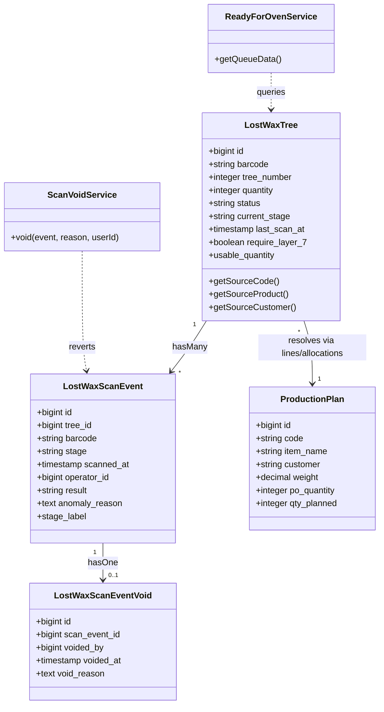
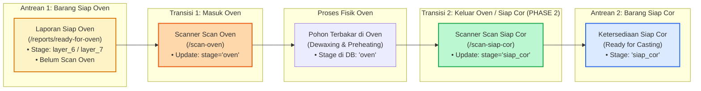

# AUDIT TEKNIS READ-ONLY — RANCANGAN SCAN SIAP COR (PHASE 2) LOST WAX

**Repository:** `C:\laragon\www\kanban-ppic`  
**Proyek:** Kanban PPIC — Lost Wax Phase 2  
**Halaman yang Dirancang:** `/lost-wax/scan-siap-cor`  
**Mode:** STRICT READ-ONLY AUDIT & TECHNICAL DESIGN  
**Tanggal:** 10 November 2026  

---

## 1. Executive Summary

Audit teknis ini menganalisis secara komprehensif rancangan arsitektur, data flow, proteksi konkurensi, dan antarmuka untuk fitur baru **Scan Siap Cor** pada lini produksi Lost Wax di repositori lokal `C:\laragon\www\kanban-ppic`.

### A. Inti Proses Bisnis Baru
1. Traveler Card (Pohon Rangkai / `LostWaxTree`) telah menyelesaikan seluruh lapisan (*dipping* Layer 6 atau 7).
2. Pohon masuk ke antrean *Ready for Oven* (`/lost-wax/reports/ready-for-oven`).
3. Operator oven melakukan pemindaian barcode pohon saat rak dimasukkan ke Oven (`/lost-wax/scan-oven`), mencatat event `oven`, dan memindahkan pohon dari antrean Siap Oven ke proses Oven fisik (`current_stage = 'oven'`).
4. Barang menjalani proses pembakaran keramik / *dewaxing* dan *preheating* di oven secara fisik.
5. **Setelah proses oven benar-benar selesai secara fisik**, operator penuangan/cor melakukan pemindaian barcode Traveler Card satu per satu di menu baru **Scan Siap Cor**.
6. Pemindaian ini memvalidasi kelayakan pohon, mencatat pemindahan status WIP dari status `oven` menuju tahap **Siap Cor** (`current_stage = 'siap_cor'`), serta menambah ketersediaan WIP pada dokumen ketersediaan penuangan (**Barang Siap Cor**).

### B. Kesimpulan Kunci Audit
- **Zero Migration Database:** Seluruh entitas data yang dibutuhkan (`lost_wax_trees`, `lost_wax_scan_events`, `lost_wax_scan_event_voids`) **sudah memiliki kolom dan tipe data yang sepenuhnya kompatibel** (`VARCHAR(20)` pada `current_stage` dan `stage`). Tidak ada penambahan migration database yang diperlukan.
- **Isolasi Service (Anti-Regresi):** Logika Scan Siap Cor dirancang pada service baru `App\Services\LostWax\ScanSiapCorService` tanpa memodifikasi `ScanService.php` eksisting. Hal ini menjamin scanner lapisan 1–7 dan scanner oven tidak terganggu.
- **Proteksi Konkurensi & Anti-Double Scan:** Menggunakan *pessimistic row-level locking* (`lockForUpdate()`) di dalam database transaction (`DB::transaction()`) identik dengan standar keamanan tertinggi di aplikasi.
- **Kepatuhan SOP Non-Interlock:** Sistem tidak mengatur durasi waktu oven, tidak memvalidasi suhu/timer oven, dan tidak mengubah sistem Sand Casting. Sistem murni mencatat perpindahan WIP administratif berdasarkan pemindaian fisik operator.

---

## 2. Struktur Kode yang Relevan Saat Ini



### Rincian Komponen Terkait

| Komponen | File Path | Fungsi Utama | Kesiapan untuk Phase 2 |
| :--- | :--- | :--- | :--- |
| **Model Tree** | `app/Models/LostWaxTree.php` | Entitas utama Traveler Card pohon lilin. Menyimpan `barcode`, `quantity`, `current_stage`, `last_scan_at`, dan accessor kuantitas bersih `usable_quantity`. | **Sangat Siap.** Kolom `current_stage` dapat langsung menampung nilai `'siap_cor'`. |
| **Model Scan Event** | `app/Models/LostWaxScanEvent.php` | Pencatatan histori event pemindaian. Menyimpan `tree_id`, `barcode`, `stage`, `scanned_at`, `operator_id`, `result` (`success`/`rejected`), dan `anomaly_reason`. | **Sangat Siap.** Riwayat scan sukses maupun anomali/penolakan langsung tercatat di sini. |
| **Model Scan Void** | `app/Models/LostWaxScanEventVoid.php` | Audit trail pembatalan event scan oleh admin/PPIC. | **Sangat Siap.** Mendukung pembatalan Scan Siap Cor jika terjadi kesalahan scan operator. |
| **Void Service** | `app/Services/ScanVoidService.php` | Mengelola pembatalan scan terakhir dan merekonstruksi `current_stage` mundur ke scan sukses sebelumnya. | **Sangat Siap.** Jika event `siap_cor` di-void, pohon otomatis mundur ke status `'oven'`. |
| **Scanner Oven Eksisting** | `app/Services/ScanService.php` | Menangani scan dipping dan oven (`processOvenScan`). | **Dipertahankan steril.** Tidak disentuh agar tidak menimbulkan regresi. |
| **Ready for Oven Service** | `app/Services/LostWax/ReadyForOvenService.php` | Menghitung antrean barang yang siap masuk oven (Phase 1.2/1.3). | **Aman & Terisolasi.** Query mengecualikan pohon dengan scan event `oven` dan `current_stage != 'oven'`. |
| **Konfigurasi Modul** | `config/lost_wax.php` | Daftar stage resmi, standar aging, kapasitas target oven harian, dll. | Cukup mendaftarkan `'siap_cor' => 'Siap Cor'` pada array `'stages'`. |

---

## 3. Alur Data Eksisting: Dari Pelapisan Hingga Scan Oven

### A. Penentuan Ketersediaan Barang Siap Oven

Sistem saat ini menentukan bahwa satu Traveler Card (`LostWaxTree`) masuk ke antrean **Barang Siap Oven** (`ReadyForOvenService::getQueueData`) melalui evaluasi kriteria berikut:

```php
// app/Services/LostWax/ReadyForOvenService.php (L52-L82)
$query = LostWaxTree::query()
    ->where('status', '!=', 'cancelled')
    ->where('current_stage', '!=', 'oven')
    ->where(function ($q) {
        // Kandidat 6 Lapisan: require_layer_7 = false dan current_stage = 'layer_6'
        // Kandidat 7 Lapisan: require_layer_7 = true dan current_stage = 'layer_7'
    })
    ->whereDoesntHave('scanEvents', function ($q) {
        $q->where('stage', 'oven')
          ->where('result', 'success')
          ->whereDoesntHave('void');
    });
```

Syarat fisik & digital:
1. Pohon tidak berstatus `cancelled`.
2. Kuantitas layak pakai $> 0$ (`usable_quantity = quantity - defects > 0`).
3. Pohon telah menyelesaikan lapisan terakhir yang diwajibkan (`layer_6` jika 6 lapis, atau `layer_7` jika wajib 7 lapis).
4. Pohon **belum pernah dipindai di Scan Oven** (tidak memiliki event `oven` sukses aktif, dan `current_stage != 'oven'`).

### B. Dampak Pemindaian di Scanner Oven (`/lost-wax/scan-oven`)

Ketika operator memindai barcode pohon di menu **Scan Oven** (`ScanService::processOvenScan`):
1. Sistem memvalidasi bahwa pohon berada di tahap final pelapisan (`layer_6` atau `layer_7`).
2. Dibuat record `LostWaxScanEvent`: `stage = 'oven'`, `result = 'success'`, `scanned_at = now()`, `operator_id = auth()->id()`.
3. Kolom pada `LostWaxTree` diperbarui: `current_stage = 'oven'`, `last_scan_at = now()`.
4. **Dampak Otomatis pada Siap Oven:**  
   Pohon tersebut **SEKETIKA KELUAR dari laporan Barang Siap Oven**, karena kondisi `where('current_stage', '!=', 'oven')` dan `whereDoesntHave('scanEvents', stage='oven')` tidak lagi terpenuhi.
5. **Posisi WIP Pasca Scan Oven Saat Ini:**  
   Pohon berada di dalam tungku pembakaran / oven fisik, dengan status digital `current_stage = 'oven'`. Di sistem saat ini, alur data pohon berhenti di sini (tertahan di status `oven`).

---

## 4. Analisis Hubungan: Ready for Oven, Scan Oven, dan Scan Siap Cor

Terdapat perbedaan terminologi operasional lantai pabrik dengan status digital yang perlu diperjelas agar rancangan tepat sasaran:



### Klarifikasi Terminologi "Ready for Oven" vs "Ready for Casting"

1. **Definisi Antrean Siap Oven (Ready for Oven):**
   - Merupakan pohon lilin yang telah tuntas pelapisan dan sedang menunggu dimasukkan ke dalam oven pembakaran.
   - Pohon ini otomatis berkurang saat operator melakukan **Scan Oven**.
2. **Definisi WIP Sedang di Oven (In Oven):**
   - Merupakan pohon keramik yang sedang menjalani pembakaran suhu tinggi di oven.
   - Status di database adalah `current_stage = 'oven'`.
3. **Definisi Scan Siap Cor (Phase 2):**
   - Dilakukan **setelah proses oven fisik selesai**.
   - Memindahkan WIP dari status `oven` menjadi `siap_cor`.
   - Mengurangi kuantitas WIP yang sedang di oven, dan menambah kuantitas **Barang Siap Cor** (*Ready for Casting*).
4. **Ketiadaan Risiko Double-Counting:**
   - Pohon yang sudah berstatus `current_stage = 'oven'` maupun `current_stage = 'siap_cor'` sama sekali **tidak pernah masuk ke laporan Barang Siap Oven**.
   - Dengan demikian, kuantitas Barang Siap Oven (antrean masuk oven) dan Barang Siap Cor (antrean penuangan logam) terpisah 100% secara deterministik.

---

## 5. Rancangan Spesifikasi Scan Siap Cor

### A. Aturan Bisnis dan Validasi

| No | Kondisi Barcode | Hasil Validasi | HTTP Code / Respons | Pesan Operator (UI Copy) | Tindakan Database |
| :---: | :--- | :---: | :---: | :--- | :--- |
| **1** | Barcode kosong / whitespace | **GAGAL** | `200` (`success: false`) | **`GAGAL — Barcode tidak boleh kosong.`** | Tidak ada perubahan. |
| **2** | Barcode tidak ada di `lost_wax_trees` | **GAGAL** | `200` (`success: false`) | **`GAGAL — Barcode tidak ditemukan.`** | Tidak mencatat event (karena `tree_id` non-nullable). |
| **3** | Pohon berstatus `status = 'cancelled'` | **GAGAL** | `200` (`success: false`) | **`GAGAL — Traveler Card telah dibatalkan.`** | Catat event `rejected` (`anomaly_reason`). |
| **4** | Pohon masih di tahap pelapisan (`layer_1` s.d. `layer_7`, atau belum scan) | **GAGAL** | `200` (`success: false`) | **`GAGAL — Belum Scan Siap Oven.`** | Catat event `rejected` (`anomaly_reason`). |
| **5** | Pohon tidak memiliki event sukses aktif `stage = 'oven'` | **GAGAL** | `200` (`success: false`) | **`GAGAL — Belum Scan Siap Oven.`** | Catat event `rejected` (`anomaly_reason`). |
| **6** | Pohon sudah berstatus `current_stage = 'siap_cor'` | **GAGAL** | `200` (`success: false`) | **`GAGAL — Sudah pernah Scan Siap Cor.`** | Catat event `rejected` (`anomaly_reason`). |
| **7** | Pohon memiliki kuantitas layak 0 (`usable_quantity <= 0`) | **GAGAL** | `200` (`success: false`) | **`GAGAL — Seluruh produk afkir (0 PCS layak).`** | Catat event `rejected` (`anomaly_reason`). |
| **8** | Pohon valid (`current_stage = 'oven'`, belum pernah siap cor, ada pcs layak) | **BERHASIL** | `200` (`success: true`) | **`BERHASIL — Siap Cor.`** | Buat `LostWaxScanEvent(stage: 'siap_cor')`, update `$tree->current_stage = 'siap_cor'`. |

> **Catatan Kepatuhan SOP:**  
> Sesuai instruksi, sistem **TIDAK** menerapkan interlock timer durasi oven, tidak memvalidasi suhu oven, dan tidak memeriksa parameter fisik tungku. Validasi murni berbasis riwayat scan Traveler Card.

---

## 6. Penanganan Konkurensi & Pencegahan Double Scan

### A. Pola Transaksi dan Kunci Database (*Pessimistic Locking*)

Untuk memastikan tidak terjadi *double consumption* atau inkonsistensi saat dua operator memindai barcode pohon yang sama pada waktu bersamaan, digunakan pola locking:

```php
namespace App\Services\LostWax;

use App\Models\LostWaxScanEvent;
use App\Models\LostWaxTree;
use Carbon\Carbon;
use Illuminate\Support\Facades\DB;

class ScanSiapCorService
{
    public function processScan(string $barcode, int $operatorId): array
    {
        return DB::transaction(function () use ($barcode, $operatorId) {
            // 1. Pessimistic lock row level pada pohon
            $tree = LostWaxTree::with([
                'workOrder.itemReference',
                'printOrderLine.printOrder',
                'printOrderLine.productionPlan',
                'defects',
            ])
            ->where('barcode', $barcode)
            ->lockForUpdate()
            ->first();

            if (! $tree) {
                return [
                    'success' => false,
                    'code' => 'NOT_FOUND',
                    'reason' => 'Barcode tidak ditemukan.',
                ];
            }

            // 2. Validasi Pembatalan
            if ($tree->status === 'cancelled') {
                $this->recordRejection($tree, $operatorId, 'Traveler Card telah dibatalkan.');
                return [
                    'success' => false,
                    'code' => 'CANCELLED',
                    'tree' => $tree,
                    'reason' => 'Traveler Card telah dibatalkan.',
                ];
            }

            // 3. Validasi Duplikasi Siap Cor
            if ($tree->current_stage === 'siap_cor') {
                $this->recordRejection($tree, $operatorId, 'Sudah pernah Scan Siap Cor.');
                return [
                    'success' => false,
                    'code' => 'ALREADY_SCANNED',
                    'tree' => $tree,
                    'reason' => 'Sudah pernah Scan Siap Cor.',
                ];
            }

            $alreadyScannedEvent = LostWaxScanEvent::where('tree_id', $tree->id)
                ->where('stage', 'siap_cor')
                ->where('result', 'success')
                ->whereDoesntHave('void')
                ->exists();

            if ($alreadyScannedEvent) {
                $this->recordRejection($tree, $operatorId, 'Sudah pernah Scan Siap Cor.');
                return [
                    'success' => false,
                    'code' => 'ALREADY_SCANNED',
                    'tree' => $tree,
                    'reason' => 'Sudah pernah Scan Siap Cor.',
                ];
            }

            // 4. Validasi Prasyarat: Harus Berasal dari Tahap Oven
            $hasActiveOven = LostWaxScanEvent::where('tree_id', $tree->id)
                ->where('stage', 'oven')
                ->where('result', 'success')
                ->whereDoesntHave('void')
                ->exists();

            if ($tree->current_stage !== 'oven' || ! $hasActiveOven) {
                $this->recordRejection($tree, $operatorId, 'Belum Scan Siap Oven.');
                return [
                    'success' => false,
                    'code' => 'NOT_OVEN_READY',
                    'tree' => $tree,
                    'reason' => 'Belum Scan Siap Oven.',
                ];
            }

            // 5. Validasi Kuantitas Layak Pakai
            if ($tree->usable_quantity <= 0) {
                $this->recordRejection($tree, $operatorId, 'Seluruh produk pada pohon ini afkir (0 PCS).');
                return [
                    'success' => false,
                    'code' => 'ZERO_USABLE',
                    'tree' => $tree,
                    'reason' => 'Seluruh produk pada pohon ini afkir (0 PCS).',
                ];
            }

            // 6. Eksekusi Transisi WIP ke Siap Cor
            $scannedAt = Carbon::now(config('app.timezone'));

            $event = LostWaxScanEvent::create([
                'tree_id' => $tree->id,
                'barcode' => $barcode,
                'stage' => 'siap_cor',
                'scanned_at' => $scannedAt,
                'operator_id' => $operatorId,
                'result' => 'success',
            ]);

            $tree->update([
                'current_stage' => 'siap_cor',
                'last_scan_at' => $scannedAt,
            ]);

            return [
                'success' => true,
                'code' => 'SUCCESS',
                'message' => 'Siap Cor',
                'tree' => $tree,
                'event' => $event,
            ];
        });
    }

    private function recordRejection(LostWaxTree $tree, int $operatorId, string $reason): void
    {
        LostWaxScanEvent::create([
            'tree_id' => $tree->id,
            'barcode' => $tree->barcode,
            'stage' => 'siap_cor',
            'scanned_at' => Carbon::now(config('app.timezone')),
            'operator_id' => $operatorId,
            'result' => 'rejected',
            'anomaly_reason' => $reason,
        ]);
    }
}
```

### B. Analisis Skenario Konkurensi & Kegagalan

1. **Dua Scan Simultan untuk Barcode yang Sama:**
   - Permintaan A dan B masuk pada waktu yang sama.
   - Permintaan A mengunci baris pohon (`select ... for update`).
   - Permintaan B tertahan (*blocked*) oleh database engine.
   - Permintaan A memverifikasi `current_stage === 'oven'`, memperbarui menjadi `'siap_cor'`, dan *commit*.
   - Kunci terlepas. Permintaan B membaca baris yang sudah di-commit di mana `current_stage` sekarang adalah `'siap_cor'`.
   - Permintaan B ditolak dengan pesan `GAGAL — Sudah pernah Scan Siap Cor`.
   - **Hasil:** Tepat 1 event sukses, 1 event rejected, tidak ada duplikasi kuantitas.
2. **Koneksi / Eksekusi Terputus di Tengah Jalan:**
   - Karena dibungkus di dalam `DB::transaction()`, jika terjadi error SQL saat insert event atau update tree, seluruh operasi di-*rollback*.
   - Status pohon tetap berada di `current_stage = 'oven'` tanpa data parsial.
3. **Pembatalan / Koreksi (*Void Audit Trail*):**
   - Jika operator salah memindai pohon, PPIC/Admin dapat membatalkan event tersebut melalui route eksisting `POST /lost-wax/scan-events/{event}/void`.
   - `ScanVoidService::void()` secara otomatis mendeteksi event sukses terakhir sebelum `siap_cor` adalah `oven`, lalu mengubah kembali `$tree->current_stage = 'oven'` secara aman.

---

## 7. Rancangan Antarmuka Pengguna (UI/UX)

Halaman baru: **SCAN SIAP COR**  
Route: `/lost-wax/scan-siap-cor`

### A. Komponen Antarmuka

1. **Header & Kontrol Audio:**
   - Judul: **LOST WAX — SCAN SIAP COR**
   - Deskripsi: *Scan barcode Traveler Card setelah selesai proses oven fisik untuk memindahkan WIP ke Siap Cor*
   - Tombol audio toggle (Bell suara sukses & Buzzer suara gagal) identik dengan Scanner Oven.
2. **Input Barcode:**
   - Input teks besar terpusat dengan placeholder `SCAN BARCODE TRAVELER CARD`.
   - `autofocus` otomatis aktif saat halaman dimuat dan tetap fokus setelah setiap pemindaian.
   - Tombol clear instan setelah submit AJAX.
3. **Banner Status Visual (Jarak Pandang 10 Meter):**
   - Saat Berhasil: Banner hijau terang (`#DCFCE7`), border `#86EFAC`, ikon centang hijau besar, judul **`BERHASIL — SIAP COR`**, menampilkan Nama Produk, Kode Produksi, dan Kuantitas PCS.
   - Saat Gagal: Banner merah terang (`#FEE2E2`), border `#FCA5A5`, ikon silang merah besar, judul **`SCAN GAGAL`**, dengan teks alasan eksplisit (misal: **`Belum Scan Siap Oven`** atau **`Sudah pernah Scan Siap Cor`**).
4. **Informasi Detail Kartu Traveler:**
   - Barcode & Nomor Pohon
   - Kode Produksi & Nomor SPK Rangkai
   - Nama Produk & Customer
   - Kuantitas Bersih (Pcs Layak Pakai)
   - Status Tahap Sebelumnya (`Oven`) $\rightarrow$ Tahap Baru (`Siap Cor`)
5. **Tabel Riwayat Pemindaian Sesi (10 Terakhir):**
   - Kolom: Waktu (WIB), Barcode, Kode Produksi, Nama Item, Qty PCS, Status, Keterangan.
   - Diperbarui secara *real-time* melalui JavaScript tanpa reload halaman.

---

## 8. Rencana Pengujian Otomatis (*Test Plan*)

Test suite baru akan dibuat pada:  
`tests/Feature/LostWax/ScanSiapCorTest.php`

Daftar skenario uji komprehensif:

| No | Nama Test Method | Skenario Uji | Ekspektasi |
|:---|:---|:---|:---|
| 1 | `test_page_accessible_by_authorized_user` | Operator/Admin dengan permission `access_execution` mengakses `/lost-wax/scan-siap-cor` | HTTP 200, view memuat form barcode. |
| 2 | `test_unauthenticated_user_redirected` | Pengguna tanpa login mengakses scanner | Redirect ke halaman login (HTTP 302). |
| 3 | `test_barcode_not_found_is_rejected` | Barcode `UNKNOWN-999` dipindai | Respons `success: false`, pesan `Barcode tidak ditemukan.` |
| 4 | `test_empty_barcode_is_rejected` | Input string kosong atau spasi | Respons `success: false`, pesan `Barcode tidak boleh kosong.` |
| 5 | `test_tree_not_yet_in_oven_is_rejected` | Pohon masih di tahap pelapisan (`layer_6`) dipindai | Respons `success: false`, pesan `Belum Scan Siap Oven.` |
| 6 | `test_tree_never_scanned_is_rejected` | Pohon baru diterbitkan (`current_stage = null`) dipindai | Respons `success: false`, pesan `Belum Scan Siap Oven.` |
| 7 | `test_valid_oven_tree_moves_to_siap_cor` | Pohon berstatus `current_stage = 'oven'` dengan event oven sukses dipindai | Respons `success: true`, message `Siap Cor`, status tree berubah ke `siap_cor`. |
| 8 | `test_scan_siap_cor_creates_audit_event` | Scan sukses pada pohon oven | Record baru di `lost_wax_scan_events` dengan `stage = 'siap_cor'`, `result = 'success'`, dan `operator_id`. |
| 9 | `test_re_scan_siap_cor_is_rejected_as_duplicate` | Pohon yang sudah `current_stage = 'siap_cor'` dipindai ulang | Respons `success: false`, pesan `Sudah pernah Scan Siap Cor.`, dibuat event `rejected`. |
| 10 | `test_cancelled_tree_is_rejected` | Pohon berstatus `status = 'cancelled'` dipindai | Respons `success: false`, pesan `Traveler Card telah dibatalkan.` |
| 11 | `test_tree_with_zero_usable_qty_is_rejected` | Pohon 100% afkir (`usable_quantity = 0`) dipindai | Respons `success: false`, ditolak dengan alasan kuantitas afkir. |
| 12 | `test_void_siap_cor_event_reverts_tree_to_oven_stage` | Admin melakukan void pada event `siap_cor` via `ScanVoidService` | `$tree->current_stage` otomatis kembali ke `'oven'`, pohon dapat dipindai ulang. |
| 13 | `test_siap_cor_trees_never_appear_in_ready_for_oven_report` | Memeriksa laporan `/lost-wax/reports/ready-for-oven` setelah scan siap cor | Pohon `siap_cor` tidak muncul, kuantitas laporan tidak double count, FIFO aman. |

---

## 9. Rencana File yang Perlu Ditambahkan / Diubah

### A. File Baru (Akan Dibuat saat Implementasi)

1. **`app/Http/Controllers/LostWax/ScanSiapCorController.php`**  
   Controller khusus untuk menangani tampilan GET `/lost-wax/scan-siap-cor` dan pemrosesan POST AJAX `/lost-wax/scan-siap-cor`.
2. **`app/Services/LostWax/ScanSiapCorService.php`**  
   Domain service berorientasi transaksi dan *locking* untuk validasi dan perpindahan stage ke `siap_cor`.
3. **`resources/views/lost-wax/scan-siap-cor/index.blade.php`**  
   Tampilan scanner operator responsif dengan dukungan audio feedback, banner status visual, dan riwayat scan sesi.
4. **`tests/Feature/LostWax/ScanSiapCorTest.php`**  
   Automated test suite mencakup 13 skenario uji di atas.

### B. File Eksisting yang Perlu Penyesuaian Minimal (Non-Breaking)

1. **`config/lost_wax.php`**  
   Menambahkan entri `'siap_cor' => 'Siap Cor'` ke dalam array `'stages'`.
2. **`routes/web.php`**  
   Mendaftarkan route grup scanner siap cor di bawah middleware `permission:access_execution`:
   ```php
   // Scan Siap Cor (Phase 2)
   Route::get('/scan-siap-cor', [\App\Http\Controllers\LostWax\ScanSiapCorController::class, 'index'])->name('scan-siap-cor.index');
   Route::post('/scan-siap-cor', [\App\Http\Controllers\LostWax\ScanSiapCorController::class, 'process'])->name('scan-siap-cor.process');
   ```
3. **`resources/views/layouts/app.blade.php`**  
   Menambahkan tautan menu sidebar **Scan Siap Cor** di bawah menu **Scan Oven**:
   ```html
   <li>
       <a href="{{ route('lost-wax.scan-siap-cor.index') }}"
           class="sidebar-link flex items-center pl-10 pr-6 py-2 hover:bg-slate-800 {{ request()->routeIs('lost-wax.scan-siap-cor.*') ? 'text-white font-medium border-l-2 border-amber-400' : 'text-slate-300' }}"
           title="Scan Siap Cor">
           <i class="fas fa-check-double w-4 shrink-0 text-center text-xs opacity-70 mr-2"></i>
           <span class="text-sm sidebar-text">Scan Siap Cor</span>
       </a>
   </li>
   ```

---

## 10. Pernyataan Kepatuhan Batasan Audit

1. **Mode Audit Read-Only:** Selama proses analisis ini, **TIDAK ADA file kode aplikasi, migration, database, maupun konfigurasi yang diubah**. File yang dibuat murni laporan markdown analisis ini.
2. **Zero Migration:** Struktur database eksisting (`lost_wax_trees` dan `lost_wax_scan_events`) telah diverifikasi mampu mendukung fitur ini tanpa modifikasi tabel.
3. **Isolasi Modul:** Tidak ada perubahan pada logika pelapisan 1–7, scanner oven, maupun modul Sand Casting.
4. **Local Only:** Tidak ada akses SSH, push git, maupun deployment ke server production.

