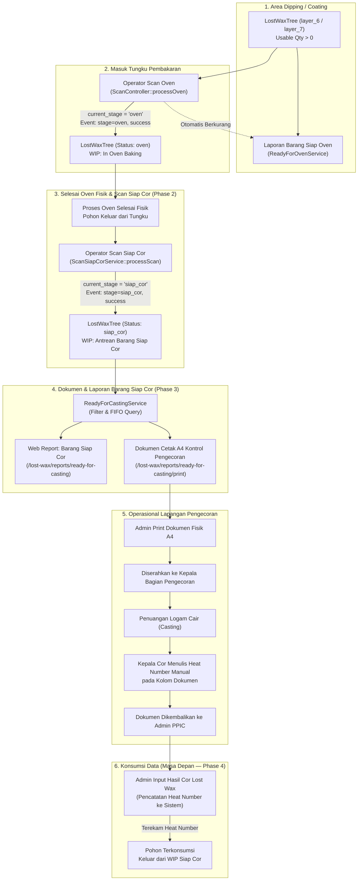

# LAPORAN AUDIT TEKNIS READ-ONLY
# LOST WAX PHASE 3: DOKUMEN DAN LAPORAN BARANG SIAP COR

**Repository:** `C:\laragon\www\kanban-ppic`  
**Fitur Fokus:** Modul Lost Wax — Barang Siap Cor (Phase 3)  
**Dokumen Referensi:** `AUDIT_LOST_WAX_PHASE2_SCAN_SIAP_COR.md`, `IMPLEMENTATION_LOST_WAX_PHASE2_SCAN_SIAP_COR.md`, `AUDIT_LOST_WAX_GROUPING.md`  
**Sifat Tugas:** **Strict Read-Only Technical Audit** (Zero Code Modification, Zero Database Migration)  
**Tanggal Audit:** 10 November 2026  

---

## 1. Ringkasan Struktur Kode yang Ditemukan

Audit menyeluruh terhadap modul Lost Wax pada codebase `C:\laragon\www\kanban-ppic` menghasilkan pemetaan struktur komponen utama berikut:

### A. Model Eloquent
1. **`LostWaxTree` (`app/Models/LostWaxTree.php`):**
   - Merupakan entitas utama representasi fisik Traveler Card / Pohon Lilin.
   - Kolom kunci: `id`, `barcode`, `tree_number`, `quantity` (gross), `status` (status operasional, default `'generated'`), `current_stage` (tahap scan saat ini), `last_scan_at`, `require_layer_7` (flag lapisan 7), `work_order_id`, `work_order_plan_id`, `lost_wax_print_order_line_id`, `rangkai_execution_id`, `rack_id`.
   - Accessor & Helper Kunci:
     - `usable_quantity`: `max(0, $this->quantity - $this->total_defect_quantity)` — kuantitas bersih layak cor.
     - `total_defect_quantity`: total akumulasi cacat dari relasi `defects` (`LostWaxTreeDefect`).
     - `human_barcode`: format terpecah yang mudah dibaca manusia (contoh: `P 26-08-25 0001`).
     - `getSourceCode()`: mengambil kode produksi (`printOrderLine->code` atau `workOrder->et_code`).
     - `getSourceProduct()`: mengambil nama item barang.
     - `getSourceCustomer()`: mengambil nama pelanggan.
     - `getSourceAisi()`: mengambil spesifikasi material AISI (misal: CF8, CF8M, SUS304).
2. **`LostWaxScanEvent` (`app/Models/LostWaxScanEvent.php`):**
   - Mencatat seluruh riwayat pemindaian barcode per tahapan produksi.
   - Kolom: `tree_id`, `barcode`, `stage`, `scanned_at`, `operator_id`, `result` (`'success'` atau `'rejected'`), `anomaly_reason`, `aging_minutes`, `aging_status`.
   - Relasi: `tree` (`belongsTo`), `operator` (`belongsTo` ke `User`), `void` (`hasOne` ke `LostWaxScanEventVoid`).
3. **`LostWaxScanEventVoid` (`app/Models/LostWaxScanEventVoid.php`):**
   - Tabel audit pembatalan pemindaian (`lost_wax_scan_event_voids`).
   - Kolom: `scan_event_id`, `voided_by`, `voided_at`, `void_reason`.
4. **`LostWaxTreeDefect` (`app/Models/LostWaxTreeDefect.php`):**
   - Mencatat jumlah barang afkir/cacat pada suatu pohon (`defect_qty`, `defect_type`, `notes`).
5. **`LostWaxWorkOrder` & `LostWaxPrintOrderLine`:**
   - Menyediakan metadata Perintah Rangkai (SPK), pesanan cetak lilin, dan relasi ke `ProductionPlan` (termasuk `po_number` dan `po_quantity`).
6. **`LostWaxTreeAllocation` (`app/Models/LostWaxTreeAllocation.php`):**
   - Mendukung skenario multi-alokasi bila 1 pohon fisik membawa komponen dari beberapa pesanan/item yang berbeda.

### B. Service Domain
1. **`ScanSiapCorService` (`app/Services/LostWax/ScanSiapCorService.php`):**
   - Implementasi Phase 2 yang menangani transaksi transisi dari `current_stage = 'oven'` ke `current_stage = 'siap_cor'`.
   - Menggunakan `DB::transaction()` dengan pessimistic lock `lockForUpdate()`.
   - Menolak barcode tidak ditemukan, pohon berstatus `cancelled`, pohon belum scan oven, scan duplikat `siap_cor`, serta pohon dengan `usable_quantity <= 0`.
2. **`ScanVoidService` (`app/Services/ScanVoidService.php`):**
   - Menangani pembatalan event scan terakhir yang berstatus sukses (LIFO).
   - Saat event `siap_cor` dibatalkan (void), service merekonstruksi `current_stage` dan `last_scan_at` pohon kembali ke event sebelumnya (`oven`).
3. **`ReadyForOvenService` (`app/Services/LostWax/ReadyForOvenService.php`):**
   - Menghitung antrean barang siap masuk oven (Phase 1) dengan grouping master-detail, perbandingan PO, dan multi-select dropdown filter. Menjadi acuan pola arsitektur untuk Phase 3.

### C. Controller & Views
1. **`ScanSiapCorController` (`app/Http/Controllers/LostWax/ScanSiapCorController.php`):**
   - Mengelola endpoint scanner operasional (`GET /lost-wax/scan-siap-cor` dan `POST /lost-wax/scan-siap-cor`).
2. **`ReadyForOvenController` (`app/Http/Controllers/LostWax/ReadyForOvenController.php`):**
   - Mengelola laporan antrean Ready for Oven (`/lost-wax/reports/ready-for-oven`) dan cetak PDF/A4 (`/lost-wax/reports/ready-for-oven/print`).

---

## 2. Alur Data Lengkap: Scan Oven → Scan Siap Cor → Barang Siap Cor



### Penjelasan Status Digital Pohon:
1. **Bagaimana sistem menentukan bahwa Traveler Card sudah berada pada status Siap Cor?**
   Sistem **TIDAK HANYA** memeriksa satu flag `current_stage = 'siap_cor'`, melainkan memvalidasi kombinasi aturan integritas:
   - `lost_wax_trees.current_stage === 'siap_cor'`.
   - `lost_wax_trees.status !== 'cancelled'`.
   - Terdapat record `LostWaxScanEvent` dengan `stage = 'siap_cor'` dan `result = 'success'`.
   - Event sukses tersebut **belum di-void** (`whereDoesntHave('void')`).
   - `usable_quantity > 0` ($quantity - defect\_qty > 0$).
2. **Keterkaitan dengan Pembatalan (Void):**
   Bila terjadi kesalahan scan dan dibatalkan via `ScanVoidService`, event `siap_cor` akan memiliki relasi ke `LostWaxScanEventVoid`, dan status pohon dikembalikan ke `current_stage = 'oven'`. Query Barang Siap Cor otomatis mengabaikan event yang berstatus void ini.

---

## 3. Tabel Sumber Data dan Kondisi Kelayakan WIP

Untuk memastikan data antrean Barang Siap Cor 100% akurat tanpa *phantom records* atau *double counting*, berikut 5 parameter kelayakan WIP:

| No | Parameter Kelayakan | Kondisi Teknis Database | Alasan Bisnis & Dampak Integritas |
|:--:|:--------------------|:------------------------|:-----------------------------------|
| 1 | **Status Pohon Tidak Dibatalkan** | `lost_wax_trees.status != 'cancelled'` | Pohon yang dibatalkan karena revisi SPK rangkai atau pembatalan admin tidak boleh masuk antrean cor. |
| 2 | **Current Stage Valid** | `lost_wax_trees.current_stage = 'siap_cor'` | Menjamin pointer tahapan aktif pohon memang berada pada fase siap cor. |
| 3 | **Scan Event Siap Cor Sukses & Aktif** | `whereHas('scanEvents', function($q) { $q->where('stage', 'siap_cor')->where('result', 'success')->whereDoesntHave('void'); })` | Menjamin pohon benar-benar telah melalui scan barcode fisik dan scan tersebut bukan pemindaian yang telah di-void/dibatalkan. |
| 4 | **Kuantitas Layak (Usable Qty) > 0** | `$tree->usable_quantity > 0`<br/>*(Query: `(quantity - COALESCE(defects_sum, 0)) > 0`)* | Pohon yang 100% afkir (seluruh pcs rusak/pecah saat proses oven) tidak boleh dikirim ke bagian pengecoran. |
| 5 | **Belum Dikonsumsi Pengecoran (Phase 4)** | *Belum ada penanda di DB saat ini.*<br/>*(Phase 4: `whereNull('heat_number')`)* | Pohon yang sudah dituangi cairan logam dan diinput heat number-nya pada Phase 4 akan otomatis keluar dari daftar antrean. |

---

## 4. Struktur Database dan Relasi yang Relevan

### A. Tabel dan Kolom yang Digunakan
1. **`lost_wax_trees`:**
   - Kolom yang dibaca: `id`, `barcode`, `tree_number`, `quantity`, `status`, `current_stage`, `last_scan_at`, `work_order_id`, `lost_wax_print_order_line_id`, `rangkai_execution_id`.
2. **`lost_wax_scan_events`:**
   - Kolom yang dibaca: `id`, `tree_id`, `stage`, `scanned_at`, `result`.
3. **`lost_wax_scan_event_voids`:**
   - Kolom yang dibaca: `id`, `scan_event_id`, `voided_at`.
4. **`lost_wax_tree_defects`:**
   - Kolom yang dibaca: `lost_wax_tree_id`, `defect_qty`.
5. **`lost_wax_print_order_lines` & `production_plans`:**
   - Kolom yang dibaca: `code`, `item_name`, `customer`, `po_number`, `po_quantity`, `product_scope`, `aisi`.
6. **`lost_wax_work_orders`:**
   - Kolom yang dibaca: `wo_number`, `et_code`, `customer_name`.

### B. Audit Ketersediaan Relasi & Kolom Heat Number (Poin 2.6)
- **Temuan Hasil Audit Codebase:**
  1. Pada tabel `lost_wax_trees` **TIDAK DITEMUKAN** kolom `heat_number`, `casting_order_id`, `casting_result_id`, maupun timestamp pengecoran.
  2. Modul Sand Casting memiliki tabel `sand_casting_casting_results` dan `casting_order_lines`, namun modul Lost Wax **belum memiliki** tabel transaksi pengecoran (`lost_wax_casting_results`).
  3. Satu-satunya referensi `heat_number` pada Lost Wax ada di `ScanController.php` (line 207):
     ```php
     'heat_number' => $tree->heat_number ?? $tree->printOrderLine?->productionPlan?->heat_number ?? null
     ```
     Kode ini hanyalah fallback dinamis ke `productionPlan` (rencana cor), bukan pencatatan aktual per pohon individual.
- **Kesimpulan Pasti:**
  Database saat ini **BELUM MEMILIKI** mekanisme penanda atau relasi untuk mencatat bahwa suatu `LostWaxTree` telah dikonsumsi oleh Input Hasil Cor.
- **Kebutuhan Perubahan untuk Phase 4 (Jangan Dibuat Sekarang):**
  Pada Phase 4, diperlukan salah satu dari dua pendekatan:
  - **Opsi A (Direct Column):** Tambahkan kolom `heat_number VARCHAR(50) NULL` dan `cast_at DATETIME NULL` pada tabel `lost_wax_trees`.
  - **Opsi B (Dedicated Transaction Table):** Buat tabel `lost_wax_casting_results` yang memiliki relasi `lost_wax_tree_id`, `heat_number`, `furnace_number`, `pouring_date`, `good_qty`, `scrap_qty`.
  Setelah Phase 4 diimplementasikan, query Barang Siap Cor cukup menambahkan filter `whereNull('heat_number')` atau `whereDoesntHave('castingResult')`.

---

## 5. Rancangan Query Barang Siap Cor

Query Eloquent berikut dirancang dengan eager loading optimal untuk mencegah *N+1 query problem* serta mendukung pemfilteran multi-kode dan urutan FIFO:

```php
namespace App\Services\LostWax;

use App\Models\LostWaxTree;
use Illuminate\Database\Eloquent\Builder;

class ReadyForCastingService
{
    public function getQueueQuery(?string $search = null, ?string $scope = null, array $codes = [], array $customers = []): Builder
    {
        $query = LostWaxTree::query()
            ->with([
                'defects',
                'printOrderLine.productionPlan',
                'printOrderLine.printOrder',
                'rangkaiExecution.workOrder',
                'workOrder.itemReference',
                'allocations.printOrderLine.productionPlan',
                'scanEvents' => function ($q) {
                    $q->where('stage', 'siap_cor')
                        ->where('result', 'success')
                        ->whereDoesntHave('void')
                        ->orderByDesc('scanned_at')
                        ->orderByDesc('id');
                },
            ])
            // 1. Pohon tidak berstatus batal
            ->where('status', '!=', 'cancelled')
            // 2. Tahap aktif saat ini adalah siap_cor
            ->where('current_stage', 'siap_cor')
            // 3. Memiliki scan event siap_cor sukses aktif (bukan void)
            ->whereHas('scanEvents', function ($q) {
                $q->where('stage', 'siap_cor')
                    ->where('result', 'success')
                    ->whereDoesntHave('void');
            })
            // 4. Kuantitas layak > 0 (mengecualikan pohon 100% cacat)
            ->whereRaw('(quantity - COALESCE((SELECT SUM(defect_qty) FROM lost_wax_tree_defects WHERE lost_wax_tree_defects.lost_wax_tree_id = lost_wax_trees.id), 0)) > 0');

        // 5. Filter RBAC product scope PPIC (bila ada)
        if ($scope) {
            $query->where(function ($q) use ($scope) {
                $q->whereHas('printOrderLine.productionPlan', fn ($p) => $p->where('product_scope', $scope))
                  ->orWhereHas('allocations.printOrderLine.productionPlan', fn ($p) => $p->where('product_scope', $scope));
            });
        }

        // 6. Urutan FIFO murni berdasarkan waktu scan siap cor terawal
        $query->orderBy('last_scan_at', 'asc')
              ->orderBy('id', 'asc');

        return $query;
    }
}
```

---

## 6. Rancangan Tampilan Halaman Laporan Web

**URL:** `/lost-wax/reports/ready-for-casting`  
**Judul Halaman:** `Lost Wax — Barang Siap Cor`  
**Target Pengguna:** Admin PPIC & Admin Produksi  

### A. Kartu Ringkasan (Summary KPI Cards)
1. **Total Traveler Card:** Jumlah fisik pohon lilin siap cor (contoh: `24 Pohon`).
2. **Total PCS Layak:** Akumulasi `usable_quantity` siap cor (contoh: `1.152 PCS`).
3. **Total Kode Produksi:** Jumlah variasi kode produksi aktif dalam antrean (contoh: `6 Kode`).
4. **WIP Coverage:** Estimasi kesiapan terhadap target penuangan harian.

### B. Kontrol Filter (Pola Dropdown Phase 1.3)
1. **Dropdown Kode Produksi:** Multi-select checkbox dengan search box inline, tombol `Select All`, dan `Clear`.
2. **Dropdown Customer:** Multi-select checkbox dengan search box inline.
3. **Kolom Pencarian Global:** Input teks untuk mencari barcode traveler card, kode produksi, nama barang, atau nomor SPK.
4. **Tombol Aksi:**
   - Tombol `Terapkan Filter` & `Reset`.
   - Tombol **`Cetak Dokumen Pengecoran (A4)`** yang otomatis menyertakan parameter filter aktif ke endpoint cetak.

### C. Tabel Data Utama (Traceability per Traveler Card Terjaga)
> **PENTING:** Setiap Traveler Card / Barcode ditampilkan sebagai **1 baris tersendiri** agar bagian pengecoran dapat mencocokkan fisik pohon satu per satu di lantai produksi. Pengelompokan visual per kode produksi (bila diaktifkan) disajikan sebagai *visual section header*, tanpa menggabungkan baris barcode.

**Struktur Kolom Tabel Web:**
1. **No.** Urutan antrean FIFO (1, 2, 3, ...).
2. **Waktu Scan Siap Cor:** Tanggal & jam scan sukses (`d/m/Y H:i:s`) + durasi relatif (misal: `2 jam lalu`).
3. **Traveler Card / Barcode:** Format monospace human barcode (misal: `P 26-08-25 0001`) dan barcode asli (`P2608250001`).
4. **Kode Produksi:** Badge kontras (misal: `268IL435`).
5. **Customer:** Nama pelanggan (misal: `PT. Pindad`).
6. **Nama Barang & Material:** Deskripsi produk beserta grade AISI (misal: `Flange 2 Inch - CF8M`).
7. **SPK / WO Rangkai:** Nomor Perintah Rangkai asal pohon.
8. **Qty Siap Cor (PCS):** Jumlah layak pakai (`usable_quantity`), dengan keterangan kecil kuantitas bruto dan cacat bila ada.
9. **Status Pengecoran:** Badge status `Siap Dituang / Belum Cor` (indikator persiapan Phase 4).

---

## 7. Rancangan Dokumen Cetak A4 (Lembar Kontrol Pengecoran)

**URL:** `/lost-wax/reports/ready-for-casting/print`  
**Media:** Kertas A4 Portrait  
**Tujuan Dokumen:** Dicetak oleh admin dan diserahkan kepada Kepala Bagian Pengecoran. Kepala Pengecoran membawa lembar ini ke area tungku, mencatat Heat Number aktual pada setiap Traveler Card dengan pulpen/spidol, lalu mengembalikannya ke admin.

### A. Karakteristik Desain Fisik
1. **Keterbacaan Lapangan:** Spasi baris longgar (tinggi baris minimal 28px - 32px), batas sel tegas, ramah penulisan manual tangan.
2. **Non-Print Toolbar:** Tombol Cetak dan Tutup di bagian atas yang otomatis hilang saat dicetak (`@media print`).
3. **Header Dokumen:**
   - Kop: `PT. PERONI KARYA UTAMA`
   - Judul: **LEMBAR KONTROL PENGECORAN — BARANG SIAP COR (LOST WAX)**
   - Metadata Dokumen:
     - Nomor Rujukan Dokumen: `DOC/LW-SC/YYYYMMDD/XXXX` (pola rujukan dinamis timestamp).
     - Tanggal & Jam Cetak: `DD MMMM YYYY, HH:mm WIB`.
     - Dicetak Oleh: Nama admin yang sedang login.
     - Parameter Filter: Menampilkan filter yang digunakan (misal: `Kode: 268IL435` atau `Semua Kode`).

### B. Format Tabel Dokumen Cetak

| No | Kode Produksi & Customer | Traveler Card / Barcode | Qty (PCS) | HEAT NUMBER (Diisi Manual Tulisan Tangan) | KETERANGAN / TUNGKU / PARAF |
|:--:|:-------------------------|:------------------------|:---------:|:------------------------------------------:|:----------------------------:|
| 1  | **268IL435**<br/><span style="font-size:8px;">PT. Pindad (CF8M)</span> | `P 26-08-25 0001`<br/><span style="font-size:7.5px; color:#666;">Scan: 10/11 08:30</span> | **24** | [ &nbsp;&nbsp;&nbsp;&nbsp;&nbsp;&nbsp;&nbsp;&nbsp;&nbsp;&nbsp;&nbsp;&nbsp;&nbsp;&nbsp;&nbsp;&nbsp;&nbsp;&nbsp;&nbsp;&nbsp;&nbsp;&nbsp;&nbsp;&nbsp;&nbsp;&nbsp;&nbsp;&nbsp;&nbsp;&nbsp; ] | [ &nbsp;&nbsp;&nbsp;&nbsp;&nbsp;&nbsp;&nbsp;&nbsp;&nbsp;&nbsp;&nbsp;&nbsp;&nbsp;&nbsp;&nbsp;&nbsp;&nbsp;&nbsp;&nbsp;&nbsp;&nbsp;&nbsp;&nbsp;&nbsp;&nbsp;&nbsp;&nbsp;&nbsp;&nbsp;&nbsp; ] |
| 2  | **268IL435**<br/><span style="font-size:8px;">PT. Pindad (CF8M)</span> | `P 26-08-25 0002`<br/><span style="font-size:7.5px; color:#666;">Scan: 10/11 08:31</span> | **24** | [ &nbsp;&nbsp;&nbsp;&nbsp;&nbsp;&nbsp;&nbsp;&nbsp;&nbsp;&nbsp;&nbsp;&nbsp;&nbsp;&nbsp;&nbsp;&nbsp;&nbsp;&nbsp;&nbsp;&nbsp;&nbsp;&nbsp;&nbsp;&nbsp;&nbsp;&nbsp;&nbsp;&nbsp;&nbsp;&nbsp; ] | [ &nbsp;&nbsp;&nbsp;&nbsp;&nbsp;&nbsp;&nbsp;&nbsp;&nbsp;&nbsp;&nbsp;&nbsp;&nbsp;&nbsp;&nbsp;&nbsp;&nbsp;&nbsp;&nbsp;&nbsp;&nbsp;&nbsp;&nbsp;&nbsp;&nbsp;&nbsp;&nbsp;&nbsp;&nbsp;&nbsp; ] |
| 3  | **268IL508**<br/><span style="font-size:8px;">PT. Barata (SUS304)</span> | `P 26-08-25 0003`<br/><span style="font-size:7.5px; color:#666;">Scan: 10/11 08:45</span> | **36** | [ &nbsp;&nbsp;&nbsp;&nbsp;&nbsp;&nbsp;&nbsp;&nbsp;&nbsp;&nbsp;&nbsp;&nbsp;&nbsp;&nbsp;&nbsp;&nbsp;&nbsp;&nbsp;&nbsp;&nbsp;&nbsp;&nbsp;&nbsp;&nbsp;&nbsp;&nbsp;&nbsp;&nbsp;&nbsp;&nbsp; ] | [ &nbsp;&nbsp;&nbsp;&nbsp;&nbsp;&nbsp;&nbsp;&nbsp;&nbsp;&nbsp;&nbsp;&nbsp;&nbsp;&nbsp;&nbsp;&nbsp;&nbsp;&nbsp;&nbsp;&nbsp;&nbsp;&nbsp;&nbsp;&nbsp;&nbsp;&nbsp;&nbsp;&nbsp;&nbsp;&nbsp; ] |

### C. Kolom Tanda Tangan Formal
Mengikuti pola dokumen operasional standar pada `ready-for-oven/print.blade.php`:

```
+-----------------------------------+-----------------------------------+-----------------------------------+
|            Diserahkan Oleh,       |        Diterima & Dituang Oleh,   |        Diperiksa & Diinput Oleh,  |
|          (Admin PPIC/Produksi)    |       (Kepala Bagian Pengecoran)  |          (PPIC / QC Casting)      |
|                                   |                                   |                                   |
|   ( ........................... ) |   ( ........................... ) |   ( ........................... ) |
|   Tgl:                            |   Tgl:                            |   Tgl:                            |
+-----------------------------------+-----------------------------------+-----------------------------------+
```

---

## 8. Perilaku Dokumen dan Integritas WIP

Sesuai ketentuan bisnis yang wajib dipertahankan:

1. **Sifat Stateless & Idempotent (Read-Only):**
   - Membuka halaman web `/lost-wax/reports/ready-for-casting` maupun dokumen cetak `/lost-wax/reports/ready-for-casting/print` murni mengeksekusi HTTP `GET` dan query `SELECT`.
   - Tidak ada operasi `UPDATE`, perubahan status pohon, maupun pengurangan kuantitas.
2. **Tidak Ada Kunci/Reservasi Sistem Saat Dokumen Dicetak:**
   - Mencetak dokumen atau mencetak ulang dokumen berkali-kali **tidak membuat reservasi** dan tidak mengunci pohon di database.
   - Tidak ada kolom `is_printed` atau status sementara `reserved_for_casting`.
3. **Penanganan Pemrosesan Sebagian (Partial Pouring):**
   - Skenario: Admin mencetak dokumen berisi 50 Traveler Card. Kepala Cor hanya menuang 40 pohon dan mencatat Heat Number untuk 40 pohon tersebut, sementara 10 pohon belum sempat dicor.
   - Dokumen dikembalikan ke admin. Pada Phase 4, admin menginput 40 pohon tersebut ke sistem.
   - Hasil: 40 pohon yang telah diinput heat number-nya otomatis keluar dari query antrean. **10 pohon sisanya tetap berada di status `siap_cor` sebagai WIP aktif**, dan akan otomatis muncul kembali pada pembukaan web maupun pencetakan dokumen berikutnya.

---

## 9. Filter dan Urutan FIFO

### A. Desain Filter
Mengadopsi pola dropdown dari Phase 1.3:
- **Filter Kode Produksi:** Memuat daftar unik kode produksi yang saat ini ada di antrean siap cor. Operator dapat memilih 1 kode, beberapa kode, atau Select All.
- **Filter Customer:** Memuat daftar unik nama pelanggan dari pohon-pohon yang sedang aktif di antrean.
- **Pencarian Teks:** Memfilter instan berdasarkan barcode, kode barang, atau nomor SPK.

### B. Penegakan Prinsip FIFO (First-In, First-Out)
- Antrean diurutkan secara mutlak berdasarkan waktu pemindaian Scan Siap Cor terawal:  
  `ORDER BY last_scan_at ASC, id ASC`.
- Pohon yang lebih dahulu keluar dari oven dan discan siap cor akan selalu menduduki nomor urut awal (No. 1, No. 2, dst.) pada lembar cetak kontrol.
- Kepala Bagian Pengecoran diinstruksikan untuk memprioritaskan penuangan pohon dari nomor urut teratas.

---

## 10. Rancangan Route, Controller, Service, dan Sidebar

### A. Rute Aplikasi (`routes/web.php`)
Ditempatkan di dalam grup `Route::prefix('lost-wax')->name('lost-wax.')` di bawah middleware `permission:access_execution`:

```php
// Antrean & Dokumen Kontrol Barang Siap Cor (Phase 3)
Route::get('/reports/ready-for-casting', [\App\Http\Controllers\LostWax\ReadyForCastingController::class, 'index'])
    ->name('reports.ready-for-casting.index');
Route::get('/reports/ready-for-casting/print', [\App\Http\Controllers\LostWax\ReadyForCastingController::class, 'print'])
    ->name('reports.ready-for-casting.print');
```

### B. Controller (`app/Http/Controllers/LostWax/ReadyForCastingController.php`)
- `index(Request $request)`: Menerima query parameter `codes`, `customers`, `search`; memanggil `ReadyForCastingService::getQueueData()`; me-render view `lost-wax.reports.ready-for-casting.index`.
- `print(Request $request)`: Menerima query parameter yang sama; me-render view cetak `lost-wax.reports.ready-for-casting.print`.

### C. Domain Service (`app/Services/LostWax/ReadyForCastingService.php`)
- Berdiri sendiri secara modular (terpisah dari `ScanSiapCorService` dan `ReadyForOvenService`).
- Bertanggung jawab mengeksekusi query kelayakan WIP, formatting per-Traveler Card, kalkulasi KPI summary, dan penyusunan daftar opsi dropdown filter.

### D. Menu Sidebar (`resources/views/layouts/app.blade.php`)
- **Penempatan:** Sesuai instruksi, diletakkan pada grup menu **Lost Wax**, tepat setelah menu **Scan Siap Cor** (setelah baris 511).
- **Audit Penempatan Menu Eksisting:**
  Saat ini, menu *Scan Oven* (baris 497) dan *Scan Siap Cor* (baris 504) berada di dalam blok pemeriksaan peran:
  `@if(Auth::user() && (Auth::user()->roles->contains('name', 'admin') || Auth::user()->roles->contains('name', 'spv') || Auth::user()->roles->contains('name', 'admin_qc_fitting')))`
  Sedangkan menu *Barang Siap Oven* (baris 514) berada di luar blok tersebut (sehingga dapat diakses oleh admin PPIC).
- **Rekomendasi Penempatan:**
  Karena dokumen *Barang Siap Cor* dicetak oleh Admin PPIC / Admin Produksi dan digunakan bersama Kepala Pengecoran, link menu harus dapat dilihat oleh role `admin`, `ppic`, `spv`, dan `admin_qc_fitting`.
  - Kode navigasi sidebar yang diusulkan:
    ```blade
    <li>
        <a href="{{ route('lost-wax.reports.ready-for-casting.index') }}"
            class="sidebar-link flex items-center pl-10 pr-6 py-2 hover:bg-slate-800 {{ request()->routeIs('lost-wax.reports.ready-for-casting.*') ? 'text-white font-medium border-l-2 border-amber-400' : 'text-slate-300' }}"
            title="Barang Siap Cor">
            <i class="fas fa-clipboard-check w-4 shrink-0 text-center text-xs opacity-70 mr-2"></i>
            <span class="text-sm sidebar-text">Barang Siap Cor</span>
        </a>
    </li>
    ```

---

## 11. Daftar File yang Perlu Dibuat / Diubah pada Tahap Implementasi

### A. File Baru yang Akan Dibuat
1. `app/Services/LostWax/ReadyForCastingService.php` — Logika query WIP, filter, dan formatting data per Traveler Card.
2. `app/Http/Controllers/LostWax/ReadyForCastingController.php` — Controller web report dan tampilan cetak A4.
3. `resources/views/lost-wax/reports/ready-for-casting/index.blade.php` — View antarmuka web dengan dropdown filter dan tabel detail barcode.
4. `resources/views/lost-wax/reports/ready-for-casting/print.blade.php` — Layout dokumen cetak A4 fisik lembar kontrol pengecoran ramah tulisan tangan.
5. `tests/Feature/LostWax/ReadyForCastingReportTest.php` — Test otomatis (memverifikasi kelayakan WIP, evaluasi void, FIFO, dan isolasi filter).

### B. File Eksisting yang Akan Diubah
1. `routes/web.php` — Menambahkan 2 rute laporan (`reports.ready-for-casting.index` dan `reports.ready-for-casting.print`).
2. `resources/views/layouts/app.blade.php` — Menambahkan link sidebar "Barang Siap Cor" tepat setelah "Scan Siap Cor".

---

## 12. Analisis Risiko Teknis & Potensi Konflik

| Area Potensi Risiko | Analisis Dampak | Mitigasi yang Dirancang |
|:--------------------|:----------------|:------------------------|
| **1. Gangguan terhadap Scanner Phase 2** | Sangat Rendah | Phase 3 murni membaca data (`SELECT`). File `ScanSiapCorService.php` dan `ScanService.php` tidak diubah sama sekali. |
| **2. Sinkronisasi dengan Pembatalan (Void)** | Sedang | Jika ada scan siap cor yang dibatalkan via `ScanVoidService`, pohon kembali ke tahap `oven`. Query Phase 3 memvalidasi `whereDoesntHave('void')` dan `current_stage = 'siap_cor'`, sehingga pohon yang di-void secara instan tidak muncul di laporan. |
| **3. Multi-Alokasi Pohon (Tree Allocation)** | Sedang | Bila 1 pohon fisik membawa 2 pesanan yang berbeda, kuantitas layak prorata harus dihitung dengan benar agar kuantitas fisik pohon dan total PCS tidak terjadi *double-counting*. |
| **4. Integritas Data Menuju Phase 4** | Sangat Rendah | Karena belum ada kolom `heat_number` di database saat ini, query Phase 3 dirancang modular sehingga saat Phase 4 menambahkan kolom/tabel hasil cor, penambahan filter `whereNull('heat_number')` dapat dilakukan dengan mudah tanpa mengubah struktur dokumen. |

---

## 13. Rekomendasi Implementasi Bertahap

Untuk menjamin kelancaran delivery fitur, tahapan implementasi disarankan sebagai berikut:

- **Tahap 3.1: Service Domain & Query Engine (`ReadyForCastingService`)**
  Bangun service untuk mengambil antrean siap cor dengan kriteria kelayakan ketat, FIFO order berdasarkan `last_scan_at`, dan ekstraksi opsi filter.
- **Tahap 3.2: Controller & Web Report (`ReadyForCastingController` & `index.blade.php`)**
  Bangun antarmuka web dengan kartu KPI, filter dropdown (Kode Produksi & Customer), dan tabel yang menyajikan detail masing-masing Traveler Card.
- **Tahap 3.3: Dokumen Cetak A4 Kontrol Pengecoran (`print.blade.php`)**
  Bangun layout cetak fisik A4 dengan kotak kosong lebar untuk penulisan Heat Number manual, keterangan tungku/paraf, serta tanda tangan 3 pihak (Admin PPIC, Kepala Pengecoran, QC Casting).
- **Tahap 3.4: Navigasi Sidebar & Pengujian Menyeluruh (Automated Feature Tests)**
  Daftarkan menu di sidebar tepat setelah Scan Siap Cor dan buat automated test suite untuk memastikan 100% skenario validasi, void, dan FIFO lulus tanpa cela.
- **Tahap 4 (Masa Depan): Input Hasil Cor Lost Wax**
  Kembangkan form pencatatan hasil cor berdasarkan barcode Traveler Card dan Heat Number fisik, yang secara otomatis mengonsumsi WIP antrean Barang Siap Cor.

---
*Laporan audit ini disusun secara independen berdasarkan source code aktual repositori `C:\laragon\www\kanban-ppic` tanpa melakukan modifikasi kode atau struktur database apa pun.*

