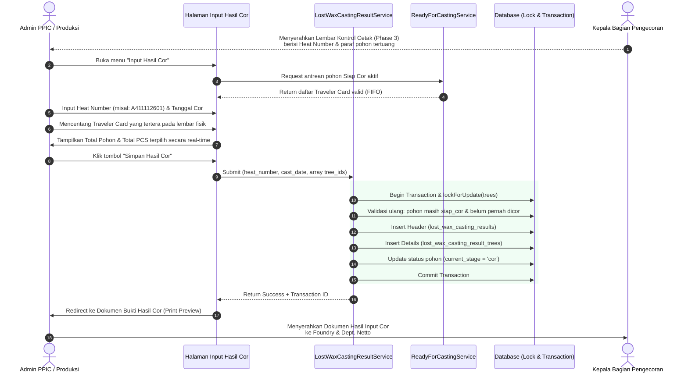
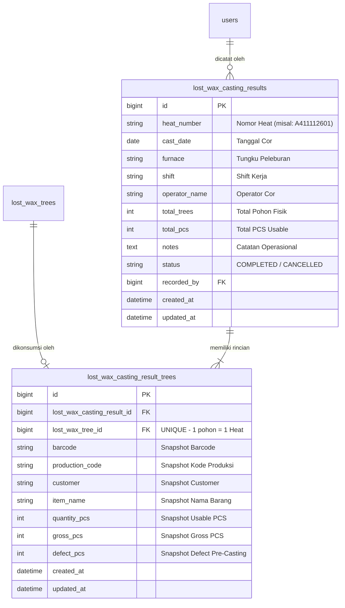

# LAPORAN AUDIT TEKNIS READ-ONLY
# LOST WAX PHASE 4: RANCANGAN FITUR INPUT HASIL COR

**Repository:** `C:\laragon\www\kanban-ppic`  
**Fitur Fokus:** Modul Lost Wax — Input Hasil Cor (Phase 4)  
**Dokumen Referensi:** `AUDIT_LOST_WAX_PHASE3_BARANG_SIAP_COR.md`, `IMPLEMENTATION_LOST_WAX_PHASE3_BARANG_SIAP_COR.md`, `IMPLEMENTATION_LOST_WAX_PHASE2_SCAN_SIAP_COR.md`  
**Sifat Tugas:** **Strict Read-Only Technical Audit** (Zero Code Modification, Zero Database Migration)  
**Tanggal Audit:** 11 November 2026  

---

## 1. Ringkasan Struktur Database Aktual

Audit menyeluruh terhadap seluruh skema database, migration, dan model Eloquent yang ada di repositori `C:\laragon\www\kanban-ppic` menghasilkan temuan faktual berikut:

### A. Tabel dan Model Lost Wax yang Tersedia Saat Ini:
1. **`lost_wax_trees` (`app/Models/LostWaxTree.php`):**
   - Kolom aktual: `id`, `work_order_id`, `work_order_plan_id`, `lost_wax_print_order_line_id`, `rangkai_execution_id`, `rack_id`, `barcode`, `tree_number`, `quantity`, `status`, `current_stage`, `last_scan_at`, `production_date`, `family_code`, `daily_sequence`, `require_layer_7`, `printed_count`, `rack_assigned_at`, `created_at`, `updated_at`.
   - **Fakta Kritis:** **TIDAK ADA** kolom `heat_number`, `casting_result_id`, `cast_date`, maupun penanda penuangan cor.
2. **`lost_wax_scan_events` (`app/Models/LostWaxScanEvent.php`):**
   - Kolom aktual: `id`, `tree_id`, `barcode`, `stage`, `scanned_at`, `operator_id`, `result`, `anomaly_reason`, `aging_minutes`, `aging_status`, `created_at`, `updated_at`.
   - Tahapan pemindaian tertinggi yang tercatat saat ini adalah `stage = 'siap_cor'` (Phase 2).
3. **`lost_wax_scan_event_voids` (`app/Models/LostWaxScanEventVoid.php`):**
   - Kolom aktual: `id`, `scan_event_id`, `voided_by`, `voided_at`, `void_reason`, `created_at`, `updated_at`.
4. **`lost_wax_tree_defects` (`app/Models/LostWaxTreeDefect.php`):**
   - Kolom aktual: `id`, `lost_wax_tree_id`, `defect_qty`, `defect_type`, `stage`, `defect_reason`, `recorded_by`, `notes`, `created_at`, `updated_at`.
   - Mengakumulasi cacat sebelum penuangan logam (selama proses lilin/coating) yang mengurangi `usable_quantity`.
5. **`lost_wax_tree_allocations` (`app/Models/LostWaxTreeAllocation.php`):**
   - Kolom aktual: `id`, `lost_wax_tree_id`, `lost_wax_print_order_line_id`, `allocated_qty`, `created_at`, `updated_at`.
6. **`lost_wax_work_orders` & `lost_wax_print_order_lines`:**
   - Menghubungkan pohon dengan Perintah Rangkai, rencana cetak lilin, dan `production_plans`.
7. **`production_plans` (`app/Models/ProductionPlan.php`):**
   - Memiliki kolom `heat_number`, namun kolom ini di level rencana perencanaan Sand Casting/global dan **tidak memiliki relasi atau penanda konsumsi** terhadap entitas individual `LostWaxTree`.

### B. Temuan Ketiadaan Fitur Cor di Lost Wax:
- **Tabel Hasil Cor Lost Wax:** **BELUM ADA.**
- **Relasi Heat Number dengan Traveler Card Lost Wax:** **BELUM ADA.**
- **Kolom Pencatatan Hasil Cor Aktual:** **BELUM ADA.**
- **Penanda Traveler Card yang Sudah Dikonsumsi:** **BELUM ADA.**
- **Riwayat Koreksi Transaksi Cor Lost Wax:** **BELUM ADA.**

### C. Perbandingan dengan Modul Sand Casting:
- Modul Sand Casting telah memiliki tabel transaksi penuangan mandiri:
  - Header: `sand_casting_casting_results` (`heat_number`, `cast_date`, `furnace`, `shift`, `operator_name`, `notes`, `recorded_by`).
  - Detail: `sand_casting_casting_result_lines` (`sand_casting_casting_result_id`, `traveler_number`, `qty_good`, `qty_reject`, `unit_weight_kg`, `total_weight_kg`).
  - Koreksi: `sand_casting_casting_result_corrections`.
- **Perbedaan Alur Bisnis Fundamental:**
  - Pada **Sand Casting**, Perintah Cor dibuat terlebih dahulu, dan pencatatan hasil cor menerbitkan kartu baru (KTR) untuk tahap Netto.
  - Pada **Lost Wax**, fisik Traveler Card (`LostWaxTree`) **SUDAH ADA SEJAK AWAL** (tahap Rangkai $\rightarrow$ Dipping $\rightarrow$ Oven $\rightarrow$ Siap Cor). Pengecoran Lost Wax bertugas **mengonsumsi Traveler Card yang sudah ada** dan memetakan barcode fisik pohon tersebut ke dalam nomor Heat aktual.
  - Oleh karena itu, modul Lost Wax membutuhkan skema tabel transaksinya sendiri tanpa mencampuradukkan data dengan Sand Casting.

---

## 2. Sumber Data Traveler Card Tersedia

Sumber data antrean pohon siap cor diambil langsung dari domain service Phase 3 yang sudah teruji dan stabil:  
`app/Services/LostWax/ReadyForCastingService.php`.

### A. Kriteria Kelayakan Traveler Card:
Untuk dapat muncul pada daftar checklist Input Hasil Cor, Traveler Card harus memenuhi 5 kriteria:
1. `lost_wax_trees.current_stage = 'siap_cor'`.
2. `lost_wax_trees.status != 'cancelled'`.
3. Memiliki riwayat `LostWaxScanEvent` dengan `stage = 'siap_cor'`, `result = 'success'`, dan belum di-void (`whereDoesntHave('void')`).
4. `usable_quantity > 0` ($usable = quantity - total\_defect > 0$).
5. **Belum pernah dikonsumsi oleh transaksi hasil cor** (pada Phase 4 akan divalidasi via relasi `whereDoesntHave('castingResultTree')`).

### B. Penanganan Multi-Alokasi (Integritas Kartu & PCS):
- Mengadopsi aturan Phase 3: **Satu Traveler Card fisik hanya muncul tepat satu kali** pada daftar pilihan.
- Kuantitas yang disajikan murni sebesar `$tree->usable_quantity` fisik asli pohon.
- Jika pohon dialokasikan ke beberapa pesanan (misal: `ALLOC-A` dan `ALLOC-B`), kode produksi menampilkan gabungan kode terkait dengan lencana `Multi`, tanpa menduplikasi baris pohon atau melipatgandakan PCS.

---

## 3. Rancangan Proses Input Hasil Cor

Alur kerja operasional dirancang sederhana, ergonomis, dan selaras dengan ritme kerja admin produksi di lantai pabrik:



### Penjelasan Detail Langkah:
1. **Penerimaan Dokumen Fisik:** Admin menerima dokumen cetak *Lembar Kontrol Pengecoran* (Phase 3) dari Kepala Pengecoran yang telah diisi tulisan tangan Heat Number (contoh: `A411112601`) pada baris-baris pohon yang berhasil dituang.
2. **Pembukaan Antarmuka:** Admin membuka form Input Hasil Cor.
3. **Perekaman Parameter Heat:** Admin memasukkan Heat Number, tanggal penuangan cor, pilihan tungku, dan shift kerja.
4. **Pencarian & Pencentangan Pohon:** Admin mencentang Traveler Card yang cocok dengan lembar fisik. Tersedia kolom pencarian cepat untuk memfilter barcode atau kode produksi.
5. **Kalkulasi Instan:** Tampilan menampilkan counter *Total Traveler Card Terpilih* dan *Total PCS Terpilih*.
6. **Eksekusi Penyimpanan:** Admin mengklik tombol Simpan. Sistem menjalankan validasi atomik dan mengunci baris data di database.
7. **Penerbitan Dokumen:** Sistem secara otomatis menyediakan dokumen cetak *Bukti Pencatatan Hasil Cor* untuk diarsipkan dan diteruskan ke departemen Netto/Finishing.

---

## 4. Rancangan Tabel Transaksi dan Integritas Data

Untuk memisahkan transaksi metalurgi Heat dari siklus hidup pohon lilin, direkomendasikan membuat skema tabel **Header-Detail**:



### A. Tabel Header: `lost_wax_casting_results`
Mencatat metadata peristiwa peleburan dan penuangan logam cair:
- `id` (BigInt, Primary Key)
- `heat_number` (VARCHAR 50, Indexed) — Identifikasi unik metalurgi Heat.
- `cast_date` (DATE) — Tanggal aktual penuangan cor.
- `furnace` (VARCHAR 50, Nullable) — Nomor tungku peleburan (misal: "Induksi 1").
- `shift` (VARCHAR 20, Nullable) — Shift kerja (1, 2, atau 3).
- `operator_name` (VARCHAR 100, Nullable) — Nama petugas penuangan/kepala cor.
- `total_trees` (INTEGER) — Jumlah pohon yang dituang dalam heat ini.
- `total_pcs` (INTEGER) — Akumulasi kuantitas PCS layak yang dituangkan.
- `notes` (TEXT, Nullable) — Catatan penuangan (suhu, durasi, anomali).
- `status` (VARCHAR 20, Default `'COMPLETED'`) — Status transaksi (`COMPLETED`, `CANCELLED`).
- `recorded_by` (BigInt, Foreign Key ke `users.id`) — Admin yang menginput.
- `created_at`, `updated_at` (DATETIME).

### B. Tabel Detail: `lost_wax_casting_result_trees`
Menghubungkan setiap fisik Traveler Card yang dituang ke dalam transaksi Heat:
- `id` (BigInt, Primary Key)
- `lost_wax_casting_result_id` (BigInt, Foreign Key ke `lost_wax_casting_results.id`, Cascade Delete)
- `lost_wax_tree_id` (BigInt, Foreign Key ke `lost_wax_trees.id`, Restrict Delete) — **UNIQUE CONSTRAINT:** Menjamin secara absolut di level database bahwa satu pohon fisik **TIDAK BISA** masuk ke dua Heat Number berbeda!
- `barcode` (VARCHAR 30) — Snapshot nomor barcode pohon.
- `production_code` (VARCHAR 50, Nullable) — Snapshot kode produksi barang.
- `customer` (VARCHAR 100, Nullable) — Snapshot nama customer.
- `item_name` (VARCHAR 150, Nullable) — Snapshot nama item.
- `quantity_pcs` (INTEGER) — Kuantitas layak pakai (`usable_quantity`) saat transaksi dibuat.
- `gross_pcs` (INTEGER) — Kuantitas bruto pohon lilin.
- `defect_pcs` (INTEGER, Default 0) — Jumlah afkir lilin sebelum cor.
- `created_at`, `updated_at` (DATETIME).

### C. Integritas Transaksi & Pencegahan Concurrency:
1. **Pessimistic Locking (`lockForUpdate`):**  
   Saat admin menekan Simpan, sistem mengunci seluruh baris pohon yang dipilih (`LostWaxTree::whereIn('id', $ids)->lockForUpdate()->get()`). Jika ada admin lain yang sedang mencoba memproses salah satu pohon yang sama, proses kedua akan menunggu hingga transaksi pertama selesai atau gagal.
2. **Validasi Ulang Save-Time:**  
   Sistem tidak mengandalkan status saat halaman dibuka di browser. Saat penyimpanan dieksekusi, sistem memeriksa ulang:
   - Apakah pohon masih `current_stage === 'siap_cor'`?
   - Apakah pohon belum berstatus `cancelled`?
   - Apakah pohon belum pernah ada di tabel `lost_wax_casting_result_trees`?
3. **Database Transaction Atomik:**  
   Seluruh pembuatan header, detail, dan pembaruan pointer pohon dibungkus dalam `DB::transaction()`. Jika salah satu pohon gagal atau terjadi error jaringan, seluruh data otomatis di-rollback tanpa meninggalkan data setengah jadi.

---

## 5. Analisis Kuantitas: Usable Qty, Qty Rusak, dan Qty Good

Sesuai permintaan audit, berikut evaluasi mendalam terkait perlakuan kuantitas:

### A. Sumber Kuantitas Siap Cor:
- Kuantitas yang ditransfer ke Heat Number **wajib menggunakan `usable_quantity`**, yaitu kuantitas bruto dikurangi cacat lilin pre-casting:  
  $$Usable\ Quantity = Quantity - Total\ Defect\ Quantity$$
- Cacat lilin/coating yang terjadi sebelum penuangan logam (afkir lilin patah, cetakan retak saat oven) **sudah tercatat** pada `lost_wax_tree_defects` dan telah mengurangi kuantitas layak pohon sebelum masuk tungku cor.

### B. Pertimbangan Qty Rusak dan Qty Good Hasil Cor:
1. **Fisik Proses Pengecoran Logam:**  
   Saat cairan logam membara selesai dituangkan ke cetakan keramik, kondisi coran di dalam cetakan **belum dapat diketahui**. Kerusakan hasil cor (seperti *porosity*, *shrinkage*, *misrun*, patah cor, atau cacat dimensi) baru dapat diidentifikasi setelah cetakan keramik dibongkar (*knock-out*) dan coran dibersihkan melalui proses sandblasting/pemotongan spru.
2. **Kebutuhan Operasional Saat Ini:**  
   Pencatatan Input Hasil Cor pada Phase 4 berfokus pada **pencatatan konsumsi WIP dan pemetaan Traveler Card ke Heat Number**.
3. **Rekomendasi Arsitektural:**  
   - **Pada Input Hasil Cor (Phase 4):** Catat kuantitas yang dituangkan sebesar $Qty\ Siap\ Cor$ (`usable_quantity`).
   - **Pencatatan Qty Rusak Hasil Cor:** Jangan membebani form Input Hasil Cor dengan kewajiban inspeksi cacat cor yang fisiknya belum dingin. Pencatatan Qty Rusak pengecoran direkomendasikan ditempatkan pada **tahap lanjutan (Departemen Netto / QC Hasil Cor)**.
   - **Fleksibilitas Opsional:** Di skema tabel detail, dapat disediakan kolom nullable/default 0 `qty_cast_reject`, sehingga bila ada pohon yang tumpah atau gagal tuang seketika di depan tungku, operator dapat mencatatnya langsung:  
     $$Qty\ Good\ Cor = Qty\ Siap\ Cor - Qty\ Cast\ Reject$$

---

## 6. Rancangan Halaman Input Hasil Cor Web

**URL:** `/lost-wax/casting-results/create`  
**Judul:** `Lost Wax — Input Hasil Cor`  
**Target Pengguna:** Admin PPIC / Admin Produksi  

### Komponen Antarmuka:
1. **Header Form (Panel Atas):**
   - **Nomor Heat:** Input teks besar dengan font monospace dan autofocus (contoh: `A411112601`). Wajib diisi.
   - **Tanggal Cor:** Input tanggal (default: tanggal hari ini).
   - **Tungku Peleburan:** Dropdown/input teks pilihan tungku (misal: "Tungku 1", "Tungku 2").
   - **Shift:** Pilihan radio/dropdown (Shift 1, Shift 2, Shift 3).
   - **Operator / Kepala Cor:** Input nama petugas pengecoran.
   - **Catatan:** Input textarea ringkas untuk keterangan penuangan.
2. **Bar Ringkasan Real-Time (Sticky Header/Top Bar):**
   - Menampilkan indikator dinamis:
     - **Traveler Card Terpilih:** `0 Pohon` (bertambah otomatis saat dicentang).
     - **Total Qty Siap Cor Terpilih:** `0 PCS` (dihitung otomatis via JavaScript).
   - Tombol utama **"Simpan Hasil Cor"** (disabled bila 0 pohon terpilih).
3. **Tabel Checklist Traveler Card Tersedia:**
   - Menampilkan seluruh antrean pohon siap cor aktif dengan urutan FIFO.
   - Filter Cepat Inline: Kotak pencarian instan (filter barcode, kode, customer) serta tombol `Pilih Semua` dan `Batalkan Pilihan`.
   - **Kolom Tabel Checklist:**
     1. `[✓]` Checkbox pilihan pohon (value: `tree_id`).
     2. `No.` Urutan antrean FIFO (1, 2, 3, ...).
     3. `Barcode / Traveler Card` (format monospace `P 26-08-25 0001` + barcode asli).
     4. `Kode Produksi` (lencana tebal, misal: `268IL435`).
     5. `Customer` (nama pelanggan).
     6. `Nama Item & Material` (deskripsi part name & grade material AISI).
     7. `SPK / WO Rangkai` (nomor perintah rangkai).
     8. `Qty Siap Cor (PCS)` (angka kuantitas layak pakai tebal).
4. **Validasi Frontend & Feedback:**
   - Pop-up konfirmasi SweetAlert2 sebelum submit untuk memastikan admin tidak keliru memasukkan nomor Heat.

---

## 7. Rancangan Dokumen Hasil Input Cor (Bukti Pencatatan Cor)

**URL:** `/lost-wax/casting-results/{id}/print`  
**Media:** Kertas A4 Portrait  
**Tujuan Dokumen:** Dicetak setelah transaksi tersimpan. Dokumen ini menjadi surat jalan dan bukti fisik resmi bagi Kepala Pengecoran dan departemen lanjutan (Bongkar Kerak / Netto / Finishing).

### Elemen Dokumen:
1. **Kop Dokumen:**  
   `PT. PERONI KARYA SENTRA • DIVISI FOUNDRY & LOST WAX`
2. **Judul Dokumen:**  
   `BUKTI PENCATATAN HASIL COR — LOST WAX (HEAT POURING REPORT)`
3. **Informasi Metadata:**
   - **Nomor Heat:** `A411112601` (Dicetak sangat besar dan mencolok).
   - **ID Transaksi:** `TX-LWC-20261111-0001` (pola rujukan berbasis ID/tanggal).
   - **Tanggal Penuangan:** `11 November 2026`.
   - **Tungku & Shift:** `Tungku 1 / Shift 2`.
   - **Diinput Oleh:** Nama Admin PPIC yang melakukan input.
   - **Waktu Input:** `11/11/2026 14:25 WIB`.
4. **Tabel Rincian Traveler Card Tertuang:**
   - Kolom: `No`, `Traveler Card / Barcode`, `Kode Produksi`, `Customer`, `Nama Barang / Material`, `SPK/WO`, `Qty Siap Cor (PCS)`.
5. **Baris Total:**
   - Akumulasi total fisik pohon (`X Pohon`) dan total kuantitas (`Y PCS`).
6. **Kolom Tanda Tangan Formal (3 Pihak):**
   - **Dibuat Oleh:** Admin PPIC / Produksi.
   - **Dituang Oleh:** Kepala Bagian Pengecoran.
   - **Diterima Oleh:** Bagian Netto / Finishing (saat serah terima fisik hasil cor).
7. **Sifat Dokumen:** Murni read-only. Dicetak atau dicetak ulang berkali-kali tidak akan mengubah status transaksi maupun WIP.

---

## 8. Sidebar, Hak Akses, dan Route

### A. Penempatan Menu Sidebar (`resources/views/layouts/app.blade.php`):
Sesuai instruksi, menu baru ditempatkan pada kelompok menu **Lost Wax**, **tepat setelah menu Barang Siap Cor**:
```blade
<!-- Menu 1: Scan Siap Cor -->
<li><a href="{{ route('lost-wax.scan-siap-cor.index') }}">Scan Siap Cor</a></li>

<!-- Menu 2: Barang Siap Cor (Phase 3) -->
<li><a href="{{ route('lost-wax.reports.ready-for-casting.index') }}">Barang Siap Cor</a></li>

<!-- Menu 3: Input Hasil Cor (Phase 4 - Baru!) -->
@if(Auth::user() && (Auth::user()->roles->contains('name', 'admin') || Auth::user()->roles->contains('name', 'ppic') || Auth::user()->roles->contains('name', 'spv') || Auth::user()->roles->contains('name', 'admin_qc_fitting')))
<li>
    <a href="{{ route('lost-wax.casting-results.create') }}"
        class="sidebar-link flex items-center pl-10 pr-6 py-2 hover:bg-slate-800 {{ request()->routeIs('lost-wax.casting-results.*') ? 'text-white font-medium border-l-2 border-amber-400' : 'text-slate-300' }}"
        title="Input Hasil Cor">
        <i class="fas fa-fire w-4 shrink-0 text-center text-xs opacity-70 mr-2"></i>
        <span class="text-sm sidebar-text">Input Hasil Cor</span>
    </a>
</li>
@endif
```

### B. Usulan Rute Aplikasi (`routes/web.php`):
Didaftarkan di dalam grup prefix `lost-wax` di bawah middleware `permission:access_execution`:
```php
// Modul Hasil Cor Lost Wax (Phase 4)
Route::prefix('casting-results')->name('casting-results.')->group(function () {
    Route::get('/', [\App\Http\Controllers\LostWax\LostWaxCastingResultController::class, 'index'])->name('index');
    Route::get('/create', [\App\Http\Controllers\LostWax\LostWaxCastingResultController::class, 'create'])->name('create');
    Route::post('/', [\App\Http\Controllers\LostWax\LostWaxCastingResultController::class, 'store'])->name('store');
    Route::get('/{castingResult}', [\App\Http\Controllers\LostWax\LostWaxCastingResultController::class, 'show'])->name('show');
    Route::get('/{castingResult}/print', [\App\Http\Controllers\LostWax\LostWaxCastingResultController::class, 'print'])->name('print');
});
```

### C. Konsistensi Hak Akses RBAC:
- Pengguna yang berhak mengakses adalah: `admin`, `ppic`, `spv`, dan `admin_qc_fitting`.
- Seluruh peran di atas telah memiliki permission `access_execution` sehingga tidak memerlukan perubahan konfigurasi izin Spatie di database.

---

## 9. Dampak Terhadap Phase 3 (Barang Siap Cor)

Penerapan transaksi Input Hasil Cor pada Phase 4 secara otomatis menyelesaikan siklus antrean Phase 3 tanpa merusak atau mengubah logika scanner Phase 2:

### A. Pengurangan Antrean Otomatis:
1. Saat transaksi Heat disimpan:
   - Pohon lilin yang dipilih tercatat di `lost_wax_casting_result_trees`.
   - Status tahapan pohon pada `lost_wax_trees` dapat diperbarui menjadi `current_stage = 'cor'` (atau `'selesai_cor'`).
2. Pada `ReadyForCastingService.php` (Phase 3):
   Query antrean yang saat ini mencari `current_stage = 'siap_cor'` secara alami akan langsung mengabaikan pohon yang sudah `cor`.
   Sebagai pengaman ganda yang absolut, query Phase 3 ditambahkan klausa:
   ```php
   ->whereDoesntHave('castingResultTree')
   ```
3. **Simulasi Pengurangan WIP:**
   - Antrean Awal: 50 Traveler Card.
   - Transaksi Heat `A411112601`: memilih 40 Traveler Card.
   - Sisa antrean Barang Siap Cor: **Tepat 10 Traveler Card**.
   - Halaman web Barang Siap Cor dan dokumen cetak Phase 3 otomatis hanya menampilkan 10 Traveler Card yang belum dikonsumsi.
   - KPI Total Traveler Card, Total Qty Siap Cor, dan filter dropdown di Phase 3 seketika berkurang sesuai sisa 10 pohon.
   - **Steril:** Alur Scan Siap Cor Phase 2 sama sekali tidak tersentuh dan tidak terganggu.

---

## 10. Penutup Perjalanan Lost Wax dan Riwayat Transaksi

### A. Titik Akhir Siklus Hidup Traveler Card:
- Transaksi Input Hasil Cor merupakan **garis akhir (*end of journey*)** bagi entitas Traveler Card fisik pohon lilin di modul Lost Wax.
- Setelah penuangan logam cair, wujud fisik pohon lilin dan lapisan keramik telah lenyap/dileburkan dan berganti menjadi benda padat coran logam (*raw casting*).
- Status pohon ditandai sebagai telah selesai dicor (`cor`).

### B. Pelestarian Riwayat (Traceability Permanen):
- Data pohon (`LostWaxTree`), scan event pelapisan 1–7, scan oven, dan scan siap cor **tetap tersimpan utuh** di database (tidak ada penghapusan data).
- Hubungan antara nomor barcode fisik pohon dengan nomor Heat tersimpan permanen di tabel detail `lost_wax_casting_result_trees`.
- Siapa pun di masa depan dapat melacak: *Pohon lilin barcode `P2608250001` dibuat pada SPK apa, dilapisi kapan, di-oven jam berapa, dan dituangkan pada Heat Number apa.*

### C. Halaman Riwayat Transaksi (`index.blade.php`):
- Menyediakan tabel daftar seluruh transaksi Heat yang pernah disimpan (`/lost-wax/casting-results`).
- Admin dapat melihat histori tanggal cor, Heat Number, jumlah pohon tertuang, total PCS, dan membuka dokumen cetak bukti cor kapan saja.

---

## 11. Mekanisme Koreksi Transaksi dan Audit Trail

Jika terjadi kesalahan input oleh admin (misalnya salah mengetik Heat Number, atau salah mencentang nomor barcode Traveler Card):

### A. Larangan Keras:
- **DILARANG** melakukan penghapusan data secara diam-diam (*hard delete*) pada tabel hasil cor. Transaksi metalurgi pabrik harus meninggalkan jejak audit (*audit trail*).

### B. Mekanisme Pembatalan Transaksi (Void Hasil Cor):
Mengikuti pola `ScanVoidService` yang sudah terbukti andal pada Phase 2:
1. Tombol **"Batalkan / Void Transaksi"** hanya dapat diakses oleh user berwenang (Admin PPIC / SPV).
2. Wajib menginput alasan pembatalan transaksi (*void reason*).
3. Saat dibatalkan:
   - Status header `lost_wax_casting_results.status` diubah menjadi `'CANCELLED'`.
   - Menyimpan data audit pembatalan (`voided_by`, `voided_at`, `void_reason`).
   - Seluruh pohon yang terikat pada detail transaksi tersebut dikembalikan statusnya ke `current_stage = 'siap_cor'`.
   - Relasi ke pohon dilepas atau ditandai void, sehingga pohon-pohon tersebut **secara instan muncul kembali ke antrean Barang Siap Cor (Phase 3)** untuk dapat diproses pada Heat Number yang benar.

---

## 12. Daftar File yang Perlu Dibuat atau Diubah pada Implementasi Phase 4

### A. File Baru yang Akan Dibuat:
1. `database/migrations/xxxx_create_lost_wax_casting_results_tables.php`  
   Membuat tabel `lost_wax_casting_results` dan `lost_wax_casting_result_trees` dengan foreign key dan unique constraints.
2. `app/Models/LostWaxCastingResult.php`  
   Model Eloquent untuk header transaksi hasil cor.
3. `app/Models/LostWaxCastingResultTree.php`  
   Model Eloquent untuk detail pohon yang terikat pada Heat.
4. `app/Services/LostWax/LostWaxCastingResultService.php`  
   Domain service yang mengelola transaksi `DB::transaction()`, pessimistic row locking `lockForUpdate()`, validasi anti-duplikasi, penyimpanan data atomik, dan mekanisme void.
5. `app/Http/Controllers/LostWax/LostWaxCastingResultController.php`  
   Controller untuk melayani request antarmuka: `index` (riwayat), `create` (form checklist), `store` (simpan transaksi), `show` (detail), dan `print` (cetak bukti cor).
6. `resources/views/lost-wax/casting-results/index.blade.php`  
   View tabel riwayat transaksi Heat Lost Wax.
7. `resources/views/lost-wax/casting-results/create.blade.php`  
   View form input Heat Number dan checklist pohon dengan counter dinamis.
8. `resources/views/lost-wax/casting-results/show.blade.php`  
   View detail transaksi hasil cor yang sudah tersimpan.
9. `resources/views/lost-wax/casting-results/print.blade.php`  
   Layout dokumen cetak resmi A4 Bukti Hasil Cor.
10. `tests/Feature/LostWax/LostWaxCastingResultTest.php`  
    Suite automated feature test komprehensif yang menguji pembuatan transaksi, validasi heat kosong, pencegahan double casting, lock concurrency, pembatalan void, dan pengurangan antrean Phase 3.

### B. File Eksisting yang Akan Diubah:
1. `app/Models/LostWaxTree.php`  
   Menambahkan relasi Eloquent `castingResultTree()` ke `LostWaxCastingResultTree`.
2. `app/Services/LostWax/ReadyForCastingService.php`  
   Menambahkan klausa proteksi `whereDoesntHave('castingResultTree')` untuk mengeluarkan pohon yang sudah dicor.
3. `routes/web.php`  
   Mendaftarkan rute resource `lost-wax.casting-results.*`.
4. `resources/views/layouts/app.blade.php`  
   Menambahkan tautan menu sidebar **Input Hasil Cor** tepat setelah **Barang Siap Cor**.
5. `config/lost_wax.php`  
   Menambahkan label tahapan `'cor' => 'Selesai Cor'` pada array stages jika pelacakan stage diperpanjang.

---

## 13. Analisis Risiko Teknis dan Rekomendasi Bertahap

| Potensi Risiko | Tingkat Risiko | Mitigasi yang Dirancang |
|:---------------|:--------------:|:------------------------|
| **1. Concurrency (Dua Admin Memilih Pohon yang Sama)** | Tinggi | Gunakan `DB::transaction()` dengan `LostWaxTree::lockForUpdate()` saat validasi dan `unique(['lost_wax_tree_id'])` pada tabel database detail. |
| **2. Satu Pohon Masuk ke 2 Heat Number Berbeda** | Kritis | Database constraint `UNIQUE KEY` pada kolom `lost_wax_tree_id` di tabel `lost_wax_casting_result_trees` menjamin pohon tidak dapat disimpan dua kali secara fisik. |
| **3. Pencampuran Data dengan Modul Sand Casting** | Sedang | Pembuatan tabel terisolasi dengan awalan `lost_wax_casting_*` dan service tersendiri menjamin isolasi penuh tanpa memengaruhi modul Sand Casting. |
| **4. Kesalahan Input Heat Number oleh Operator** | Sedang | Dialog konfirmasi SweetAlert2 sebelum submit, serta mekanisme void transaksi resmi yang mencatat audit trail pembatalan. |

### Rekomendasi Tahapan Implementasi:
- **Langkah 1 (Database & Model):** Buat migration tabel `lost_wax_casting_results` dan `lost_wax_casting_result_trees`, buat model Eloquent, serta daftarkan relasi di `LostWaxTree`.
- **Langkah 2 (Domain Service & Locking):** Implementasikan `LostWaxCastingResultService` dengan transaksi atomik dan pessimistic locking, serta integrasikan filter pengecualian ke `ReadyForCastingService`.
- **Langkah 3 (Controller & Form Checklist Web):** Buat form checklist `create.blade.php` dengan penghitungan counter real-time dan konfirmasi SweetAlert2.
- **Langkah 4 (Dokumen Cetak Bukti Cor):** Bangun layout cetak A4 `print.blade.php` dan tampilan detail transaksi.
- **Langkah 5 (Automated Tests & Navigasi Sidebar):** Daftarkan menu sidebar tepat setelah Barang Siap Cor dan jalankan 100% test suite untuk memastikan sistem siap pakai di produksi lokal.

---
*Laporan audit teknis ini disusun secara independen berdasarkan kode aktual repositori `C:\laragon\www\kanban-ppic` tanpa melakukan modifikasi file aplikasi, tanpa pembuatan migration, dan tanpa perubahan data apa pun.*

