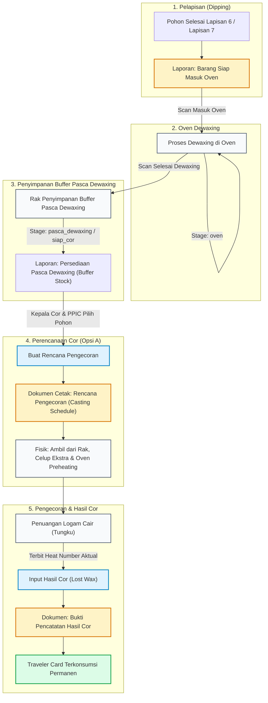

# AUDIT & BRAINSTORMING TEKNIS
## EVALUASI WORKFLOW BARANG SIAP OVEN, PERSIAPAN COR, DAN INPUT HASIL COR LOST WAX

Repository: `C:\laragon\www\kanban-ppic`  
Tanggal Audit: 11 November 2026  
Status: **DRAFT ARSITEKTUR & AUDIT READ-ONLY (TIDAK ADA PERUBAHAN KODE)**

---

## DAFTAR ISI

1. [Gambaran Workflow Saat Ini Berdasarkan Kode](#1-gambaran-workflow-saat-ini-berdasarkan-kode)
2. [Gambaran Workflow Aktual Berdasarkan Penjelasan Lapangan](#2-gambaran-workflow-aktual-berdasarkan-penjelasan-lapangan)
3. [Identifikasi Gap (Sistem vs Lapangan)](#3-identifikasi-gap-sistem-vs-lapangan)
4. [Audit Layer 6 dan Layer 7 (Ready for Oven)](#4-audit-layer-6-dan-layer-7-ready-for-oven)
5. [Audit Scan Oven (Masuk vs Selesai Dewaxing)](#5-audit-scan-oven-masuk-vs-selesai-dewaxing)
6. [Audit Scan Siap Cor (Status Pasca Dewaxing)](#6-audit-scan-siap-cor-status-pasca-dewaxing)
7. [Evaluasi Definisi Barang Siap Cor (Persediaan vs Rencana Cor)](#7-evaluasi-definisi-barang-siap-cor-persediaan-vs-rencana-cor)
8. [Perbandingan Opsi A vs Opsi B (Pemilihan Barang untuk Cor)](#8-perbandingan-opsi-a-vs-opsi-b-pemilihan-barang-untuk-cor)
9. [Rekomendasi Workflow Terbaik](#9-rekomendasi-workflow-terbaik)
10. [Rekomendasi Nama Menu dan Stage yang Lebih Tepat](#10-rekomendasi-nama-menu-dan-stage-yang-lebih-tepat)
11. [Rekomendasi Dokumen yang Diperlukan](#11-rekomendasi-dokumen-yang-diperlukan)
12. [Dampak terhadap Implementasi Phase 1 s/d Phase 4](#12-dampak-terhadap-implementasi-phase-1-sd-phase-4)
13. [Dampak Database, Skema, dan Histori Transaksi](#13-dampak-database-skema-dan-histori-transaksi)
14. [Analisis Risiko & Strategi Mitigasi](#14-analisis-risiko--strategi-mitigasi)
15. [Rencana Implementasi Bertahap (Roadmap)](#15-rencana-implementasi-bertahap-roadmap)

---

## 1. Gambaran Workflow Saat Ini Berdasarkan Kode

Berdasarkan audit menyeluruh terhadap kode pada repositori `kanban-ppic` (Phase 1 s/d Phase 4), berikut adalah rantai proses yang saat ini terpasang di sistem:

```
[Layer 1..5] ──► [Layer 6] ──► [Layer 7 (Opsional)]
                     │                │
                     ▼                ▼
         [ReadyForOvenService (Antrean Siap Oven)]
                     │
                     ▼ (Scan 1: Scan Oven)
             [Stage: 'oven'] (Pohon Sedang / Selesai Oven)
                     │
                     ▼ (Scan 2: Scan Siap Cor)
           [Stage: 'siap_cor'] (Pohon Siap Cor)
                     │
                     ▼
         [ReadyForCastingService (Antrean Barang Siap Cor)]
                     │
                     ▼ (Input Hasil Cor + Heat Number)
       [LostWaxCastingResultService (Transaksi Hasil Cor)]
                     │
                     ▼
             [Pohon Terkonsumsi / COMPLETED]
```

### Logika Alur Kode Saat Ini:
1. **Pelapisan (*Coating*):** Pohon dipindai secara berurutan dari `layer_1` sampai `layer_6` (atau `layer_7` jika kolom `require_layer_7 == true` pada `lost_wax_trees` atau `lost_wax_work_orders`).
2. **Antrean Siap Oven:** File `ReadyForOvenService.php` mengambil pohon yang berada di `current_stage == 'layer_6'` (jika `require_layer_7 == false`) ATAU `current_stage == 'layer_7'` (jika `require_layer_7 == true`), serta belum memiliki event scan `oven`.
3. **Scan Oven:** Operator memindai barcode di route `lost-wax/scan-oven` (`ScanService::processOvenScan`). Status berubah menjadi `current_stage = 'oven'`. Pohon otomatis hilang dari antrean Siap Oven.
4. **Scan Siap Cor:** Operator memindai barcode di route `lost-wax/scan-siap-cor` (`ScanSiapCorService::processScan`). Sistem memvalidasi pohon harus berstatus `oven`, lalu mengubah status menjadi `current_stage = 'siap_cor'`.
5. **Antrean Barang Siap Cor:** File `ReadyForCastingService.php` mengambil seluruh pohon dengan `current_stage == 'siap_cor'` yang belum diikat ke transaksi hasil cor berstatus `COMPLETED`.
6. **Input Hasil Cor:** Admin memasukkan `heat_number`, mencentang Traveler Card dari antrean Siap Cor, lalu menyimpan transaksi (`LostWaxCastingResultService::storeCastingResult`). Pohon dikonsumsi secara permanen.

---

## 2. Gambaran Workflow Aktual Berdasarkan Penjelasan Lapangan

Berdasarkan hasil klarifikasi kondisi fisik manufaktur di pabrik, proses nyata yang berlangsung di lantai produksi (*shopfloor*) adalah sebagai berikut:

```
+----------------------------------------------------------------------------------------------------+
| 1. AREA PELAPISAN (DIPPING ROOM)                                                                   |
|    - Pohon lilin dilapisi bubur keramik & pasir zirkon.                                            |
|    - Lapisan normal berakhir pada Layer 6.                                                         |
|    - Pada kondisi geometri khusus / tebal, pohon diberi lapisan ke-7 (Layer 7).                   |
|    - Pohon Layer 6 maupun Layer 7 yang sudah kering sama-sama SIAP MASUK OVEN DEWAXING.           |
+----------------------------------------------------------------------------------------------------+
                                                 │
                                                 ▼
+----------------------------------------------------------------------------------------------------+
| 2. MESIN OVEN DEWAXING (PELELEHAN LILIN)                                                           |
|    - Pohon dibawa dari ruang dipping ke mesin oven dewaxing.                                       |
|    - Tepat saat pohon dimasukkan ke oven dewaxing, pohon BUKAN LAGI "Siap Oven".                   |
|    - Lilin di dalam cetakan keramik dilelehkan dan dikeluarkan pada suhu ~150-180°C.              |
+----------------------------------------------------------------------------------------------------+
                                                 │
                                                 ▼
+----------------------------------------------------------------------------------------------------+
| 3. RAK PENYIMPANAN PASCA-DEWAXING (BUFFER WIP STORAGE)                                             |
|    - Cetakan keramik kosong dikeluarkan dari oven dewaxing.                                        |
|    - Barcode dipindai 1x lagi untuk mencatat bahwa dewaxing selesai.                               |
|    - Cetakan dimasukkan ke RAK-RAK PENYIMPANAN BUFFER.                                             |
|    - KRUSIAL: Barang di rak ini BELUM TENTU DICOR HARI INI!                                        |
|      Kapasitas pengecoran terbatas. Barang bisa menginap 1 s/d 3 hari di rak ini.                  |
|      Barang di rak ini adalah "PERSEDIAAN PASCA DEWAXING", bukan barang yang langsung dituang!     |
+----------------------------------------------------------------------------------------------------+
                                                 │
                                                 ▼
+----------------------------------------------------------------------------------------------------+
| 4. PEMILIHAN & PENJADWALAN COR (CASTING SELECTION / BATCHING)                                      |
|    - Setiap hari / shift, Kepala Cor memeriksa rak persediaan pasca-dewaxing.                      |
|    - Kepala Cor memilih cetakan tertentu yang akan diproses sesuai kapasitas tungku & target paduan|
|    - Hanya sebagian dari seluruh persediaan di rak yang dipilih (misal 20-40 pohon dari 300 pohon).|
|    - Cetakan terpilih dicelup 1x lagi (extra seal dip).                                            |
|    - Cetakan dipindahkan ke depan tungku cor & dimasukkan ke OVEN PREHEATING (suhu ~1000°C).      |
+----------------------------------------------------------------------------------------------------+
                                                 │
                                                 ▼
+----------------------------------------------------------------------------------------------------+
| 5. PENUANGAN LOGAM CAIR & INPUT HASIL COR                                                          |
|    - Logam cair dituangkan ke dalam cetakan yang sudah merah membara dari oven preheating.         |
|    - Satu tungku peleburan menghasilkan satu "Heat Number" aktual.                                 |
|    - Setelah penuangan selesai, Admin mencatat Heat Number aktual & Traveler Card yang ikut dicor. |
|    - Traveler Card dikonsumsi secara permanen.                                                     |
+----------------------------------------------------------------------------------------------------+
```

---

## 3. Identifikasi Gap (Sistem vs Lapangan)

| Area Workflow | Perilaku Sistem Saat Ini (Kode) | Kebutuhan Nyata di Lapangan | Gap / Masalah yang Terjadi |
|---|---|---|---|
| **Kriteria Siap Oven** | `ReadyForOvenService` mengunci: jika `require_layer_7 == false` harus tepat di `layer_6`; jika `true` harus tepat di `layer_7`. | Cetakan di `layer_6` maupun `layer_7` sama-sama siap masuk oven dewaxing jika sudah kering. | **Gap 1:** Pohon yang di awal berspesifikasi 6 lapis, namun di lapangan diberi lapisan ke-7, **HILANG DARI LAPORAN SIAP OVEN** karena query menolak `layer_7` jika flag-nya `false`. |
| **Scan Oven** | Mengubah `current_stage` menjadi `'oven'`. | Mencatat fisik saat pohon **dimasukkan ke oven dewaxing**. | **Gap 2:** Secara fungsional sudah benar mencatat *masuk oven dewaxing*, namun terminologi di UI sering disalahartikan sebagai "pohon sudah selesai di-oven". |
| **Scan Pasca Oven** | Dinamai **Scan Siap Cor** (`current_stage = 'siap_cor'`). | Mencatat bahwa cetakan **keluar dari oven dewaxing & masuk ke rak penyimpanan buffer**. | **Gap 3 (Misnomer):** Penamaan "Siap Cor" sangat prematur. Cetakan baru keluar dewaxing dan masih mengendap di rak buffer, belum tentu dicor pada hari yang sama. |
| **Laporan Siap Cor** | Menampilkan **seluruh** pohon dengan `current_stage == 'siap_cor'` (Phase 3). | Kepala Cor hanya membutuhkan daftar cetakan yang **terpilih untuk dicor hari ini/besok**. | **Gap 4:** Laporan saat ini menampilkan seluruh persediaan buffer di rak (bisa 300–500 pohon). Lembar kontrol cetak menjadi puluhan halaman dan tidak fokus sebagai instruksi kerja harian. |
| **Penjadwalan Cor** | Tidak ada proses perantara antara rak buffer dan Input Hasil Cor. | Kepala Cor memilih sebagian cetakan dari rak, dicelup ulang, dipanaskan di oven preheating. | **Gap 5:** Sistem melompati tahap perencanaan/pemilihan cetakan harian. Tidak ada dokumen "Rencana Pengecoran" (Casting Schedule) per shift. |
| **Input Hasil Cor** | Admin memilih langsung dari seluruh antrean `siap_cor` yang ada di sistem (Phase 4). | Admin mencatat Heat Number aktual dari cetakan yang memang sudah dipilih dan selesai dicor. | **Gap 6:** Admin harus mencari-cari pohon di antara ratusan pohon di rak buffer, bukan dari kelompok cetakan yang memang sudah direncanakan untuk dicor. |

---

## 4. Audit Layer 6 dan Layer 7 (Ready for Oven)

### 4.1 Pemeriksaan Kode `ReadyForOvenService.php`

Pada `app/Services/LostWax/ReadyForOvenService.php` baris 54–76:
```php
->where(function ($q) {
    // 6-layer candidates: neither tree nor work_order requires layer 7, current_stage = layer_6
    $q->where(function ($sub) {
        $sub->where('lost_wax_trees.require_layer_7', false)
            ->where(function ($woSub) {
                $woSub->whereNull('lost_wax_trees.work_order_id')
                    ->orWhereDoesntHave('workOrder', function ($w) {
                        $w->where('require_layer_7', true);
                    });
            })
            ->where('lost_wax_trees.current_stage', 'layer_6');
    })
    // 7-layer candidates: either tree or work_order requires layer 7, current_stage = layer_7
        ->orWhere(function ($sub) {
            $sub->where(function ($req7Sub) {
                $req7Sub->where('lost_wax_trees.require_layer_7', true)
                    ->orWhereHas('workOrder', function ($w) {
                        $w->where('require_layer_7', true);
                    });
            })
                ->where('lost_wax_trees.current_stage', 'layer_7');
        });
})
```
Dan pada level PHP baris 115–121:
```php
$requiresLayer7 = $tree->require_layer_7;
$requiredFinalStage = $requiresLayer7 ? 'layer_7' : 'layer_6';

if ($tree->current_stage !== $requiredFinalStage) {
    continue;
}
```

### 4.2 Temuan Kritis Audit
1. **Pohon yang Mendapat Lapisan Tambahan (Layer 7 Dinamis):**  
   Jika sebuah pohon pada awalnya dibuat dengan `require_layer_7 = false` (standar 6 lapis), namun operator dipping memutuskan menambah 1 lapisan pelindung lagi menjadi Layer 7, pohon tersebut berhasil dipindai ke stage `layer_7`.  
   **Akibat pada sistem:** Pohon tersebut **HILANG 100% DARI ANTREAN SIAP OVEN**!
   - Kueri SQL menolak pohon tersebut karena `lost_wax_trees.require_layer_7` bernilai `false`, sementara `current_stage` adalah `layer_7`.
   - Di level PHP, `$requiredFinalStage` dievaluasi menjadi `'layer_6'`. Karena `$tree->current_stage` adalah `'layer_7'`, baris `continue` membuang pohon tersebut dari daftar.
2. **Kontradiksi dengan `ScanService.php`:**  
   Pada `app/Services/ScanService.php` baris 216–218:
   ```php
   $allowedStages = ['layer_6', 'layer_7'];
   if (! in_array($tree->current_stage, $allowedStages)) {
       // ditolak
   }
   ```
   Scanner Oven sebenarnya **SUDAH MENGIZINKAN** pohon berstatus `layer_6` maupun `layer_7` untuk discan masuk oven tanpa memeriksa flag `require_layer_7`!  
   Kontradiksi ini membuktikan bahwa filter pada `ReadyForOvenService` terlalu restriktif dan tidak mencerminkan fleksibilitas operasional dipping di lapangan.

### 4.3 Kesimpulan & Rekomendasi Teknis untuk Siap Oven
Definisi Barang Siap Oven yang benar secara fisik:
> **Setiap pohon yang saat ini berada pada tahap `layer_6` ATAU `layer_7`, berstatus aktif (tidak cancelled), memiliki kuantitas layak > 0, dan belum memiliki event scan `oven` aktif, adalah BARANG SIAP MASUK OVEN DEWAXING.**

Kueri tidak boleh lagi mengunci kecocokan antara flag `require_layer_7` dengan stage saat ini, melainkan cukup mengecek:
```sql
WHERE current_stage IN ('layer_6', 'layer_7')
  AND status != 'cancelled'
  AND NOT EXISTS (
      SELECT 1 FROM lost_wax_scan_events 
      WHERE tree_id = lost_wax_trees.id 
        AND stage = 'oven' 
        AND result = 'success' 
        AND voided_at IS NULL
  )
```

---

## 5. Audit Scan Oven (Masuk vs Selesai Dewaxing)

### 5.1 Analisis Peristiwa Fisik vs Event Sistem
Terdapat 3 kemungkinan peristiwa terkait oven dewaxing:
1. *Akan masuk oven dewaxing (rencana).*
2. *Sedang masuk / dimasukkan ke oven dewaxing.*
3. *Sudah selesai dari oven dewaxing.*

Berdasarkan penelusuran kode pada `ScanController::processOven` dan `ScanService::processOvenScan`:
- Scanner oven berada di dekat tungku dewaxing.
- Operator mengambil pohon dari rak gantung dan memindai barcode tepat sebelum/saat pohon dimasukkan ke dalam tungku dewaxing.
- Sistem mencatat:
  - Event baru: `stage = 'oven'`, `result = 'success'`.
  - Pembaruan tree: `current_stage = 'oven'`, `last_scan_at = now()`.
  - Validasi penolakan: Jika pohon sudah berstatus `oven`, scan kedua ditolak (*"Tree sudah masuk Oven / sudah selesai"*).

### 5.2 Kesimpulan Audit Scan Oven
Scan Oven saat ini **MENCATAT BARANG YANG MASUK KE OVEN DEWAXING** (*Oven Entry*).  
Selama pohon berstatus `current_stage == 'oven'`, pohon tersebut secara fisik sedang berada di dalam tungku dewaxing (proses pelelehan lilin sedang berlangsung).  
Scan ini **BUKAN** pencatatan selesai dewaxing, dan **BUKAN** sekadar rencana.

---

## 6. Audit Scan Siap Cor (Status Pasca Dewaxing)

### 6.1 Analisis Peristiwa Fisik vs Event Sistem
Pada `ScanSiapCorService::processScan`:
- Scanner kedua dijalankan saat cetakan keramik dikeluarkan dari oven dewaxing setelah lilin habis meleleh.
- Sistem memvalidasi: pohon harus memiliki `current_stage === 'oven'`.
- Setelah lolos, sistem mencatat event `stage = 'siap_cor'` dan memperbarui `tree->current_stage = 'siap_cor'`.

### 6.2 Fakta Lapangan
- Setelah lilin keluar, cetakan keramik kosong tersebut **disimpan di rak penyimpanan (buffer storage)**.
- Cetakan di rak ini belum tentu dicor pada hari yang sama. Tergantung kapasitas cor dan jadwal peleburan harian, cetakan bisa tersimpan selama 1 hingga 3 hari.
- Sebelum dicor, cetakan masih harus:
  1. Dipilih oleh Kepala Cor sesuai kapasitas tungku.
  2. Dicelup 1 kali lagi (*extra dipping/seal coat*).
  3. Dimasukkan ke oven preheating suhu tinggi (~1000°C).

### 6.3 Kesimpulan Audit Scan Siap Cor
- **Apakah scan kedua ini diperlukan?**  
  **YA, MUTLAK DIPERLUKAN.** Tanpa scan ini, sistem tidak pernah tahu apakah proses oven dewaxing berhasil atau cetakan rusak/hancur di dalam oven dewaxing. Scan ini menandai bahwa proses dewaxing telah tuntas dan cetakan telah aman masuk ke rak penyimpanan.
- **Apakah penamaannya tepat?**  
  **TIDAK TEPAT (MISNOMER).** Menamai scan ini sebagai "Scan Siap Cor" dan stage `siap_cor` menciptakan ilusi bahwa barang tersebut langsung mengantre di depan tungku peleburan logam, padahal barang tersebut sebenarnya adalah **persediaan buffer di rak pasca dewaxing**.

---

## 7. Evaluasi Definisi Barang Siap Cor (Persediaan vs Rencana Cor)

Saat ini modul Phase 3 ("Barang Siap Cor") menampilkan seluruh pohon berstatus `siap_cor` yang belum dicor.

Di sini terjadi percampuran antara dua konsep yang sangat berbeda:

```
+-------------------------------------------------------------+
| KONSEP A: PERSEDIAAN PASCA DEWAXING (BUFFER STOCK RAK)      |
| - Cakupan: Seluruh pohon yang sudah selesai dewaxing di rak.|
| - Jumlah: Besar (misal 200 s/d 500 pohon).                  |
| - Sifat: Living inventory / stok mengendap.                 |
| - Pengguna: Admin PPIC & Kepala Cor untuk memantau stok.    |
+-------------------------------------------------------------+
                               │
                               ▼ (Dipilih oleh Kepala Cor)
+-------------------------------------------------------------+
| KONSEP B: RENCANA PENGECORAN (CASTING SCHEDULE / BATCH COR) |
| - Cakupan: Hanya pohon yang DIPILIH untuk dicor hari ini.   |
| - Jumlah: Terbatas sesuai kapasitas tungku (20 s/d 40 pohon)|
| - Sifat: Instruksi kerja harian / SPK cor shift aktif.      |
| - Pengguna: Operator tungku, operator preheating, penungang.|
+-------------------------------------------------------------+
```

### Kesimpulan Evaluasi:
Sistem saat ini hanya memiliki Konsep A (seluruh stok buffer), tetapi menyajikannya dengan format lembar kerja (Konsep B).  
Akibatnya:
- Ketika Kepala Cor ingin melihat apa yang harus dicor hari ini, mereka disajikan 300 pohon.
- Lembar kontrol cetak memuat puluhan lembar kertas yang tidak praktis untuk dibawa ke area tungku cor.
- Tidak ada catatan digital mengenai pohon mana yang sedang "dijadwalkan" vs mana yang "masih menunggu di rak".

---

## 8. Perbandingan Opsi A vs Opsi B (Pemilihan Barang untuk Cor)

Ketika barang akan diambil dari rak penyimpanan menuju area tungku cor, bagaimana sistem mencatat pemilihan tersebut?

### 8.1 Opsi A — Dokumen Pemilihan Tanpa Scan Tambahan (*Digital Checklist & Schedule Document*)
- **Alur:**
  1. Cetakan selesai dewaxing discan $\rightarrow$ masuk rak penyimpanan (stok buffer).
  2. Kepala Cor bersama Admin PPIC membuka halaman **Persediaan Pasca Dewaxing**.
  3. Kepala Cor menentukan cetakan mana yang akan dicor hari ini sesuai kapasitas tungku (misal 30 pohon).
  4. Admin memilih/mencentang 30 pohon tersebut, lalu klik **"Buat Rencana Pengecoran"**.
  5. Sistem menerbitkan **Dokumen Rencana Pengecoran** (memuat No. Rencana, Tanggal Cor, Estimasi Heat/Tungku, daftar 30 pohon).
  6. Dokumen dicetak untuk Kepala Cor sebagai surat perintah kerja fisik.
  7. Fisik pohon diambil dari rak, dicelup ulang, masuk oven preheating, lalu dicor.
  8. Setelah selesai dicor, Admin membuka **Input Hasil Cor**, memilih dari batch Rencana Pengecoran tersebut, memasukkan Heat Number aktual, dan menyimpan transaksi.

### 8.2 Opsi B — Menambahkan Scan Fisik Saat Keluar Rak (*Preheating Gate Scan*)
- **Alur:**
  1. Cetakan selesai dewaxing discan $\rightarrow$ masuk rak penyimpanan.
  2. Saat cetakan diambil dari rak untuk dicelup ulang dan dimasukkan oven preheating, operator harus men-scan barcode satu per satu lagi menggunakan scanner/smartphone.
  3. Scan mengubah stage pohon menjadi `preheating` atau `siap_tuang`.
  4. Dokumen rencana cor terbentuk otomatis dari pohon yang sudah di-scan tersebut.
  5. Setelah selesai dicor, Admin melakukan Input Hasil Cor.

### 8.3 Tabel Matriks Perbandingan Mendalam

| Parameter Evaluasi | Opsi A (Dokumen Pemilihan Tanpa Scan Tambahan) | Opsi B (Scan Tambahan Saat Keluar Rak) | Pemenang & Analisis |
|---|---|---|:---:|
| **1. Kesederhanaan Operator** | **Sangat Sederhana.** Operator tidak dibebani scan di area panas/berdebu. Pemilihan dilakukan di komputer kantor PPIC/Cor. | **Membebani.** Operator harus membawa scanner/ponsel ke area oven preheating (~1000°C) yang panas dan bising. | **Opsi A** |
| **2. Akurasi WIP** | **Tinggi.** Pohon terbagi tegas: (a) Di Rak Buffer, (b) Dijadwalkan Cor, (c) Selesai Dicor (Heat). | **Sedang.** Rentan *human error* jika operator lupa men-scan pohon saat terburu-buru memasukkan ke oven preheating. | **Opsi A** |
| **3. Traceability (Ketertelusuran)** | **Sangat Baik.** Tercatat kapan direncanakan, siapa yang merencanakan, dan di Heat mana akhirnya dicor. | **Sangat Baik.** Mengetahui jam persis cetakan keluar dari rak. | **Imbang** |
| **4. Potensi Double / Mis-Scan** | **Nol.** Tidak ada aktivitas pemindaian perangkat keras baru. | **Tinggi.** Risiko scan terulang, sinyal putus di dekat tungku, atau barcode kertas terbakar/rusak. | **Opsi A** |
| **5. Penanganan Batal Cor (Cancellation)** | **Sangat Mudah & Bersih.** Jika cetakan retak di preheating atau tungku rusak, Admin cukup membatalkan pohon dari Rencana Cor $\rightarrow$ pohon otomatis kembali ke stok rak buffer. | **Rumit.** Memerlukan menu "Void Scan Preheating" dan otorisasi khusus untuk membatalkan scan fisik. | **Opsi A** |
| **6. Dokumentasi untuk Kepala Cor** | **Sempurna.** Dokumen Rencana Cor tercetak rapi sesuai shift/batch hari itu (hanya berisi 20–40 pohon terpilih). | Dokumen baru bisa dicetak *setelah* semua barang discan fisik di depan tungku (terlambat untuk perencanaan). | **Opsi A** |
| **7. Pengaruh terhadap Kapasitas & Jadwal** | Memungkinkan perencanaan 1 hari sebelumnya (*ahead of time planning*). | Hanya mencatat secara reaktif saat barang sudah ditarik ke tungku. | **Opsi A** |

### 8.4 Rekomendasi Opsi
> [!IMPORTANT]
> **REKOMENDASI BULAT: GUNAKAN OPSI A.**  
> Opsi A memberikan pengendalian manufaktur yang rapi, profesional, dan realistis. Opsi A tidak memaksakan beban pemindaian tambahan pada operator di zona kerja berbahaya (area peleburan logam panas), serta sangat tangguh menangani situasi barang yang batal dicor di lantai produksi.

---

## 9. Rekomendasi Workflow Terbaik

Berikut adalah alur produksi ideal yang diusulkan untuk diterapkan:



---

## 10. Rekomendasi Nama Menu dan Stage yang Lebih Tepat

Untuk menghilangkan kebingungan operasional di kalangan operator dan manajemen, disarankan penyelarasan nama tampilan (*UI Label*) tanpa harus merusak nama kolom database:

| Komponen | Nama Saat Ini | Rekomendasi Nama Baru (UI) | Alasan Penyelarasan |
|---|---|---|---|
| **Menu Scanner 1** | Scan Oven | **Scan Masuk Oven Dewaxing** | Memperjelas bahwa scan ini dilakukan saat pohon *masuk* tungku dewaxing, bukan saat selesai. |
| **Menu Scanner 2** | Scan Siap Cor | **Scan Selesai Dewaxing** *(atau Scan Masuk Rak Pasca Oven)* | Menghilangkan misnomer "siap cor". Menegaskan bahwa cetakan baru saja keluar dari oven dewaxing dan masuk rak penyimpanan. |
| **Menu Laporan Phase 3** | Barang Siap Cor | **Persediaan Pasca Dewaxing** *(atau Stok Rak Siap Cor)* | Menggambarkan fungsi aslinya sebagai laporan inventori/buffer stock seluruh cetakan yang mengendap di rak. |
| **Menu Baru (Opsi A)** | *(Belum ada)* | **Rencana Pengecoran** | Tempat Kepala Cor dan PPIC membuat batch kerja harian dan mencetak SPK jadwal cor. |
| **Menu Transaksi Phase 4**| Input Hasil Cor | **Input Hasil Cor** *(Tetap)* | Sudah sangat tepat dan akurat mewakili pencatatan Heat Number aktual. |

### Rekomendasi Terkait Nilai Stage di Database (`current_stage`):
- Secara teknis, nilai string internal `'siap_cor'` di database **TETAP BISA DIPERTAHANKAN** agar tidak merusak data historis pada `lost_wax_trees` dan `lost_wax_scan_events`.
- Cukup ubah label presentasi di `config('lost_wax.stages')`:
  ```php
  'oven' => 'Oven Dewaxing',
  'siap_cor' => 'Selesai Dewaxing (Rak Buffer)',
  ```
- Dengan cara ini, **zero migration** dan **zero historical risk** tetap tercapai.

---

## 11. Rekomendasi Dokumen yang Diperlukan

Sistem manufaktur Lost Wax sebaiknya memiliki **3 jenis dokumen kerja operasional** yang saling melengkapi:

### Dokumen 1: Laporan Barang Siap Masuk Oven (Phase 1)
- **Tujuan:** Antrean cetakan basah yang sudah tuntas dilapisi dan menunggu giliran oven dewaxing.
- **Pengguna:** Operator Dipping & Operator Tungku Dewaxing.
- **Karakter:** Daftar dinamis berdasarkan FIFO pengeringan.
- **Status Dokumen:** **SUDAH ADA** (Perlu penyesuaian filter agar Layer 7 dinamis masuk).

### Dokumen 2: Laporan Persediaan Pasca Dewaxing / Buffer Rak (Phase 3)
- **Tujuan:** Mengetahui posisi stok seluruh cetakan keramik kosong yang tersimpan di rak pasca dewaxing.
- **Pengguna:** PPIC & Kepala Cor untuk evaluasi ketersediaan WIP dan umur simpan cetakan di rak.
- **Karakter:** Laporan ringkasan inventori (Total Pohon, Total PCS per Kode Produksi, Lokasi Rak).
- **Status Dokumen:** **SUDAH ADA** (Merupakan halaman `reports/ready-for-casting` saat ini, diselaraskan judul dan fungsinya sebagai laporan persediaan buffer).

### Dokumen 3: Dokumen Rencana Pengecoran (*Casting Schedule / Batch Sheet*) — BARU
- **Tujuan:** Lembar kerja resmi yang dibawa Kepala Cor ke depan tungku peleburan, memuat hanya cetakan yang akan dicor hari ini.
- **Format & Informasi yang Wajib Ada:**
  1. **Header:** No. Rencana Cor (contoh: `RPC-20261111-01`), Tanggal Rencana Cor, Shift, Nama Kepala Cor / Penanggung Jawab Tungku.
  2. **Parameter Metalurgi:** Target Paduan Logam (contoh: AISI 304 / CF8, AISI 316 / CF8M) dan Nomor Tungku (*Furnace ID*).
  3. **Tabel Rincian Cetakan (Hanya 20–40 pohon terpilih):**
     - No. Urut Prioritas Pengecoran.
     - Barcode & Nomor Pohon.
     - Kode Produksi & Nama Item.
     - Lokasi Rak Pengambilan.
     - Jumlah PCS Layak.
     - Kotak Kosong: *Checklist Pengambilan Rak*.
     - Kotak Kosong: *Checklist Celup Ulang & Preheating*.
     - Kotak Kosong: *Heat Number Aktual (Diisi tangan saat dituang)*.
     - Kolom Catatan (misal jika ada cetakan yang retak saat preheating).
  4. **Footer Tanda Tangan:** Dibuat Oleh (PPIC), Disetujui Oleh (Kepala Cor), Diterima Operator Tungku.
- **Status Dokumen:** **USULAN FITUR BARU (Fase Berikutnya).**

### Dokumen 4: Bukti Pencatatan Hasil Cor (Phase 4)
- **Tujuan:** Berita acara permanen yang mengikat Heat Number aktual dengan daftar Traveler Card yang sudah nyata dicor.
- **Status Dokumen:** **SUDAH SELESAI & TERTATA BAIK** pada implementasi Phase 4 (`casting-results/{id}/print`).

---

## 12. Dampak terhadap Implementasi Phase 1 s/d Phase 4

| Fitur / Modul | Status Saat Ini | Dampak Jika Workflow Diperbaiki | Tingkat Perubahan |
|---|---|---|:---:|
| **Phase 1: Ready for Oven** | Berjalan di produksi. | Memperbaiki filter query agar Layer 7 dinamis otomatis masuk ke antrean bersama Layer 6. | **Rendah (Bugfix Query)** |
| **Phase 2: Scan Siap Cor** | Berjalan di produksi. | Mengubah teks judul halaman menjadi "Scan Selesai Dewaxing". Logika validasi dan transaksi atomik tetap 100% sama. | **Sangat Rendah (Label UI)** |
| **Phase 3: Barang Siap Cor** | Berjalan di produksi. | Menyesuaikan fungsi halaman sebagai pemantau "Persediaan Pasca Dewaxing". Menambahkan tombol "Buat Rencana Pengecoran" (jika Opsi A disetujui). | **Sedang (Enhancement UI)** |
| **Phase 4: Input Hasil Cor** | Berjalan di repositori lokal. | Menghubungkan pemilihan Traveler Card agar bisa memilih berdasarkan batch "Rencana Pengecoran" atau tetap memilih manual dari antrean. Logika `active_tree_id`, pembatalan transaksi, dan snapshot tetap utuh. | **Rendah (Penyempurnaan Filter)** |

---

## 13. Dampak Database, Skema, dan Histori Transaksi

1. **Integritas Histori Transaksi:**
   - Seluruh baris pada tabel `lost_wax_scan_events` dengan `stage = 'oven'` dan `stage = 'siap_cor'` **TIDAK PERLU DIUBAH ATAU DIMIGRASI**.
   - Seluruh baris transaksi `lost_wax_casting_results` dan `lost_wax_casting_result_trees` yang sudah tersimpan **TETAP 100% VALID**.
2. **Kebutuhan Skema Database Baru (Jika Opsi A Diterapkan):**
   - Hanya memerlukan 2 tabel baru untuk menyimpan dokumen Rencana Pengecoran:
     - `lost_wax_casting_plans` (id, plan_number, plan_date, furnace, alloy, head_of_casting, status, created_by).
     - `lost_wax_casting_plan_trees` (id, plan_id, tree_id, sequence, status, notes).
   - Tabel `lost_wax_trees` **TIDAK PERLU DIUBAH STRUKTURNYA**.
   - Tetap mematuhi prinsip keselamatan: tidak ada penghapusan kolom, tidak ada pengubahan tipe data, dan migration baru bersifat aditif murni.

---

## 14. Analisis Risiko & Strategi Mitigasi

| Skenario Risiko di Lapangan | Potensi Masalah | Strategi Mitigasi Teruji |
|---|---|---|
| **1. Cetakan Pecah Saat Preheating** | Cetakan sudah masuk dalam Rencana Cor, tetapi rusak sebelum dituangi logam cair. | Pada dokumen Rencana Cor, sediakan tombol **"Batalkan dari Rencana"** (*Unschedule*). Cetakan dicatat sebagai defect dan dikeluarkan dari rencana, kuantitas dikurangi tanpa merusak rencana cor pohon lainnya. |
| **2. Kapasitas Tungku Tidak Cukup** | Direncanakan 30 pohon, tetapi logam cair di tungku hanya cukup untuk 25 pohon. | Sisa 5 pohon yang belum dicor tidak dimasukkan ke Input Hasil Cor. Pada sistem, sisa pohon tersebut otomatis tetap berstatus terjadwal untuk batch berikutnya atau dikembalikan ke rak buffer. |
| **3. Cetakan Terlalu Lama di Rak Buffer** | Cetakan mengendap berminggu-minggu di rak dan berdebu/lembab. | Pada laporan Persediaan Pasca Dewaxing, tambahkan indikator warna umur simpan (*aging alert*): misal hijau (< 3 hari), kuning (3–7 hari), merah (> 7 hari butuh inspeksi ulang). |
| **4. Pengecoran Gabungan Beberapa Rencana** | Dua rencana kecil digabung ke dalam satu Heat Number tunggal. | Form Input Hasil Cor tetap fleksibel: dapat memilih pohon lintas rencana cor asalkan pohon tersebut berstatus valid di rak buffer. |

---

## 15. Rencana Implementasi Bertahap (Roadmap)

Jika hasil audit dan brainstorming ini disetujui, rekomendasi tahapan pengembangan adalah sebagai berikut:

### Tahap 1: Quick-Fix Kriteria Ready for Oven (Prioritas Segera)
- **Tujuan:** Memastikan seluruh pohon di `layer_6` dan `layer_7` yang belum masuk oven dewaxing otomatis tampil di laporan Ready for Oven.
- **Aksi:** Memperbaiki kueri di `ReadyForOvenService.php` dan memperbarui unit test.
- **Estimasi:** Sangat cepat (tanpa migration).

### Tahap 2: Penyelarasan Istilah & UI Copywriting (Prioritas Menengah)
- **Tujuan:** Menghilangkan salah paham operasional antara oven dewaxing dan siap cor.
- **Aksi:** Memperbarui label di `config/lost_wax.php`, header halaman Scan Oven, header Scan Siap Cor, dan header Laporan Barang Siap Cor.
- **Estimasi:** Cepat (hanya penyesuaian Blade dan config).

### Tahap 3: Perancangan Fitur "Rencana Pengecoran" (Opsi A)
- **Tujuan:** Menyediakan antarmuka bagi Kepala Cor untuk memilih pohon dari rak buffer dan mencetak SPK Rencana Cor harian (20–40 pohon).
- **Aksi:** Membuat migration tabel `lost_wax_casting_plans`, service, controller, dan template cetak dokumen A4.
- **Estimasi:** 1 sprint terpisah setelah disetujui.

### Tahap 4: Integrasi Input Hasil Cor dengan Rencana Pengecoran
- **Tujuan:** Mempermudah Admin menginput Heat Number langsung berdasarkan batch Rencana Cor yang sudah dibuat di Tahap 3.
- **Aksi:** Menambahkan filter dropdown/pilihan Rencana Cor pada form `casting-results/create`.

---

## 16. Pertanyaan Terbuka untuk Penyelarasan Bisnis

Sebelum melangkah ke implementasi, terdapat beberapa pertanyaan operasional yang diserahkan kepada pihak manajemen pabrik:

1. **Batas Maksimal Lapisan:**  
   Apakah secara fisik proses pelapisan hanya bisa berakhir di Layer 6 dan Layer 7? Apakah pernah terjadi kondisi khusus di mana barang memerlukan Layer 8?
2. **Kewenangan Pembuatan Rencana Cor:**  
   Siapa yang berwenang menekan tombol "Buat Rencana Pengecoran" di sistem? Apakah murni Kepala Cor, atau Admin PPIC berdasarkan instruksi tertulis Kepala Cor?
3. **Pencelupan Ekstra (Extra Dip):**  
   Proses pencelupan tambahan sebelum preheating apakah memerlukan pencatatan khusus di sistem (misal jam celup), atau cukup dianggap sebagai bagian dari prosedur fisik penyiapan cetakan?
4. **Pemisahan Berdasarkan Paduan (*Alloy/AISI*):**  
   Saat memilih cetakan untuk satu Rencana Cor, apakah sistem perlu memberikan peringatan jika Kepala Cor memilih pohon dengan paduan yang berbeda (misal mencampur SUS 304 dengan SUS 316 dalam satu rencana tungku)?

