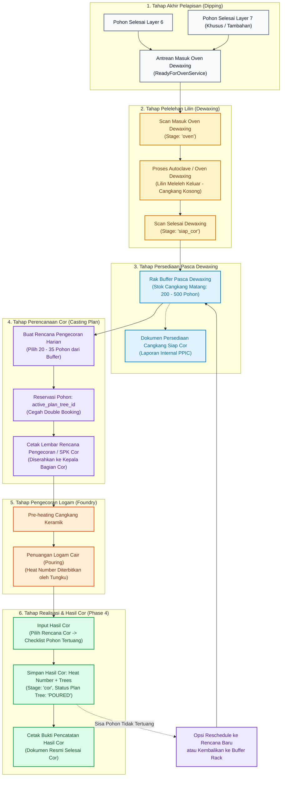
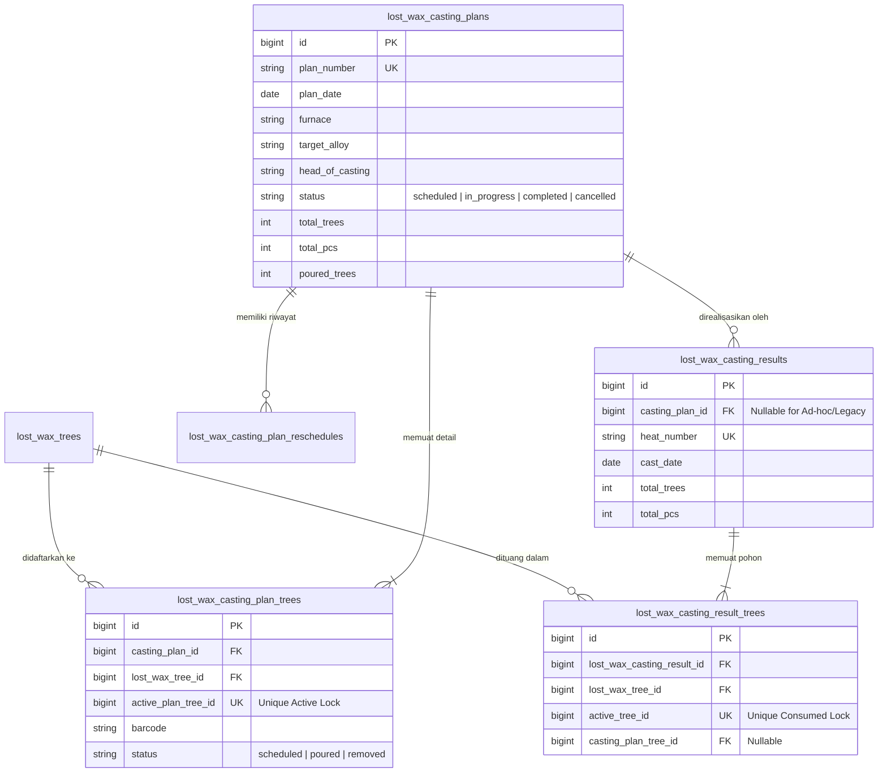

# LAPORAN AUDIT TEKNIS & BLUEPRINT ARSITEKTUR
# RANCANGAN WORKFLOW RENCANA PENGECORAN (CASTING PLAN) MODUL LOST WAX

**Repository:** `C:\laragon\www\kanban-ppic`  
**Fitur Fokus:** Workflow Rencana Pengecoran (Casting Plan), Buffer Pasca Dewaxing, & Integrasi Phase 1–4  
**Dokumen Referensi:** 
- `AUDIT_LOST_WAX_PHASE3_BARANG_SIAP_COR.md`
- `IMPLEMENTATION_LOST_WAX_PHASE3_BARANG_SIAP_COR.md`
- `AUDIT_LOST_WAX_PHASE4_INPUT_HASIL_COR.md`
- `IMPLEMENTATION_LOST_WAX_PHASE4_INPUT_HASIL_COR.md`
- Codebase audit: `ReadyForOvenService.php`, `ScanService.php`, `ScanSiapCorService.php`, `ReadyForCastingService.php`, `LostWaxCastingResultService.php`  
**Sifat Tugas:** **Strict Read-Only Technical Audit & Architectural Blueprint** (Zero Code Modification, Zero Database Migration)  
**Tanggal Audit:** 11 November 2026  

---

## 1. Ringkasan Eksekutif (Executive Summary)

Audit teknis ini dilakukan untuk merespons temuan operasional lapangan pasca implementasi Phase 1 sampai Phase 4 Lost Wax. Secara fisik di pabrik:
1. **Dipping/Pelapisan:** Cangkang keramik normal selesai pada **Layer 6**, namun terdapat produk tertentu yang memerlukan atau secara situasional diberi lapisan tambahan hingga **Layer 7**. Keduanya sah untuk masuk ke tahap Oven Dewaxing.
2. **Dewaxing (Oven):** Proses pelelehan lilin (dewaxing) di dalam oven uap/autoclave bukanlah proses penuangan logam, melainkan proses pengosongan cangkang keramik dari pola lilin.
3. **Buffer Pasca Dewaxing:** Cangkang kosong hasil dewaxing disimpan di rak buffer antrean (berkisar antara 200 hingga 500 pohon cangkang siap cor).
4. **Kebutuhan Rencana Pengecoran:** Sebelum penuangan logam cair aktual, PPIC bersama Kepala Bagian Pengecoran menyusun **Rencana Pengecoran Harian** (misal 20–35 pohon per hari berdasarkan kapasitas tungku induksi dan jenis paduan/alloy). Dokumen rencana ini dicetak dan menjadi Surat Perintah Kerja (SPK) bagi tim cor.
5. **Realisasi Hasil Cor:** Transaksi Input Hasil Cor (Phase 4) yang saat ini menghubungkan Traveler Card ke Heat Number aktual semestinya mengonsumsi pohon yang telah dijadwalkan dalam Rencana Pengecoran, dengan tetap mengakomodasi kasus penuangan parsial (sebagian pohon tertunda) atau penuangan darurat (ad-hoc).

**Hasil Kesimpulan Audit Teknis:**
- **Kondisi Codebase:** Implementasi Phase 1–4 berada dalam kondisi sangat sehat, stabil, dan memiliki test coverage yang tinggi (15 unit/feature test lolos 100%).
- **Kelayakan Arsitektur:** Workflow Rencana Pengecoran dapat ditambahkan secara mulus (**non-breaking enhancement**) tanpa merusak struktur Phase 4 yang sudah berjalan. Skema tabel baru `lost_wax_casting_plans` dan `lost_wax_casting_plan_trees` dapat diintegrasikan secara backward-compatible melalui relasi opsional (`nullable foreign key`) pada `lost_wax_casting_results`.
- **Integritas Konkurensi:** Mekanisme *active reservation* berbasis indeks unik basis data (`active_plan_tree_id`) yang terbukti sukses mencegah konsumsi ganda pada Phase 4 dapat diadopsi kembali untuk menjamin satu Traveler Card tidak pernah dijadwalkan pada dua rencana cor aktif yang bersamaan.

---

## 2. Peta Implementasi Saat Ini (Current Implementation Map)

Tabel berikut memetakan seluruh komponen terkait tahapan akhir Lost Wax (dari Pelapisan hingga Hasil Cor) yang saat ini aktif di repositori:

| # | Komponen / Halaman | Route Name | File Controller / View | Domain Service | Model / Tabel Basis Data | Fungsi Utama & Kondisi Saat Ini |
|---|--------------------|------------|------------------------|----------------|--------------------------|---------------------------------|
| 1 | **Scan Masuk Oven** | `lost-wax.scan-oven.*` | `LostWaxScanOvenController`<br>`resources/views/lost-wax/scan-oven.blade.php` | `app/Services/LostWax/ScanService.php` | `LostWaxTree`<br>`LostWaxScanEvent`<br>`table: lost_wax_trees` | Mencatat masuk oven dewaxing. Mengubah `current_stage` menjadi `'oven'`. Menerima pohon dari `layer_6` dan `layer_7`. |
| 2 | **Antrean Siap Oven** | `lost-wax.reports.ready-for-oven` | `LostWaxReportController::readyForOven`<br>`resources/views/lost-wax/reports/ready-for-oven.blade.php` | `app/Services/LostWax/ReadyForOvenService.php` | `LostWaxTree`<br>`LostWaxScanEvent` | Menampilkan pohon cangkang yang selesai pelapisan dan siap dide-wax. Terdapat bug logika pada pohon Layer 7 tanpa flag manual. |
| 3 | **Cetak Siap Oven** | `lost-wax.reports.ready-for-oven-print` | `LostWaxReportController::readyForOvenPrint`<br>`resources/views/lost-wax/reports/ready-for-oven-print.blade.php` | `ReadyForOvenService.php` | `LostWaxTree` | Lembar cetak antrean cangkang untuk diserahkan ke operator oven dewaxing. |
| 4 | **Scan Siap Cor** | `lost-wax.scan-siap-cor.*` | `LostWaxScanSiapCorController`<br>`resources/views/lost-wax/scan-siap-cor.blade.php` | `app/Services/LostWax/ScanSiapCorService.php` | `LostWaxTree`<br>`LostWaxScanEvent` | Mencatat selesainya proses oven dewaxing. Mengubah `current_stage` dari `'oven'` menjadi `'siap_cor'` (masuk rak buffer pasca dewaxing). |
| 5 | **Barang Siap Cor** (Buffer Inventory) | `lost-wax.reports.ready-for-casting` | `LostWaxReportController::readyForCasting`<br>`resources/views/lost-wax/reports/ready-for-casting.blade.php` | `app/Services/LostWax/ReadyForCastingService.php` | `LostWaxTree`<br>`LostWaxScanEvent`<br>`LostWaxCastingResultTree` | Menampilkan seluruh persediaan cangkang pasca dewaxing (200–500 pohon) yang belum pernah dicor. Saat ini berfungsi sebagai daftar inventory buffer. |
| 6 | **Cetak Siap Cor** | `lost-wax.reports.ready-for-casting-print` | `LostWaxReportController::readyForCastingPrint`<br>`resources/views/lost-wax/reports/ready-for-casting-print.blade.php` | `ReadyForCastingService.php` | `LostWaxTree` | Lembar cetak daftar pohon yang siap dicor. Belum terikat pada nomor rencana pengecoran harian. |
| 7 | **Form Input Hasil Cor** | `lost-wax.casting-results.create` | `LostWaxCastingResultController::create`<br>`resources/views/lost-wax/casting-results/create.blade.php` | `ReadyForCastingService.php`<br>`LostWaxCastingResultService.php` | `LostWaxCastingResult`<br>`LostWaxCastingResultTree`<br>`LostWaxTree` | Mengambil langsung seluruh antrean pohon `siap_cor` dari `ReadyForCastingService`, mencentang pohon, dan menugaskan ke satu Heat Number. |
| 8 | **Simpan Hasil Cor** | `lost-wax.casting-results.store` | `LostWaxCastingResultController::store` | `LostWaxCastingResultService::storeCastingResult` | `lost_wax_casting_results`<br>`lost_wax_casting_result_trees`<br>`lost_wax_trees` | Menyimpan transaksi penuangan cor. Menyetel `current_stage = 'cor'`, mengisi `active_tree_id`, mengonsumsi cangkang secara permanen. |
| 9 | **Riwayat & Cetak Hasil Cor** | `lost-wax.casting-results.index`<br>`lost-wax.casting-results.show`<br>`lost-wax.casting-results.print` | `LostWaxCastingResultController` | `LostWaxCastingResultService.php` | `lost_wax_casting_results`<br>`lost_wax_casting_result_trees` | Menampilkan riwayat Heat Number, detail pohon tertuang, dan cetak Bukti Pencatatan Hasil Cor. |
| 10 | **Batalkan Hasil Cor** | `lost-wax.casting-results.cancel` | `LostWaxCastingResultController::cancel` | `LostWaxCastingResultService::cancelCastingResult` | `lost_wax_casting_results`<br>`lost_wax_casting_result_trees`<br>`lost_wax_trees` | Membatalkan transaksi hasil cor, mengosongkan `active_tree_id = NULL`, mengembalikan status pohon ke `siap_cor`. |

---

## 3. Gap Analysis (Analisis Kesenjangan)

Audit teknis mendalam menemukan 6 kesenjangan antara praktik fisik di lantai pabrik dan implementasi kode saat ini:

| # | Kebutuhan Produksi Lapangan | Kondisi Kode Saat Ini | Gap Teknis | Dampak Operasional | Rekomendasi Solusi |
|---|-----------------------------|-----------------------|------------|---------------------|--------------------|
| 1 | **Kelayakan Layer 6 & Layer 7 Siap Oven**<br>Pohon selesai Layer 6 atau Layer 7 (baik default maupun dinamis) langsung berhak masuk Oven Dewaxing. | `ReadyForOvenService.php:54-76` & `115-121` membagi kueri berdasarkan `$tree->require_layer_7`. Jika pohon dibuat dengan default `false`, namun di lapangan dilapisi hingga Layer 7, pohon tersebut tidak muncul pada tab Layer 7 maupun Layer 6. | Inkonsistensi filter: `ScanService::processOvenScan` (baris 178) sudah menerima `layer_6` dan `layer_7`, namun `ReadyForOvenService` memblokirnya dari tampilan antrean jika status flag tidak sinkron. | Pohon Layer 7 dinamis "hilang" dari layar antrean Siap Oven operator, meskipun barcode-nya valid saat discan. | Sederhanakan kueri `ReadyForOvenService`: pohon berhak siap oven jika `current_stage IN ('layer_6', 'layer_7')` dan scan terakhir sukses tanpa void. |
| 2 | **Semantik Proses Scan Oven**<br>Scan ini secara fisik adalah *Scan Masuk Oven Dewaxing* (Pelelehan Lilin). | Route: `/lost-wax/scan-oven`<br>Label: `Scan Oven`. Controller: `LostWaxScanOvenController`. | Penamaan cukup akurat, namun narasi UI belum menegaskan bahwa ini adalah tahap dewaxing, bukan pemanasan jelang tuang. | Potensi salah tafsir oleh admin baru antara oven dewaxing vs oven pre-heating cor. | Pertahankan route dan controller, perjelas subjudul UI: *"Scan Masuk Oven Dewaxing (Pelelehan Lilin)"*. |
| 3 | **Semantik Proses Scan Siap Cor**<br>Scan ini secara fisik adalah *Scan Selesai Dewaxing & Masuk Rak Buffer*. | Route: `/lost-wax/scan-siap-cor`<br>Stage: `'siap_cor'`. Menandai cangkang keluar dari oven dewaxing menuju rak penyimpanan. | Nama stage `'siap_cor'` diartikan sebagai "siap dituang hari ini", padahal cangkang masih tersimpan di rak buffer (bisa berhari-hari). | Pemahaman status WIP rancu antara "persediaan cangkang matang di rak" vs "jadwal penuangan harian". | Pertahankan nama stage teknis `'siap_cor'` demi stabilitas database, namun ubah label tampilan UI menjadi *"Scan Selesai Dewaxing (Masuk Buffer Cor)"*. |
| 4 | **Pemisahan Antara Persediaan Buffer vs Jadwal Pengecoran**<br>Pabrik memiliki stok cangkang 200–500 pohon di rak. Pengecoran harian hanya membutuhkan 20–35 pohon sesuai kapasitas tungku. | Halaman `Barang Siap Cor` (`ReadyForCastingService`) saat ini langsung menjadi sumber checklist pada `Input Hasil Cor` (Phase 4). | Tidak ada entitas perantara untuk menyusun Rencana Pengecoran harian (Casting Plan). Admin harus mencari 20 pohon di antara 500 pohon di halaman input hasil cor. | 1. Admin kesulitan memilih pohon saat input hasil cor.<br>2. Tidak ada dokumen SPK Cor resmi sebelum penuangan dilakukan.<br>3. Tidak ada proteksi reservasi pohon antar admin. | Buat fitur dan tabel baru **Rencana Pengecoran (Casting Plan)**. Pindahkan fungsi Phase 3 murni sebagai *"Persediaan Pasca Dewaxing / Buffer Rak"*, dan buat SPK dari Rencana Pengecoran. |
| 5 | **Kebutuhan Dokumen SPK Cor Resmi**<br>Kepala Bagian Cor memerlukan lembar kerja berisi daftar pohon yang *direncanakan* untuk dituang pada shift/tanggal tertentu beserta target paduan logam (alloy). | Cetak Phase 3 mencetak seluruh antrean buffer, sedangkan Cetak Phase 4 mencetak bukti *setelah* penuangan selesai. | Tidak ada dokumen cetak resmi untuk fase perencanaan sebelum penuangan logam. | Operator cor bekerja berdasarkan instruksi lisan atau catatan manual di kertas coretan. | Buat template cetak dokumen: *"Lembar Rencana Pengecoran / SPK Cor"* berbasis nomor rencana (`plan_number`). |
| 6 | **Realisasi Pengecoran Tidak Penuh (Partial Realization)**<br>Rencana cor menargetkan 30 pohon, namun karena keterbatasan kapasitas tungku atau waktu, hanya 25 pohon yang berhasil dituang pada Heat A. Sisa 5 pohon ditunda ke shift berikutnya. | Phase 4 saat ini mengonsumsi pohon secara langsung dan permanen (`current_stage = 'cor'`). | Jika dibuat Rencana Cor, belum ada mekanisme yang menangani sisa pohon yang tidak tertuang agar tetap aman di buffer atau dijadwalkan ulang. | Pohon yang batal dituang bisa "tergantung" statusnya jika rencana cor bersifat mengunci tanpa opsi reschedule/release. | Desain relasi Rencana Cor dengan status per pohon (`SCHEDULED`, `POURED`, `REMOVED`), sehingga sisa pohon dapat di-reschedule atau dikembalikan ke buffer secara aman. |

---

## 4. Rancangan Workflow Baru (Proposed Workflow)

Workflow yang diusulkan menghubungkan seluruh tahapan dari Pelapisan hingga Selesai Cor secara runut, aman, dan mencerminkan alur fisik pabrik yang sebenarnya:



---

## 5. Rancangan Basis Data (Proposed Database Design)

Untuk mendukung alur Rencana Pengecoran tanpa mengganggu stabilitas data Phase 4 yang sudah ada, dirancang dua tabel baru dengan pola integritas yang identik dengan arsitektur Phase 4 (`active_tree_id` pattern):

### A. Tabel `lost_wax_casting_plans` (Header Rencana Pengecoran)

Tabel ini menyimpan identitas dokumen rencana kerja pengecoran harian:

```sql
CREATE TABLE `lost_wax_casting_plans` (
    `id` BIGINT UNSIGNED NOT NULL AUTO_INCREMENT PRIMARY KEY,
    `plan_number` VARCHAR(50) NOT NULL UNIQUE,       -- Format: CP-YYYYMMDD-XXXX (misal: CP-20261111-0001)
    `plan_date` DATE NOT NULL,                        -- Tanggal rencana penuangan
    `furnace` VARCHAR(50) NULL,                       -- Identitas tungku (opsional, misal: Induksi 1, Induksi 2)
    `target_alloy` VARCHAR(50) NULL,                  -- Target paduan logam (opsional, misal: FCD 450, FC 250, SS304)
    `head_of_casting` VARCHAR(100) NULL,              -- Nama Kepala Bagian Cor penerima SPK
    `status` ENUM('scheduled', 'in_progress', 'completed', 'cancelled') NOT NULL DEFAULT 'scheduled',
    `total_trees` INT UNSIGNED NOT NULL DEFAULT 0,    -- Snapshot jumlah pohon terdaftar
    `total_pcs` INT UNSIGNED NOT NULL DEFAULT 0,      -- Snapshot total PCS terdaftar
    `poured_trees` INT UNSIGNED NOT NULL DEFAULT 0,   -- Jumlah pohon yang sudah berhasil dituang
    `notes` TEXT NULL,                                -- Catatan teknis rencana
    `created_by` BIGINT UNSIGNED NULL,                -- User PPIC pembuat rencana
    `updated_by` BIGINT UNSIGNED NULL,
    `created_at` TIMESTAMP NULL,
    `updated_at` TIMESTAMP NULL,
    INDEX `idx_lw_cp_date_status` (`plan_date`, `status`),
    CONSTRAINT `fk_lw_cp_created_by` FOREIGN KEY (`created_by`) REFERENCES `users` (`id`) ON DELETE SET NULL
) ENGINE=InnoDB DEFAULT CHARSET=utf8mb4 COLLATE=utf8mb4_unicode_ci;
```

### B. Tabel `lost_wax_casting_plan_trees` (Detail Pohon dalam Rencana)

Tabel ini mencatat pohon-pohon yang dimasukkan ke dalam rencana, dilengkapi kolom kunci **`active_plan_tree_id`** untuk proteksi konkurensi tingkat basis data:

```sql
CREATE TABLE `lost_wax_casting_plan_trees` (
    `id` BIGINT UNSIGNED NOT NULL AUTO_INCREMENT PRIMARY KEY,
    `casting_plan_id` BIGINT UNSIGNED NOT NULL,
    `lost_wax_tree_id` BIGINT UNSIGNED NOT NULL,
    
    -- KOLOM KUNCI INTEGRITAS (UNIQUE CONSTRAINT PATTERN):
    -- Bernilai lost_wax_tree_id jika status pohon masih aktif dalam rencana ('scheduled').
    -- Bernilai NULL jika pohon sudah dituang ('poured'), dikeluarkan ('removed'), atau rencana dibatalkan ('cancelled').
    `active_plan_tree_id` BIGINT UNSIGNED NULL,
    
    `barcode` VARCHAR(50) NOT NULL,
    `production_code` VARCHAR(100) NULL,
    `quantity_pcs` INT UNSIGNED NOT NULL DEFAULT 0,
    `status` ENUM('scheduled', 'poured', 'removed') NOT NULL DEFAULT 'scheduled',
    `removed_reason` VARCHAR(255) NULL,               -- Alasan jika pohon dikeluarkan dari rencana sebelum cor
    `removed_by` BIGINT UNSIGNED NULL,
    `removed_at` DATETIME NULL,
    `created_at` TIMESTAMP NULL,
    `updated_at` TIMESTAMP NULL,
    
    -- Constraint Unik: Mencegah 1 pohon masuk ke > 1 Rencana Pengecoran aktif secara bersamaan!
    UNIQUE KEY `uk_lw_cpt_active_tree` (`active_plan_tree_id`),
    
    INDEX `idx_lw_cpt_plan_status` (`casting_plan_id`, `status`),
    INDEX `idx_lw_cpt_tree` (`lost_wax_tree_id`),
    CONSTRAINT `fk_lw_cpt_plan` FOREIGN KEY (`casting_plan_id`) REFERENCES `lost_wax_casting_plans` (`id`) ON DELETE CASCADE,
    CONSTRAINT `fk_lw_cpt_tree` FOREIGN KEY (`lost_wax_tree_id`) REFERENCES `lost_wax_trees` (`id`) ON DELETE RESTRICT
) ENGINE=InnoDB DEFAULT CHARSET=utf8mb4 COLLATE=utf8mb4_unicode_ci;
```

### C. Tabel Audit Log Reschedule: `lost_wax_casting_plan_reschedules`

Mencatat riwayat pemindahan tanggal rencana jika penuangan tertunda akibat kendala teknis tungku:

```sql
CREATE TABLE `lost_wax_casting_plan_reschedules` (
    `id` BIGINT UNSIGNED NOT NULL AUTO_INCREMENT PRIMARY KEY,
    `casting_plan_id` BIGINT UNSIGNED NOT NULL,
    `old_plan_date` DATE NOT NULL,
    `new_plan_date` DATE NOT NULL,
    `reason` TEXT NOT NULL,
    `rescheduled_by` BIGINT UNSIGNED NOT NULL,
    `created_at` TIMESTAMP NOT NULL DEFAULT CURRENT_TIMESTAMP,
    CONSTRAINT `fk_lw_cpr_plan` FOREIGN KEY (`casting_plan_id`) REFERENCES `lost_wax_casting_plans` (`id`) ON DELETE CASCADE,
    CONSTRAINT `fk_lw_cpr_user` FOREIGN KEY (`rescheduled_by`) REFERENCES `users` (`id`) ON DELETE RESTRICT
) ENGINE=InnoDB DEFAULT CHARSET=utf8mb4 COLLATE=utf8mb4_unicode_ci;
```

### D. Relasi dan Modifikasi Aman pada Phase 4 (`lost_wax_casting_results`)

Untuk menghubungkan transaksi penuangan Phase 4 dengan Rencana Pengecoran secara aman tanpa merusak data lampau (*backward-compatible*):

```sql
-- Penambahan kolom opsional (nullable) pada tabel Phase 4 eksisting:
ALTER TABLE `lost_wax_casting_results`
    ADD COLUMN `casting_plan_id` BIGINT UNSIGNED NULL AFTER `cast_date`,
    ADD CONSTRAINT `fk_lw_cr_casting_plan` FOREIGN KEY (`casting_plan_id`) 
        REFERENCES `lost_wax_casting_plans` (`id`) ON DELETE SET NULL;

ALTER TABLE `lost_wax_casting_result_trees`
    ADD COLUMN `casting_plan_tree_id` BIGINT UNSIGNED NULL AFTER `lost_wax_tree_id`,
    ADD CONSTRAINT `fk_lw_crt_plan_tree` FOREIGN KEY (`casting_plan_tree_id`) 
        REFERENCES `lost_wax_casting_plan_trees` (`id`) ON DELETE SET NULL;
```

### E. Diagram Hubungan Antar Tabel (Entity Relationship)



---

## 6. Strategi Integrasi dengan Phase 4 (Input Hasil Cor)

Implementasi Phase 4 yang baru saja selesai menggunakan domain service `LostWaxCastingResultService.php` dan `ReadyForCastingService.php`. Integrasi Rencana Pengecoran dirancang dengan prinsip **kombinasi modular**:

### A. Alur Pemilihan Pohon pada Halaman Input Hasil Cor

Pada form Input Hasil Cor (`/lost-wax/casting-results/create`), UI diperkaya dengan mode sumber data:
1. **Mode 1: Berdasarkan Rencana Pengecoran (Rekomendasi Utama):**
   - Admin memilih nomor Rencana Pengecoran dari dropdown rencana aktif (`status IN ('scheduled', 'in_progress')`).
   - Sistem secara otomatis menampilkan **hanya pohon-pohon yang terdaftar dalam rencana tersebut yang statusnya masih `scheduled`** (misal 25–35 pohon).
   - Admin tidak lagi dibebani mencari pohon di antara 500 pohon di rak buffer.
2. **Mode 2: Penuangan Langsung / Ad-hoc (Bypass Rencana):**
   - Untuk kasus penuangan darurat (misal ada pohon sample mendesak yang dituang tanpa rencana sebelumnya) atau untuk data transisi.
   - Admin dapat memilih *"Penuangan Tanpa Rencana / Ad-hoc"*, yang akan memuat pohon dari buffer cangkang pasca dewaxing yang **tidak sedang direservasi oleh rencana apa pun** (`whereDoesntHave('activePlanTree')`).

### B. Penanganan Realisasi Penuh vs Realisasi Sebagian (Partial Realization)

Sering kali di lantai pabrik, dari 30 pohon yang direncanakan:
- **Skenario 1 (Realisasi Penuh):** Seluruh 30 pohon tertuang dalam Heat A.
  - Seluruh 30 baris pada `lost_wax_casting_plan_trees` beralih ke `status = 'poured'`, `active_plan_tree_id = NULL`.
  - Header `lost_wax_casting_plans` beralih ke `status = 'completed'`.
- **Skenario 2 (Realisasi Sebagian / Partial):** Hanya 25 pohon yang tertuang pada Heat A. Sisa 5 pohon belum dituang karena kapasitas tungku penuh.
  - 25 pohon yang tertuang: Disimpan ke `lost_wax_casting_results` (Heat A), status plan tree menjadi `'poured'`, `active_plan_tree_id = NULL`, `current_stage = 'cor'`.
  - 5 pohon yang tersisa: Tetap berstatus `'scheduled'` dengan `active_plan_tree_id = lost_wax_tree_id`.
  - Status header rencana menjadi `'in_progress'`.
  - Admin memiliki 2 opsi tindakan untuk 5 pohon sisa tersebut:
    1. **Dituang pada Heat Berikutnya:** Dimasukkan ke Heat B pada hari yang sama atau rencana yang sama.
    2. **Dikeluarkan / Dikembalikan ke Buffer:** Admin mengklik tombol *"Keluarkan dari Rencana"*, mengisi alasan (misal: "Kapasitas tungku tidak mencukupi"), status pohon menjadi `'removed'`, `active_plan_tree_id = NULL`. Pohon otomatis kembali muncul sebagai pohon bebas di rak buffer pasca dewaxing.

### C. Penanganan Pembatalan Transaksi Cor (Void/Cancel Heat Result)

Jika transaksi hasil cor Heat A dibatalkan via `LostWaxCastingResultService::cancelCastingResult`:
- Transaksi hasil cor ditandai `is_cancelled = true`.
- Kolom `active_tree_id` pada `lost_wax_casting_result_trees` di-set menjadi `NULL`.
- Status pohon pada `lost_wax_trees` kembali menjadi `current_stage = 'siap_cor'`.
- **Integrasi dengan Rencana:** Jika hasil cor tersebut berasal dari suatu Rencana Pengecoran, relasi `lost_wax_casting_plan_trees` untuk pohon terkait dikembalikan statusnya dari `'poured'` menjadi `'scheduled'`, dan `active_plan_tree_id` diisi kembali sebesar `lost_wax_tree_id`. Status header rencana kembali menjadi `'in_progress'`.

### D. Kompatibilitas Penuh dengan Data Legacy (Masa Lalu)

- Transaksi hasil cor Phase 4 yang telah tersimpan sebelum fitur Rencana Pengecoran dibuat memiliki nilai `casting_plan_id = NULL`.
- Seluruh kueri riwayat, detail, dan cetak Phase 4 menggunakan *null-safe navigation* (`$result->castingPlan?->plan_number ?? 'Non-Plan / Ad-hoc'`).
- Tidak ada data masa lalu yang rusak atau invalid.

---

## 7. Dampak pada UI dan Sidebar (UI & Sidebar Impact)

### A. Penyelarasan Urutan Menu Sidebar (`resources/views/layouts/app.blade.php`)

Menu baru **Rencana Pengecoran** ditempatkan tepat di antara persediaan cangkang dan input hasil cor, dengan penyesuaian label agar mencerminkan tahapan fisik:

```text
URUTAN MENU SIDEBAR LOST WAX SAAT INI           URUTAN MENU SIDEBAR BARU YANG DIREKOMENDASIKAN
--------------------------------------           -----------------------------------------------
1.  Perintah Cetak                               1.  Perintah Cetak
2.  Hasil Cetak                                  2.  Hasil Cetak
3.  Rangkai                                      3.  Rangkai
4.  Hasil Rangkai                                4.  Hasil Rangkai
5.  Rangkaian / Traveler                         5.  Rangkaian / Traveler
6.  Scan Lapisan                                 6.  Scan Lapisan
7.  Scan Oven                                    7.  Scan Masuk Oven (Dewaxing)
8.  Barang Siap Oven                             8.  Antrean Siap Oven (Dewaxing)
9.  Scan Siap Cor                                9.  Scan Selesai Dewaxing
10. Barang Siap Cor                             10. Persediaan Pasca Dewaxing (Buffer Cor)
                                                11. Rencana Pengecoran [MENU BARU]
11. Input Hasil Cor                             12. Input Hasil Cor
12. Rak Monitoring                              13. Rak Monitoring
13. Production Status                           14. Production Status
14. Rekap Kerusakan                             15. Rekap Kerusakan
15. Report Produksi                             16. Report Produksi
```

### B. Perbedaan 4 Dokumen Cetak Fisik Terkait Pengecoran

Untuk menghindari tumpang tindih dokumen operasional di pabrik, sistem membedakan 4 dokumen dengan peruntukan yang tegas:

| # | Nama Dokumen | Template View Blade | Pengguna Dokumen | Kapan Dicetak? | Isi Utama Dokumen |
|---|--------------|---------------------|------------------|----------------|-------------------|
| 1 | **Lembar Antrean Siap Oven** | `views/lost-wax/reports/ready-for-oven-print.blade.php` | Operator Oven Dewaxing | Saat batch pelapisan selesai dan akan dimasukkan ke oven uap. | Daftar pohon Layer 6/7, barcode, rak asal, dan tanggal pelapisan. |
| 2 | **Laporan Persediaan Pasca Dewaxing** | `views/lost-wax/reports/ready-for-casting-print.blade.php` | PPIC & Kepala Produksi | Saat stock opname atau evaluasi persediaan cangkang matang di rak buffer. | Total persediaan cangkang matang (200–500 pohon), umur cangkang di rak, dan total PCS per jenis produk. |
| 3 | **Lembar Rencana Pengecoran (SPK Cor)** | `views/lost-wax/casting-plans/print.blade.php` **[BARU]** | Kepala Bagian Pengecoran & Operator Tungku | **Sebelum penuangan logam cair dimulai** (awal shift/jadwal cor). | Nomor Rencana (`CP-...`), tanggal cor, target tungku, target alloy, daftar 20–35 pohon terpilih, kolom paraf penuangan, dan kolom catatan aktual. |
| 4 | **Bukti Pencatatan Hasil Cor** | `views/lost-wax/casting-results/print.blade.php` | Kepala Cor & Departemen Finishing/Bubut | **Setelah penuangan selesai** dan data Heat Number diinput ke sistem. | Nomor Heat (`A4...`), tanggal tuang aktual, daftar pohon yang tertuang, total PCS, dan nomor referensi Rencana Pengecoran. |

---

## 8. Strategi Pengujian (Test Strategy)

Pengujian fitur Rencana Pengecoran wajib mencakup matriks skenario pengujian komprehensif berikut:

| # | Kategori Pengujian | Skenario Uji | Ekspektasi Hasil | Level Validasi |
|---|--------------------|--------------|------------------|----------------|
| 1 | **Double Reservation Prevention** | Mencoba memasukkan pohon yang sama ke dalam dua Rencana Pengecoran yang berbeda secara bersamaan. | Rencana kedua ditolak dengan pesan error validasi. Kolom `active_plan_tree_id` memicu `QueryException` unik jika validasi service ditembus. | Database Constraint & Service Exception |
| 2 | **Rescheduling Plan** | Mengubah tanggal rencana cor dari hari ini ke besok dengan mengisi alasan perubahan. | Tanggal rencana terupdate, riwayat tercatat di `lost_wax_casting_plan_reschedules`, seluruh pohon tetap berstatus `scheduled` dan tetap tereservasi. | Unit / Service Test |
| 3 | **Partial Realization** | Rencana memuat 30 pohon. Admin menginput hasil cor untuk 25 pohon pada Heat A. | - 25 pohon beralih ke `poured`, `current_stage = 'cor'`.<br>- 5 pohon tetap `scheduled` dalam rencana.<br>- Status rencana menjadi `in_progress`. | Feature Test Integration |
| 4 | **Cancel Casting Plan** | Membatalkan rencana cor yang belum pernah dituang (`status = 'cancelled'`). | Seluruh pohon dalam rencana dilepaskan reservasinya (`active_plan_tree_id = NULL`). Pohon langsung kembali tersedia di buffer pasca dewaxing. | Feature Test |
| 5 | **Remove Tree from Plan** | Mengeluarkan 1 pohon dari rencana aktif sebelum penuangan dengan alasan "Cangkang retak". | Status pohon pada detail rencana menjadi `removed`, alasan tersimpan, reservasi dilepas (`active_plan_tree_id = NULL`), total kuantitas rencana berkurang otomatis. | Feature Test |
| 6 | **Cancel Casting Result (Rollback)** | Membatalkan Heat Result yang berasal dari suatu Rencana Cor. | Transaksi Heat batal, `active_tree_id` di-set NULL, pohon kembali ke stage `'siap_cor'`, dan status pohon pada Rencana Cor kembali ke `'scheduled'`. | Feature Test Integration |
| 7 | **Race Condition / Concurrency** | Dua admin membuka form Buat Rencana Cor pada detik yang sama dan memilih 5 pohon yang saling beririsan. | Transaksi pertama berhasil. Transaksi kedua rollback secara atomik dengan error user-friendly: *"Beberapa pohon telah dipilih dalam rencana lain"*. | Concurrency Test (`lockForUpdate`) |
| 8 | **Regression Test Phase 1–4** | Menjalankan seluruh test suite eksisting (`LostWaxScanSiapCorTest`, `LostWaxCastingResultTest`, dll). | Seluruh 15 test suite lama tetap hijau (Pass 100%) tanpa regresi. | PHPUnit Regression Suite |
| 9 | **Legacy Data Compatibility** | Menampilkan riwayat hasil cor dan mencetak dokumen hasil cor untuk data masa lalu yang tidak memiliki `casting_plan_id`. | Tampilan tidak melempar null exception, label rencana menampilkan *"Penuangan Langsung (Ad-hoc)"*. | Regression / Blade Test |

---

## 9. Keputusan Bisnis yang Perlu Dikonfirmasi (Unresolved Business Decisions)

Sebelum tahap implementasi kode dimulai, terdapat 6 keputusan bisnis yang memerlukan konfirmasi dari Product Owner / Manajemen PPIC:

### Keputusan 1: Apakah Pembuatan Rencana Pengecoran Wajib (Mandatory) atau Opsional?
- **Opsi A (Wajib / Strict):** Seluruh input hasil cor di Phase 4 harus merujuk pada nomor Rencana Pengecoran yang sah. Tidak ada pohon yang boleh dicor tanpa rencana tertulis.
  - *Dampak Teknis:* Menjamin 100% kepatuhan SOP PPIC, namun jika terjadi penuangan mendesak di luar jam kerja PPIC, operator tidak bisa langsung menginput hasil cor.
- **Opsi B (Opsional / Fleksibel - Rekomendasi):** Sistem menyediakan dropdown Rencana Pengecoran sebagai alur utama, namun tetap menyediakan sakelar/opsi *"Penuangan Langsung (Ad-hoc)"* untuk kasus darurat dengan kewajiban mengisi alasan.
  - *Dampak Teknis:* Alur kerja lebih luwes di lapangan, transisi dari sistem lama ke baru berlangsung mulus tanpa resistensi operator.

### Keputusan 2: Penanganan Sisa Pohon pada Realisasi Sebagian (Partial Realization)
- **Opsi A (Tetap di Rencana Eksisting - Rekomendasi):** Sisa pohon tetap tinggal di dalam rencana tersebut (`status = 'scheduled'`) hingga dituang pada Heat berikutnya atau dikeluarkan manual oleh admin.
  - *Dampak Teknis:* Logika sederhana, tidak membingungkan, histori rencana mencerminkan tahapan penuangan bertahap.
- **Opsi B (Otomatis Buat Rencana Baru / Carry Over):** Sistem secara otomatis membuat rencana pecahan baru (misal: `CP-20261111-0001-B`) untuk menampung sisa pohon.
  - *Dampak Teknis:* Menambah kompleksitas nomor dokumen dan kueri pelacakan.

### Keputusan 3: Penjadwalan Lintas Tanggal (Reschedule Policy)
- **Opsi A (Update Tanggal dengan Log Alasan - Rekomendasi):** Dokumen rencana yang sama diperpanjang tanggalnya ke hari berikutnya dengan mencatat alasan penundaan (misal: "Kerusakan coil tungku").
  - *Dampak Teknis:* Nomor SPK yang dipegang Kepala Cor tetap sama, tidak perlu mencetak ulang barcode kartu.
- **Opsi B (Tutup Rencana & Terbitkan Rencana Baru):** Rencana lama ditutup dengan status `cancelled`, lalu diterbitkan nomor rencana baru untuk esok hari.
  - *Dampak Teknis:* Lebih banyak nomor dokumen yang harus dicetak ulang.

### Keputusan 4: Dokumen Fisik yang Menjadi Acuan Kerja Kepala Cor
- **Opsi A (Cukup Lembar Rencana Pengecoran - Rekomendasi):** Kepala Cor hanya memegang Dokumen Rencana Pengecoran (SPK Cor) yang memuat 20–35 pohon target. Laporan Persediaan Pasca Dewaxing murni dipegang PPIC di kantor.
  - *Dampak Teknis:* Area tungku tidak dipenuhi kertas daftar persediaan yang panjang (200–500 baris).
- **Opsi B (Kedua Dokumen Diberikan ke Cor):** Kepala Cor menerima kedua dokumen.

### Keputusan 5: Kriteria Penutupan Status Rencana (`status = 'completed'`)
- **Opsi A (Otomatis Saat Seluruh Pohon Selesai):** Status otomatis berubah menjadi `completed` begitu seluruh pohon berstatus `poured` atau `removed`.
  - *Dampak Teknis:* Otomatis dan bebas lupa.
- **Opsi B (Tombol Manual "Tutup Rencana" oleh PPIC - Rekomendasi Kombinasi):** Sistem otomatis mengubah ke `completed` jika semua pohon tertuang, namun juga menyediakan tombol *"Tutup Rencana"* manual jika sisa pohon diputuskan batal dituang dan dikembalikan ke buffer.

### Keputusan 6: Strategi Penamaan Label Menu Sidebar
- **Opsi A (Ubah Langsung Sesuai Terminologi Fisik):** Ubah nama label sidebar menjadi *"Scan Masuk Oven"*, *"Scan Selesai Dewaxing"*, dan *"Persediaan Pasca Dewaxing"*.
  - *Dampak Teknis:* Sangat jelas bagi pemula, namun operator lama mungkin membutuhkan adaptasi selama 1–2 hari.
- **Opsi B (Bertahap / Label Kombinasi - Rekomendasi):** Gunakan label transisi seperti *"Scan Selesai Dewaxing (Siap Cor)"* dan *"Persediaan Pasca Dewaxing (Siap Cor)"*.

---

## 10. Urutan Implementasi yang Direkomendasikan (Implementation Sequence)

Untuk memitigasi risiko gangguan pada sistem produksi yang sedang aktif, implementasi direkomendasikan dibagi ke dalam 4 fase terstruktur:

### Fase A: Perbaikan Logika Layer 7 & Penyelarasan Istilah (Quick Win - Non-breaking)
1. Perbaiki filter kueri pada `ReadyForOvenService.php` agar pohon berstatus `current_stage IN ('layer_6', 'layer_7')` muncul secara konsisten di antrean Siap Oven tanpa bergantung pada flag `$tree->require_layer_7`.
2. Tulis automated unit test untuk membuktikan pohon Layer 7 dinamis muncul dengan benar di antrean Siap Oven.
3. Selaraskan subjudul dan teks panduan pada view `scan-oven.blade.php` dan `scan-siap-cor.blade.php`.

### Fase B: Skema Database & Domain Model Rencana Pengecoran (Foundational)
1. Buat migration baru dengan skema idempotent (`Schema::hasTable` & `Schema::hasColumn`):
   - Tabel `lost_wax_casting_plans`
   - Tabel `lost_wax_casting_plan_trees` (dengan constraint unik `active_plan_tree_id`)
   - Tabel `lost_wax_casting_plan_reschedules`
   - Penambahan kolom nullable `casting_plan_id` pada `lost_wax_casting_results`.
2. Buat Model Eloquent:
   - `App\Models\LostWaxCastingPlan`
   - `App\Models\LostWaxCastingPlanTree`
   - `App\Models\LostWaxCastingPlanReschedule`
3. Definisikan relasi Eloquent pada `LostWaxTree`, `LostWaxCastingPlan`, dan `LostWaxCastingResult`.

### Fase C: Antarmuka & Layanan Rencana Pengecoran (Core Feature)
1. Buat domain service `App\Services\LostWax\LostWaxCastingPlanService`:
   - `getAvailableTreesForPlanning()`: Mengambil pohon dari buffer pasca dewaxing yang bebas dari reservasi aktif.
   - `storeCastingPlan(array $data)`: Validasi atomik, `lockForUpdate`, pembuatan nomor rencana `CP-...`, pengisian `active_plan_tree_id`.
   - `reschedulePlan($planId, $newDate, $reason)`: Pembaruan tanggal dan pencatatan riwayat.
   - `removeTreeFromPlan($planId, $treeId, $reason)`: Melepaskan pohon kembali ke buffer.
   - `cancelPlan($planId, $reason)`: Pembatalan rencana dan pelepasan seluruh pohon.
2. Buat Controller & View Rencana Pengecoran:
   - Index: Daftar rencana pengecoran dengan badge status (`scheduled`, `in_progress`, `completed`, `cancelled`).
   - Create: Antarmuka pemilihan pohon dari rak buffer dengan ringkasan jumlah cangkang dan PCS.
   - Show: Detail rencana, status tiap pohon, dan tombol aksi (reschedule/remove tree).
   - Print: Dokumen Lembar Rencana Pengecoran (SPK Cor).
3. Tambahkan menu **Rencana Pengecoran** pada sidebar `layouts/app.blade.php` di posisi ke-11.

### Fase D: Integrasi Dua Arah dengan Phase 4 (Input Hasil Cor)
1. Perbarui `LostWaxCastingResultController::create` dan view-nya:
   - Tambahkan dropdown pilihan Rencana Pengecoran aktif.
   - Jika rencana dipilih, filter checklist otomatis menampilkan pohon dari rencana tersebut.
   - Sediakan tombol sakelar *"Mode Ad-hoc (Tanpa Rencana)"*.
2. Perbarui `LostWaxCastingResultService::storeCastingResult`:
   - Simpan `casting_plan_id` ke header hasil cor.
   - Perbarui status baris `lost_wax_casting_plan_trees` menjadi `'poured'`.
   - Lepaskan `active_plan_tree_id = NULL`.
   - Evaluasi penutupan rencana (`status = 'completed'` jika seluruh pohon telah tertuang).
3. Perbarui `LostWaxCastingResultService::cancelCastingResult`:
   - Tambahkan logika pengembalian status pohon pada Rencana Pengecoran ke `'scheduled'`.
4. Jalankan pengujian menyeluruh (Unit Test, Feature Test, Regression Suite).

---
*Laporan Audit Teknis & Blueprint Arsitektur ini disusun secara objektif berdasarkan kondisi kode aktual di repositori `C:\laragon\www\kanban-ppic` tanpa melakukan perubahan pada kode maupun database.*

