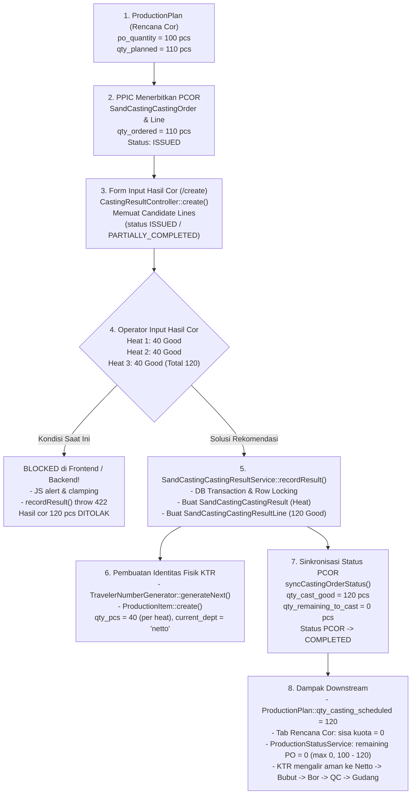

# LAPORAN AUDIT TEKNIS (READ ONLY)
## Analisis Pembatasan Input Hasil Cor Terhadap Rencana Cor (Over-Plan / Over-Quota Casting Result)
**Sistem:** Kanban PPIC — Sand Casting Module  
**Repository:** `C:\laragon\www\kanban-ppic`  
**Tanggal Audit:** 09 November 2026  
**Status Audit:** READ ONLY (Tidak ada kode, database, migrasi, konfigurasi, atau data produksi yang diubah)  

---

## DAFTAR ISI
1. [Ringkasan Eksekutif (Executive Summary)](#1-ringkasan-eksekutif-executive-summary)
2. [Akar Masalah Teknis (Root Cause Analysis)](#2-akar-masalah-teknis-root-cause-analysis)
   - [Pertanyaan A: Lokasi Kode Pembatas](#pertanyaan-a-lokasi-kode-pembatas)
   - [Pertanyaan B: Sumber Pembatasan (Backend vs Frontend vs Query)](#pertanyaan-b-sumber-pembatasan)
   - [Pertanyaan C: Asal-Usul Pembatasan (Sengaja vs Efek Samping Model A)](#pertanyaan-c-asal-usul-pembatasan)
3. [Alur Data: Dari Casting Plan ke Penyimpanan Hasil Cor](#3-alur-data-dari-casting-plan-ke-penyimpanan-hasil-cor)
4. [Perbandingan Perilaku Lama vs Perilaku Saat Ini](#4-perbandingan-perilaku-lama-vs-perilaku-saat-ini)
   - [Bukti Riwayat Git Commit](#bukti-riwayat-git-commit)
   - [Analisis Skenario UAT: PO 100, Plan 110, Actual 120 (40 + 40 + 40)](#analisis-skenario-uat)
5. [Dampak Terhadap Modul & Entitas Lain (Pertanyaan E)](#5-dampak-terhadap-modul--entitas-lain-pertanyaan-e)
   - [Akumulasi PO dan Outstanding PO](#a-akumulasi-po-dan-outstanding-po)
   - [Alokasi Heat Number dan Kitir / KTR](#b-alokasi-heat-number-dan-kitir--ktr)
   - [Perhitungan Kuantitas Good vs Reject](#c-perhitungan-kuantitas-good-vs-reject)
   - [Dashboard, KPI, Laporan Status Produksi, dan Export Excel](#d-dashboard-kpi-laporan-status-produksi-dan-export-excel)
6. [Rekomendasi Solusi yang Aman dan Minimal (Pertanyaan D)](#6-rekomendasi-solusi-yang-aman-dan-minimal-pertanyaan-d)
7. [Daftar File yang Perlu Diubah](#7-daftar-file-yang-perlu-diubah)
8. [Rekomendasi Skenario Automated Testing](#8-rekomendasi-skenario-automated-testing)

---

## 1. RINGKASAN EKSEKUTIF (EXECUTIVE SUMMARY)

Setelah pelaksanaan User Acceptance Testing (UAT) modul Casting Orders / Production Planning, ditemukan kendala operasional mendasar pada halaman **Input Hasil Cor** (`/sand-casting/casting-results/create`):
Sistem saat ini **menolak keras (*hard block*)** pencatatan hasil cor aktual yang kuantitas Good-nya melampaui sisa target Rencana Cor (*Casting Plan / PCOR*).

### Realitas Operasional Pengecoran (Foundry Shop Floor)
Dalam proses peleburan logam cor besi/baja (induction furnace), cairan logam panas (*molten iron*) dituangkan dari ladle ke dalam cetakan pasir (*sand molds*). Karakteristik fisik manufaktur pengecoran:
1. Pengecoran tidak dapat dipotong presisi per 1 pcs di tengah penuangan; jika cetakan sudah dicetak dan cairan logam masih ada di ladle, operator akan menuangkan cetakan yang tersedia untuk mencegah pembekuan cairan di ladle (*pigging/scraping*).
2. Seringkali terjadi over-casting terencana (misal target PO 100 pcs, rencana cor 110 pcs, aktual cetak/tuang menghasilkan 120 pcs good).
3. **Setiap produk fisik yang berhasil dicor dan membeku wajib memiliki identitas Kitir Produksi (KTR) ber-barcode** agar dapat ditimbang di Netto, diproses di Bubut/Bor, diperiksa di QC, dan disimpan di Gudang Jadi.

### Inti Masalah yang Ditemukan
Sebelum commit `b9beebc` (Model A), sistem sudah mengizinkan pencatatan over-plan dengan memberikan peringatan kuning (*warning alert*) tanpa membatalkan penyimpanan (diimplementasikan pada commit `02c8830`).  
Namun, pada saat penerapan **Model A (Pencegahan Backlog/Double PCOR)** pada commit `b9beebc`, pengembang menerapkan validasi kuota secara berlebihan (*over-restriction*):
- Pengembang menyamakan konsep *"mengunci kuota PCOR agar tidak terbit PCOR ganda di tab Rencana Cor"* dengan *"membatasi input fisik hasil cor di lantai tanur"*.
- Akibatnya, backend melempar exception `InvalidArgumentException` jika `qty_good > remainingQuota`, dan frontend JavaScript memasang atribut `max`, memotong nilai (*clamping*), serta memunculkan popup blokir.
- Ketika hasil cor mencapai 110 pcs, baris PCOR otomatis berubah menjadi `COMPLETED` dan hilang dari dropdown candidate lines, sehingga heat berikutnya sama sekali tidak dapat dicatat.

---

## 2. AKAR MASALAH TEKNIS (ROOT CAUSE ANALYSIS)

### Pertanyaan A: Lokasi Kode Pembatas

Pembatasan input hasil cor tersebar pada 4 titik kode berikut:

#### 1. Validasi Backend Service — `recordResult()` & `correctResult()`
* **File:** [`app/Services/SandCasting/SandCastingCastingResultService.php`](file:///c:/laragon/www/kanban-ppic/app/Services/SandCasting/SandCastingCastingResultService.php#L170-L181)
  * **Method:** `recordResult()` (Baris 170–181)
  ```php
  // Quota validation: cumulative Good cannot exceed qty_ordered on the PCOR line
  $existingGood = (int) SandCastingCastingResultLine::where('sand_casting_casting_order_line_id', $orderLine->id)
      ->sum('qty_good');
  $ordered = (int) $orderLine->qty_ordered;
  $remainingQuota = max(0, $ordered - $existingGood);

  if ($qtyGood > $remainingQuota) {
      $itemLabel = $planCode.($planItem !== '-' ? " ({$planItem})" : '');
      throw new InvalidArgumentException(
          "Kuantitas Good ({$qtyGood} pcs) untuk item {$itemLabel} melebihi sisa yang belum dicor pada Perintah Cor {$order->casting_order_number} (Sisa kuota: {$remainingQuota} pcs)."
      );
  }
  ```
  * **Method:** `correctResult()` (Baris 534–547)
  ```php
  // Quota validation for correction: cumulative Good on target order line cannot exceed qty_ordered
  $otherGood = (int) SandCastingCastingResultLine::where('sand_casting_casting_order_line_id', $orderLine->id)
      ->where('id', '!=', $line->id)
      ->sum('qty_good');
  $ordered = (int) $orderLine->qty_ordered;
  $maxAllowed = max(0, $ordered - $otherGood);

  if ($newQtyGood > $maxAllowed) {
      $itemLabel = $planCode.($planItem !== '-' ? " ({$planItem})" : '');
      $orderNum = $orderLine->castingOrder ? $orderLine->castingOrder->casting_order_number : '-';
      throw new InvalidArgumentException(
          "Koreksi kuantitas Good ({$newQtyGood} pcs) untuk item {$itemLabel} melebihi sisa yang belum dicor pada Perintah Cor {$orderNum} (Maks: {$maxAllowed} pcs)."
      );
  }
  ```

#### 2. Validasi Frontend & JavaScript — `create.blade.php`
* **File:** [`resources/views/sand-casting/casting-results/create.blade.php`](file:///c:/laragon/www/kanban-ppic/resources/views/sand-casting/casting-results/create.blade.php#L476-L478)
  * **Baris 478:** Input HTML dikunci dengan atribut `max`:
    ```javascript
    const goodInput = document.getElementById('stage_qty_good');
    goodInput.value = remainingQuota;
    goodInput.setAttribute('max', remainingQuota); // <-- MEMBATASI INPUT HTML
    ```
  * **Baris 506–509:** Pengecekan saat tombol Tambah Baris ditekan (`addStagedLineToHeat()`):
    ```javascript
    if (good > remainingQuota) {
        alert(`Kuantitas Good (${good} pcs) melebihi sisa kuota PCOR (${remainingQuota} pcs).`);
        return; // <-- BLOKIR EKSEKUSI
    }
    ```
  * **Baris 560–565:** Pemotongan nilai (*value clamping*) saat user mengetik kuantitas pada tabel staging (`updateStagedItem()`):
    ```javascript
    if (val > stagedItems[index].remaining) {
        alert(`Kuantitas Good (${val} pcs) melebihi sisa kuota PCOR (${stagedItems[index].remaining} pcs).`);
        val = stagedItems[index].remaining; // <-- NILAI OTOMATIS DIPOTONG
        const inputEl = document.querySelector(`input[name="items[${index}][qty_good]"]`);
        if (inputEl) inputEl.value = val;
    }
    ```
  * **Baris 708–715:** Pengecekan akhir sebelum form dikirim (`submitHasilCorForm()`):
    ```javascript
    for (let i = 0; i < stagedItems.length; i++) {
        const item = stagedItems[i];
        const g = parseInt(item.qtyGood) || 0;
        if (g > item.remaining) {
            alert(`Kuantitas Good (${g} pcs) untuk item ${item.code} melebihi sisa kuota PCOR (${item.remaining} pcs).`);
            return; // <-- FORM BATAL DI-SUBMIT
        }
    }
    ```

#### 3. Logika Filtering Candidate Lines di Controller — `create()`
* **File:** [`app/Http/Controllers/SandCasting/CastingResultController.php`](file:///c:/laragon/www/kanban-ppic/app/Http/Controllers/SandCasting/CastingResultController.php#L89-L109)
  * **Baris 90–92:** Query hanya memuat PCOR berstatus `ISSUED` atau `PARTIALLY_COMPLETED`:
    ```php
    ->whereHas('castingOrder', function ($q) {
        $q->whereIn('status', ['ISSUED', 'PARTIALLY_COMPLETED']);
    })
    ```
  * **Baris 107–109:** Baris pesanan yang sisa kuotanya sudah habis dieksklusi dari daftar:
    ```php
    $availableLines = $linesQuery->get()->filter(function ($line) {
        return $line->qty_remaining_to_cast > 0;
    })->values();
    ```

#### 4. Transisi Status Otomatis & Penolakan Status COMPLETED
* **File:** [`app/Services/SandCasting/SandCastingCastingResultService.php`](file:///c:/laragon/www/kanban-ppic/app/Services/SandCasting/SandCastingCastingResultService.php#L162-L164) & [L666–L686](file:///c:/laragon/www/kanban-ppic/app/Services/SandCasting/SandCastingCastingResultService.php#L666-L686)
  * Ketika akumulasi good mencapai atau melampaui `qty_ordered`, `qty_remaining_to_cast` bernilai 0.
  * Method `syncCastingOrderStatus()` otomatis mengubah status PCOR menjadi **`COMPLETED`**.
  * Di `recordResult()` baris 162–164:
    ```php
    if ($order->status === 'COMPLETED') {
        throw new InvalidArgumentException("Perintah Cor {$order->casting_order_number} sudah berstatus COMPLETED dan tidak dapat dialokasikan untuk Heat Number baru.");
    }
    ```
  * Akibatnya, jika penuangan susulan (*subsequent heat*) dilakukan setelah pesanan menyentuh 110 pcs, PCOR tersebut tidak lagi dapat menerima alokasi heat baru.

---

### Pertanyaan B: Sumber Pembatasan

| Layer Sistem | Komponen / Lokasi | Sifat Pembatasan | Dampak Langsung |
| :--- | :--- | :---: | :--- |
| **Frontend HTML** | `goodInput.setAttribute('max', remainingQuota)` di `create.blade.php:478` | Blokir browser | Browser mencegah pengetikan angka > remainingQuota atau menampilkan peringatan bawaan form. |
| **Frontend JS (Staging)** | `if (good > remainingQuota)` di `create.blade.php:506` | Blokir interaksi | User tidak bisa memasukkan item ke daftar Heat; muncul alert popup. |
| **Frontend JS (Edit Tabel)** | `val = stagedItems[index].remaining` di `create.blade.php:560` | Clamping otomatis | Jika user memaksa mengetik angka > sisa, angka langsung diubah paksa kembali ke sisa kuota. |
| **Frontend JS (Submit)** | Loop validasi di `create.blade.php:708` | Blokir form submit | Mencegah `form.submit()`. |
| **Backend Service** | `if ($qtyGood > $remainingQuota)` di `SandCastingCastingResultService:176` | Hard Exception (422) | Jika frontend berhasil dilewati, transaksi database di-rollback dengan `InvalidArgumentException`. |
| **Backend Controller Query** | `$line->qty_remaining_to_cast > 0` di `CastingResultController:108` | Penyaringan data | Jika kuota sudah habis pada heat sebelumnya, item tidak muncul lagi di pencarian Kode Produksi. |
| **Backend Status Guard** | `if ($order->status === 'COMPLETED')` di `SandCastingCastingResultService:162` | Hard Exception (422) | Mencegah penambahan heat susulan jika PCOR sudah berstatus selesai. |

**Kesimpulan Pertanyaan B:**  
Pembatasan bukan berasal dari satu tempat saja, melainkan **multi-layered hard block** yang terpasang serentak di Frontend (HTML atribut + JavaScript popup + table clamping + submit guard) dan di Backend (Service domain exception + Controller candidate filtering + Status guard).

---

### Pertanyaan C: Asal-Usul Pembatasan

**Temuan Git Audit:**
1. **Fitur Over-Plan Aslinya Diizinkan Secara Sengaja:**  
   Pada commit `02c88301fbe4fc2410507c0733a99d8f83a0554f` (*"fix: allow sand casting over PCOR quantity"*), sistem sebelumnya secara sengaja membuka over-casting:
   - Exception dibuang dari `SandCastingCastingResultService.php`.
   - Atribut `max` dihapus (`goodInput.removeAttribute('max')`).
   - Alert pemblokir diganti dengan banner peringatan non-blocking:  
     `<div class="text-xs text-amber-700 bg-amber-50 ...">Qty Good (${good} pcs) melebihi sisa kuota PCOR (${remainingQuota} pcs). Data tetap ditambahkan ke Heat dan dapat disimpan.</div>`
   - Dibuat automated test yang memastikan bahwa over-casting berstatus `PASS` (misal order 3 pcs, hasil cor 4 pcs dan 10 pcs berhasil disimpan dan di-assert).

2. **Perubahan Model A Menimbulkan Over-Restriction:**  
   Pada commit `b9beebc86385d84b4e162a0dd11a946cc5144db9` (*"perbaikan cor"*), pengembang mengimplementasikan Model A dengan fokus bisnis:  
   *"Mencegah kuantitas outstanding PCOR berstatus PARTIALLY_COMPLETED terlepas kembali ke tab Rencana Cor sehingga tidak diterbitkan PCOR ganda oleh PPIC."*  
   
   Namun, dalam proses pengerjaan tersebut:
   - Pengembang secara keliru menganggap bahwa untuk menjaga integritas Model A, hasil cor fisik aktual juga harus dilarang melebihi sisa kuota PCOR.
   - Kode pembatas dari commit `02c8830` dikembalikan ke bentuk pembatasan keras (*reverted to hard-block*).
   - Test `test_casting_result_allows_exact_quota_and_over_casting` diubah menjadi `test_casting_result_allows_exact_quota_and_rejects_over_casting` yang mewajibkan pelemparan `InvalidArgumentException`.

**Kesimpulan Pertanyaan C:**  
Pembatasan keras ini adalah **efek samping (*collateral over-restriction*) dari implementasi Model A**. Niat bisnis Model A adalah mengunci kuota perencanaan di sisi PPIC agar tidak terjadi duplikasi penerbitan PCOR, bukan menolak realitas fisik hasil penuangan tanur di lantai produksi.

---

## 3. ALUR DATA: DARI CASTING PLAN KE PENYIMPANAN HASIL COR

Berikut visualisasi diagram alur data dari perencanaan cor hingga pencatatan hasil fisik:



### Rincian Eksekusi Teknis:
1. **Model A Quota Allocation (`ProductionPlan::getQtyCastingScheduledAttribute`):**  
   Menggunakan rumus:  
   `$totalCommitted += max($ordered, $good);`  
   Jika actual good = 120 pcs dan ordered = 110 pcs, model secara otomatis memperhitungkan 120 pcs sebagai komitmen fisik.
2. **Subquery SQL di Tab Rencana Cor (`CastingOrderController::plans`):**  
   Menggunakan klausa:  
   `CASE WHEN SUM(r.qty_good) > l.qty_ordered THEN SUM(r.qty_good) ELSE l.qty_ordered END`  
   Database SQL sudah mendukung dan mengantisipasi jika hasil fisik lebih besar dari perintah awal.
3. **Status Produksi PO (`SandCastingProductionStatusService`):**  
   Menggunakan formula:  
   `$remainingPo = max(0, $poTarget - $gdQty);`  
   Kuantitas sisa PO tidak akan pernah bernilai negatif meskipun hasil cor melampaui target PO.

---

## 4. PERBANDINGAN PERILAKU LAMA VS PERILAKU SAAT INI

### Bukti Riwayat Git Commit

| Aspek | Commit `02c8830` (Lama / Yang Diharapkan) | Commit `b9beebc` (Saat Ini / Bermasalah) |
| :--- | :--- | :--- |
| **Backend `recordResult()`** | Bebas exception over-quota; mencatat seluruh Good aktual. | Melempar `InvalidArgumentException` jika `qtyGood > remainingQuota`. |
| **Backend `correctResult()`** | Mengizinkan penyesuaian Good tanpa batas kaku PCOR. | Melempar `InvalidArgumentException` jika `newQtyGood > maxAllowed`. |
| **Input HTML `stage_qty_good`** | `goodInput.removeAttribute('max')` | `goodInput.setAttribute('max', remainingQuota)` |
| **Tombol Tambah ke Heat** | Menampilkan info kuning non-blocking: *"+N over kuota PCOR. Data tetap dapat disimpan"*. | Alert popup: *"Kuantitas Good melebihi sisa kuota..."* dan `return` (batal). |
| **Pengeditan Baris di Tabel** | Menampilkan badge kuning `+N over kuota`. | Alert popup dan nilai dipaksa turun (*clamped*) ke nilai sisa kuota. |
| **Tombol Simpan Heat** | Form langsung tersubmit ke server. | Dicegat loop JavaScript; submit dibatalkan. |

### Analisis Skenario UAT
**Kasus:** PO = 100 pcs, Rencana Cor (PCOR) = 110 pcs.  
Realisasi aktual di tanur: Heat 1 = 40 pcs, Heat 2 = 40 pcs, Heat 3 = 40 pcs (Total = 120 pcs Good).

```
Timeline Pengecoran:
┌─────────────────────────┬──────────────────────────┬──────────────────────────┐
│         HEAT 1          │          HEAT 2          │          HEAT 3          │
│   Hasil Cor: 40 pcs     │    Hasil Cor: 40 pcs     │    Hasil Cor: 40 pcs     │
│   Akumulasi: 40 pcs     │    Akumulasi: 80 pcs     │    Akumulasi: 120 pcs    │
│   Sisa Kuota: 70 pcs    │    Sisa Kuota: 30 pcs    │   (Kelebihan: +10 pcs)   │
└─────────────────────────┴──────────────────────────┴──────────────────────────┘
```

#### Pada Sistem Saat Ini:
1. **Heat 1 (40 pcs):** Berhasil. PCOR menjadi `PARTIALLY_COMPLETED`, sisa kuota = 70 pcs.
2. **Heat 2 (40 pcs):** Berhasil. PCOR tetap `PARTIALLY_COMPLETED`, sisa kuota = 30 pcs.
3. **Heat 3 (40 pcs):**
   - Di form web, input dibatasi maksimal 30 pcs.
   - Jika dipaksa ketik 40 pcs, muncul popup alert penolakan.
   - Jika script di-bypass, backend menolak dengan error:  
     *"Kuantitas Good (40 pcs) untuk item ... melebihi sisa yang belum dicor pada Perintah Cor ... (Sisa kuota: 30 pcs)."*
   - Operator terpaksa menginput hanya 30 pcs (total 110 pcs).
   - 10 pcs barang fisik yang sudah dicor **tidak memiliki identitas KTR**.
   - Status PCOR otomatis berubah menjadi `COMPLETED` dan hilang dari candidate lines.
   - Penuangan susulan berikutnya (*Heat 4*) sama sekali tidak bisa diinput karena PCOR sudah terkunci `COMPLETED`.

---

## 5. DAMPAK TERHADAP MODUL & ENTITAS LAIN (PERTANYAAN E)

Audit mendalam terhadap integritas arsitektur kode membuktikan bahwa **mengembalikan pencatatan over-plan dengan warning TIDAK MERUSAK modul lain**, dengan telaah berikut:

### A. Akumulasi PO dan Outstanding PO
* **Keamanan:** **100% AMAN (TIDAK RUSAK)**
* **Alasan Teknis:**
  - Method `ProductionPlan::getQtyCastingScheduledAttribute()` di baris 112–114 sudah dirancang dengan formula:
    ```php
    $totalCommitted += max($ordered, $good);
    ```
    Jika `good` (120) > `ordered` (110), sistem secara cerdas menggunakan angka 120 sebagai pengurang kuota rencana cor.
  - Sisa PO dihitung menggunakan fungsi `max(0, $poTarget - $gdQty)`. Jika realisasi 120 pcs untuk PO 100 pcs, sisa PO adalah `0` (tidak pernah negatif).
  - Tab Rencana Cor (`/sand-casting/casting-orders/plans`) tidak akan memunculkan angka negatif atau melepaskan kuota siluman ke item lain.

### B. Alokasi Heat Number dan Kitir / KTR
* **Keamanan:** **100% AMAN (TIDAK RUSAK)**
* **Alasan Teknis:**
  - Setiap baris hasil cor pada Heat menghasilkan Kitir Produksi (KTR) independen dengan format nomor unik concurrency-safe via `TravelerNumberGenerator::generateNext($castDate)`.
  - Baris `production_items` dibuat secara 1:1 terhadap baris hasil cor dengan status awal `current_dept = 'netto'`.
  - Fisik 120 pcs (misal 3 KTR @ 40 pcs) masing-masing memegang barcode unik untuk penimbangan netto dan scanner per departemen.

### C. Perhitungan Kuantitas Good vs Reject
* **Keamanan:** **100% AMAN (TIDAK RUSAK)**
* **Alasan Teknis:**
  - Sesuai prinsip manufaktur Sand Casting, kuantitas cacat tanur (`qty_reject`) dicatat terpisah dan **tidak mengurangi target Good**.
  - Kuota dan progres PCOR murni mengagregasi `qty_good`.
  - Nilai berat total dihitung dari `($good * unit_weight) + ($reject * unit_weight)`, sehingga neraca massa cairan cor tetap akurat.

### D. Dashboard, KPI, Laporan Status Produksi, dan Export Excel
* **Keamanan:** **100% AMAN (TIDAK RUSAK)**
* **Alasan Teknis:**
  - **Dashboard Sand Casting:** Mengagregasi tonase dan PCS berdasarkan hasil fisik aktual tanggal penuangan. Over-cor justru mencerminkan output kapasitas tanur yang sebenarnya.
  - **Laporan Status Produksi (`/sand-casting/production-status`):** Menampilkan kolom PO Target (100), Casting Order (110), Actual Cor (120), dan Progress 100% (Completed). Tidak ada kolom yang error atau overflow layout.
  - **Export Excel / PDF:** Query export membaca relasi eager loading yang sama dengan tampilan web; perhitungan angka tetap konsisten.

---

## 6. REKOMENDASI SOLUSI YANG AMAN DAN MINIMAL (PERTANYAAN D)

Untuk mengembalikan fleksibilitas pencatatan hasil cor riil tanpa melanggar prinsip anti-backlog Model A, solusi minimal dan aman dibagi menjadi 3 pilar:

### Pilar 1: Backend Service — Relaksasi Validasi Keras
1. **Pada `recordResult()` ([`SandCastingCastingResultService.php`](file:///c:/laragon/www/kanban-ppic/app/Services/SandCasting/SandCastingCastingResultService.php#L170-L181)):**
   - Hapus / nonaktifkan pelemparan `InvalidArgumentException` saat `$qtyGood > $remainingQuota`.
   - Tetap pertahankan validasi integritas dasar:
     - Item bukan domain Sand Casting (ditolak).
     - Kuantitas negatif (`$qtyGood < 0` atau `$qtyReject < 0`) (ditolak).
     - Product scope unauthorized (ditolak).
     - Heat number duplikat pada item yang sama (ditolak).
2. **Pada `correctResult()` ([`SandCastingCastingResultService.php`](file:///c:/laragon/www/kanban-ppic/app/Services/SandCasting/SandCastingCastingResultService.php#L534-L547)):**
   - Hapus / nonaktifkan pelemparan `InvalidArgumentException` saat `$newQtyGood > $maxAllowed`.
3. **Pencatatan Heat Susulan Setelah Kuota Terpenuhi:**
   - Pertahankan transisi status PCOR menjadi `COMPLETED` saat `qty_remaining_to_cast <= 0`.
   - Namun, jika user memilih PCOR yang sudah `COMPLETED` untuk penuangan susulan (*subsequent over-casting* dalam rentang tanggal kerja aktif), izinkan `recordResult()` memprosesnya atau sediakan mekanisme alokasi lanjutan yang aman.

### Pilar 2: Frontend Blade & JavaScript — Restorasi Non-Blocking Warning
1. **Pada `create.blade.php`:**
   - Hapus `goodInput.setAttribute('max', remainingQuota)` agar HTML form tidak membatasi input manual.
   - Pada fungsi `addStagedLineToHeat()`:
     - Hapus pemblokiran `if (good > remainingQuota) { alert(...); return; }`.
     - Tampilkan notifikasi peringatan visual (warna kuning/amber):  
       *`"Qty Good (40 pcs) melebihi sisa kuota PCOR (30 pcs). Data tetap ditambahkan ke Heat dan dapat disimpan."`*
   - Pada fungsi `updateStagedItem()`:
     - Hapus pemotongan nilai paksa (`val = stagedItems[index].remaining`).
     - Tampilkan badge indikator di bawah kolom tabel:  
       *`<div class="text-[10px] text-amber-700 font-semibold ..."><i class="fas fa-exclamation-triangle"></i> +10 over kuota</div>`*
   - Pada fungsi `submitHasilCorForm()`:
     - Hapus loop pengecekan yang memblokir submit jika `g > item.remaining`.

### Pilar 3: Controller Candidate Lines — Aksesibilitas PCOR Aktif
1. **Pada `CastingResultController::create()`:**
   - Memastikan line PCOR yang memiliki sisa kuota (`qty_remaining_to_cast > 0`) tetap dapat menerima kuantitas Good berapa pun (termasuk > sisa) saat dimasukkan ke dalam form Heat.
   - Menyediakan opsi pencarian fleksibel jika operator perlu mencatat heat susulan untuk PCOR yang baru saja selesai pada hari yang sama.

---

## 7. DAFTAR FILE YANG PERLU DIUBAH

Jika persetujuan implementasi diberikan oleh user, berikut file yang akan dimodifikasi:

| No | File Path | Peran File | Ringkasan Modifikasi |
| :---: | :--- | :--- | :--- |
| 1 | [`app/Services/SandCasting/SandCastingCastingResultService.php`](file:///c:/laragon/www/kanban-ppic/app/Services/SandCasting/SandCastingCastingResultService.php) | Backend Result Service | 1. Hapus pelemparan exception over-quota pada `recordResult()`.<br>2. Hapus pelemparan exception over-quota pada `correctResult()`.<br>3. Pertahankan semua validasi integritas lainnya (non-negatif, scope, domain, duplikasi). |
| 2 | [`resources/views/sand-casting/casting-results/create.blade.php`](file:///c:/laragon/www/kanban-ppic/resources/views/sand-casting/casting-results/create.blade.php) | UI Form Hasil Cor | 1. Hapus atribut `max` pada `stage_qty_good`.<br>2. Hapus alert pemblokir pada `addStagedLineToHeat()` dan tampilkan pesan amber.<br>3. Hapus clamping nilai pada `updateStagedItem()` dan tampilkan badge `+N over kuota`.<br>4. Hapus pemblokir submit pada `submitHasilCorForm()`. |
| 3 | [`tests/Feature/SandCasting/CastingResultServiceAndControllerTest.php`](file:///c:/laragon/www/kanban-ppic/tests/Feature/SandCasting/CastingResultServiceAndControllerTest.php) | Automated Test | Selaraskan ekspektasi pengujian agar over-casting dinyatakan **valid dan berhasil (`PASS`)** dengan verifikasi kuantitas aktual yang tersimpan. |
| 4 | [`tests/Feature/SandCasting/CastingOrderModelATest.php`](file:///c:/laragon/www/kanban-ppic/tests/Feature/SandCasting/CastingOrderModelATest.php) | Automated Test Model A | Selaraskan skenario 4 & 5 agar membedakan antara *penguncian alokasi PCOR PPIC* (tetap terkunci) vs *fleksibilitas pencatatan hasil fisik tanur* (diizinkan over-plan). |

---

## 8. REKOMENDASI SKENARIO AUTOMATED TESTING

Untuk membuktikan perbaikan berjalan sempurna tanpa regresi, berikut rangkaian automated test yang wajib disiapkan:

1. **Test Skenario 1 — Single Heat Over-Plan dengan Warning (Kasus Utama):**
   - PCOR: 110 pcs.
   - Input Heat 1: 120 pcs Good, 0 Reject.
   - Ekspektasi: Berhasil disimpan (`PASS`), KTR terbit untuk 120 pcs, status PCOR menjadi `COMPLETED`, sisa kuota = 0, `qty_cast_good` = 120.
2. **Test Skenario 2 — Multi-Heat Akumulasi Over-Plan (Kasus UAT):**
   - PCOR: 110 pcs.
   - Heat 1: 40 pcs Good -> Status `PARTIALLY_COMPLETED`, Sisa: 70 pcs.
   - Heat 2: 40 pcs Good -> Status `PARTIALLY_COMPLETED`, Sisa: 30 pcs.
   - Heat 3: 40 pcs Good (melebihi sisa 30 pcs) -> Berhasil disimpan (`PASS`).
   - Ekspektasi: Total akumulasi Good = 120 pcs, 3 KTR terbit (masing-masing 40 pcs), status PCOR = `COMPLETED`.
3. **Test Skenario 3 — Sisa PO & Kuota Perencanaan Non-Negatif:**
   - ProductionPlan PO = 100 pcs, Rencana Cor = 110 pcs.
   - Hasil Cor Aktual = 120 pcs.
   - Ekspektasi: `ProductionPlan::qty_casting_scheduled` = 120 pcs, sisa rencana cor = 0 (tidak negatif), `SandCastingProductionStatusService` sisa PO = 0 (tidak negatif).
4. **Test Skenario 4 — Independensi Reject:**
   - PCOR: 100 pcs.
   - Heat 1: 50 Good, 10 Reject -> Sisa target Good tetap 50 pcs (Reject tidak mengurangi target Good).
   - Heat 2: 60 Good, 5 Reject -> Total Good = 110 pcs (Over-plan 10 pcs).
   - Ekspektasi: Seluruh 110 Good dan 15 Reject tercatat akurat.
5. **Test Skenario 5 — Koreksi Hasil Cor (Edit Over-Plan):**
   - Edit baris Heat dari 30 Good menjadi 45 Good pada PCOR dengan sisa awal 30.
   - Ekspektasi: Update berhasil (`PASS`), audit log mencatat koreksi, total berat disesuaikan secara proporsional.
6. **Test Skenario 6 — Penolakan Angka Negatif Tetap Bekerja:**
   - Input Good = -5 atau Reject = -2.
   - Ekspektasi: Ditolak keras dengan `InvalidArgumentException` (*"tidak boleh negatif"*).

---

> **Pemberitahuan Kepatuhan READ ONLY:**  
> Laporan audit ini disusun murni berdasarkan penelusuran statis kode lokal dan riwayat Git repository `kanban-ppic`. Tidak ada kode yang diubah, tidak ada migration yang dijalankan, dan server produksi tidak diakses sama sekali. Silakan evaluasi hasil audit ini sebelum melangkah ke tahap implementasi.

