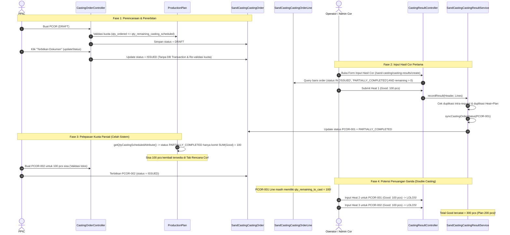

# LAPORAN AUDIT TEKNIS LANJUTAN
## VALIDASI WORKFLOW ISSUED, PARTIALLY_COMPLETED, DAN OUTSTANDING PCOR SAND CASTING
**Aplikasi:** Kanban PPIC (PT Peroni Karya Sentosa)  
**Status Audit:** READ ONLY (Tanpa Perubahan Kode, Database, Migrasi, Konfigurasi, atau Data)  
**Tanggal Audit:** 06 November 2026  
**Objek Audit:**
- `app/Http/Controllers/SandCasting/CastingOrderController.php`
- `app/Http/Controllers/SandCasting/CastingResultController.php`
- `app/Services/SandCasting/SandCastingCastingResultService.php`
- `app/Models/ProductionPlan.php`
- `app/Models/SandCastingCastingOrder.php`
- `app/Models/SandCastingCastingOrderLine.php`
- `resources/views/sand-casting/casting-orders/plans.blade.php`
- `resources/views/sand-casting/casting-orders/show.blade.php`
- `resources/views/sand-casting/casting-orders/print.blade.php`
- `resources/views/sand-casting/casting-results/create.blade.php`

---

## 1. RINGKASAN EKSEKUTIF

Audit teknis mendalam ini dilakukan untuk menjawab pertanyaan kritis:  
**"Apakah mekanisme pelepasan kuota outstanding dari PCOR berstatus `PARTIALLY_COMPLETED` ke tab Rencana Cor dapat menyebabkan kuantitas yang sama diperintahkan dan dicor oleh dua PCOR berbeda?"**

### Temuan Utama (Key Finding):
> [!CAUTION]
> **TERDAPAT RISIKO NYATA OVER-CASTING / DOUBLE ALLOCATION PADA IMPLEMENTASI AKTUAL SAAT INI.**  
> Berdasarkan kode backend yang berjalan, skenario double casting pada 100 PCS sisa **BISA TERJADI**.  
> Ketika PCOR-001 berstatus `PARTIALLY_COMPLETED` (misal 100 dari 200 pcs selesai dicor), sistem melepaskan sisa 100 pcs kembali ke kuota `ProductionPlan`. PPIC kemudian dapat membuat PCOR-002 untuk 100 pcs tersebut. Namun, sistem **TIDAK MENGUNCI ATAU MENUTUP** PCOR-001.  
> Akibatnya:
> 1. PCOR-001 tetap aktif di menu Input Hasil Cor dan tetap dapat menerima penuangan leburan (*Heat*) baru hingga 100 pcs lagi.
> 2. PCOR-002 juga aktif dan dapat menerima penuangan leburan sebesar 100 pcs.
> 3. Dokumen cetak PDF PCOR-001 dan PCOR-002 keduanya mencantumkan pekerjaan 100 pcs yang sama tanpa relasi/penanda pengalihan.
> 4. Backend `SandCastingCastingResultService` tidak memiliki validasi pembatasan sisa kuota, sehingga total aktual yang dicor dapat mencapai **300 PCS** untuk rencana awal yang hanya **200 PCS**.

---

## 2. ALUR AKTUAL: ISSUED SAMPAI INPUT HASIL COR



---

## 3. SIMULASI SKENARIO 200 PCS SECARA DETAIL

Berikut adalah trace matematis dan status database pada skenario uji wajib:

| Tahap | PCOR-001 (Status, Ord, Good, Sisa) | PCOR-002 (Status, Ord, Good, Sisa) | Total Good Tercatat | Kuota Terikat Plan | Kuota Tersedia di Rencana Cor | Status Risiko |
| :--- | :--- | :--- | :---: | :---: | :---: | :--- |
| **1. Kondisi Awal** | Belum ada | Belum ada | 0 | 0 | **200** | Normal |
| **2. PCOR-001 Terbit (ISSUED)** | `ISSUED`<br>Ord: 200, Good: 0, Sisa: 200 | Belum ada | 0 | 200 | **0** | Terkunci penuh |
| **3. Hasil Pertama (Heat 1)** | `PARTIALLY_COMPLETED`<br>Ord: 200, Good: 100, Sisa: 100 | Belum ada | 100 | 100 | **100** | **Outstanding dilepas ke Rencana Cor** |
| **4. PCOR-002 Dibuat & ISSUED** | `PARTIALLY_COMPLETED`<br>Ord: 200, Good: 100, Sisa: 100 | `ISSUED`<br>Ord: 100, Good: 0, Sisa: 100 | 100 | 200 | **0** | **Dua PCOR aktif memegang sisa yang sama!** |
| **5. Jika PCOR-001 dicor lagi (Heat 2)** | `COMPLETED`<br>Ord: 200, Good: 200, Sisa: 0 | `ISSUED`<br>Ord: 100, Good: 0, Sisa: 100 | 200 | 300 | **0** | Target awal 200 terpenuhi di PCOR-001 |
| **6. Jika PCOR-002 juga dicor (Heat 3)** | `COMPLETED`<br>Ord: 200, Good: 200, Sisa: 0 | `COMPLETED`<br>Ord: 100, Good: 100, Sisa: 0 | **300** | 300 | **0** | **OVER-CASTING: Terjadi kelebihan cor 100 pcs (150%)** |

### Analisis Kondisi Tahap 6:
Apakah tahap 6 dapat terjadi menurut implementasi aktual?  
**JAWABAN: YA, DAPAT TERJADI 100%.**  
Tidak ada mekanisme di backend maupun database yang memblokir penuangan Heat 2 untuk PCOR-001 atau Heat 3 untuk PCOR-002.

---

## 4. BUKTI KODE (CODE EVIDENCE)

### A. Bukti Pelepasan Kuota Parsial pada ProductionPlan
File: [`app/Models/ProductionPlan.php`](file:///c:/laragon/www/kanban-ppic/app/Models/ProductionPlan.php#L104-L117)  
Method: `getQtyCastingScheduledAttribute()`
```php
// Baris 110-116:
if (in_array($status, ['DRAFT', 'ISSUED'], true)) {
    $totalCommitted += $ordered;
} elseif ($status === 'PARTIALLY_COMPLETED') {
    $totalCommitted += $good; // <-- HANYA MENGUNCI SEBESAR HASIL GOOD!
} elseif ($status === 'COMPLETED') {
    $totalCommitted += max($ordered, $good);
}
```
Subquery SQL di [`app/Http/Controllers/SandCasting/CastingOrderController.php`](file:///c:/laragon/www/kanban-ppic/app/Http/Controllers/SandCasting/CastingOrderController.php#L42-L48) juga menerapkan logika yang identik:
```sql
WHEN o.status = 'PARTIALLY_COMPLETED' THEN COALESCE((
    SELECT SUM(r.qty_good)
    FROM sand_casting_casting_result_lines r
    WHERE r.sand_casting_casting_order_line_id = l.id
), 0)
```
**Fakta:** Begitu status berubah menjadi `PARTIALLY_COMPLETED`, kuota terikat langsung menciut menjadi sebesar `qty_good`. Sisa selisih `($ordered - $good)` secara instan muncul kembali pada perhitungan `qty_remaining_casting_scheduled`.

---

### B. Bukti PCOR `PARTIALLY_COMPLETED` Tetap Dianggap Terbuka untuk Input Hasil Cor
File: [`app/Http/Controllers/SandCasting/CastingResultController.php`](file:///c:/laragon/www/kanban-ppic/app/Http/Controllers/SandCasting/CastingResultController.php#L89-L95)  
Method: `create()`
```php
// Baris 89-95:
$linesQuery = SandCastingCastingOrderLine::with(['castingOrder', 'productionPlan', 'resultLines'])
    ->whereHas('castingOrder', function ($q) {
        $q->whereIn('status', ['ISSUED', 'PARTIALLY_COMPLETED']); // <-- PARTIALLY_COMPLETED TETAP DIIKUTKAN!
    })
    ->whereHas('productionPlan', function ($q) {
        $q->where('production_domain', \App\Models\ProductionPlan::DOMAIN_SAND_CASTING);
    });
```
Dan pada filter baris (baris 107-109):
```php
$availableLines = $linesQuery->get()->filter(function ($line) {
    return $line->qty_remaining_to_cast > 0;
})->values();
```
**Fakta:** Selama `qty_remaining_to_cast > 0`, baris PCOR-001 tetap lolos query dan dikirim ke form penuangan.

---

### C. Bukti Ketiadaan Validasi Batas Kuota pada Backend Input Hasil Cor
File: [`app/Services/SandCasting/SandCastingCastingResultService.php`](file:///c:/laragon/www/kanban-ppic/app/Services/SandCasting/SandCastingCastingResultService.php#L153-L170)  
Method: `recordResult()`
```php
// Baris 154-168:
if ($order->status === 'DRAFT') {
    throw new InvalidArgumentException("Perintah Cor {$order->casting_order_number} harus berstatus ISSUED sebelum Hasil Cor dapat dicatat.");
}

if ($order->status === 'CANCELLED') {
    throw new InvalidArgumentException("Tidak dapat mencatat Hasil Cor pada Perintah Cor yang sudah dibatalkan ({$order->casting_order_number}).");
}

if ($order->status === 'COMPLETED') {
    throw new InvalidArgumentException("Perintah Cor {$order->casting_order_number} sudah berstatus COMPLETED dan tidak dapat dialokasikan untuk Heat Number baru.");
}

if (! in_array($order->status, ['ISSUED', 'PARTIALLY_COMPLETED'], true)) {
    throw new InvalidArgumentException("Perintah Cor {$order->casting_order_number} tidak dalam status yang valid untuk pencatatan Hasil Cor.");
}
```
**Fakta:**
- Hanya ada validasi status dokumen parent.
- **TIDAK ADA** pengecekan kuantitas seperti:  
  `if ($qtyGood > $orderLine->qty_remaining_to_cast)`
- **TIDAK ADA** pengecekan batas total produksi pada `ProductionPlan`.

---

### D. Bukti Frontend Mengizinkan Over-Quota Input
File: [`resources/views/sand-casting/casting-results/create.blade.php`](file:///c:/laragon/www/kanban-ppic/resources/views/sand-casting/casting-results/create.blade.php#L476-L479)
```javascript
// Baris 476-478:
const goodInput = document.getElementById('stage_qty_good');
goodInput.value = remainingQuota;
goodInput.removeAttribute('max'); // <-- ATRIBUT MAX DIHAPUS DARI ELEMEN INPUT!
```
Dan saat item ditambahkan (baris 538-540):
```javascript
if (good > remainingQuota) {
    document.getElementById('candidateContainer').innerHTML = 
        `<div class="text-xs text-amber-700 bg-amber-50 border border-amber-200 rounded p-2 font-semibold my-2">
            <i class="fas fa-exclamation-triangle mr-1"></i> 
            Qty Good (${good} pcs) melebihi sisa kuota PCOR (${remainingQuota} pcs). 
            Data tetap ditambahkan ke Heat dan dapat disimpan.
        </div>`;
}
```
**Fakta:** Frontend secara eksplisit menyatakan *"Data tetap ditambahkan ke Heat dan dapat disimpan"* dan sama sekali tidak membatalkan submit jika angka melebihi kuota sisa.

---

### E. Bukti Cetak PDF Menampilkan Item yang Sama di Dua Dokumen
File: [`app/Http/Controllers/SandCasting/CastingOrderController.php`](file:///c:/laragon/www/kanban-ppic/app/Http/Controllers/SandCasting/CastingOrderController.php#L562-L564)  
Method: `print()`
```php
$printableLines = $castingOrder->lines
    ->filter(fn ($line) => $line->qty_remaining_to_cast > 0)
    ->values();
```
File: [`resources/views/sand-casting/casting-orders/print.blade.php`](file:///c:/laragon/www/kanban-ppic/resources/views/sand-casting/casting-orders/print.blade.php#L198-L213)
```blade
@foreach($linesToPrint as $index => $line)
    @php
        $qtyOutstanding = (int) $line->qty_remaining_to_cast;
    @endphp
    ...
    <td class="text-center font-bold">{{ number_format($qtyOutstanding) }}</td>
```
**Fakta:**
- Cetakan PCOR-001 menampilkan: `Qty Perintah (Sisa) = 100 PCS`.
- Cetakan PCOR-002 menampilkan: `Qty Perintah (Sisa) = 100 PCS`.
- Tidak ada indikasi pada lembar fisik PCOR-001 bahwa sisa 100 PCS tersebut sudah dibuatkan PCOR-002.

---

### F. Bukti Ketiadaan Transaksi Database pada Tombol Terbitkan Dokumen
File: [`app/Http/Controllers/SandCasting/CastingOrderController.php`](file:///c:/laragon/www/kanban-ppic/app/Http/Controllers/SandCasting/CastingOrderController.php#L534-L550)  
Method: `updateStatus()`
```php
// Baris 534-538:
if ($targetStatus === 'ISSUED') {
    if ($castingOrder->status !== 'DRAFT') {
        return back()->with('error', 'Hanya dokumen DRAFT yang dapat diterbitkan.');
    }
}
...
// Baris 549:
$castingOrder->update(['status' => $targetStatus]);
```
**Fakta:**
- Tidak dibungkus `DB::transaction()`.
- Tidak ada pengecekan ulang kuota `ProductionPlan` saat beralih dari `DRAFT` ke `ISSUED`.
- Tidak ada pencatatan timestamp penerbitan (`issued_at`) atau siapa yang menerbitkan (`issued_by`).

---

## 5. TEMUAN RISIKO & KEMUNGKINAN DOUBLE ALLOCATION

Dari audit kode di atas, ditemukan 4 celah struktural:

1. **Dual Active Instruction Problem:**  
   PCOR-001 dan PCOR-002 berada dalam status instruksi aktif secara bersamaan di lantai pabrik untuk kuantitas fisik yang identik.
2. **Ambiguity at Shop Floor:**  
   Ketika operator mencari kode produk di form input hasil cor (`lookupProductionCode()`), sistem menemukan 2 kandidat PCOR aktif:
   ```
   Ditemukan 2 Perintah Cor untuk kode [KODE]. Silakan pilih dokumen PCOR target:
   - PCOR-001 (Sisa: 100 pcs)
   - PCOR-002 (Sisa: 100 pcs)
   ```
   Operator bebas memilih PCOR mana pun, atau tanpa sengaja memasukkan hasil cor pada kedua dokumen tersebut.
3. **Absence of Capacity Lock in Backend Result Recording:**  
   `SandCastingCastingResultService::recordResult` tidak memvalidasi kuantitas yang dicor terhadap `qty_remaining_to_cast` baris order maupun terhadap `qty_planned` rencana induk.
4. **Physical Document Disconnect:**  
   Lembar PDF PCOR-001 yang dipegang pengawas lapangan masih tertulis sisa 100 PCS. Pengawas tidak mengetahui bahwa PPIC di kantor telah menerbitkan lembar PDF PCOR-002 untuk sisa yang sama.

---

## 6. EVALUASI DUA MODEL WORKFLOW

Berikut adalah perbandingan mendalam antara dua model tata kelola alur kerja PCOR:

| Aspek Evaluasi | Model A: PCOR Berkelanjutan (Continuous PCOR) | Model B: PCOR Harian (Daily PCOR with Explicit Cut-Off) |
| :--- | :--- | :--- |
| **Konsep Inti** | Satu dokumen PCOR berlaku sampai kuantitas totalnya tuntas dicor (bisa melintasi beberapa hari/shift). | Satu dokumen PCOR hanya berlaku untuk 1 tanggal cor (`scheduled_date`). Sisa harian dipotong dan dialihkan secara resmi ke PCOR hari berikutnya. |
| **Konsistensi Data** | **Sangat Tinggi.** Kuantitas 200 pcs selalu terkunci pada PCOR-001 sampai selesai. Tidak pernah ada celah pelepasan parsial. | **Tinggi (jika ada mekanisme cut-off).** Membutuhkan disiplin sistem untuk memotong order lama sebelum menerbitkan order baru. |
| **Risiko Double Casting** | **Nol / Sangat Rendah.** Tidak akan pernah ada 2 nomor PCOR aktif untuk sisa item yang sama. | **Rendah (dengan syarat):** PCOR lama wajib otomatis di-close/dipotong saat PCOR baru terbit. Pada kode saat ini, risikonya **Tinggi**. |
| **Traceability Heat & KTR** | **Baik.** Seluruh leburan (Heat 1, Heat 2, dst) menginduk pada satu nomor PCOR yang sama hingga selesai. | **Sangat Detail.** Setiap Heat terikat presisi pada PCOR tanggal hari penuangan tersebut. |
| **Beban Kerja PPIC** | **Sangat Ringan.** PPIC cukup membuat 1 kali PCOR. Tidak perlu membuat ulang PCOR setiap hari untuk sisa barang yang sama. | **Tinggi.** PPIC harus memonitor sisa cor setiap sore dan membuat dokumen PCOR baru setiap hari untuk sisa barang. |
| **Kemudahan Lapangan** | **Sedang.** Pengawas tanur memegang 1 lembar fisik yang dicoret/diisi bertahap selama beberapa hari sampai kuota tuntas. | **Tinggi.** Pengawas menerima lembar target harian baru setiap pagi yang hanya memuat target cor hari itu. |
| **Koreksi Hasil Cor** | **Mudah.** Koreksi Heat tidak mempengaruhi nomor PCOR lain. | **Kompleks.** Jika ada koreksi pada Heat hari kemarin setelah kuota sisa dialihkan ke PCOR hari ini, terjadi benturan kuota. |
| **Audit Trail Kuantitas** | Terpusat pada 1 siklus hidup dokumen. | Tersebar di banyak dokumen PCOR harian yang saling bersambung (*chaining*). |

---

## 7. REKOMENDASI WORKFLOW PALING AMAN

Untuk mengeliminasi risiko penuangan ganda (*double casting*) secara permanen tanpa merusak fleksibilitas operasional pabrik, **rekomendasi terbaik adalah:**

### Pilihan Rekomendasi Utama: "Model A yang Ditingkatkan (Enhanced Continuous PCOR)"
**Mengapa Model A?**  
Dalam proses pengecoran pasir (*sand casting*), pembuatan cetakan dan peleburan sering kali memakan waktu lebih dari 1 hari kalender karena siklus pembongkaran cetakan (*shakeout*) dan pendinginan. Mengunci kuantitas pada satu nomor PCOR hingga selesai adalah pendekatan industri manufaktur paling stabil dan minim galat (*error-proof*).

#### Prinsip Kerja Model A:
1. **Kunci Penuh Sepanjang Siklus Hidup:**  
   Status `PARTIALLY_COMPLETED` **TIDAK MELEPASKAN KUOTA** ke tab Rencana Cor. Komitmen kuota tetap sebesar `qty_ordered` sampai seluruh item selesai (`COMPLETED`) atau dokumen dibatalkan.
2. **PCOR Lama Tetap Menerima Hasil:**  
   Jika hari ini baru selesai 100 dari 200 pcs, operator besok tetap memilih PCOR-001 untuk mencatat sisa 100 pcs berikutnya.
3. **Penutupan Paksa (Short-Close):**  
   Jika sisa 100 pcs memang diputuskan untuk tidak dilanjutkan (misal pola rusak atau pesanan batal), PPIC harus menekan tombol **"Tutup Sisa (Short Close)"** pada PCOR-001. Aksi ini akan mengubah `qty_ordered` menjadi sama dengan `qty_cast_good` (100 pcs), menandai PCOR-001 sebagai `COMPLETED`, dan baru saat itulah sisa kuota yang belum dicor dilepaskan kembali ke Rencana Cor secara sah.

---

### Alternatif Jika Pabrik Wajib Menggunakan "Model B (PCOR Harian)":
Jika manajemen pabrik mewajibkan lembar kerja baru setiap hari kalender:
1. **Wajib ada mekanisme "Tutup & Alihkan (Rollover / Transfer)":**  
   Ketika PPIC memilih sisa kuota dari PCOR yang berstatus `PARTIALLY_COMPLETED` untuk dibuatkan PCOR baru:
   - Sistem harus secara otomatis memotong `qty_ordered` pada PCOR lama menjadi sebesar `qty_cast_good`.
   - PCOR lama otomatis diberi status `COMPLETED` (Closed by System).
   - Baris PCOR lama **DILARANG KERAS** menerima hasil cor tambahan karena sisa kuotanya sudah dialihkan ke PCOR baru.
2. **Keterkaitan Dokumen (Handover Traceability):**  
   Menyimpan relasi `transferred_to_order_id` dan `transferred_from_order_id` agar riwayat sisa dapat dilacak.

---

## 8. DAFTAR PERUBAHAN YANG DIPERLUKAN (JIKA REKOMENDASI DITERAPKAN)

*Catatan: Sesuai batasan audit, bagian ini HANYA daftar spesifikasi teknis rencana perbaikan masa depan tanpa melakukan perubahan apa pun saat ini.*

### Jika Menerapkan Model A (Paling Direkomendasikan & Minim Perubahan):

1. **Perbaikan Model `ProductionPlan.php`:**
   - Ubah logika `getQtyCastingScheduledAttribute()`:
     ```php
     // Status PARTIALLY_COMPLETED harus tetap mengunci qty_ordered, bukan qty_good!
     if (in_array($status, ['DRAFT', 'ISSUED', 'PARTIALLY_COMPLETED'], true)) {
         $totalCommitted += $ordered;
     } elseif ($status === 'COMPLETED') {
         $totalCommitted += max($ordered, $good);
     }
     ```
2. **Perbaikan Subquery pada `CastingOrderController::plans()`:**
   - Samakan subquery SQL di baris 42–48 agar `PARTIALLY_COMPLETED` memperlakukan komitmen sebesar `l.qty_ordered`.
   - Dampak langsung: Sisa kuota PCOR-001 **tidak akan pernah muncul** di Tab Rencana Cor selama PCOR-001 belum tuntas/ditutup, sehingga PPIC mustahil membuat PCOR-002 untuk item yang sama!
3. **Penambahan Validasi Backend pada `SandCastingCastingResultService::recordResult()`:**
   - Tambahkan validasi batas sisa kuota:
     ```php
     if ($qtyGood > $orderLine->qty_remaining_to_cast) {
         throw new InvalidArgumentException(
             "Qty Good ({$qtyGood} pcs) melebihi sisa perintah ({$orderLine->qty_remaining_to_cast} pcs) pada PCOR {$order->casting_order_number}."
         );
     }
     ```
4. **Fitur "Tutup Sisa (Short-Close)" di `CastingOrderController`:**
   - Menyediakan tombol bagi PPIC di halaman detail PCOR untuk menutup sisa pesanan secara sadar jika sisa tidak akan dicor lagi pada dokumen tersebut.

---

### Jika Menerapkan Model B (PCOR Harian Murni):

1. **Migrasi Database:**
   - Tambahkan kolom `transferred_to_order_id` pada tabel `sand_casting_casting_order_lines`.
   - Tambahkan kolom `is_cut_off` pada tabel `sand_casting_casting_orders`.
2. **Prosedur Cut-Off Akhir Hari / Handover Engine:**
   - Buat command / service `CloseDailyCastingOrderService`.
   - Saat PPIC membuat PCOR baru dari sisa rencana yang memiliki riwayat PCOR lama:
     - Sistem mendeteksi order aktif sebelumnya.
     - Memotong baris order lama: `$oldLine->qty_ordered = $oldLine->qty_cast_good`.
     - Mengubah status order lama menjadi `COMPLETED`.
     - Mengunci order lama dari form `CastingResultController::create`.
3. **Penyempurnaan Form Input Hasil Cor:**
   - Memastikan baris yang sudah di-cut-off tidak lagi muncul sebagai opsi pilihan di `create.blade.php`.

---

## 9. KESIMPULAN AUDIT

| Pertanyaan Kritis | Temuan Berdasarkan Kode Aktual |
| :--- | :--- |
| **Apakah sisa kuota PCOR `PARTIALLY_COMPLETED` dilepas ke Rencana Cor?** | **YA.** Diimplementasikan pada `ProductionPlan.php` baris 112 dan SQL subquery `CastingOrderController.php` baris 44. |
| **Apakah PPIC bisa membuat PCOR baru dari sisa kuota tersebut?** | **YA.** Validasi lolos karena kuota rencana terbuka kembali. |
| **Apakah PCOR lama masih bisa menerima hasil cor setelah PCOR baru terbit?** | **YA.** Status `PARTIALLY_COMPLETED` tetap lolos query form hasil cor dan service backend. |
| **Apakah ada proteksi backend terhadap over-casting kuantitas?** | **TIDAK ADA.** Backend hanya memvalidasi `qty >= 0`, tidak membatasi terhadap sisa kuota. |
| **Apakah cetakan PDF lama dan baru bisa memuat perintah yang sama?** | **YA.** Keduanya mencetak sisa kuantitas 100 PCS tanpa tanda pengalihan. |
| **Status Risiko:** | **KRITIS (Tinggi terhadap risiko Double Casting di lantai pabrik).** |

