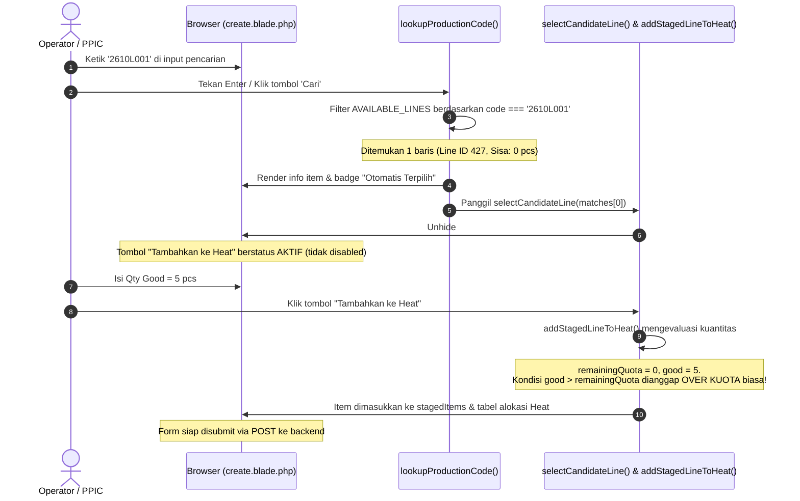

# AUDIT LAPORAN — BUG ZERO REMAINING QUOTA STILL SELECTABLE IN INPUT HASIL COR

Dokumen ini merupakan hasil audit teknis mendalam (READ-ONLY) terhadap temuan bug pada modul **Sand Casting — Input Hasil Cor / Pencarian & Alokasi Production Code ke Heat** di repository lokal Laragon `C:\laragon\www\kanban-ppic`.

Sesuai instruksi:
- **Audit dilakukan murni READ-ONLY**.
- **Tidak ada kode PHP, Blade, JavaScript, atau database yang diubah**.
- **Tidak ada migrasi atau deployment ke server production**.

---

## 1. Root Cause yang Ditemukan

Akar masalah utama berasal dari **hilangnya penyaringan kuota di tingkat baris pesanan (*Line-Level Quota Filtering*)** pada backend dan frontend yang terjadi saat perbaikan fitur *Over-Plan Casting Result*:

1. **Fakta Operasional Pabrik (Multi-Line PCOR)**:
   Satu dokumen Perintah Cor (PCOR) di lantai pabrik sering kali terdiri dari beberapa baris item (misalnya `PCOR-20261027-0001` pada database riil memiliki 11 item).
   Ketika sebagian item sudah selesai dicor sepenuhnya (misalnya `2610L001` kuota order 3 pcs, realisasi good 6 pcs $\rightarrow$ **sisa kuota 0 pcs**), dokumen PCOR induknya **belum selesai (status `PARTIALLY_COMPLETED` atau `ISSUED`)** karena item-item lainnya masih memiliki sisa kuota (misalnya `269UN152X` sisa 10 pcs, `269L030` sisa 16 pcs).

2. **Pelemahan Filter di `CastingResultController::create()`**:
   Sebelumnya, backend menyaring baris kandidat dengan:
   ```php
   $availableLines = $linesQuery->get()->filter(function ($line) {
       return $line->qty_remaining_to_cast > 0;
   })->values();
   ```
   Namun saat implementasi over-plan, filter tersebut diubah menjadi `return true;` untuk semua baris dari order berstatus `ISSUED` atau `PARTIALLY_COMPLETED`:
   ```php
   // Include lines with remaining quota to cast or actively in-progress orders
   return true;
   ```
   Akibatnya, **seluruh baris item di dalam PCOR yang masih aktif dikirimkan ke frontend `$availableLines`, termasuk item yang sisa kuotanya sudah 0 pcs**.

3. **Frontend Tidak Memvalidasi Sisa Kuota Saat Pencarian**:
   Pada `create.blade.php`, fungsi `lookupProductionCode()` hanya mencocokkan string kode (`l.code.toUpperCase() === query`). Karena baris `2610L001` (sisa 0 pcs) ada di dalam `AVAILABLE_LINES`, sistem menemukan 1 kecocokan (`matches.length === 1`), langsung mengeksekusi `selectCandidateLine()`, menampilkan label `"Otomatis Terpilih"`, dan membuka area input staging. Tombol `"Tambahkan ke Heat"` tetap aktif karena `addStagedLineToHeat()` tidak memeriksa apakah `remainingQuota <= 0`.

4. **Ketiadaan Line-Level Guard di Service Backend**:
   Pada `SandCastingCastingResultService::recordResult()`, validasi status hanya memeriksa level dokumen:
   ```php
   if ($order->status === 'COMPLETED') { throw ... }
   ```
   Karena status dokumen PCOR masih `PARTIALLY_COMPLETED` (akibat item lain masih belum selesai), pengecekan ini lolos. Backend tidak memiliki validasi `$orderLine->qty_remaining_to_cast <= 0`, sehingga request penambahan Heat baru untuk item yang sudah tuntas tetap berhasil disimpan dan membuat KTR baru.

---

## 2. File dan Method Terkait Beserta Nomor Baris

| Komponen | File | Method / Lokasi | Baris | Peran / Masalah |
| :--- | :--- | :--- | :--- | :--- |
| **Backend Controller** | `app/Http/Controllers/SandCasting/CastingResultController.php` | `create()` | L99–L105 | Query awal mengambil order `ISSUED` & `PARTIALLY_COMPLETED`. |
| **Backend Controller** | `app/Http/Controllers/SandCasting/CastingResultController.php` | `create()` | L117–L129 | Filter koleksi mengembalikan `return true;` sehingga baris dengan sisa kuota 0 pcs tetap dikirim ke browser. |
| **Frontend Dataset** | `resources/views/sand-casting/casting-results/create.blade.php` | Datalist init | L272, L294 | Menyimpan data `AVAILABLE_LINES` dan mendaftarkan kode `2610L001` ke autocomplete `#availableCodesList`. |
| **Frontend Search** | `resources/views/sand-casting/casting-results/create.blade.php` | `lookupProductionCode()` | L389 | Filter hanya mencocokkan string `code` tanpa memeriksa `remaining > 0`. |
| **Frontend Auto-Select** | `resources/views/sand-casting/casting-results/create.blade.php` | `lookupProductionCode()` | L398–L412 | Jika `matches.length === 1`, otomatis memilih item dan menyematkan badge `"Otomatis Terpilih"` meskipun sisa kuota 0 pcs. |
| **Frontend Ambiguous** | `resources/views/sand-casting/casting-results/create.blade.php` | `lookupProductionCode()` | L414–L442 | Jika ada beberapa PCOR, tetap menampilkan tombol pilihan untuk baris yang sisa kuotanya 0 pcs. |
| **Frontend Staging** | `resources/views/sand-casting/casting-results/create.blade.php` | `selectCandidateLine()` | L465–L484 | Menghapus class `hidden` pada `#stagingInputRow` tanpa men-disable input atau tombol. |
| **Frontend Add Line** | `resources/views/sand-casting/casting-results/create.blade.php` | `addStagedLineToHeat()` | L486–L547 | Tidak memblokir penambahan ke Heat jika `remainingQuota <= 0`. Malah menganggap `good > 0` sebagai kondisi *over kuota* biasa. |
| **Backend Service** | `app/Services/SandCasting/SandCastingCastingResultService.php` | `recordResult()` | L162–L168 | Hanya menolak status dokumen `COMPLETED`, tidak menolak baris order yang `qty_remaining_to_cast <= 0`. |
| **Domain Model** | `app/Models/SandCastingCastingOrderLine.php` | Accessors | L85–L88, L99–L110 | `qty_remaining_to_cast` dan `execution_status` sudah tersedia dengan benar, namun belum difungsikan sebagai guard di Controller & Service. |

---

## 3. Alur Frontend: Dari Pencarian Hingga Tombol "Tambahkan ke Heat"



---

## 4. Alur Backend: Dari Request Hingga Penyimpanan Heat

1. **Request Masuk**:
   Form mengirim `POST /sand-casting/casting-results` dengan muatan item berisi `sand_casting_casting_order_line_id = 427` dan `qty_good = 5`.
2. **Controller Validation (`CastingResultController::store`)**:
   Validasi Laravel memeriksa struktur array, integer minimal 0, dsb. Validasi lolos.
3. **Pemanggilan Service (`SandCastingCastingResultService::recordResult`)**:
   - Menjalankan `DB::transaction()`.
   - Mengambil baris pesanan dengan row-level lock:
     `SandCastingCastingOrderLine::lockForUpdate()->find(427)`.
   - Mengambil dokumen PCOR induk:
     `$order = $orderLine->castingOrder`.
4. **Pemeriksaan Status Dokumen**:
   - Memeriksa apakah `$order->status === 'COMPLETED'`.
   - Karena dokumen `PCOR-20261027-0001` masih memiliki baris lain yang belum selesai (misalnya Line 424 sisa 10 pcs), maka status dokumen masih `ISSUED` (atau `PARTIALLY_COMPLETED`).
   - Pengecekan ini **LOLOS**.
5. **Ketiadaan Pemeriksaan Kuota Baris**:
   - Backend **TIDAK** memanggil pengecekan apakah `$orderLine->qty_remaining_to_cast <= 0`.
   - Transaksi berlanjut: Header Heat `SandCastingCastingResult` dibuat.
   - Baris KTR baru dibuat (`SandCastingCastingResultLine`) untuk kode `2610L001`.
   - Status PCOR disinkronkan via `syncCastingOrderStatus()`.
   - Transaksi database di-commit.
6. **Dampak Nyata**:
   Item `2610L001` yang seharusnya sudah selesai diproduksi bertambah lagi hasil cornya tanpa kontrol.

---

## 5. Validasi yang Masih Berfungsi

1. **Document-Level Order Guard**:
   Backend service `recordResult()` menolak pembuatan Heat jika status seluruh dokumen PCOR sudah `COMPLETED`, `DRAFT`, atau `CANCELLED`.
2. **Preselected URL Guard**:
   `CastingResultController::create()` memeriksa parameter `?casting_order_id=...` dan me-redirect jika PCOR tersebut berstatus `COMPLETED` atau tidak valid.
3. **Domain & Scope Guard**:
   Backend menolak item non-Sand Casting dan item di luar product scope user PPIC.
4. **Duplicate Heat/Plan Guard**:
   Backend mencegah pencatatan item yang sama lebih dari satu kali dalam satu Heat number yang sama.
5. **Frontend Negative / Zero Guard**:
   Frontend menolak jika input kuantitas bernilai negatif atau total Good + Reject = 0.
6. **Frontend Table Duplicate Guard**:
   Frontend mencegah penambahan baris yang sama ke dalam tabel alokasi heat yang sedang disusun.

---

## 6. Validasi yang Hilang atau Terlewati

1. **Line-Level Quota Filtering di Controller `create()`**:
   Penyaringan `$line->qty_remaining_to_cast > 0` hilang dan diganti `return true;`, menyebabkan baris berkuota 0 masuk ke memori browser.
2. **Line-Level Match Filtering di Frontend `lookupProductionCode()`**:
   Hanya mencocokkan string kode tanpa memeriksa sisa kuota.
3. **Pesan Validasi UI "Sisa kuota cor sudah habis"**:
   Pesan pada line 392 `create.blade.php`:
   `"Tidak ditemukan Perintah Cor aktif dengan kode X (atau sisa kuota cor sudah habis)"`
   tidak pernah terpicu karena `matches.length` selalu $\ge 1$.
4. **Auto-Select Guard pada Single Match**:
   Sistem langsung memilih otomatis dan membuka input meskipun sisa kuota 0.
5. **Add-to-Heat Guard di `addStagedLineToHeat()`**:
   Tidak ada penolakan ketika `remainingQuota <= 0`.
6. **Line-Level Status Guard di Backend `recordResult()`**:
   Tidak ada pengecekan `$orderLine->qty_remaining_to_cast <= 0` sebelum membuat KTR baru.

---

## 7. Penjelasan: Bug UI, Bug Backend, atau Keduanya?

**KESIMPULAN: KEDUANYA (FULL-STACK GAP).**

- **Dari Sisi Backend**:
  Backend menjadi sumber utama data anomali karena Controller `create()` menyuplai baris pesanan berkuota 0 ke browser, dan Service `recordResult()` tidak memverifikasi apakah baris pesanan yang dikirim sudah tuntas/habis kuotanya.
- **Dari Sisi UI (Frontend)**:
  Frontend memperparah kondisi tersebut dengan tidak memiliki filter sisa kuota pada pencarian, mengotomatiskan pemilihan baris yang kuotanya 0, membiarkan tombol penambahan tetap aktif, dan memperlakukan sisa 0 sebagai kasus *over kuota* biasa.

---

## 8. Rekomendasi Perbaikan Minimal (Surgical & Clean)

Perbaikan harus terfokus agar tidak mematahkan aturan bisnis over-plan pada penuangan terakhir:

### A. Backend Controller — `app/Http/Controllers/SandCasting/CastingResultController.php`
Kembalikan syarat bahwa baris kandidat harus **memiliki sisa kuota cor > 0**:
```php
$availableLines = $linesQuery->get()->filter(function ($line) use ($preselectedOrderId) {
    $orderStatus = $line->castingOrder ? $line->castingOrder->status : null;
    if (! in_array($orderStatus, ['ISSUED', 'PARTIALLY_COMPLETED'], true)) {
        return false;
    }

    if ($preselectedOrderId) {
        return (int) $line->sand_casting_casting_order_id === (int) $preselectedOrderId
            && $line->qty_remaining_to_cast > 0;
    }

    // Hanya sertakan baris yang masih memiliki sisa kuota untuk dicor
    return $line->qty_remaining_to_cast > 0;
})->values();
```

### B. Backend Service — `app/Services/SandCasting/SandCastingCastingResultService.php`
Tambahkan perlindungan fail-closed di tingkat baris pesanan pada `recordResult()`:
```php
// Verify line-level remaining quota: cannot allocate a new heat to an already completed line
if ($orderLine->qty_remaining_to_cast <= 0) {
    throw new InvalidArgumentException("Baris Perintah Cor {$orderLine->code} sudah terpenuhi (Sisa kuota: 0 pcs) dan tidak dapat menerima penambahan Heat baru.");
}
```

### C. Frontend UI — `resources/views/sand-casting/casting-results/create.blade.php`
1. Di `lookupProductionCode()`:
   Saring baris yang memiliki sisa kuota `> 0`:
   ```javascript
   const matches = AVAILABLE_LINES.filter(l => l.code && l.code.toUpperCase() === query && getRemainingQuota(l) > 0);
   ```
   Jika suatu kode hanya memiliki baris dengan sisa 0, `matches.length` otomatis bernilai 0, sehingga pesan peringatan:
   `Tidak ditemukan Perintah Cor aktif dengan kode 2610L001 (atau sisa kuota cor sudah habis)`
   akan otomatis muncul kembali, dan input staging tetap tersembunyi.
2. Di `addStagedLineToHeat()`:
   Tambahkan guard pencegah:
   ```javascript
   if (remainingQuota <= 0) {
       alert('Sisa kuota untuk item ini sudah habis (0 pcs). Tidak dapat menambahkan ke Heat.');
       return;
   }
   ```

---

## 9. Test Case yang Perlu Ditambahkan

1. **Test Multi-Line PCOR Candidate Isolation**:
   Sebuah PCOR memiliki 2 item: Item A (sisa 0 pcs) dan Item B (sisa 10 pcs).
   - Assert bahwa Item A **TIDAK MUNCUL** di `$availableLines`.
   - Assert bahwa Item B **MUNCUL** di `$availableLines`.
2. **Test Direct Request Rejection on Zero-Quota Line**:
   Melakukan request HTTP `POST /sand-casting/casting-results` dengan payload menargetkan Item A (sisa 0 pcs) dari PCOR yang berstatus `PARTIALLY_COMPLETED`.
   - Assert bahwa request ditolak dengan HTTP 422 (`InvalidArgumentException`).
   - Assert bahwa tidak ada KTR baru yang dibuat untuk Item A.
3. **Test Legitimate Over-Plan Still Works**:
   Item B (sisa 10 pcs) dicor sebesar 15 pcs pada Heat baru.
   - Assert bahwa input 15 pcs diterima.
   - Assert bahwa KTR berhasil dibuat dengan good = 15 pcs.
   - Assert bahwa status PCOR tersinkronisasi menjadi `COMPLETED`.
4. **Test Reopened PCOR Restores Line to Candidates**:
   Setelah koreksi KTR menyebabkan kuota Item A kembali memiliki sisa > 0 dan PCOR reopened menjadi `PARTIALLY_COMPLETED`:
   - Assert bahwa Item A kembali muncul di `$availableLines`.

---

## 10. Risiko Regresi Terhadap Over-Plan dan PCOR Reopening

| Mekanisme | Bagaimana Cara Kerjanya Setelah Perbaikan? | Ada Risiko Regresi? |
| :--- | :--- | :---: |
| **Over-Plan pada Heat Terakhir** | Sebelum Heat terakhir dicatat, baris pesanan **masih memiliki sisa kuota** (misal sisa 30 pcs). Karena sisa 30 pcs $> 0$, baris tersebut **tetap lolos filter dan tetap dapat dipilih**. Ketika dicor 40 pcs (+10 pcs over kuota), sistem tetap mengizinkan dan menyimpannya. Yang diblokir hanyalah penambahan heat baru **setelah** kuota baris tersebut menyentuh 0. | **TIDAK ADA RISIKO** (Aman 100%) |
| **PCOR Reopening Setelah Koreksi KTR** | Ketika admin mengoreksi KTR lama sehingga total good aktual turun, sisa kuota baris pesanan kembali bernilai $> 0$ dan status PCOR kembali menjadi `PARTIALLY_COMPLETED`. Karena sisa kuota sudah $> 0$, baris pesanan tersebut **secara otomatis akan kembali muncul** di pencarian kandidat. | **TIDAK ADA RISIKO** (Aman 100%) |

---

## 11. Status Pengerjaan

Audit teknis telah selesai dilakukan secara menyeluruh tanpa mengubah file kode aplikasi maupun database production/lokal. Dokumen ini diserahkan untuk dievaluasi oleh user sebelum tindakan perbaikan kode dilakukan.

