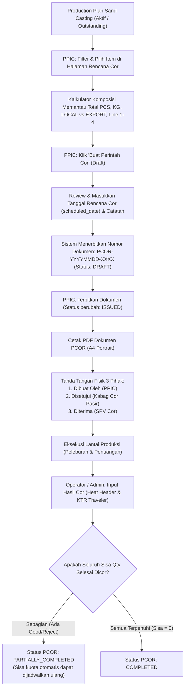

# PANDUAN PENGGUNA (USER MANUAL)
## SISTEM PERINTAH COR (PCOR) SAND CASTING — DAILY CASTING PLAN
**PT PERONI KARYA SENTOSA — KANBAN PPIC**

---

## 1. PENDAHULUAN & TUJUAN SISTEM

Sistem Perintah Cor (PCOR) Sand Casting adalah modul operasional pada aplikasi Kanban PPIC yang menghubungkan perencanaan produksi jangka menengah (*Production Plan*) dengan eksekusi harian di lantai pabrik pengecoran pasir (*Daily Casting Plan*).

### Tujuan Utama Sistem:
1. **Perencanaan Harian Terukur:** Mengontrol pemilihan item cor berdasarkan kuota sisa rencana (*quota-guarded*), beban kapasitas tonase (KG), dan jalur cetak (Line 1 s/d 4).
2. **Monitoring Komposisi Pasar:** Menjaga keseimbangan alokasi pemenuhan pesanan customer **LOCAL** dan **EXPORT** secara transparan sebelum penuangan dilakukan.
3. **Pemberian Identitas Tunggal:** Menerbitkan nomor Perintah Cor resmi (`PCOR-YYYYMMDD-XXXX`) dan melacak realisasi leburan (*Heat Number*) hingga Kartu Trayek / Kitir (`KTR-SC-XXXXXX`).
4. **Mencegah Over-Casting:** Memastikan lantai produksi tidak mencor melebihi target perencanaan dan otomatis menghitung sisa kebutuhan (*Outstanding*).

---

## 2. PENGGUNA & PERAN (ROLES & RESPONSIBILITIES)

| Peran | Akun / Jabatan | Tanggung Jawab Utama dalam Alur PCOR |
| :--- | :--- | :--- |
| **PPIC** | Staff / Supervisor PPIC | • Membuka halaman Rencana Cor (`/sand-casting/casting-orders/plans`).<br>• Memilih item cor lintas halaman menggunakan Kalkulator Komposisi.<br>• Menetapkan tanggal rencana cor (`scheduled_date`).<br>• Menerbitkan dokumen PCOR (`DRAFT` → `ISSUED`).<br>• Mencetak PDF PCOR A4 Portrait dan menandatangani kolom *Dibuat Oleh*. |
| **Kepala Cor Pasir** | Kabag Cor Pasir | • Menerima lembar cetak PDF PCOR dari PPIC.<br>• Melakukan verifikasi teknis kesiapan cetakan, pola, line, dan ketersediaan pasir/inti.<br>• Menyetujui rencana harian dengan menandatangani fisik lembar PDF pada kolom *Disetujui (Kabag Cor Pasir)*.<br>• Menyerahkan lembar PCOR resmi yang sudah disetujui kepada SPV / Pelaksana Pengecoran. |
| **Supervisor Cor** | SPV Cor Pasir | • Menerima dokumen fisik PCOR yang telah disetujui.<br>• Menandatangani kolom *Diterima (SPV Cor)* sebagai bukti penerimaan target kerja harian.<br>• Mengatur pembagian kerja tim peleburan (*furnace*) dan penuangan (*pouring*). |
| **Operator / Admin Pengecoran** | Operator Furnace & Admin Pengecoran | • Melakukan peleburan dan penuangan sesuai urutan nomor PCOR.<br>• Mencatat hasil cor aktual secara manual pada tabel lembar cetak PCOR (*Good*, *Reject*, *Keterangan*).<br>• Menginput realisasi hasil cor ke sistem pada modul *Hasil Cor / Casting Results* (`/sand-casting/casting-results/create`) dengan mereferensikan nomor PCOR dan nomor Heat. |

> [!NOTE]
> **Penting Mengenai Approval Digital:**  
> Sistem aplikasi saat ini **TIDAK MENGGUNAKAN FITUR DIGITAL APPROVAL / KLIK APPROVE SISTEM**.  
> Persetujuan resmi antara PPIC, Kepala Cor Pasir, dan SPV Cor dilakukan **SECARA FISIK PADA LEMBAR CETAK DOKUMEN PDF RESMI (A4 PORTRAIT)** melalui tanda tangan basah.

---

## 3. ALUR KERJA END-TO-END (LIFECYCLE PCOR)



---

## 4. PANDUAN LANGKAH DEMI LANGKAH: PPIC (PERENCANAAN)

### Langkah 1: Mengakses Halaman Rencana Cor
1. Masuk ke aplikasi Kanban PPIC.
2. Di menu navigasi sidebar, pilih **Sand Casting** $\rightarrow$ **Rencana Cor / Perintah Cor** (URL: `/sand-casting/casting-orders/plans`).
3. Halaman ini memuat dua tab:
   - **Tab 1: Rencana Cor Pasir** (daftar item rencana produksi yang memiliki sisa kuota cor).
   - **Tab 2: Daftar Perintah Cor** (arsip seluruh dokumen PCOR yang sudah terbit).

### Langkah 2: Menggunakan Filter & Pencarian
Gunakan bilah filter di atas tabel untuk menyaring target cor:
- **Pencarian Kode / Nama Produk:** Masukkan kode barang atau nama produk (didukung *autocomplete*).
- **Customer:** Filter pesanan berdasarkan nama customer tertentu.
- **Line Cetak:** Filter berdasarkan jalur produksi: `Line 1`, `Line 2`, `Line 3`, `Line 4`, atau `Unassigned`.
- **Status:** Secara default sistem memfilter `Aktif Saja` (`qty_planned > qty_casting_scheduled`). Anda dapat mengubahnya ke `Semua` untuk melihat riwayat.

### Langkah 3: Memilih Item & Menggunakan Kalkulator Komposisi
1. Centang kotak (*checkbox*) pada baris item yang ingin dijadwalkan cor.
2. Anda dapat berpindah halaman paginasi (Next/Prev/Nomor Halaman) tanpa khawatir pilihan hilang. Sistem menggunakan mekanisme penyimpanan browser (*sessionStorage*) yang mengunci pilihan Anda berdasarkan akun login.
3. Perhatikan **Kalkulator Komposisi (Sticky Header)** di bagian atas halaman:
   - **Total Item & Total PCS:** Menampilkan akumulasi kuantitas yang dipilih.
   - **Estimasi Berat (KG):** Menghitung total tonase cor berdasarkan berat satuan produk.
   - **Komposisi Pasar:** Menampilkan persentase dan total KG/PCS untuk kelompok **LOCAL** (Orange), **EXPORT** (Biru), dan **UNCLASSIFIED** (Abu-abu).
   - **Distribusi Jalur Cetak:** Memantau persebaran kapasitas pada Line 1, Line 2, Line 3, dan Line 4.
4. Jika ingin menyembunyikan sementara ringkasan kalkulator, klik tombol **Ciutkan / Expand** di pojok kalkulator.

### Langkah 4: Membuat Draft PCOR
1. Setelah komposisi dan tonase harian sesuai kapasitas tanur, klik tombol hijau **"Buat Perintah Cor (X Item)"**.
2. Anda akan diarahkan ke form konfirmasi pembuatan PCOR:
   - **Tanggal Rencana Cor (`scheduled_date`):** Tentukan tanggal rencana penuangan (default: hari ini).
   - **Qty Perintah (`qty_ordered`):** Masukkan kuantitas yang hendak dicor. Sistem secara otomatis membatasi kuantitas agar tidak melebihi sisa rencana cor (`qty_remaining_casting_scheduled`).
   - **Catatan PCOR:** Tambahkan instruksi khusus untuk pabrik (misal: "Prioritas ekspor kontainer tanggal 10").
3. Klik **Simpan**. Sistem akan menerbitkan nomor dokumen unik berurutan: `PCOR-YYYYMMDD-XXXX` dengan status awal **DRAFT**.
4. Pilihan pada *sessionStorage* di browser otomatis dibersihkan oleh sistem.

### Langkah 5: Penerbitan dan Pencetakan Dokumen
1. Buka rincian dokumen PCOR yang baru dibuat (`/sand-casting/casting-orders/{id}`).
2. Periksa kembali daftar item dan jumlahnya. Selama berstatus **DRAFT**, Anda masih dapat mengedit baris atau membatalkannya.
3. Jika sudah final, klik tombol **"Terbitkan Dokumen"**. Status dokumen akan berubah menjadi **ISSUED**.
4. Klik tombol **"Cetak PDF"**.
5. Sistem akan menampilkan dokumen standar A4 Portrait siap cetak. Cetak dokumen fisik tersebut untuk diserahkan ke bagian produksi.

---

## 5. PANDUAN LANGKAH DEMI LANGKAH: KEPALA COR PASIR & SPV COR (VERIFIKASI & APPROVAL)

### Langkah 1: Pemeriksaan Fisik Lembar Cetak PCOR
Kepala Cor Pasir menerima cetakan PCOR dari PPIC dan memeriksa bagian-bagian penting:
1. **Header Dokumen:**
   - Nomor PCOR dan Tanggal Rencana Cor.
   - Pembuat dokumen (PPIC) dan tanggal/waktu cetak dokumen.
   - Catatan instruksi khusus PPIC.
2. **Tabel Item Cor (Outstanding Only):**
   - Hanya item dengan sisa cor $> 0$ yang tercantum.
   - Periksa kolom *Kode Customer*, *Nama Produk*, *Ukuran*, *AISI*, dan *Qty Perintah Sisa*.
3. **Rekap Kategori Customer & Jalur Cetak:**
   - Memastikan rasio tonase Local vs Export sesuai jadwal peleburan harian.
   - Memastikan Line cetak siap menerima pola dan inti yang dijadwalkan.

### Langkah 2: Otorisasi & Tanda Tangan Fisik
1. Jika rencana harian disetujui, **Kepala Cor Pasir** membubuhkan tanda tangan basah pada kolom:  
   **Disetujui (Kabag Cor Pasir)**.
2. Dokumen diserahkan kepada **SPV Cor Pasir**.
3. **SPV Cor Pasir** menandatangani kolom:  
   **Diterima (SPV Cor)** sebagai konfirmasi penerimaan tugas cor harian.

---

## 6. PANDUAN OPERASIONAL LANTAI PRODUKSI & PENCATATAN HASIL (ADMIN / OPERATOR)

### Langkah 1: Pengisian Lembar Manual saat Penuangan
Selama proses pengecoran di lantai pabrik:
1. Operator / Pengawas membawa lembar cetak PCOR di area tanur.
2. Pada kolom kosong yang telah disediakan di tabel PDF:
   - Tulis jumlah aktual cor baik pada kolom **Good**.
   - Tulis jumlah cor cacat/gagal pada kolom **Reject**.
   - Tulis nomor leburan (*Heat No*) dan keterangan kendala pada kolom **Keterangan**.

### Langkah 2: Input Hasil Cor ke Sistem (Digitalisasi)
Setelah penuangan selesai:
1. Admin Hasil Cor membuka menu **Sand Casting** $\rightarrow$ **Hasil Cor Pasir** $\rightarrow$ **Input Hasil Cor** (`/sand-casting/casting-results/create`).
2. Masukkan data leburan (*Heat Header*):
   - **Nomor Heat / Leburan:** (contoh: `H261102-1`).
   - **Tanggal Cor & Shift:** Tanggal pengecoran aktual dan shift kerja.
   - **Tanur / Furnace:** Nomor tanur yang digunakan.
   - **Operator:** Nama operator penanggung jawab leburan.
3. Masukkan item rincian:
   - Pilih referensi **Nomor PCOR** dan baris item terkait.
   - Masukkan **Qty Good** (hasil baik) dan **Qty Reject** (hasil cacat).
4. Klik **Simpan**.
5. Sistem secara otomatis:
   - Menerbitkan nomor identitas Kartu Trayek / Kitir baru: `KTR-SC-XXXXXX`.
   - Mengarahkan item masuk ke antrean stasiun berikutnya: **Netto**.
   - Memperbarui status PCOR secara otomatis:
     - Jika baru sebagian item yang dicor $\rightarrow$ status PCOR berubah menjadi **PARTIALLY_COMPLETED**.
     - Jika seluruh item telah memenuhi kuantitas perintah $\rightarrow$ status PCOR berubah menjadi **COMPLETED**.

---

## 7. STRUKTUR & ANATOMI DOKUMEN CETAK PDF PCOR

Dokumen cetak PDF PCOR Sand Casting dirancang presisi dengan tata letak **A4 Portrait** satu lembar terintegrasi:

```
+-----------------------------------------------------------------------------------+
|  PT PERONI KARYA SENTOSA                       PERINTAH COR PASIR (PCOR)          |
|  SISTEM KANBAN PPIC                            No: PCOR-20261102-0001             |
|-----------------------------------------------------------------------------------|
|  Tgl Rencana Cor   : 02/11/2026                Tgl Cetak Dokumen : 02/11/2026 08:30|
|  Dibuat Oleh       : PPIC User                 Catatan           : Prioritas Ekspor|
+-----------------------------------------------------------------------------------+
| No | Cust | Customer | Produk | Ukuran | AISI | Sisa | Good* | Reject* | Ket*    |
|----+------+----------+--------+--------+------+------+-------+---------+---------|
| 1  | C01  | PT ABC   | Body   | 2 Inch | FCD  |  50  | [   ] |  [    ] | [     ] |
| 2  | C02  | XYZ Corp | Flange | 4 Inch | FC   | 100  | [   ] |  [    ] | [     ] |
+-----------------------------------------------------------------------------------+
|  REKAP KATEGORI CUSTOMER               |  REKAP LINE PRODUKSI                     |
|  • LOCAL        :   50 PCS |   500 KG  |  • LINE 1       :   50 PCS |   500 KG    |
|  • EXPORT       :  100 PCS | 1.200 KG  |  • LINE 2       :  100 PCS | 1.200 KG    |
|  • TOTAL        :  150 PCS | 1.700 KG  |  • TOTAL        :  150 PCS | 1.700 KG    |
+-----------------------------------------------------------------------------------+
|    Dibuat Oleh,                Disetujui,                     Diterima,           |
|                                                                                   |
|  ( .................... )   ( .................... )      ( .................... )|
|         PPIC                    Kabag Cor Pasir                   SPV Cor         |
+-----------------------------------------------------------------------------------+
  *Kolom bertanda kurung siku [ ] diisi manual dengan pena oleh operator di lapangan.
```

---

## 8. LOGIKA SISTEM & ATURAN BISNIS (BUSINESS RULES)

1. **Aturan Filter Sisa (*Outstanding Only*):**
   - Halaman cetak PDF dan jadwal eksekusi hanya menampilkan baris item yang memiliki sisa cor positif:  
     $$\text{Qty Sisa Cor} = \max(0, \text{Qty Perintah} - \text{Total Qty Good Aktual})$$
   - Item yang sudah selesai 100% secara otomatis **hilang dari cetakan PDF berikutnya**, menghindarkan salah cetak atau pengecoran ganda di lapangan.
2. **Pelepasan Kuota Sebagian (*Partial Release Rule*):**
   - Jika suatu PCOR berstatus `PARTIALLY_COMPLETED` (misal perintah 100 pcs, namun hari ini hanya selesai dicor 40 pcs), komitmen terhadap rencana awal hanya dihitung sebesar hasil baik (40 pcs).
   - Sisa 60 pcs yang belum tertuang secara otomatis **dilepaskan kembali ke kuota Rencana Cor (`ProductionPlan`)**. PPIC dapat langsung menjadwalkan sisa 60 pcs tersebut pada PCOR baru hari berikutnya tanpa perlu revisi rumit!
3. **Pencegahan Over-Casting:**
   - Validasi backend mengunci kuantitas pembuatan PCOR: `qty_ordered` tidak boleh lebih besar dari kuota sisa yang belum terjadwal (`qty_remaining_casting_scheduled`).
4. **Pembatasan Status Dokumen:**
   - Dokumen `DRAFT` dapat diedit dan dihapus.
   - Dokumen `ISSUED` adalah dokumen resmi aktif; tidak dapat diedit tanpa pembatalan (*cancel*).
   - Dokumen yang sudah memiliki catatan hasil cor aktual di lantai pabrik **tidak dapat dibatalkan atau dikembalikan ke Draft** guna menjaga integritas data penelusuran (*traceability*).

---

## 9. PANDUAN PEMECAHAN MASALAH (TROUBLESHOOTING)

| Permasalahan | Kemungkinan Penyebab | Tindakan Solusi |
| :--- | :--- | :--- |
| **Item rencana produksi tidak muncul di Tab Rencana Cor.** | 1. Rencana sudah terpenuhi kuotanya.<br>2. Filter status disetel ke "Aktif Saja" sementara status rencana sudah ditutup (*closed*).<br>3. Produk bukan kategori Sand Casting. | • Ubah filter status menjadi `Semua`.<br>• Periksa master produk pada tab Pengaturan untuk memastikan metode produksi adalah Sand Casting.<br>• Periksa apakah item sudah terjadwal di PCOR draft lain. |
| **Kuantitas pesanan ditolak saat klik Simpan PCOR.** | Kuantitas yang diinput melebihi kuota sisa rencana (`qty_ordered > qty_remaining`). | • Kurangi jumlah `qty_ordered` sesuai angka sisa yang tertera pada kolom Kuota Rencana. |
| **Pilihan checkbox hilang saat refresh halaman.** | Fitur *sessionStorage* terikat pada browser dan sesi user login aktif. | • Pastikan tidak membuka tab penyamaran (*incognito*) baru atau berpindah akun di tengah proses pemilihan item. |
| **Tombol Hapus / Batal PCOR dinonaktifkan.** | Sudah ada data penuangan (*Heat Number* / Hasil Cor) yang diinput oleh operator untuk nomor PCOR tersebut. | • Data yang sudah memiliki riwayat fisik tidak boleh dihapus. Lakukan penyelesaian sisa atau koordinasikan dengan Admin Hasil Cor jika terjadi salah input. |

---

## 10. GLOSARIUM ISTILAH

- **PCOR (Perintah Cor):** Dokumen kerja resmi yang diterbitkan PPIC sebagai instruksi peleburan dan penuangan logam pada tanggal tertentu.
- **Production Plan:** Rencana kerja produksi induk bulanan/mingguan dari order penjualan.
- **Heat Number:** Nomor identitas satu kali leburan tanur induksi (*batch melt*).
- **KTR (Kartu Trayek / Kitir):** Nomor identitas alur kerja fisik benda cor (*Traveler Number*) yang mengikuti produk mulai dari stasiun Netto, Bubut, Bor, QC, hingga Gudang Jadi.
- **Line 1 - 4:** Jalur pencetakan pasir (*molding line*) di lantai produksi Sand Casting.
- **Outstanding:** Sisa kuantitas benda kerja yang belum terpenuhi dari target perintah cor.
- **Good Qty:** Kuantitas hasil cor yang memenuhi standar kualitas visual awal.
- **Reject Qty:** Kuantitas hasil cor yang cacat atau gagal saat penuangan/pembongkaran cetakan.

